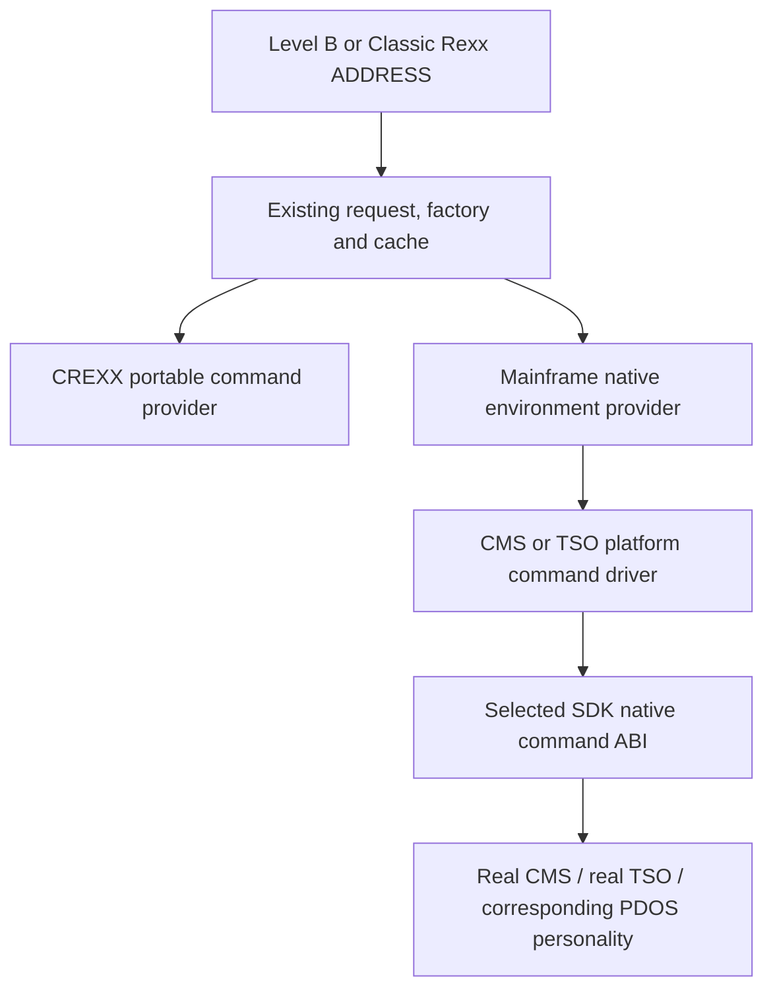

# Mainframe ADDRESS integration

11 October 2026. Stage 1 approved by Adrian: implement on `develop`, include
capture where it can be tested, use minimal slice checks and combined guest QA
at the end. On 12 October, implementation, four-cell native script qualification,
supported host QA and independent normal handback are complete locally.
Adrian approved committing and publishing Stage 1 across CREXX, the SDK,
z-pdos and Mainframe Lab on 12 October. This is a development checkpoint;
application environment registration and the combined PDOS build remain later.
Source review used
`54f736804de08684852c63eb7673435157ef1e30`. Unrelated numeric-review and example
work in this checkout is preserved. This file owns the proposed implementation
plan; the retired `compiler/docs/address_rexxsaa_working.md` is historical.

Publication incorporates the independent RXPP/RexxScript changes already on
`origin/develop` at `18d13e5c8504f9790c8f004dec5c1fc33cc58c81`.
Those paths do not overlap this campaign's changed source or the preserved
local work. The broad and native results retain their recorded input identities;
they are not relabelled as a new full qualification of the combined tree.
The normal automatic development workflows are expected to succeed. Their
observed status belongs to GitHub's run records, without a status-only follow-up
commit or another overnight qualification campaign.

## Vision and confirmed scope

I want real cREXX scripts to issue native commands through ADDRESS on CMS,
TSO and PDOS, with correct results, output and caller survival. We will use
the existing language and environment protocol, put mainframe command policy
and drivers in the CREXX source, and reuse the SDK's native ABI mechanisms.
Application environment registration and callbacks into Rexx remain later.

Adrian confirmed two stages:

1. A CMS-built cREXX remains a CMS client, including when PDOS emulates CMS.
   It uses the CMS driver and discovers CMS subcommand environments. A TSO
   build similarly remains a TSO client. Native driver selection follows the
   build profile; detecting PDOS does not change that personality. PDOS is
   an additional environment only when the selected native interface reports
   it available.
2. A later PDOS-specific build, for the cREXX bundled into PDOS, can expose
   the wider PDOS facilities and CMS/TSO/PDOS command vocabulary together.
   That requires a separately designed PDOS platform policy and checked
   routing interface. Stage 1 does not implement it by mixing native ABIs.

The first native qualification profiles are CMS31 and TSO31, whose command
interfaces have actual native and PDOS C-fixture evidence. Other client modes
retain their own qualification requirements. The intended outcome includes
real compiled Rexx scripts; C stubs and the existing simulated CMS demo are
focused checks, not substitutes for native script execution.

## Existing architecture

- `compiler/exits/address/Address.crexx` owns the typed ADDRESS exit.
  Classic `RexxClassicAddress.crexx` feeds the same environment request path
  while keeping invocation-local ADDRESS state, RC, .RC, .RS and conditions.
- `lib/rxfnsb/rexx/_address.crexx` owns `addressrequest`, `addressresponse`,
  `.addressenvironment`, provider matching and the per-runtime object cache.
  Environment names are trimmed and uppercased. Dispatch passes the command
  string intact; `normalize_command()` is a provider helper, not compulsory
  transport normalization.
- `ADDRESS CREXX` is one provider: a cREXX-defined portable command language
  with its own parser, argument anchors, worker-local directory/environment
  state, batch and direct run. It is distinct from native CMS/TSO commands.
- RXVML's callback API and `crexxsaa_register_address_environment()` support
  embedding applications. Standalone `rxvmmain.c` initializes an ordinary
  `rxvm_context`; it does not create an RXVML context. A callback installed
  only through RXVML is consequently insufficient for standalone RXVM.
- Static RXPA native classes already support factory matching, interface
  methods, native payload ownership and `SETOBJECTTYPE`. Both standalone and
  embedded VMs consume the common provider machinery.
- The mainframe single-thread port excludes OS process/channel providers and
  dynamic plugins. Native ADDRESS must execute synchronously through the
  platform command driver, without requiring the desktop spawn path.

Current source references:
[ADDRESS protocol](../ai-context/RXVM_INTERPRETER.md#address-environment-objects-and-functions),
[native object bindings](../ai-context/CREXX_LIBS.md#constructing-and-binding-objects-entirely-in-c),
[CREXXSAA](../books/crexx_programming_guide/crexxsaa.md),
[mainframe port](../../ports/single-threaded/README.md).

## Proposed layers

Keep the parser, bytecode and public ADDRESS protocol. Implement the native
provider with existing RXPA C class/factory/method bindings, statically linked
only into the selected mainframe runtime. Supply its declaration metadata to
the build compiler; no runtime dynamic loading is required. Reuse common
request/response validation rather than copying the RXVML bridge or creating
a second command protocol. Existing CREXXSAA host registrations remain valid.
The provider is a system integration, not a new application registration API.

The provider adapter owns VM values and response/condition mapping. Platform
drivers expose opaque command handles and plain text/result records, and own
no Rexx objects. SDK adapters retain native parameter layouts, mode/linkage,
LOAD/DELETE, UTF-8 to IBM1047 conversion and low-level service calls. PDOS K
continues to own I/O, storage and invocation resources. No assembly or runtime
implementation is copied from the SDK into CREXX.

Provisional source placement:

- `platform/mainframe_command.h`: plain command-driver contract, explicit
  input/output capture capabilities and record sinks; includes no interpreter
  value types.
- `platform/mainframe_command_cms.c` and `mainframe_command_tso.c`: selected
  CMS and TSO implementations, using the existing platform configuration.
- `lib/plugins/mainframe_address/mainframe_address.c`: a mainframe-only static
  RXPA provider, with factory/method glue over those drivers. Its CMake module
  uses the existing static and DECL_ONLY linker helpers; the selected target
  runtime includes its declarations and native archive.
- `platform/tests/` and compiler/runtime Rexx fixtures: focused transport,
  provider, lifecycle and real-language checks.

## Naming, selection and normalization

| Build | Native command path | Available native names |
| --- | --- | --- |
| CMS31 on real CMS | CMS SUBCOM/CMSCALL | CMS and actual queried CMS subcommands |
| CMS31 on PDOS | Same CMS ABI | CMS and optional PDOS reported by that interface |
| TSO31 on real TSO | IKJEFTSR | TSO invocation; other names have separate discovery/invocation capabilities |
| TSO31 on PDOS | Same TSO ABI | TSO and optional PDOS reported by that interface |
| Later PDOS build | Explicit PDOS driver | PDOS-supported CMS/TSO/PDOS routes and broader native facilities |

Normalize names for matching, and retain their native length/encoding checks.
Do not uppercase, trim or collapse the command text, reinterpret quotes, or
substitute host-variable anchors for native commands. CREXX continues to own
its existing anchor expansion and command normalization. Preserve its current
default and meaning in Stage 1; adding native providers does not establish that
every CREXX command is implemented by the compact mainframe port.

On mainframes, propose routing SYSTEM/COMMAND/CMD's existing host-command
meaning through the build's native CMS or TSO driver. SHELL/PATH and process
features retain explicit capability limits. Native factory selection must
not accidentally use the simulated CMS demo; test provider precedence and
keep that demo as an explicit desktop/demo consumer.

The existing SDK generic CMS call can invoke queried subcommands. The generic
TSO C route invokes TSO through IKJEFTSR; IRXSUBCM presence does not establish
an invocable generic IRXHST interface. Report a present but unsupported TSO
handler truthfully. General IBM Rexx runtime integration is separate.
Cache the provider object, not a permanent assertion of native availability.
Native name probes and execution results remain authoritative; an initially
missing OS subcommand must not be made permanently absent by the runtime's
unknown-environment cache. Refresh follows lookup/call events, not timers.

## Transport, results and lifecycle

The current SDK `mf_command_open()` on TSO requires IRXINIT FINDENVB before
opening its discovery session. Basic ADDRESS TSO must not depend on finding
an IBM Rexx processor. Propose a small, separate SDK command-service entry for
IKJEFTSR execution/availability, preserving the existing borrowed-context API
for IRXSUBCM discovery. Do not fabricate an active MfCommandSession, create an
IBM Rexx processor, or use IRXHST as a fallback. IBM describes IKJEFTSR as an
[application command service](https://www.ibm.com/docs/en/zos/3.1.0?topic=ikjeftsr-overview-tsoe-service-facility);
its [optional initialization](https://www.ibm.com/docs/en/zos/2.5.0?topic=facility-tsoe-service-routines)
is distinct from this borrowed Rexx context. Qualification still requires an
actual TSO environment; non-TSO/E initialization is outside Stage 1.

Preserve signed command RC separately from adapter/facility/loader errors.
An RC7 command must remain RC7 with valid completion, rather than being
mistaken for failure to call the service. Map platform-defined command errors
and failures explicitly into the existing response conditions; do not infer
one universal condition solely from nonzero RC or invent an ABEND code.
Classic RC/.RC/.RS and CALL/SIGNAL ON ERROR/FAILURE use the existing response
path. Retain service, reason and loader diagnostics when command RC is invalid.

Native output currently goes to the host console/DD because our qualified
SDK adapter does not capture it. This is an implementation gap, not a general
CMS/TSO prohibition. Console-only operation was a proposed first minimum, not
an accepted permanent restriction or an agreed capture deferral.

The driver contract must allow output record sinks and explicit capture/input
capabilities. Investigate and qualify the actual CMS20/TSO guest mechanisms
before selecting the supported capture subset. IBM's
[OUTTRAP documentation](https://www.ibm.com/docs/en/zos/3.1.0?topic=tef-outtrap)
demonstrates TSO capture but identifies PUTLINE versus direct TPUT/WTO output
limits. [CMS Pipelines](https://www.ibm.com/docs/en/zvm/7.4.0?topic=pipelines-basic-concepts-functions-cms)
provides native command/output interfaces, with a documented
[CP-to-stem example](https://www.ibm.com/docs/en/zvm/7.2.0?topic=commands-how-obtain-response-from-cp-command).
These are evidence of OS facilities, not ready-made cREXX drivers: IBM Rexx
stems and trapping state do not automatically refer to cREXX's variables.
Do not introduce an IBM language processor or copy a PIPE wrapper as a claim
of complete capture. Verify which facilities exist on our older actual guests.

Where capture is supported, deliver records through the existing ADDRESS
redirect endpoints and finish them on the controlling VM. State output-path,
blank-record and error-stream distinctions; do not promise that every native
command has independent stdout/stderr or universally capturable output.
Until a requested combination is implemented and qualified, reject it before
execution rather than returning an empty or silently incomplete capture.
Console/monitor transcripts provide independent output evidence. Native
variable-pool access, sandbox writeback and environment functions are not
inferred from the request shape or CREXXSAA's existing callback support.

Native handles belong to the VM/provider instance, with reference-safe copy
and finalization. Borrowed OS context is not owned or terminated by cREXX.
Repeated commands and repeated VM lifetimes must leave the caller's file
cursor, storage and selected ADDRESS state sound. The initial native runtime
keeps its existing one-thread contract; no asynchronous host callback or
process-global mutable command session is introduced. Completion uses the
native call return and owned events, with timeouts only as test watchdogs.

## Numbered acceptance criteria

Implementation criteria remain open until their recorded checks pass.

1. **MFADDR-AC-01:** CMS and TSO builds retain their selected personality on
   real and emulated hosts. Query and driver-selection tests prove no implicit
   cross-personality routing; optional PDOS is actually probed, and availability
   changes are not trapped in a permanent negative cache.
2. **MFADDR-AC-02:** Explicit/implicit ADDRESS, ADDRESS VALUE and ADDRESS()
   state use the existing Level B/Classic protocol, with exact command text,
   name normalization and portable CREXX behavior preserved. Focused desktop
   regressions pass.
3. **MFADDR-AC-03:** Static native providers work in standalone RXVM and the
   existing embedding path, with compiler declaration metadata and installed
   native dependencies. Native provider tests distinguish the real CMS route
   from the simulated demo and preserve host registration precedence.
4. **MFADDR-AC-04:** TSO command execution succeeds in a real TSO session
   without requiring an existing IBM Rexx processor. Borrowed discovery and
   absent/unsupported handler results remain distinct; native ABI/libraries
   are reused from their owning SDK.
5. **MFADDR-AC-05:** RC0, valid nonzero RC, absent name, unknown command,
   facility/loader error and contained child fault have correct signed RC,
   condition and diagnostic behavior. Real Classic scripts prove RC/.RC/.RS
   and ERROR/FAILURE handling, followed by another successful command.
6. **MFADDR-AC-06:** UTF-8/native conversion is explicit and independent of
   file mode. Exact spaces/case/quotes survive; malformed, unrepresentable,
   zero-containing and excessive text is rejected without execution.
7. **MFADDR-AC-07:** Actual native output is observed once per command. The
   reviewed native capture subset has real OS evidence and delivers correct
   records to the requested Rexx receiver; unsupported combinations are
   rejected before effects. Caller file/storage continuation and repeated
   command/VM lifecycle checks pass, with no leaked handles or invented
   capture/variable-pool capability. The selected native CMS QUERY DISK capture
   subset is qualified; other unavailable combinations fail explicitly.
8. **MFADDR-AC-08:** Real Level B and small Classic Rexx scripts pass the
   matching RXC/RXAS/RXLINK/RXVM chain on real CMS31 and TSO31, then on their
   PDOS personalities. Optional ADDRESS PDOS is tested where present.
   No old beta-3 libraries/exits are mixed with the current develop runtime.
9. **MFADDR-AC-09:** Complete review and exact source/input freeze precede
   combined guest QA. The operator's results are independently validated;
   actual processes/ports/leases/handles and normal shutdown close cleanly.
10. **MFADDR-AC-10:** Mainframe C/metadata/build/runtime changes live in CREXX
    and the native ABI prerequisite in the SDK. Current docs record qualified
    profiles and limits; unrelated desktop behavior and checkout work are
    preserved. Step 2 and application registration remain visibly separate.

## Numbered implementation steps

1. **MFADDR-STEP-01 — complete; approved 11 October:** Inspect
   current ADDRESS, CREXX, CREXXSAA, compact-port and SDK code; confirm profile
   selection and the later PDOS-specific build. Record this proposal before
   implementation. Serves all criteria.
2. **MFADDR-STEP-02 — locally qualified for the selected profiles:** Define and check the plain platform contract;
   investigate native capture/input mechanisms and agree the supported
   subset, then implement the minimal SDK execution/discovery separation and
   CMS/TSO drivers. Focused exact-text/status/no-context/capture controls
   first. Serves AC-01, AC-04 to AC-07; depends on approved architecture.
3. **MFADDR-STEP-03 — locally qualified for the selected profiles:** Add the static native provider using existing
   RXPA factories/methods and shared ADDRESS response handling; wire both VM
   entry paths, target metadata/libraries and native SYSTEM aliases. Serves
   AC-02/03/05/10; depends on STEP-02. No syntax or opcode extension.
4. **MFADDR-STEP-04 — local builds and four-cell script qualification complete:** Add real B/Classic scripts and minimum focused
   host checks per slice, including failures and repeated execution. Build the
   matching native packages with generous measured stack/heap headroom.
   Serves AC-02 to AC-08; depends on STEP-03.
5. **MFADDR-STEP-05 — reviewed and locally qualified:** Complete code review, resolve findings, record
   the exact candidate freeze, then perform combined native CMS, TSO and PDOS
   script QA through the shared operator/fleet. Reuse unchanged valid checks;
   a repair requires review/refreeze and affected replay. Serves AC-08/09.
6. **MFADDR-STEP-06 — independent validation and normal handback complete:** Independently validate output/results/lifecycle
   and handback; update maintained docs and qualification receipts. Source
   commit/publication or release selection requires session authorization.
   Serves AC-09/10.

## Delivery prerequisite discovered during implementation

Current matching Classic libraries exceed PDOS's 3 MiB CMS input and 2 MiB
output/journal limits. The native RXC images fit their separate 8 MiB CMS and
5 MiB TSO loader bounds. Do not omit the current G library or reuse old exits.
The owning PD-030 backlog now records an explicit fresh-media large-file
qualification profile with 16 MiB per-object headroom, checked layout identity
and coordinated media/readback geometry. Default released STORE and the later
extent-allocation/streaming design remain separate. This prerequisite is part
of completing AC-08, not a claim of general large-file qualification.

The new boundary mock's short-command overread is repaired. Focused Debug,
Apple ASan and Linux ASan/LSan panels pass on their recorded inputs. Strengthened
final fixtures also pass Debug on macOS and Linux and fresh Linux ASan/LSan;
the earlier full normal macOS gate passes all 3,151 tests. Earlier full Linux
ASan/LSan passes 3,133/3,133; the earlier macOS ASan fixture failures led to
the preparation repair. All 11 current allocation/ADDRESS checks pass on
macOS Debug, macOS ASan and Linux ASan/LSan. The final normal macOS gate passes
3,338/3,338. Full final Apple ASan passes 3,140/3,140 and supported Linux
ASan/LSan passes 3,134/3,134. Its 10,484 source identities still match after
completion. SAN-013 is closed for the host mock finding; native-provider and
PDOS guest qualification retain their separately recorded scope. This is
local qualification, not a published or sanitizer-clean release claim.

The [candidate review](../qa/mainframe-address-2026-10-11-review.md) records
the implementation/resource review and exact four-cell campaign. All eight
native tools were checked against their producer input hashes; matching sources,
libraries and packages are frozen by the retained `mainframe-qa-pack.crexx`.
The operator strictly verified the replacement pack before starting native CMS.
The [memory assessment](../qa/mainframe-address-2026-10-11-memory.md) separates
the mock defect, pointer portability, PDOS file caps and loader/heap boundaries.
Actual native heap high-water remains unmeasured. Selected capture, fault
recovery, caller continuation and repeated lifetimes are qualified by the
four-cell campaign and independent validation; measured PDOS real-frame peaks
are separate from application heap usage.

Native CMS RXC exhausted the original 64 MiB application heap while expanding
the full current G library. The [heap amendment](../qa/mainframe-address-2026-10-11-heap-review.md)
records the explicit 256 MiB CMS candidate, unchanged image sizes, verified
replacement packages and affected CMS replay. This is an SDK application-profile
capacity finding; CMS virtual storage and PDOS physical/file limits remain
separate. Temporary native CMS512M must be restored before handback. Both CMS
campaign cells retain unified A1 imports and full Classic dependencies.

The [allocation amendment](../qa/mainframe-address-2026-10-11-allocation-review.md)
supersedes that failed 256 MiB profile with 192 MiB candidates for both native
personalities. Real CMS20 macro expansion confirms the SDK's 32-byte lists;
the serial native capacity oracle obtains/checks/releases 64/128/192 MiB and
rejects 256 MiB. The compiler RXPA exhaustion path now diagnoses allocation
failure before dereferencing or silently dropping metadata. The final pack
has 47 strictly verified records, manifest SHA-256
`4a63012b6189fb8392c7c328bd1751dc7a52529b350fa8b267279aa04624da17`;
its 25-record supplement has SHA-256
`e85b59c3b110f9a67e954ddc71bbf16f3e2b23e587dece8c3d53408a264884c3`.
On native CMS the full-library Level B chain now produces fresh assembly,
object and linked outputs; two real executions pass capture, nonzero/recovery
and caller-file checks at RC 0. Native TSO Level B also passes twice, including
contained native fault recovery and successful caller continuation. Both
Classic native compile/assemble/link now pass on both systems. Their first
runtime loads reject the same missing rxcstream provider. The separately
[reviewed native runtime amendment](../qa/mainframe-address-2026-10-12-classic-provider-review.md)
adds the required bounded providers and matching classlib. The original native
C objects were retained and relinked; both real OS cells now pass two B and two
Classic executions, with exact replacement-package delivery/readback. The
[runtime checkpoint](../qa/mainframe-address-2026-10-12-runtime-qualification.md)
owns current per-cell results and exact amendment identities.
Both PDOS cells now pass two B and two Classic executions. Corrected fixture
vocabulary and physical record geometry exposed a K output-member displacement defect, proven
from the actual MVSSUPA assembler symbols and stopped journal keys. z-pdos
PD-032 owns the reviewed repair, focused binary PDS roundtrip and affected
full script replay. Independent stopped readback verifies all six outputs,
matching reference assembly, transcript and outside-STORE guards for each
personality. CMS/TSO observed real-frame peaks are 340,123,648/328,568,832 bytes
on the 512 MiB machine, with zero final depth and normal resource handback.
The initial TSO runtime RC16 was an invocation spelling error corrected by
DSN:MFA12.INPUT without source changes. These findings remain distinct from
native CMS heap capacity and cREXX allocation handling.
The first disposable PDOS boot rejected raw U.COMMAND program records where
the loader requires the PDTSO31 transport envelope, before PCOMM or cREXX ran.
Its stopped core and receipts are retained; corrected delivery and both
emulated runtime cells now pass. This failure is separate from heap sizing.

Stage 1 is locally qualified on develop, with the full normal/Apple-ASan/Linux
ASan-LSan gates, selected native provider follow-ups, all four guest cells and
independent final fleet handback. Exact inputs and limits are in the runtime
checkpoint. No publication, release or managed-image adoption is implied;
application registration and the combined PDOS-specific build remain later.

## Later PDOS-specific build

Stage 2 will use an explicit PDOS platform selection for the inbuilt bundle.
It can combine the PDOS-supported command targets and portable CREXX services
over checked PDOS facilities, with a coherent capability view and the existing
PCOMM panel/line output routes. This needs its own detailed routing, I/O and
qualification design after Stage 1. It is not authorization to expose every
CMS/TSO name, supply unsupported native services, or add application registration.
No new timers, public language syntax or duplicate shell implementation are
selected by this proposal.
