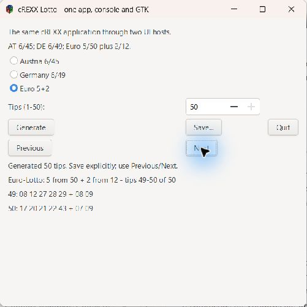
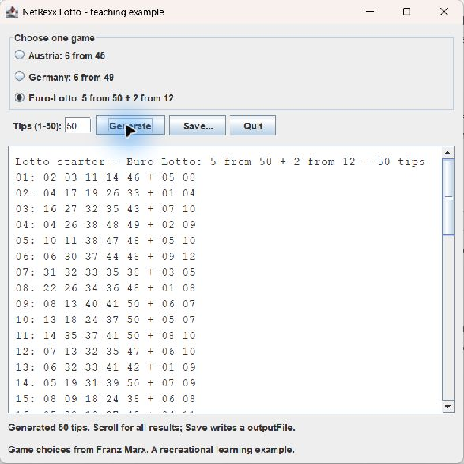
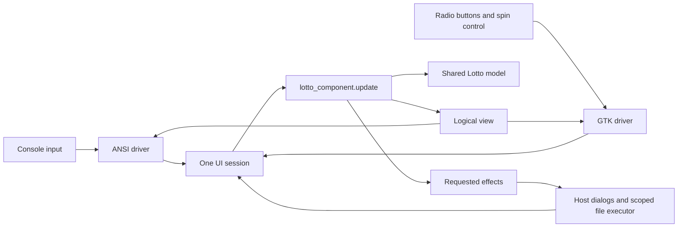
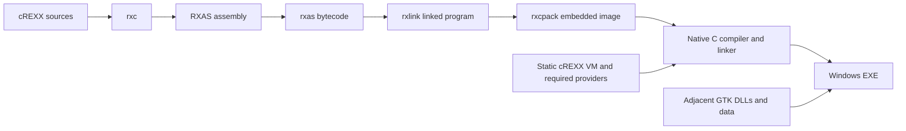

# Lotto: the same feature in console and GTK

The new cREXX demonstration has one application component and two small
launchers. The console launcher supplies the ANSI driver; the desktop launcher
supplies the GTK driver. Both use `lotto_surface.crexx` and the unchanged
`lotto_logic.crexx` game model. The original procedural Beta 3 example remains
available as a compatibility baseline. The shared UI extension requires the
development compiler containing the structured-exit fix from `a415090dc`.

| Application decision | Console projection | GTK projection |
| --- | --- | --- |
| Choose Austria, Germany or Euro | One exclusive choice, keyboard/pointer input | Three radio buttons |
| Enter 1–50 tips | Editable integer with increment/decrement | Numeric spin control |
| Generate | Registered Generate command | The same command |
| See all results | Previous/Next, eight tips per page | The same paging and results |
| Save | Terminal file picker, then confirmation | GTK file picker, then confirmation |
| Quit | Restore the terminal and complete close | Destroy the window and complete close |

The screenshots below are from the actual Windows native launchers. The GTK
view is on the last page of fifty generated tips; NetRexx shows its Swing result
list. The console capture demonstrates the same shared feature and page.

| cREXX GTK | NetRexx Swing |
| --- | --- |
|  |  |

```text
cREXX Lotto - one app, console and GTK

The same cREXX application through two UI hosts.
AT 6/45; DE 6/49; Euro 5/50 plus 2/12.
( ) Austria 6/45 ( ) Germany 6/49 (*) Euro 5+2
Tips (1-50):             [ 50 ]
[ Generate ]             [ Save... ] [ Quit ]
[ Previous ]             [ Next ]
Generated 50 tips. Save explicitly; use Previous/Next.
Euro-Lotto: 5 from 50 + 2 from 12 - tips 49-50 of 50
49: 22 27 28 35 43 + 05 11
50: 27 29 36 38 41 + 06 10

Tab: focus  Enter: activate  Esc: cancel  Ctrl-C: close
```

These runs use independent random draws, so their ball numbers differ.

## The OO separation

Start with `surface/lotto_surface.crexx`. Its `lotto_component` owns the selected
game, editable count, generated result and Save workflow. Its `update(event)`
method changes that state and returns requested work. Its `view()` method returns
logical controls with stable identities such as `game`, `tips` and `save`.
It does not hold GTK widgets, read terminal keys or write files.

The `uisession` owns the component, validates events against the shared
catalogue, invokes commands and correlates effects with their outcomes. The
driver owns the surface and event loop. A GTK signal captures a fact into an
owned mailbox; the owner loop turns it into a standard event. The ANSI host
translates terminal input into the same events. Rendering updates controls
without producing another user event.



For example, selecting Euro produces `widget.selection.changed` for `game`
with the stable item ID `EU`. Entering a count produces `widget.value.changed`;
committing it produces `widget.value.committed`. The feature validates the text
before converting it. Generate also validates, and an invalid count preserves
the previous results. The same methods handle these events in both hosts.

Save snapshots the complete generated result, including pages that are not
visible. Its chooser requests a session-owned write grant. Confirmation then
requests `io.text.write`; the shared executor resolves the grant and reports a
correlated completion or failure. Changing the selected game afterwards does
not relabel an earlier generated result. Cancellation keeps both the results
and the existing file.

## NetRexx beside cREXX

The NetRexx example deliberately shows a direct Swing application. Read
`netrexx/LottoModel.nrx` for rules and validation, then `LottoWindow.nrx` for
controls and listeners. Swing work stays on Java's event-dispatch thread.

| Concern | cREXX shared UI | NetRexx Swing |
| --- | --- | --- |
| Game rules | `lotto_logic.crexx` | `LottoModel.nrx` |
| Feature state | `lotto_component` | `LottoWindow` owns window/result state |
| User action | Catalogue event or registered command | `ActionListener.actionPerformed` |
| Presentation | Logical view projected by a driver | Swing widgets and layout managers |
| Host independence | Same component runs in ANSI and GTK | The window is authored specifically for Swing |
| Save | Requested effects and scoped executor | Swing chooser followed by model file output |
| Windows delivery | Embedded cREXX VM and static providers | Java bytecode with a bundled Java runtime |

Both examples are useful OO teaching material. cREXX demonstrates separating
feature policy from the host. NetRexx demonstrates Java desktop integration
using familiar controls and listeners. They intentionally share the same game
rules and validation behavior, rather than pretending to share a GUI toolkit.

## Native packaging

The cREXX route exercises the complete toolchain:



The resulting executable embeds the linked application image and VM. It does
not require an installed cREXX toolchain to run. GTK is still supplied by its
adjacent Windows DLLs and data; preserve that folder when copying the app.
Static provider archives are build inputs, so the product distribution must
ship the required archives even when the corresponding dynamic plugins work.

The NetRexx app image uses `jpackage`: `Lotto-NetRexx.exe` starts the compiled
Swing classes with its adjacent runtime. No separate Java or NetRexx installation
is needed to run the image. Rebuilding `.nrx` sources still needs the NetRexx
compiler and the tested JDK 21 toolchain. The compiled classes use standard Java
libraries and need no NetRexx runtime JAR.

Run each example from its complete extracted directory. Signing and the final
Windows receipt are separate delivery gates: locally built engineering images
must not be described as signed release assets.
