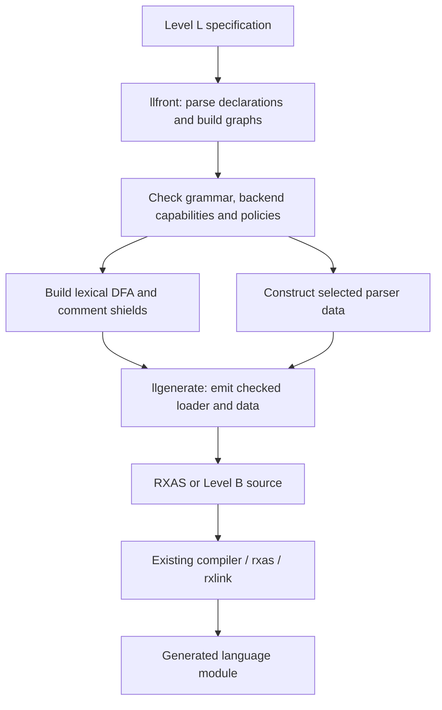
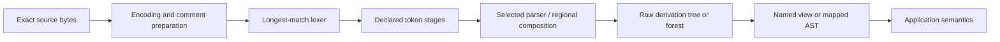

# Level L architecture

Level L is cREXX's reusable language engineering toolchain and SDK. It covers
language specifications, lexer and parser generation, source and tree services,
intermediate representation (IR), analysis, transformation and optional target
or execution services. Applications supply the meaning of their language.

This document explains how the parts fit together. The
[user guide](user-guide.md) teaches their use; the linked design references own
the detailed APIs and invariants. The [generic plan](../../research/level-l/PLAN.md)
and [compiler plan](../../research/level-l/compilers/PLAN.md) own their respective
scope and acceptance. The Classic research profile and its known limitations are
distinct from later delivery, platform and production qualification.

## Ownership and dependency direction

The implementation is written in Level B. Existing native tools build that
implementation; generated languages run through the ordinary RXAS, linker and
VM toolchain. The Level L specification language remains `options levell`.

| Location | Responsibility |
|---|---|
| `langtools/` | `rxlang`, callable generation, bootstrap, tool helpers, general examples, documentation and independent tests. |
| `lib/rxfnsl/rexx/` | Core reusable source, lexer/parser, tree, AST, flow, IR and transformation implementation. |
| `lib/rxfnsl/analysis/` | Optional IR graph indexing, liveness and structured effect proofs. |
| `lib/rxfnsl/rxas/` | Optional RXAS instruction catalogue, checked records and register assignment. |
| `lib/rxfnsl/execute/` | Optional neutral IR execution with trusted host handlers. |
| `lib/rxfnsl/unicode/` | Pinned Unicode property data and its build inputs. |
| `research/level-l/compilers/` | Source-language grammars, semantic families, frontends, selectors, compiler services and language runtime adapters. |
| `rexxscript/` | A product consumer with its own grammar, values and execution policy. |

Dependencies point from consumers to general services. Core Level L has no
dependency on the research compilers, RexxScript values, native compiler ASTs
or compiler globals. A shared graph service does not know Classic variable
names or BIFs. An RXAS service does not decide source-language evaluation rules.
Language runtime adapters reuse their owning value and numeric algorithms.

## Delivered packages

Installed images are separate selection units. Installing a package does not
make it a runtime dependency of every Level L program.

| Image | Build target | Purpose and image dependencies |
|---|---|---|
| `rxfnsl.rxbin` | `rxfnsl` | Core SDK; depends on `library.rxbin`. |
| `rxfnsl-analysis.rxbin` | `rxfnsl_analysis` | `llirgraph` and `llireffects`; depends on core and `library.rxbin`. |
| `rxfnsl-rxas.rxbin` | `rxfnsl_rxas` | `llrxascatalog` and `llrxas`; depends on `library.rxbin`. |
| `rxfnsl-execute.rxbin` | `rxfnsl_execute` | `llirexecute`; depends on core, analysis and `library.rxbin`. |
| `rxlanglib.rxbin` | `rxlanglib` | Specification frontend `llfront` and generation service `llgenerate`; depends on core and the B runtime. |
| `llrxastext.rxbin`, `llbinmeta.rxbin`, `llfileoutput.rxbin` | Corresponding module name | Separate tool helpers for records, binary metadata and publication; the file publisher also uses the filesystem provider. |

`stage-l-libraries` prepares the four SDK images. `stage-l-tools` prepares the
generator and tool libraries. Both are in normal `stage-product`. Research
compiler products require their opt-in stage and install component. The
[bootstrap guide](bootstrap.md) describes the build prerequisites and standalone
seed route.

## Specification compilation

The `rxlang` command handles arguments, file I/O and reporting. Its
`llgenerate..request` service accepts exact binary source and returns an owned
output; it performs no file publication or printing.

Declarations become shared grammar and lexical graphs. Regular lexical rules
are lowered through character sets and an NFA to a byte DFA. UTF-8 scalar
matching is lowered to that representation while preserving original byte
spans. Unicode properties and interval operations retain one SDK owner.
Longest match wins; declaration order breaks an equal-length tie.

Backend choice is explicit and capability checked:

| Profile | Implementation boundary |
|---|---|
| Context-free, default | Canonical LR(1), with packed sparse action/goto tables. |
| `backend ll1` | Admitted deterministic predictive rules. |
| Ordered, default | Ordinary packrat PEG; alternative order has meaning. |
| `backend earley` | Context-free recognition with a shared forest; acceptance need not yield one finite tree. |
| `operators` / Pratt | Admitted operator component and declared binding rules. |
| Expression regions | Checked composition of an LR(1) outer parser and operator regions. |

An unsupported grammar/profile fails admission. A resource stop does not prove
that a language is unparseable. Research Pika and Squirrel implementations are
not automatic fallbacks. See the [backend tutorial](user-guide.md#choose-a-backend-and-understand-competing-paths).

Generation emits either RXAS loaders, readable Level B source or an inspection
graph. A generated module exports `NAMESPACE..language()`, returning an
`lllanguage..definition`. Loaders use public SDK operations rather than embedding
native object layouts. RXAS and RXLINK retain binary serialization and linking;
Level L has no direct RXBIN writer.

### Packed images and lexical reuse

DFA and LR images use explicit portable little-endian fields. Loaders validate
dimensions, ordering, targets and grammar/root identity. LR loading retains the
sparse image with a per-state row directory. Runtime lookups borrow the retained
image instead of expanding all cells or copying the image for every lookup.
Public owning results may still copy; cREXX ordinary value copying is not a
general copy-on-write facility.

Supported scanner-only and nonregional DFA/LR1 generation uses a trusted frozen
LFP1 definition. Both output formats call `lllanguage..compiled()` after normal
build-time validation. Runtime creation checks only its short fixed envelope,
owns the individual packed sections, and binds scalar headers. It does not
hydrate metadata arrays, rebuild indexes or repeat semantic validation. Other
backend generation remains unchanged. This selected implementation is subject
to the [LFP qualification scope](../../research/level-l/PLAN.md#current-action-frozen-definitions).

The image carries raw grammar/revision/signature, canonical CFG rows and computed
facts, DFA/LR tables and row directory, comments/shields, ordered stages, token
holes, projection/AST schemas and diagnostics. Readers decode fixed rows and
length-bearing spans. AST schemas include per-mapping lists of original global
field IDs; node construction uses those lists without scanning every declaration.
Comment shielding reads its enclosing packed section without a temporary DFA.
Frozen mutations signal ERROR with `LL_FROZEN_DEFINITION` and leave the data
readable. Mutable builders and their existing mutation paths stay separate.

The checked external LDP1 route remains `definition.image()` followed by
`lllanguage..prepared()`. It validates complete candidates under a shared logical
budget before publication, and bulk-hydrates small metadata where required.
Trusted `compiled()` is not a substitute for this admission boundary when bytes
come from an external or untrusted source. Explicit `image()` export from a
frozen definition rebuilds the checked wire form only when requested. See the
[two representation contracts](generation-design.md#trusted-frozen-definitions-lfp1).

Each returned component owns its subsection; no constructor-local weak reference
or full outer image is retained in every child. Ordinary value getters can still
copy their owned results. Anchor a definition and use borrowed requests to share
it across input documents. This adds no ownership service or global cache.

### Select immutable data and mutable workspaces

Immutability describes permitted operations; packing describes storage. They are
separate choices, and not every immutable result has a packed representation.

| Task | Owner and representation | Mutation boundary |
|---|---|---|
| Ordinary generated parsing | Trusted frozen packed definition and schemas; anchored borrowed readers | No builder mutation; create another definition to change the language. |
| Read parsed application trees | Existing per-input AST arena, frozen when published | Read handles borrow that result; this is not a new packed AST arena. |
| Construct a language or schema | Existing mutable grammar, DFA/LR and metadata builders | Mutators run during construction; validate and encode before publishing frozen data. |
| Analyse or optimize a program | Existing annotations, facts, IR and rewrite/draft owners | Store analysis separately or publish a new rewritten tree; do not edit a frozen definition/result. |

Keep each borrowed owner live and unchanged for the reader's lifetime. Packing
does not turn ordinary B value assignment into copy-on-write or extend a weak
reference's lifetime.

AST projection can reuse completed schema lookups within that one construction.
Its local memo has sixteen round-robin slots, stores exact original-label keys
of at most 128 characters, and treats a zero result as a valid cached miss.
Every uncached query still calls the schema's normal lookup authority. The memo
does not survive in a schema or result and cannot grow with arbitrary input labels.

Lexical construction reuse is optional generation infrastructure. A request may
supply a private capsule containing the entire main/shield DFA set. Exact
lexical identity, generator stamp and construction limits must match; all other
current specification, parser, policy and output checks run freshly. A candidate
miss falls back to ordinary construction. Generated modules carry no capsule or
cache dependency. The [generation reference](generation-design.md) owns the
capsule, trust, CLI and persistence contracts.

## Runtime recognition

A definition contains reusable language data. A fresh `lllanguage..request`
owns one input and its recognition work.

Comment preparation preserves source coordinates. Token stages perform
declared finite classification or combination with bounded lookahead. They do
not silently repair a source language. Grammar references form one parse;
referencing another rule does not create another processing stage.

The raw tree retains grammar structure. `lltree` exposes a named view that hides
generated helper nodes. `then tree` mappings and `llast` construct an
application AST with checked kinds and fields. `llannotation` supplies sparse
properties; `llflow` interprets authored flow mappings for source-shaped
control analysis. An application decides which branches to execute.

Strict recognition, explicit recovery and Earley forest inspection are distinct
outcomes. A recovered tree carries damaged/generated provenance and does not
become a clean parse merely because an AST can be built. Current recovery
profiles are bounded and capability checked; see
[diagnostics and recovery](diagnostics.md).

### Source ownership and borrowing

Source and token ranges use zero-based byte offsets with an exclusive end.
Line/column rendering is a presentation operation over the original source;
Unicode scalar columns are distinct from byte offsets. Trees and transformed
nodes preserve the source ranges and origins needed for later diagnostics.

Ordinary requests own their language value. Prepared DFA/LR definitions also
support explicit borrowed requests and readers. Borrowing requires the exact
initialized owner to remain live, unchanged, anchored in stable storage and in
the same VM worker. A weak reference detects expiry; it does not detect
rebinding or mutation of live storage. Other parser backends refuse the borrowed
request profile rather than silently copying. Materialized source/tree results
retain their own data; later metadata-dependent work still requires the owner.
See the [borrowed API](user-guide.md#borrowed-language-requests).

## Checked IR and transformations

`llir` separates source syntax from executable meaning. A frozen contract names
semantic families and versions, types, operations, attributes and effects. A
builder constructs modules, functions, blocks, typed slots, values and origins.
Finishing checks structure before publishing a frozen module. Block-local
values are immutable results; typed slots carry mutable state across blocks.

The host registers type codecs, semantic verifiers, constant evaluators and
lowering services. These implement source-language rules. Generic services
verify signatures and control, analyse definite assignment, carry revision-bound
facts, and construct checked replacement modules. A failed transformation
preserves its input. Unknown effects cannot authorize removal or evaluation.
Constant folding does not execute effectful runtime handlers.

`llirservices` supplies the core analysis/transformation service. Optional
`llirgraph` adds indexed control, reachability, dominators, SCCs, natural loops
and liveness. `llireffects` separates state domains, ownership, conditional
result availability and failure/transfer/resume behavior. Its proof requests
derive checked conclusions from declared premises. A caller-supplied fact is
not interchangeable with a proved conclusion.

Analysis objects and proofs belong to one exact live owner/revision; equal
serialized bytes from another owner do not substitute. Protection, indirect
continuations or opaque lifetimes require conservative storage treatment.
Liveness does not by itself establish alias independence or result presence.
The [IR reference](ir-design.md) owns these APIs, saved-form compatibility,
revision checks and the chunked text writer.

## Optional target and execution services

### RXAS records and register assignment

`llrxascatalog` is generated from the owning native opcode, effect and signal
metadata at build time. It exposes names, operand kinds, component writes,
failure behavior and policy effects without a second opcode numbering.
UNKNOWN metadata remains conservative.

`llrxas` accepts already selected instructions. It checks records, tracks
whole-cell lifetimes and call windows, performs deterministic constrained
register assignment and independently validates the result before rendering.
Only explicitly eligible scalar temporaries can reuse storage. Managed,
addressed, observable and complex-control lifetimes retain conservative
constraints. This is neither source-language instruction selection nor a new
assembler. The emitted static application needs only its emitted runtime
dependencies, not the producer's allocator. See the
[RXAS reference](rxas-design.md).

### Neutral IR execution

`llirexecute` preflights an entire module against a trusted registry and optional
exact-revision executable manifest. It admits supported core control and
registered operations before effects occur. Saved IR cannot register host code.
Host type services check values; handlers own operation semantics and external
resources. Generic execution supplies frames, cells, local calls and checked
boundaries without implementing a second language value or variable-pool engine.

A prepared plan owns a graph snapshot. A session owns executing frames and
handler state, and returns distinct completion, failure, transfer, suspension,
limit or cancellation results. Presence is separate from a value's bytes.
Suspension tokens authorize one resume/discard on the original live session;
copying a session does not copy active execution authority. Leases provide
synchronous access to registered host bindings without making them serializable
or exportable values. Lifecycle hooks and terminal cleanup release entered
resources once, retaining the primary failure.

Execution has explicit fuel, depth, cell and logical-byte budgets. Callbacks
remain trusted synchronous code: fuel cannot interrupt an uncooperative host
operation. Aggregate ownership across sessions belongs to the application.
The [execution reference](execute-design.md) owns manifests, ports, conditional
cells, event payloads, resumption, abort and cleanup. Classic INTERPRET is a
separately owned consumer of these mechanisms.

## Tool services, publication and build lifecycle

`llgenerate` evaluates once and returns owned chunked output with no partial
artifact on failure. `llbinmeta` reads RXBIN metadata and admits callable
definitions through reciprocal procedure/public-export records in the same pool.
Classification preserves that pool identity when deriving procedure, method or
factory ownership; imported prototypes are not definitions. Selected malformed
ownership refuses without poisoning unrelated selections. Returned fields own
their lifetime. An optional bounded catalogue meters logical owned payload and
work monotonically, with no partial index/selection on exhaustion; it does not
bound process RSS or validate provider code. These are metadata facts, while a
consumer owns its language ABI admission. The
[metadata API](user-guide.md#selected-callable-classification) specifies the exact
identifier, lookup, ownership and budget rules.
`llrxastext` escapes bytes and retains source-tagged records. `llfileoutput`
publishes an existing output through an exclusively claimed sibling staging
directory; failed construction/write/close preserves the prior destination.

The `crexx` driver recognizes the Level L source forms, builds generated
providers before their consumers, tracks relevant tool/runtime inputs and links
the shared SDK once per program. A reusable grammar library contains its
authored modules. `generate.cmake` owns temporary output and rename-on-success;
direct shell redirection truncates a destination before the generator runs.
Optional persistent lexical reuse has one output-derived cache owner and a
manifest published last, so incomplete cache state is a miss.

The specification frontend is bootstrapped through L0/L1/L2. L0 uses a bounded
handwritten reader; L1/L2 use the generated lexer, token stage and LL(1) parser
over the same semantic lowering. L1/L2 generated grammar RXAS must agree before
publication. This proves repeatable regeneration, alongside independent tests;
it is not self-hosting of a new Level B compiler. Existing native B remains the
implementation seed. Host/target cross-compilation and wider delivery proof
retain their explicit qualifications in the [bootstrap guide](bootstrap.md).

## Limits, trust and qualification

Construction, parsing, tree processing, IR services, metadata and execution have
their own declared allowances. Counts describe work or logical payload/storage;
they do not promise a process RSS limit or elapsed-time bound. Fixed token,
representation and recursion ceilings remain separate. Hosts must also bound
source acquisition, trusted callbacks and aggregate retained objects.

Generated tables and optional lexical capsules are trusted build artifacts.
Shape checking does not authenticate their claimed language. Metadata validity
does not prove provider-code safety. Registered evaluators, type services and
handlers are semantic premises supplied by the host.

Independent examples and fixtures cover generic contracts without requiring a
C/G consumer. Language completeness, installed relocation, hosted platforms,
sanitizer closure, production replacement and release qualification remain
separate claims under their owning plans. Source review and documentation
changes do not establish new execution or platform proof.
