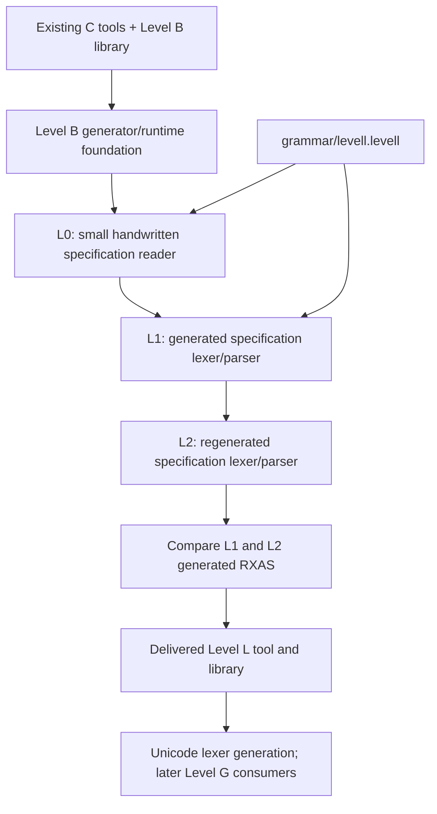

# Building Level L from Level B

The required Level L implementation is Level B. The authored language remains
`options levell`. No completed Level G library, RexxScript interpreter or
compiler exit is needed to build the tool. Level G's Unicode build is a
**downstream consumer** of the completed Level L tool.

The existing C tools (`rxc`, `rxas`, `rxlink`, VM and native packer) are unchanged
prerequisites. They may still use re2c during their own construction. This
checkpoint removes re2c from Level L and its Unicode lexer generation, not from
the repository. Replacing the C scanners needs a separate future bootstrap
strategy.

## What bootstraps what



The shared Level B foundation owns character-set algebra, grammar analysis,
DFA/LR construction, packed images, source/token/tree objects and emission.
These algorithms do not need to be generated from a grammar. The part that
becomes self-hosted is the **reader of Level L specifications**.

L0 compiles a bounded handwritten reader from `bootstrap/seed-reader.inc`
together with common semantic lowering. It has no resynchronization. L1 and
L2 instead use the generated lexer, a declared keyword/declaration token stage,
and the generated LL(1) parser. Their expression and charset trees are
walked into the common grammar. Shared keyword alternatives are factored in
the self-description; LL(1) admission checks it before generation. They contain
no seed-reader fallback.

The self-description includes a useful composite stage: `name :` becomes one
`declarationname` token. This distinguishes the start of a declaration from an
expression reference without needing two-token LR lookahead. The token owns
the original span; lowering recovers the name and colon coordinates. The other
stage rules classify case-insensitive keywords. These are declared finite
passes, not hidden grammar repairs.

CMake keeps outputs in separate `langtools/bootstrap/L0`, `L1` and `L2` directories.
Each stage has private import roots: the frontend sees only the generated
syntax module it needs, and the driver sees that stage's frontend and syntax.
The older linked driver is never in an import root. This matters during API
changes: a linked image carries embedded metadata and can otherwise shadow a
new standalone module even when that module was correctly rebuilt. The common
foundation/library imports are staged separately.

L0 generates L1's `llsyntax.rxas`; L1 generates L2's. Their RXAS files must be
byte-for-byte identical before publication. A mismatch fails the build.
Independent language/token controls remain essential: regeneration agreement
establishes repeatability, not independent semantic correctness.

## Build commands

In an existing product build:

```sh
cmake --build cmake-build-debug --target rxlang --parallel 8
cmake --build cmake-build-debug --target levell_unicode_lexer --parallel 8
```

The first target builds the final `bin/rxlang` command, `bin/rxlanglib.rxbin` and `bin/rxfnsl.rxbin`.
The second generates `bin/gennorm2_language.rxbin`. The Unicode build consumes
that module through the small `level_l_gennorm2.crexx` Level B adapter, retaining
the existing packed token ABI and typed-record parser.

To prove the prerequisite boundary, build Level L separately from already-built
native tools and `library.rxbin`:

```sh
cmake -S langtools/bootstrap -B build-level-l \
  -DCREXX_HOST_BIN=/absolute/path/to/existing/bin
cmake --build build-level-l --target rxfnsl levell_unicode_lexer --parallel 8
/path/to/existing/bin/rxbvm build-level-l/langtools/bootstrap/L2/rxlang-linked.rxbin \
  -a langtools/examples/settings.levell --rxas
```

This standalone project neither defines nor builds re2c or Level G targets. It
produces portable bytecode artifacts rather than packaging a native CLI.
Product install declarations are omitted in this mode; the normal repository
build still installs `rxlang` and `rxlanglib.rxbin`.
`-DCREXX_LEVEL_L_NOOPT=ON` disables compiler and assembler optimization for the
Level L modules and bootstrap stages. The full product build uses normal tool
optimization. `langtools/bootstrap/build-local.sh opt|noopt` wraps the same standalone graph
for the existing review scripts; it does not maintain a second bootstrap.

Generation currently requires a native host build. Cross-compiling the graph
fails explicitly before trying to execute target binaries. Host/target split
packaging remains unqualified; this checkpoint is not cross-platform release
qualification.

## Build lifecycle and failure

A no-op build does not regenerate or rewrite images. Changing the specification
regenerates both generated stages. Changing the shared runtime/generator inputs
rebuilds the affected foundation and dependent stages. The final library is
published after the comparison succeeds.

`rxlang_bootstrap` owns completion of the L0/L1/L2 chain and its comparison.
Both the public library target and Unicode generator wait for that target;
the packaged CLI also waits through the public library. File dependencies
remain in place to detect changed sources or a missing image. This target
ordering matters for parallel Make, which can otherwise copy the same L2
recipe into independent consumers and run it twice. The Unix Makefiles
`rxlang_bootstrap_build_order` regression exercises clean, missing-image,
changed-input and no-op builds using the real declarations and instrumented
stand-in tools; real compiler/bytecode qualification is separate.

`generate.cmake` writes a temporary output and renames it only on success. A bad
grammar returns nonzero, removes that temporary output and preserves the last
valid generated artifact and downstream library. Direct shell redirection has
no such guarantee. Nothing recovers from invalid grammar input and pretends the
build succeeded.

The seed retains first-error reporting. The proper readers now collect multiple
syntax errors at lexically established declaration boundaries; bad UTF-8 and
unclosed comments still stop source preparation. The current recovery and
backend profiles are described in the user guide. The specification reader
continues to use DFA/token-stage/LR throughout the bootstrap.

## Unicode lowering and its correctness argument

`lexer input utf8` denotes scalar rules. A scalar ranges from U+0000 through
U+10FFFF, excluding U+D800–U+DFFF. `scalar`, ranges, unions, grouped exclusions,
charset references, Unicode literals and codepoint atoms lower to the existing
byte-DFA representation. No Unicode property tables or Level G services are
required. Versioned normalization/casing/grapheme algorithms and their pinned
Unicode 17.0.0 data remain unchanged.

Character sets are represented during construction as sorted, disjoint closed
intervals. Union merges intersecting or adjacent intervals. Subtraction replaces
each intersecting interval by its surviving left/right pieces. These operations
preserve membership by interval arithmetic; the test oracle compares decoded
scalar membership independently of the lowering.

For each surviving interval, split at UTF-8 length boundaries and the surrogate
hole. On each resulting fixed-length interval, canonical UTF-8 encoding is
strictly lexicographically increasing. Split the endpoint encodings recursively:

1. Equal leading bytes are a common prefix; recurse on the remaining bytes.
2. Different leading bytes form a lower endpoint suffix, an optional middle
   byte range with unrestricted continuation suffix, and an upper suffix.
3. At the final byte, emit the inclusive endpoint range.

These pieces are disjoint and cover exactly the original encoding interval.
Induction on the remaining width proves equality between the constructed byte
language and the UTF-8 encodings of the scalar set. UTF-8 width is at most four;
there are O(width) boxes per fixed-length interval. Their sequence/union clauses
feed the existing Thompson NFA/subset DFA construction. Build limits still
apply; this does not promise polynomial DFA state count in arbitrary regex
size. Longer encoded matches preserve scalar-prefix order, so maximal munch
and rule priority retain their scalar-language meaning.

NUL is an ordinary scalar/byte, never an EOF sentinel. The request stream uses
its explicit length; optional EOF metadata is exposed separately. The Unicode
compatibility adapter appends the legacy zero-length EOF record. Malformed
UTF-8 is rejected before normal token recognition. Named `malformed` and
`otherwise` error actions are carried in the generated definition.

The historical gennorm2 scanner treated NUL inside a comment as end-of-input
and could accept a truncated rule file. The replacement rejects that NUL with
the existing invalid-character status. This is an explicit correction to the
NUL-as-data contract, recorded separately from the matching token/record/error
controls. The adapter preserves accepted prefix tokens on lexical rejection
and emits EOF only on success; it does not turn a failed scan into a parse.

Existing PoC byte rules have been relabelled `input utf8bytes`: validate the
source as UTF-8, then apply byte rules. In that explicit compatibility profile,
U+00E9 is byte E9. In `input utf8`, U+00E9 matches C3 A9. `input bytes` performs
raw byte matching without UTF-8 validation. Unicode property classes and
Unicode identifier policy are still separate features, not implied by scalar
support.

## Verification and limits

The [programme plan](../../research/level-l/PLAN.md) retains BOOT acceptance
criteria and the current validation summary. The maintained build verifies
L1/L2 generated RXAS agreement; the instrumented Make regression checks single
production, missing-output recovery, changed input and no-op builds. These
checks do not establish full cross-platform replacement readiness.

The native B toolchain is the seed. Compiler algorithms remain Level B.
Temporary bootstrap builds and diagnostic output are deleted on completion;
fixtures and focused regression source remain maintained.
