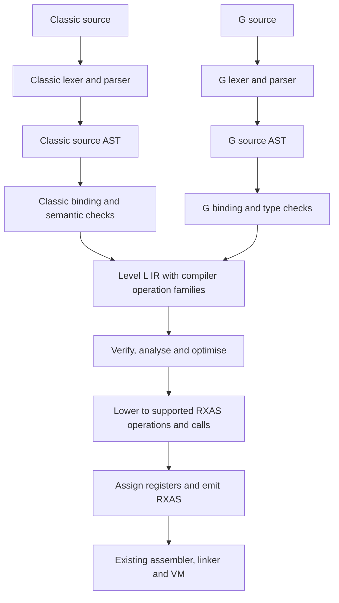

# Compiler architecture

The Level L IR foundation, semantic extension API, C/G frontends and shared
RXAS backend are implemented in Level B. The generated grammars use Level L;
output construction uses the Level L writer. STEP05 adds shared IR optimisation.
The existing compilers remain independent execution controls.
[PLAN.md](../PLAN.md) owns scope, acceptance and approval.
The [backend reference](backend.md) describes the implemented service, target
records and ABI. [STEP04-REVIEW.md](STEP04-REVIEW.md) retains the approved scope
and links its acceptance evidence.
The [STEP05 design](STEP05-REVIEW.md) is approved. Its first cleanup increment
adds reusable Level L source-position lookup and selection-based frame planning.
Batch reconstruction and shared passes now live in `llirservices`; C/G only
register their semantic evaluators and select the service. Qualification is
recorded in the plan. Formal performance testing is not a research completion
gate, under Adrian's scoped instruction in root `AGENTS.md`.

## What the pipeline does

A frontend understands one source language. It produces a tree describing what
the programmer wrote, checks its meaning, then lowers it: translates it into
smaller, explicit operations. Both frontends lower into Level L's extensible
intermediate representation, or IR. Shared passes analyse and transform that
IR. The RXAS backend chooses instructions and registers and writes assembly.



An AST owns children, such as an IF's condition and arms. The IR also has
references: two operations can use the same value, and a loop points back to
an earlier block. They therefore have different structures. The source AST
remains available for explanations and diagnostics after lowering.

## End-to-end scope and qualification

The admitted C/G pipeline already executes source through Level L grammar,
AST, verified IR, shared optimisation and RXAS emission. Compiler-specific
instruction selection/ABI logic is Level B in `llrxas`; output construction is
the generic Level L `llir.writer`, with sections, chunks, origins, limits and
sinks. The existing native assembler/linker/VM run the generated program.
STEP06 audits this existing vertical path; it does not introduce another
emission route or broaden the language.

The [coverage matrix](poc-coverage.md) maps all ten PoC rows, failure/lifetime
contracts, bootstrap dependencies, optimisation axes and platform boundaries.
The [paired walkthrough](../examples/step06/README.md) shows actual tree/IR/RXAS
views, exact outputs and reached/skipped errors. Full replacement, proper B
self-hosting, arbitrary imports/classes, full TRACE/conditions and INTERPRET
remain their later review gates. Generic Level L proof continues to use
independent non-C/G consumers, not only these compiler examples.

## Ownership of components

| Component | Owner and responsibility |
|---|---|
| AST construction, origins and properties | Existing Level L services. The compiler declares its node shapes through `then tree`. |
| IR, schemas, compact buffers and views | Level L; specified in the [IR design](../../doc/ir-design.md). |
| Verification and pass infrastructure | Level L checks structure, reference validity, contracts and pass results. |
| Common analyses and transformations | Level L implements algorithms using declared operation semantics. |
| C/G semantic extensions | `compilers/common`, `levelc` and `levelg`: numeric rules, source types, pools, calls, effects and diagnostics. |
| RXAS backend | `compilers/rxas`: ABI, instructions, register windows, literals and metadata. |
| Compile service and commands | `compilers/driver`: requests, results, budgets, files and separate tool names. |

The generic IR does not depend on either compiler. Its tests include a small
non-cREXX operation family. Compiler-specific facts do not become undocumented
requirements of generic nodes or transformations.

## Implemented foundation

`llir` owns versioned schemas, fixed-width numeric records, checked builders,
read-only handles, source origins, exact codecs and chunked output. `llirservices`
coordinates optional semantic verification, constant evaluation and target
lowering. It also supplies revision-bound sparse facts and a reachability and
definite-assignment analysis. Both modules import only Level B services.

The physical graph has thirteen tables. Functions own blocks and typed slots;
blocks link their ordered operations; operations reference local immutable
values, successors, attributes and origins. Constants and sources use an exact
byte pool. A frozen module owns its storage. Its handles borrow that owner and
check identity on access. A rewrite builds and verifies another module, leaving
the source intact on refusal or failure. See the [record and API reference](../../doc/ir-design.md).

`compilers/common/llcrexxir.crexx` is a separate consumer registering initial
C/G families. G signed addition has a checked int64 evaluator; overflow preserves
the runtime operation. Classic addition carries an explicit numeric-context
operand and has no evaluator until that language contract is implemented.
`crexx.g.say` and `crexx.c.say` declare output effects. Constant replacement never
removes SAY. The [worked example](../../examples/ir/demo.crexx) folds its argument,
shows the IR and prints the resulting constant through the existing Level B host.
That foundation example does not compile a source file. The separate
[STEP04 examples](../examples/step04/README.md) show actual C/G source-to-RXAS
compilation and execution.

Execution correctness does not establish emitted-code quality. The
[STEP04 emission review](EMISSION-QUALITY-REVIEW.md) records the historical
source-map, path, construction and frame-layout findings. Essential provenance
and STEP05 cleanup repaired the direct defects; the [coverage matrix](poc-coverage.md#code-quality-and-remaining-work)
distinguishes those repairs from remaining allocation, Classic target-contract
and full TRACE work. PLAN.md AC16 and its EQ criteria
own closure; the existing functional receipts do not close those findings.

The [essential condition-provenance correction](CONDITION-PROVENANCE-REVIEW.md)
keeps the existing function-level Classic handler and necessary location field.
Source names, ranges, generated origins and redundant updates are corrected;
B-only message formatting and generated `signalorigin` relays retain the original
fault. No condition framework, source-map format or stack machinery is added.
The [backend reference](backend.md) distinguishes the fault from retained authored
context. Proper clause grouping, full trapping/payload propagation, complete
stacks and INTERPRET lifetimes remain separate outstanding work in PLAN.md.

An independent test family uses the same APIs without importing compiler
semantics. Its lowering service produces a pure straight-line target fragment.
This initial checked profile admits constants and pure target operations;
stateful, failing and control-changing mappings need the later backend's explicit
obligations. The coordinator checks ownership, result types, order and the whole
candidate graph. It cannot establish the mathematical equivalence of arbitrary
host-supplied callbacks. That remains the semantic provider's responsibility.

The format contains an ordered schema manifest, numeric records and byte pools.
The host registers the matching schema and services before loading. Loading an
image never loads executable callback code. Unknown semantics grant no permission
to fold or claim a complete flow analysis.

## Shared optimisation between the frontend and backend

`llirservices..optimise` owns one request-local batch over a frozen module.
Numeric arrays index aliases, exact values, folded results, selected successors,
reachability, demand and the previous operation. A forward scan propagates
same-block core-slot definitions and asks eligible registered evaluators for
exact results. Core slots cannot escape; state-accessing extensions invalidate
the slot facts. It does not track Classic user-variable pools.

A queue follows successors from every function entry. Proven Boolean branches
have one selected edge. A reverse scan within each reachable block marks values
needed by retained operations and removes only proved discardable operations.
Values cannot cross blocks in this IR profile, so reverse definition order
closes demand without a repeated fixed point. Stores, potentially failing
loads, output, state operations, failures and divergence stay unless a specific
successful evaluation proves the replacement. An unknown/transfer continuation
refuses the batch and keeps the original graph.

The existing reconstruction coordinator applies the batch once, copying exact
attributes and source records, remapping values/blocks, deriving replacement
origins and verifying the candidate. Failed budgets or callbacks return the
original; nothing partly transformed is emitted. The operation/value/block maps
refer to the returned revision. Existing one-operation rewrite and target
lowering use the same coordinator. See the [generic API and limits](../../doc/ir-design.md#optimise-a-frozen-module).

G registers exact checked int64 arithmetic/comparisons, int64 formatting and
canonical Boolean conversions. Overflow, division and unproved conversions
remain runtime work. C registers truth evaluation only for exact literal `0`
and `1`; its numeric context, variable pools and arbitrary calls retain runtime
semantics. Generic algorithms never test a C/G operation name.

The compiler service retains its frontend graph for inspection and owns the
separate emission graph. `-n` or the trailing service option disables shared
passes while retaining the construction/source/emitter fixes. The [paired
example](../examples/step05/README.md) shows both stages and executed RXAS.

## Implemented frontends

Each frontend uses the existing generated DFA lexer and canonical LR(1) parser. LR(1) means that grammar construction establishes which action follows
from the current parser state and one next token. Conflicts are grammar-build
errors with witnesses, not occasions for silently choosing an interpretation.

Expression precedence is explicit in the grammar. Matched/unmatched IF
rules are used to associate ELSE with the nearest eligible IF. Primary expressions,
calls and operator levels are in the same parser. Pratt remains an
available later expression component; the current delimiter-based regional
interface is not assumed to parse arbitrary undelimited C/G expressions.

Classic has contextual words: `if = 1` is an assignment. Its lexer retains raw
word spelling, adjacency, comments and clause separators. A documented token
classification stage uses assignment/label lookahead and instruction context;
the parser then constructs the Classic tree. Classification is determined by the documented context and preserves the
original byte range. Only zero-width concatenation/separation tokens are inserted. No stage manufactures
a typed B AST. Both grammars pass LR admission. There is no hand-written source parser or
old-compiler fallback behind the generated grammar.

Source encoding is UTF-8 with exact byte spans. CRLF counts as one line break.
The initial identifier repertoire is explicit in the scope document; string
content is Unicode. These two grammars have no recovery declarations: they report the first
located error. The reusable service also rejects recovered trees. A clean
complete parse and successful semantic checks are required for verified IR.

## Compilation request and lifetime

The implemented `llfrontend.request(level, source, artifacts, filename, budget,
nesting)` compiles lazily on its first query and retains the result. `status()`,
`error()`, `offset()` and `diagnostic()` expose failure without terminating the
host. `ast()` returns the owned source tree; `graph()` returns a verified module
on success and a failed module on failure. No draft graph escapes on an error.
The artifact directory is explicit; it is read as data by the B-only RXBIN007
reader. The compiler host never imports or executes `rxfnsc`. Classic BIF
contracts in that image are target dependencies, distinct from host imports.
See the [frontend API and semantic contracts](frontends.md).

The implemented `llcompiler.request` and `llrxc-c`/`llrxc-g` command boundary is
described in the [backend architecture](backend.md).

A request supplies source bytes and identity, language/profile, import roots,
target contract and resource settings. It owns its trees, symbol tables and
draft IR. A successful result owns its RXAS, source mappings and diagnostics;
it remains usable after the request is released. The library never exits the
process or installs output on a failed request. A command writes a completed
result atomically after validation.

Borrowed handles identify their owner and revision. Passing a handle does not
copy a tree or module. A transform creates a new validated module; analyses on
the old revision cannot be attached to the new one accidentally. Stage dumps
include enough names and source information to explain a failed invariant.

## Bootstrap: native seed to self-hosted B and L

The native C-language B compiler is a seed tool. The intended normal B compiler
is written in Level B, uses Level L for its frontend and IR, and shares the
cREXX RXAS backend. It builds the infrastructure and the downstream G/C
compilers once qualified. The first C/G PoC develops and tests those common
services; completing that PoC alone does not establish a self-hosting B compiler.

### Build stages

`B0` below means the native seed. `B1`, `B2` and `B3` are generations of the
same proper B compiler sources, compiled by different preceding tools. They
are not different language levels or different compiler feature sets.

| Stage | Inputs and work | Output |
|---|---|---|
| Seed tools | Build the retained C-language B compiler and existing assembler, linker and VM with their native prerequisites, including re2c where currently required. | B0 and native execution tools. |
| Seed foundation | B0 compiles the B libraries and all required Level L services. Run Level L's own L0/L1/L2 reader bootstrap. | Complete seed-built Level L and B library closure. |
| First proper B | Level L generates the B frontend; B0 compiles the authored B compiler/IR/backend sources. Existing tools assemble and link the generated and compiled modules. | B1, the first runnable proper B compiler. |
| First self-hosted closure | Using B1, rebuild the B libraries, Level L and then the same proper B sources/generated frontend. | L and libraries built by B1; B2 built against that closure. |
| Convergence check | Repeat that exact source/option sequence using B2. | L and libraries built by B2; B3. Compare with the preceding stage. |
| Downstream tools | Qualified proper B and Level L build G and C compiler sources, semantic services and generated frontends. | Separate G and C compilers. G can then compile G-authored runtime/library sources. |

The self-hosted stages use their private import roots and newly built libraries,
not whichever installed module has the same name. Native compiler executables
and compiler libraries must be unavailable in these stages. The native
assembler/linker/VM remain available: compiler self-hosting does not rewrite
those tools. Current B runtime primitives remain the execution foundation.

Level L's **L0/L1/L2** stages regenerate its own specification reader, as
described in the [current bootstrap guide](../../doc/bootstrap.md). They are
separate from these B compiler generations. Building L again with B1 checks
that proper B can build the generator and its libraries. Building the same
closure with B2 checks whether the products stabilise. This avoids hiding an
old seed-built library or frontend inside an apparently self-hosted compiler.

The current build graph gives `levell_bootstrap` ownership of the verified L2
image. The public library and Unicode generator have target-order dependencies
on it as well as file-freshness dependencies. This prevents parallel Make
consumers from independently executing the same bootstrap recipe. The native
CLI waits through the public library; compilation remains in Level B.

Compare corresponding B2/B3 compiler products, B libraries, Level L modules and
generated grammar outputs. Pin sources, semantic schemas, flags, Unicode data,
native tools and dependency order. Use byte-identical deterministic outputs
where possible. If a container has unavoidable build-location metadata, define
and test a narrowly specified comparison that excludes only that metadata;
never normalise away code, constants, ABI or meaningful origin differences.
Retain both original products and the comparison receipt. A mismatch fails the
qualification and requires diagnosis; do not keep rebuilding until it happens
to disappear. Independent language regressions and opt/no-opt controls are also
required, because reproducibility alone does not prove semantic correctness.

This complete sequence is the cold-bootstrap qualification path. An ordinary
incremental build uses a qualified proper B/L foundation and rebuilds affected
dependencies. Repeating every generation belongs to changes that invalidate
bootstrap evidence and the final replacement gate, not every documentation edit.

### Independent compiler hosts, explicit runtime dependencies

The existing Level L core and L0/L1/L2 bootstrap use Level B, `library`, and
the existing native tools. `lib/rxfnsl/tools/CMakeLists.txt` explicitly excludes
the embedded Level G VM and compiler exits from that bootstrap.

The current `rxfnsc` package is a different closure: its CMake import stage
requires `classlib`, compiler exits, `rxfnsg` and stream/filesystem providers.
Importing that entire package into the new compiler host would defeat the
intended small Level B bootstrap.

The intended dependency graph is:

```text
qualified proper B + Level L + B host libraries
    |-- G compiler host
    |      `-- G-authored runtime/library products
    `-- C compiler host
           `-- Classic programs link the selected Classic runtime
```

B, Level L and the C compiler host must build and execute without `rxfnsg`,
compiler exits or native C/G compiler services. The G compiler host is also
written in B; it does not need a previously built G compiler. B and G may share
typed frontend code only where their contracts agree, through a B-buildable
common library. B is an explicit admitted language profile, not an invocation
of a G compiler that silently brings G runtime services into the bootstrap.

Classic target programs currently link the full Classic runtime package, whose
build can still require G. Thus G may precede Classic runtime packaging without
being a prerequisite of the C compiler itself. Making the complete Classic
runtime B-only would require a separate reviewed packaging/source split. In the
first PoC, existing built runtime packages supply the target-program services;
later migration rebuilds them in their declared dependency order.

For Classic constant evaluation, first audit the small existing Level B
`RexxValue` dependency closure, which directly imports `rxfnsb`. Reuse an
unchanged, qualified source implementation if that closure is sufficient; do
not copy its arithmetic into a divergent compiler implementation. If additional
dependencies enter the host closure, expose them before implementation. The
full pool/activation/BIF runtime remains a generated-program dependency.

The compiler's own metadata reader is cREXX. It reads prebuilt contracts without
loading their executable code or invoking an old compiler. Rebuilding a target
library is a separate build step, not an implicit source-to-RXAS escape route.

## Replacement and INTERPRET

The [scope](poc-scope.md) is a first executable slice. Later migration adds
classes, references, broader Classic state/control, tooling and full metadata.
The compile service is reusable from the start; interpreted execution arrives
only with the caller-activation, resumable-condition and code-lifetime contract
in STEP08. A normal function call is not that contract.

The current VM has load operations but no public per-module unload operation.
Bounded resident code ownership remains an explicit future design obligation.
Production routing changes only at the plan's replacement gate.

Proper B and the full B/L rebuild closure are tracked under STEP07B and AC02.
The native seed remains available after normal B/C/G routing moves to the new
compilers. Its removal would require a separate seed-distribution/trust strategy.

## Reading the detailed design

- [PoC scope and coverage inventory](poc-scope.md)
- [Source trees and semantic tables](trees-and-ir.md)
- [Level L IR and extension API](../../doc/ir-design.md)
- [Paired pipeline walkthrough](pipeline-walkthrough.md)
- [Processing algorithms and proof boundaries](algorithms.md)
- [Decisions presented for review](design-decisions.md)
