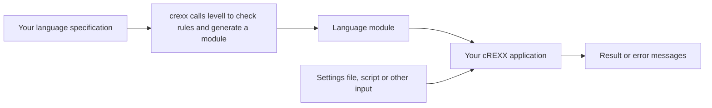
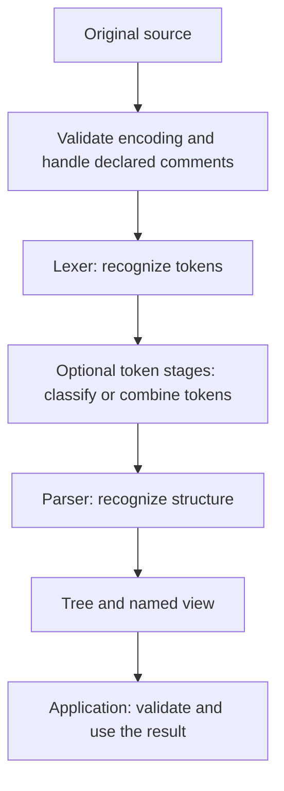

# Level L user guide

Level L helps you build programs that read a language: configuration files,
commands, scripts, expressions or source code. You describe the language in a
`.crexx` file beginning with `options levell`, or a short-form `.rxl` file.
Level L generates a module that your cREXX program uses to
recognize input and return its structure. Your program then reads settings,
evaluates expressions, executes statements or produces another output.

You do not need parsing experience to begin. Read the overview, run the settings
example, then add the features your language needs. The reference sections give
exact declaration forms, runtime methods and error handling rules.

## Contents

- [Overview: from a language description to a useful program](#overview-from-a-language-description-to-a-useful-program)
- [Build and run a complete example](#build-and-run-a-complete-example)
- [Grow one settings grammar](#grow-one-settings-grammar)
- [Choose a backend and understand competing paths](#choose-a-backend-and-understand-competing-paths)
- [Build an end-to-end calculator](#build-an-end-to-end-calculator)
- [Specification reference](#specification-reference)
- [Lexical rules and Unicode](#lexical-rules-and-unicode)
- [Comments and layout](#comments-and-layout)
- [Parser rules and operators](#parser-rules-and-operators)
- [Token stages and composite parsing](#token-stages-and-composite-parsing)
- [Runtime API reference](#runtime-api-reference)
- [Trees, fields and source locations](#trees-fields-and-source-locations)
- [Error messages and recovery](#error-messages-and-recovery)
- [Command line and build integration](#command-line-and-build-integration)
- [Resource limits](#resource-limits)
- [RexxScript: a larger example](#rexxscript-a-larger-example)
- [Troubleshooting](#troubleshooting)
- [Glossary](#glossary)

## Overview: from a language description to a useful program

Consider a settings file containing:

```text
retries = 3
```

A program reading it needs to answer three questions:

1. What pieces of text are present? Here they are a name, an equals sign and a
   number. A **lexer** finds these pieces, called **tokens**.
2. How do the pieces fit together? Here they form an assignment. A **parser**
   checks their arrangement against your **grammar**, the rules describing
   valid structures in the language.
3. What should the assignment do? Your application might store the number 3
   under the name `retries`. This is application code you write in cREXX.

The parser returns a **tree**: a collection of connected nodes showing which
pieces belong together. For example, an assignment node contains a name and a
value. Trees are particularly useful when constructs nest, as with expressions
inside assignments or statements inside loops.

### Build the language module, then use it on documents

There are two kinds of input file. A `.crexx` specification with `options levell`,
or a short-form `.rxl` file, describes your language. A settings file or script is a document written in that language.



At build time, `crexx` calls `levell` to check the specification and generate the
language module. It assembles the module, compiles your application and links
them with the Level L runtime. On later builds it reuses unchanged work.

At run time, your application creates a language definition from the module
and a fresh **request** for each input document. A request holds the source,
tokens and parse result. The language rules are reused across documents.

### How a specification is arranged

A small specification has four main parts:

| Part | What you write | What it supplies |
|---|---|---|
| Header | `options levell` and a namespace | The generated module's name. |
| Token declarations | `identifier: token`, `number: token` | Names for the kinds of text the parser receives. |
| Lexer | Patterns for names, numbers, punctuation and whitespace | Rules for turning text into tokens. |
| Parser | Rules for assignments and the whole document | Rules for combining tokens into a tree. |

For example, the lexical rule `digit+` means one or more digits. It produces a
`number` token. The parser rule `identifier equals number` means those three
token kinds in that order.

Whitespace has its own lexical rule. If it uses `then skip`, the parser does
not receive whitespace tokens. The original text remains available for source
locations and messages.

Most languages can start with these four parts. Comment declarations, custom
messages, named fields and extra processing stages are optional additions.
The specification describes the language; its declarations are not instructions
that execute from top to bottom for each document.

### Follow the input through the parser

For `retries = 3`, the lexer produces:

| Token kind | Text | Byte range |
|---|---|---|
| `identifier` | `retries` | `[0,7)` |
| `equals` | `=` | `[8,9)` |
| `number` | `3` | `[10,11)` |

A **byte range** begins at its first byte and ends just after its last byte.
Thus `[0,7)` covers seven bytes. Token text is still text: the application will
convert `3` to a numeric value if it needs one.

The tutorial's parser contains these rules:

```rexx
assignment: rule = name.value equals value
name.value: rule = identifier
value: rule = number | string
```

Here `|` means an alternative: a value may be a number or a string. The parser's
**start rule** describes the complete document. Parsing succeeds only when all
tokens fit that rule.

The resulting named tree is:

```text
settings
└── assignment
    ├── name.value
    │   └── identifier       "retries"
    ├── equals              "="
    └── value
        └── number          "3"
```

Rule names become node names. The `name.value` and `value` nodes remain because
they are named in the grammar. Repetition puts successive assignments directly
under `settings`; its generated helper nodes are hidden. The `equals` token
remains as a child of the assignment.

### Use the tree

A **tree walk** visits nodes and their children. The settings reader finds each
`assignment` and prints its name and value text. A configuration loader could
instead convert values and check for duplicate names.

A script interpreter uses the same idea to execute statements. For an IF, it
evaluates the condition and executes the selected branch. Both branches must
be syntactically valid, but only the selected branch has effects.

Level L offers two ways to inspect a successful parse:

| Representation | When to use it |
|---|---|
| Raw tree, `.llcore..tree` | Low-level tree operations. It includes helper nodes used to represent the grammar. |
| Named view, `.lltree..view` | Ordinary application code. It hides internal helper nodes and exposes your named rules and tokens with their ordered children. |

An application may also build its own **abstract syntax tree (AST)**. This is a
smaller tree organized around what the application does, for example an
`Assignment` with `name` and `value` fields. The settings reader uses the named
view directly. A compiler might prefer its own AST for checking names and types
before generating code.

### Where extra stages fit

The normal request performs these operations:



A **stage** is a processing step with an input and an output. For example, a
keyword stage can classify `SAY` as a command at the beginning of a statement,
while allowing it as a variable in `say = 7`.

References between grammar rules are different from stages. Rules for
`expression`, `product` and `atom` all contribute to one parse; they do not
mean that the source is parsed three times. The [RexxScript example](#rexxscript-a-larger-example)
shows how real token stages surround a single parser.

## Build and run a complete example

This example reads:

```text
retries = 3
greeting = "café"
note = "say ""hello"""
```

Names begin with an ASCII letter or underscore and may contain digits. Values
are unsigned integers or double-quoted strings. A doubled double quote denotes
a quote within a string. Newlines and semicolons separate assignments; blank
lines and a final separator are allowed.

Use these complete files:

- [01-basic.crexx](../examples/settings/01-basic.crexx): the specification.
- [settings-reader.crexx](../examples/settings-reader.crexx): the cREXX reader.
- [settings.txt](../examples/settings.txt): sample input.

### Read the specification

The complete basic specification is:

```rexx
options levell
namespace levell_settings
identifier: token
number: token
string: token
equals: token
separator: token
scan: lexer
  letter: charset = 'a' to 'z' | 'A' to 'Z' | '_'
  digit: charset = '0' to '9'
  space: charset = ' ' | U+0009
  body: charset = scalar except '"' | U+000A | U+000D
  name.lex: rule = letter (letter | digit)* then emit identifier
  number.lex: rule = digit+ then emit number
  string.lex: rule = '"' (body | '""')* '"' then emit string
  equals.lex: rule = '=' then emit equals
  separator.lex: rule = U+000D U+000A | U+000D | U+000A | ';' then emit separator
  whitespace: rule = space+ then skip
parse: parser start settings
  settings: rule = separator* (assignment (separator assignment?)*)?
  assignment: rule = name.value equals value
  name.value: rule = identifier
  value: rule = number | string
```

Read the lexer rules first. A **charset** is a set of characters: `digit` is the
set `0` through `9`. `U+0009` names the tab character by its Unicode number.
`scalar` means any Unicode scalar value, the character units used by the lexer.
The string rule accepts doubled quotes and characters other than line endings. Outside strings, CR, LF, CRLF and `;` produce a
`separator` token.

Read `settings` from left to right:

- `separator*` accepts any leading blank lines or semicolons.
- `assignment` reads the first setting.
- `(separator assignment?)*` reads further separators, each optionally
  followed by a setting. This allows blank lines and a final separator.
- The outer `(...)?` allows a file with no assignments.

`*` means zero or more, `+` means one or more, and `?` means optional. Repeated
matches appear in source order under their containing rule. Level L generates
the internal rules needed to implement repetition for the selected backend.


The short headers select UTF-8 character matching and the LR(1) parser. You can
use those defaults without understanding the algorithms. [Backend selection](#choose-a-backend-and-understand-competing-paths)
explains when to choose another one.

### Prepare the tools

An installed cREXX distribution supplies `crexx`, `levell` and the runtime
libraries. The commands below run from the repository root and use that
installation:

```sh
task_bin="$(dirname "$(command -v crexx)")"
```

To use a local build instead, build `stage-product` and set
`task_bin` to its `bin` directory:

```sh
cmake -S . -B cmake-build-levell-product -DCMAKE_BUILD_TYPE=Debug
cmake --build cmake-build-levell-product --target stage-product --parallel 4
task_bin="$PWD/cmake-build-levell-product/bin"
```

### Build and run the reader

The reader imports `levell_settings`, the namespace declared in the grammar.
Include both source files in one program build:

```sh
"$task_bin/crexx" --program build/settings-reader \
  lib/rxfnsl/examples/settings-reader.crexx \
  lib/rxfnsl/examples/settings/01-basic.crexx
"$task_bin/rxvme" build/settings-reader.rxbin \
  -a lib/rxfnsl/examples/settings.txt
```

The grammar can appear before or after the reader. `crexx` generates it first
and supplies its module when compiling the reader. The linked program includes
the Level L runtime. **You do not need a separate library build.**

For a quick build and run, leave out `--program`:

```sh
"$task_bin/crexx" lib/rxfnsl/examples/settings-reader.crexx \
  lib/rxfnsl/examples/settings/01-basic.crexx \
  --args lib/rxfnsl/examples/settings.txt
```

This writes the program beside the reader. Use `--program` to choose an output
path and build without running. Add `--native` to create a native executable.

Expected output:

```text
retries -> 3
greeting -> "café"
note -> "say ""hello"""
```

The reader prints source text, so the string's quotes remain in the output.
To use a value as an integer or decoded string, add that conversion to the
reader after parsing succeeds.

### Understand the reader

The central calls are:

```rexx
definition = levell_settings..language()
request = .lllanguage..request(definition,source)
status = request.parse()
if status <> 0 then do
  say llsource..diagnostic(source,request.offset(),'SETTINGS_PARSE',request.error())
  return status
end
tree = .lltree..view(request.tree(),request.root())
if tree.error() <> '' then do
  say tree.error()
  return 3
end
```

`source` is a `.binary` containing the input file's bytes. After a successful
parse, the named view gives access to rules and tokens. The complete reader
walks the tree, finds `assignment` nodes, and reads children 1 and 3.

Keeping parsing before application actions means an error near the end of a
file is found before any setting takes effect.

## Grow one settings grammar

The files in [examples/settings](../examples/settings) extend the same language.
Each numbered file is complete. Generate the selected file in place of
`01-basic.crexx` in the program build command above, then run the reader.

| Lesson | Adds | Reader |
|---|---|---|
| [01-basic](../examples/settings/01-basic.crexx) | Assignments, strings, numbers and separators | `settings-reader.crexx` |
| [02-messages](../examples/settings/02-messages.levell) | A custom value error | `settings-reader.crexx` |
| [03-unicode](../examples/settings/03-unicode.levell) | Explicit Unicode name ranges | `settings-reader.crexx` |
| [04-recovery](../examples/settings/04-recovery.levell) | Continue after a damaged setting | `settings-recover.crexx` |
| [05-composite](../examples/settings/05-composite.levell) | Arithmetic inside brackets | `settings-reader.crexx` |
| [06-fields](../examples/settings/06-fields.levell) | Named `name` and `contents` fields | `settings-fields.crexx` |
| [07-properties](../examples/settings/07-properties.levell) | Unicode identifier properties | `settings-fields.crexx` |
| [08-comments](../examples/settings/08-comments.levell) | Line, block and nested comments | `settings-fields.crexx` |

The [recovery reader](../examples/settings-recover.crexx) and
[field reader](../examples/settings-fields.crexx) use the same generated
namespace. To build either, substitute its source filename and output basename
for `settings-reader` in the build and run commands.

### Add your own wording

Lesson 2 adds one declaration:

```rexx
value.error: diagnostic rule value =
  'Expected a number or quoted string; found {found}.'
```

For `workers = many`, the reader reports line 1, column 11, and:

```text
value.error: Expected a number or quoted string; found 'many'.
```

For `workers =`, `{found}` becomes `end of input`. The message applies when the
parser is expecting a value. An extra word after a completed value gets a
separator error instead. [Message templates](#message-templates) lists the
available fields.

### Add Unicode names

Lesson 3 extends the sets of characters allowed in names. Its
[sample input](../examples/settings/unicode.settings) includes `café`, `温度`
and `Δ`. String values already support Unicode; only the name rules change.

Lesson 7 replaces the illustrative ranges with standard identifier properties:

```rexx
letter: charset = unicode.XID_Start | '_'
continuation: charset = unicode.XID_Continue | '_'
name.lex: rule = letter continuation* then emit identifier
```

`XID_Start` is a Unicode set intended for the first character of an identifier;
`XID_Continue` supplies characters allowed after it, including digits and many
combining marks. The example also permits underscore. Level L uses Unicode
17.0.0 property data.

Matching preserves the original spelling. A precomposed `é` and an `e` followed
by a combining accent can both be accepted, but are still different sequences.
If your application treats such names as equal, make that comparison rule part
of its name handling. [Unicode reference](#unicode-properties) explains the
available sets and source positions.

### Continue after an error

Lesson 4 adds:

```rexx
read.errors: recovery rule settings sync separator
```

**Recovery**, also called **resynchronization**, means skipping damaged input
so that later errors or useful records can still be found. This declaration
chooses a separator token as the point at which reading can resume.

Use `.llrecover..request` to apply it. Ordinary `request.parse()` still stops
on an error. The recovery reader reports the bad settings in
[damaged.settings](../examples/settings/damaged.settings), then displays the
valid later assignments. It returns status 1 to say that the document contains
errors. Use the surviving tree for inspection; require status 0 before applying
configuration or executing code.

Separators inside strings or valid comments do not end a record. The
[recovery reference](#recovery-requests) covers statuses, skipped records and
which languages can use this policy.

### Include arithmetic expressions

Lesson 5 adds bracketed values such as `workers = [2 + 3 * 4]`:

```rexx
arithmetic: operators atom number group lparen rparen
sum: infix arithmetic plus precedence 10 left
product: infix arithmetic times precedence 20 left
negative: prefix arithmetic minus
math.region: region token expression using arithmetic
  open lbracket close rbracket
```

The complete file declares the tokens and their spellings. These declarations
put a Pratt expression parser inside the settings parser. **Composite parsing**
means using connected parsing components for different parts of the language.

The outer parser treats the bracketed expression as one value. The expression
parser handles the arithmetic inside it. The combined tree contains:

```text
expression                 [2 + 3 * 4]
└── sum                    2 + 3 * 4
    ├── number             2
    └── product            3 * 4
        ├── number         3
        └── number         4
```

The higher precedence number makes multiplication bind more tightly than
addition. An application can evaluate this tree, as the calculator below does.
The settings reader simply prints its original text.

### Name the useful fields

Lesson 6 changes the assignment rule to:

```rexx
assignment: rule = name.value as name equals value as contents
```

A **capture**, written `as name`, gives a part of the match a field name. The
field reader uses those names instead of child positions:

```rexx
name = tree.field(assignment,'name')
contents = tree.field(assignment,'contents')
say tree.text(name) || ' -> ' || tree.text(contents)
```

Fields refer to nodes with the same source text and range operations as other
nodes. They are especially useful when an application's code should not depend
on the position of punctuation in a rule.

### Add comments

Lesson 8 combines the previous features with:

```rexx
hash.notes: comments line '#'
slash.notes: comments line '//'
rexx.notes: comments nested '/*' '*/'
plain.notes: comments block '(*' '*)' newlines keep
```

Line comments end at a line ending. Block comments end at the first closer.
Nested comments allow another comment of the same form inside them.
`newlines keep` lets line endings inside the plain block continue to separate
settings. Markers inside quoted strings remain string content.

The [sample input](../examples/settings/comments.settings) produces this output
with the field reader:

```text
café -> [2 + 3 /* arithmetic notes */ * 4]
greeting -> "# /* quoted text */"
first -> 1
second -> 2
```

The comment inside the expression is still present in the field's source text.
Comments are ignored for recognition while their original spelling is retained.
See [Comments and layout](#comments-and-layout) for delimiters and string rules.

## Choose a backend and understand competing paths

A **backend** is the algorithm Level L uses to implement your rules. Start with
the default LR(1) parser for a structured language. Use Pratt for a language
made entirely of operator expressions, or for expressions inside a declared
region. Choose another backend when its behavior suits the rules you want.

The lexer uses a **deterministic finite automaton (DFA)**: a table of states
that recognizes character patterns. All parser choices below can use this
lexer. Comment processing is shared too.

| Parser | Choose it for | How it handles choices |
|---|---|---|
| **LR(1)**, the default | Statements, nested blocks, lists and expression grammars | Combines the structure recognized so far with the next token. Refuses a grammar when its table would require a conflicting decision. |
| **LL(1)**, `backend ll1` | Commands or formats where each choice is clear from the next token | Predicts which rule to use before reading its contents. Refuses overlapping predictions and left recursion. |
| **Packrat PEG**, `semantics ordered backend packrat` | Rules where trying alternatives in a specified order is part of the language | Keeps the first locally successful alternative. Remembers earlier results to avoid repeating the same work. Refuses left recursion. |
| **Pratt**, `backend pratt` | Calculators and other operator expressions | Uses declared operators, precedence and associativity to build the expression tree. |
| **Earley**, `backend earley` | Exploring general grammars, or retaining several possible interpretations | Follows competing grammar paths. Returns a tree when the interpretation is unique, or a forest when it is not. |

The `(1)` in LL(1) and LR(1) means one token of **lookahead**: the next token
used to make a parsing decision. It does not limit how deeply structures can
nest. **Left recursion** means a rule can call itself before consuming input,
for example `list = list comma identifier | identifier`. LR and Earley support
this useful way of describing lists; the LL and packrat implementations refuse it.

### A first project for each component

Several backends can handle a simple language. These projects give each one a
clear purpose and something useful to try.

**DFA: inspect the words and punctuation in a file.** Build a token viewer for
an editor, extract items from a log, or check the spelling of numeric literals.
Start with [TinyExpr's lexer](../grammar/tinyexpr.levell) and the
[lexer-only API](#lexer-only-applications). Print each token's name, text and
range. Try `12 + 34`, then an invalid character. This is enough for a tool that
needs individual pieces of text; add a parser when their arrangement matters.

**LL(1): a small command interface.** Start with
[predictive.levell](../examples/backends/predictive.levell), which accepts
`read port` and `write port 3`. This is a model for device commands, test-control
files or a simple administrative console. The command word tells the parser
which form follows. Try omitting the value in `write port`, then extend the
grammar with a command of your own. LL(1) is convenient when these early
decisions keep the grammar easy to read.

**LR(1): a configuration or scripting language.** Use the
[settings tutorial](#build-and-run-a-complete-example) for configuration, and
[RexxScript](#rexxscript-a-larger-example) for statements and nested IFs. LR is
a good default as a language grows to include blocks, recursive lists and
expressions. The [left-recursive list](../examples/backends/left-recursive-list.levell)
is a smaller experiment: parse `a,b,c` and inspect how the rule builds the list.
LR lets you express that recurring structure directly.

**Pratt: a formula field or calculator.** Start with the
[calculator](#build-an-end-to-end-calculator). Change `2+3*4` to `(2+3)*4` and
compare the results and tree shapes. This is useful for a spreadsheet-style
formula field, an expression in a rule file, or arithmetic values in a
configuration language. When expressions are only part of a larger document,
use [settings lesson 5](../examples/settings/05-composite.levell): LR handles
assignments while Pratt handles the bracketed formula.

**PEG: values with a deliberate interpretation priority.** A configuration
language might treat `true` as a Boolean, `blue` as a bare word and `"true"` as
a quoted string. [ordered-values.levell](../examples/backends/ordered-values.levell)
expresses that policy with:

```rexx
value: rule = boolean | bareword | quoted
boolean: rule = trueword | falseword
bareword: rule = identifier | trueword | falseword
quoted: rule = string
```

The `bareword` rule deliberately includes the Boolean token kinds. Ordered
choice gives `boolean` priority at this position, so `true` has a `boolean`
node. Change the first rule to `bareword | boolean | quoted` and the same input
has a `bareword` node. This makes PEG useful when “the more specific form wins
over a general form” is an explicit language rule. The application interprets
the selected node. Quoting lets a user request text even when its spelling
would otherwise be special.

**Earley: investigate a grammar before committing to one interpretation.**
Start with [ambiguous-arithmetic.levell](../examples/backends/ambiguous-arithmetic.levell)
and try `2+3*4`. Earley accepts the grammar and reports the competing parses,
making the missing precedence rule visible. This is useful while developing a
DSL, adapting an existing language description, or diagnosing a deterministic
parser's conflict. You can also use Earley in an application designed to retain
several interpretations. Try the
[palindrome grammar](../examples/backends/palindrome.levell) with `abba` to see
a unique result from rules that the LL(1) and LR(1) backends refuse.

### Run the backend inspection examples

The examples in `examples/backends` share the namespace `levell_lesson` and the
same tree inspector. After preparing the tools, this runs the PEG value example:

```sh
"$task_bin/crexx" --program build/inspect \
  lib/rxfnsl/examples/backends/inspect.crexx \
  lib/rxfnsl/examples/backends/ordered-values.levell
printf '%s' 'true' > build/input.txt
"$task_bin/rxvme" build/inspect.rxbin -a build/input.txt
```

The output includes `STATUS|0` and `NODE|boolean|0|4`. Each `NODE` line gives a
node name and its original byte range. Replace the specification path and input
text to try another backend example, then regenerate and relink. For Earley's
ambiguous arithmetic example, expect status 5 and
`DERIVATIONS_CAPPED_AT_2|2` instead of a single tree.

### Possible alternatives versus ordered alternatives

The default `semantics contextfree` selects a **context-free grammar (CFG)**.
Its alternatives describe possible structures. Their order does not choose a
winner when more than one complete interpretation is possible.

`semantics ordered` selects a **parsing expression grammar (PEG)**. Its
alternatives are instructions to try choices in order. Once an alternative
succeeds at that position, a later failure in its caller does not reopen that
choice.

Consider these rules, where tokens `a`, `b` and `stop` spell `a`, `b` and `c`:

```rexx
root: rule = fragment stop
fragment: rule = a | a b
```

Under CFG semantics, both `ac` and `abc` fit. Under ordered semantics, `ac` fits
but `abc` fails: `fragment` has already succeeded on `a`, so `root` next expects
`c` and encounters `b`. Writing `a b | a` makes this particular PEG accept both
inputs. When changing choice order, test both accepted and rejected examples;
priority is part of the language's meaning.

This choice is independent of the lexer's longest-match rule. The lexer has
already produced the tokens before these parser rules run.

### Examples that call for different backends

The [backend examples](../examples/backends/) include complete grammars and an
[inspection program](../examples/backends/inspect.crexx) that prints a tree or
reports a forest.

| Example | What to learn |
|---|---|
| [Predictable commands](../examples/backends/predictive.levell) | `read port` and `write port 3` begin with distinct command tokens. LL(1), LR(1) and Earley accept the rules. They are a straightforward use of LL(1). |
| [Left-recursive list](../examples/backends/left-recursive-list.levell) | `list = list comma identifier \| identifier` fits LR and Earley. To use LL or packrat, express the list as `identifier (comma identifier)*` and adjust code that depends on its tree shape. |
| [Ordered prefix](../examples/backends/ordered-prefix.levell) | Demonstrates why a successful PEG choice can cause a later failure, using the `ac`/`abc` example above. |
| [Even palindrome](../examples/backends/palindrome.levell) | `palindrome = a palindrome a \| b palindrome b \| ''` accepts `abba` with Earley. These rules are refused by LL(1) and LR(1): the center is not marked by a token that tells them when to switch direction. |
| [Ambiguous arithmetic](../examples/backends/ambiguous-arithmetic.levell) | `expression = expression plus expression \| expression times expression \| number` leaves precedence unspecified. Earley retains competing trees for `2+3*4`; LR reports a build conflict. |

A **conflict** means the selected deterministic algorithm cannot make one of
its required decisions from the grammar. **Ambiguity** means the same complete
input has more than one derivation, or way of applying the rules. A conflict
can suggest ambiguity, but an unambiguous grammar can also fall outside a
particular algorithm's capabilities.

For an LR conflict, inspect the named rules and lookahead token. If you are
unsure whether the rules permit several interpretations, try them with Earley
and inspect a small failing example. For arithmetic, specifying precedence
usually expresses the intended structure directly.

### When there is more than one successful tree

For `2+3*4`, an ambiguous grammar might allow both `2+(3*4)` and `(2+3)*4`.
A **parse forest** stores those alternatives while sharing their common parts.
Earley returns request status **5** when it accepts the input without finding
one unique finite tree. Use `request.forest()` and `request.forestroot()`.
Do not send this result to code expecting a single tree.

Your language needs a rule for choosing among interpretations. Usually it is
clearest to encode that rule in the grammar, such as operator precedence. An
application that intentionally allows ambiguity can instead inspect the forest
and implement its own selection. Selecting the first stored tree would make
storage order determine the language's meaning.

`forest.derivations(root,cap)` counts derivations up to a supplied cap. With a
cap of 2, a result of 2 means at least two. It returns -1 for a reachable
cycle in the derivations and -2 if traversal exceeds its allowance. See the
[forest API](#parse-forests).

### When several paths fail

A parser may try several alternatives before the complete parse fails. Some
failures were merely unsuccessful trials; they do not all describe errors in
the user's input. Level L reports the backend's failure location and expected
tokens. It uses a custom rule message when it can identify one applicable
context, and otherwise keeps the general explanation.

For an unexpected result, first inspect the tokens, then the grammar choice
and tree. A keyword classified incorrectly by the lexer or token stage cannot
be repaired by selecting another parser. A resource-limit result needs a budget
or workload adjustment; it is not a syntax diagnosis.

## Build an end-to-end calculator

The [calculator grammar](../examples/calculator/calculator.rxl),
[evaluator](../examples/calculator/calculator.crexx) and
[sample input](../examples/calculator/example.calc) form a complete interpreter.
It accepts decimal numbers, `+ - * /`, prefix minus, parentheses and nested
`(* ... *)` comments.

The grammar chooses Pratt and declares its operators:

```rexx
parse: parser start arithmetic backend pratt
arithmetic: operators atom number group lparen rparen
sum: infix arithmetic plus precedence 10 left
difference: infix arithmetic minus precedence 10 left
product: infix arithmetic times precedence 20 left
quotient: infix arithmetic divide precedence 20 left
negative: prefix arithmetic minus
```

**Precedence** controls which operator binds more tightly: multiplication and
division have 20, while addition and subtraction have 10. **Associativity**
controls operators at the same level: `left` makes `8-3-1` mean `(8-3)-1`.
Prefix minus binds more tightly than the infix operators.

For `2+3*4`, the tree is:

```text
arithmetic
└── sum
    ├── number    "2"
    └── product
        ├── number    "3"
        └── number    "4"
```

The evaluator visits children before their parent. It converts number text to
`.decimal` values and stores a result for each node. A `product` multiplies its
two child values; a `sum` adds them. The `arithmetic` wrapper passes through its
child's result. Evaluation therefore produces 14.

After preparing the tools, build the calculator and its grammar together:

```sh
"$task_bin/crexx" --program build/calculator \
  lib/rxfnsl/examples/calculator/calculator.crexx \
  lib/rxfnsl/examples/calculator/calculator.rxl
"$task_bin/rxvme" build/calculator.rxbin \
  -a lib/rxfnsl/examples/calculator/example.calc
```

The two source files may share a basename: the driver keeps the generated
grammar and application artifacts in separate private build directories.

The sample `2 + 3 * (4 - 1)` prints `RESULT|11`. The decimal evaluator also gives
`0.3` for `0.1+0.2`. Numeric types and conversions are choices made by the
application using the tree; Level L supplies the structure and source text.

The calculator parses the whole input before evaluating it. `2+*3` reports
`CALC_PARSE` at the unexpected `*`. `7/(3-3)` reports `CALC_DIVIDE_BY_ZERO`
at the denominator. `7/0 +` reports the syntax error before evaluation begins.
These errors include the original source location and produce no `RESULT`.

## Specification reference

### File structure and names

Use `.crexx` for an ordinary cREXX source file containing a Level L description.
Begin with:

```rexx
options levell
namespace my_language
```

The short suffix `.rxl` selects Level L automatically. In that form the
`options levell` line is optional; `namespace` is still required. An explicit
other level is an error. Existing `.levell` files with their Level L header
remain supported. Suffix and header matching are case-insensitive.

Declarations have the form `name: kind ...`. Their names are global within the
specification. Names and keywords are ASCII and case-insensitive. Names begin
with a letter or underscore and may contain digits and internal dots. A
trailing dot or two consecutive dots is invalid.

Use one lexer and optionally one parser. Place lexical declarations after the
lexer header and parser rules after the parser header. Indentation helps
readability but does not create scope. Forward rule references are allowed.
Token stages and other named declarations can follow the parser rules.

Whitespace separates specification tokens; the next `name:` begins another
declaration. Do not add Rexx statement semicolons. The specification itself
accepts nested `/* ... */` comments. Declarations of target-language comment
styles affect the documents your application reads.

Single or double quotes delimit literals. Double the enclosing quote to include
it: `'can''t'` or `"say ""hello"""`. Backslashes are literal characters. To match
a newline, use `U+000A` in a lexical expression or charset.

### Declaration summary

Uppercase names below stand for names or numbers you supply; they are not
keywords to type literally.

| Form | Purpose |
|---|---|
| `NAME: token` or `NAME: token = ID` | Declare a token kind, with an automatic or explicit number. |
| `NAME: lexer [input PROFILE] [backend dfa]` | Begin lexical definitions. Default input is `utf8`. |
| `NAME: charset = SET` | Name a set of characters or bytes. |
| `NAME: pattern = EXPRESSION` | Name a reusable lexical expression. |
| `NAME: rule = EXPRESSION then emit TOKEN` | Recognize and emit a token. |
| `NAME: rule = EXPRESSION then skip` | Recognize text without emitting a token. |
| `NAME: comments line 'OPEN'` | Declare a line comment. |
| `NAME: comments block 'OPEN' 'CLOSE'` | Declare a nonnested block comment. |
| `NAME: comments nested 'OPEN' 'CLOSE'` | Declare a nested block comment. |
| `NAME: parser start RULE [semantics MODE] [backend ENGINE]` | Begin a parser. Default semantics are `contextfree`, with backend `lr1`. |
| `NAME: rule = EXPRESSION` | Define a parser rule after the parser header. |
| `NAME: diagnostic rule RULE = 'MESSAGE'` | Customize the message for a parser rule. |
| `NAME: diagnostic = 'MESSAGE'` | Define a message for a lexical error action. |
| `NAME: recovery rule START sync TOKEN` | Declare record recovery for the start rule. |
| `NAME: operators atom TOKEN group OPEN CLOSE` | Define an operator component. |
| `NAME: infix COMPONENT TOKEN precedence NUMBER left` | Declare a left-associative infix operator; `right` is also available. |
| `NAME: prefix COMPONENT TOKEN` | Declare a prefix operator. |
| `NAME: region token VIRTUAL using COMPONENT open OPEN close CLOSE` | Embed a Pratt expression in an LR parser. |
| `NAME: tokenstage start STATE` | Define a token-processing stage. |
| `NAME: transform stage ...` | Define one action in that stage; see the [stage reference](#token-stages). |
| `NAME: tree rule RULE kind NUMBER arity NUMBER` | Keep a named rule in an application-tree projection. |

Square brackets in this reference table mean an optional part of a declaration.
Do not include those brackets in the specification. The parser header also
accepts `input tokens`, its default. The generated parser consumes token kinds.

### Expression notation

| Form | Meaning |
|---|---|
| `a b` | Match `a`, then `b`. |
| `a \| b` | Alternatives; [choice semantics](#possible-alternatives-versus-ordered-alternatives) depend on the parser mode. |
| `(a b)` | Group an expression. |
| `a?` | Zero or one occurrence. |
| `a*` | Zero or more occurrences. |
| `a+` | One or more occurrences. |
| `a{n}` | Exactly `n` occurrences. |
| `a{n,}` | At least `n` occurrences. |
| `a{n,m}` | Between `n` and `m` occurrences, inclusive. |
| `''` | An empty match. |
| `a as field` | Capture a parser match as a named field. |
| `&a` | In an ordered parser, require `a` to match next without consuming it. |
| `!a` | In an ordered parser, require `a` not to match next, without consuming it. |

Repetition binds more tightly than a sequence; a sequence binds more tightly
than alternatives. Use parentheses whenever the intended grouping is unclear.
The default maximum finite repetition count is 256; `grammar.repeat` changes
that build allowance.

Lexer expressions use named charsets, patterns and literals. Token parser
expressions use named tokens and rules. A nonempty literal such as `'='` is
invalid in a token parser: declare an `equals` token, emit it from the lexer,
and use `equals` in the parser rule.

The `&` and `!` forms are called **predicates** or lookahead tests. They consume
no input. For example, `identifier !equals` matches an identifier only when
an equals token does not immediately follow. Predicates require ordered
semantics; CFG backends reject them. Repetition must make progress: do not
repeat an expression that can succeed without consuming anything.

## Lexical rules and Unicode

### Tokens and matching priority

Use `identifier: token` to allocate a token number automatically, in declaration
order, or `identifier: token = 7` to choose one. Ordinary token IDs are 1–255.
Use token names in grammar rules and `definition.tokenid(name)` in application
code so that code does not depend on assigned numbers.

A lexical rule either emits a token or skips its match:

```rexx
digit: charset = '0' to '9'
digits: pattern = digit+
integer: rule = digits then emit number
whitespace: rule = (' ' | U+0009)+ then skip
```

A `pattern` is reusable and does not emit anything by itself. Every emitting
or skipping rule must consume at least one byte. A rule that can match nothing
is called **nullable** and is rejected with `LL_NULLABLE_TOKEN`.

At each input position, the lexer chooses the **longest match**. If several
rules match the same length, the earliest declared emitting or skipping rule
wins. A keyword rule before an identifier rule wins for the exact keyword;
a longer name such as `ifname` still matches the identifier rule.

Literal matching is case-sensitive. For case-insensitive keywords, use explicit
character alternatives or a [token stage](#token-stages).

Lexical definitions must be acyclic: a pattern cannot refer back to itself,
either directly or through other patterns. Use repetition for repeated text.
Use comment declarations for nested comments and parser rules for other nested
structures.

### Character sets

Charsets name the possible values of one character or byte:

```rexx
letter: charset = 'A' to 'Z' | 'a' to 'z'
digit: charset = '0' to '9'
name.start: charset = letter | '_'
line.character: charset = scalar except (U+0000 | U+000A | U+000D)
```

`to` includes both ends of a range. `|` combines sets. `except` removes the
right-hand set from the left-hand set. Subtraction binds more tightly than
union: write `scalar except ('"' | U+000A | U+000D)` to exclude all three values.
Without those parentheses, `scalar except '"' | U+000A | U+000D` removes the
quote and then adds the two line-ending characters.

Quoted values in a charset contain one character. `U+` followed by hexadecimal
digits writes its numeric value, such as `U+0020` for a space. Charsets can refer
to other charsets. `scalar` denotes all Unicode scalar values: U+0000 through
U+10FFFF, excluding the surrogate range U+D800–U+DFFF.

### Input profiles

The **input profile** specifies what character values in the lexer mean:

| Header | Meaning |
|---|---|
| `scan: lexer` or `scan: lexer input utf8` | Match Unicode scalar values in valid UTF-8 input. `U+00E9` matches `é`. Use this for text languages. |
| `scan: lexer input bytes` | Match raw byte values 0–255. Use this for binary formats. |
| `scan: lexer input utf8bytes` | Validate UTF-8, then match byte values 0–255. Use this for byte-oriented rules over UTF-8 data. |

In `utf8bytes`, `U+00E9` means the byte E9, not the two-byte UTF-8 encoding of
`é`. A quoted `'é'` supplies its UTF-8 bytes. Prefer `utf8` when describing text
by its characters.

All token and tree positions are byte offsets in the original source, whichever
profile is selected. U+0000 (NUL) is data; end of input is determined by the
buffer length. Keep raw binary slices as `.binary` rather than converting them
to `.string`.

### Unicode properties

Unicode properties provide character sets without manually listing ranges:

```rexx
letter: charset = unicode.XID_Start | '_'
continuation: charset = unicode.XID_Continue | '_'
identifier.lex: rule = letter continuation* then emit identifier
```

Properties require `input utf8`. The generated definition reports the data
version through `unicodeversion()`; the supplied data is Unicode **17.0.0**.
Recognition uses that data consistently across host locales.

| Property family | Available names |
|---|---|
| Identifier characters | `unicode.XID_Start`, `unicode.XID_Continue` |
| Alphabetic and case properties | `unicode.Alphabetic`, `unicode.Lowercase`, `unicode.Uppercase` |
| Whitespace | `unicode.White_Space`, `unicode.Pattern_White_Space` |
| Normally invisible characters | `unicode.Default_Ignorable_Code_Point` |
| General categories | `unicode.gc.` followed by `Lu Ll Lt Lm Lo Mn Mc Me Nd Nl No Pc Pd Ps Pe Pi Pf Po Sm Sc Sk So Zs Zl Zp Cc Cf Cs Co Cn` |
| Category groups | `unicode.gc.L`, `unicode.gc.M`, `unicode.gc.N`, `unicode.gc.P`, `unicode.gc.S`, `unicode.gc.Z`, `unicode.gc.C` |

Category letters stand for letters (L), marks (M), numbers (N), punctuation (P),
symbols (S), separators (Z) and other characters (C). For example, `gc.Lu` means
uppercase letters, `gc.Mn` nonspacing marks and `gc.Nd` decimal digits. `gc.Cs`
is empty here because Unicode scalar values exclude surrogates.

Property names are case-insensitive. A charset you explicitly declare with
the same name takes precedence over a builtin property. Unknown properties,
or properties used with a byte profile, are build errors.

Character recognition and name comparison are separate operations. Level L
preserves spelling. **Normalization** converts equivalent Unicode spellings
into a chosen standard form; **case folding** creates a form suitable for
case-insensitive comparison. Implement these explicitly in your application's
name handling when required. A whitespace property likewise specifies which
characters match; your lexical rules decide which ones separate statements.

### Lexical error messages and end of input

Two special lexical expressions let you name error messages:

```rexx
bad.encoding: diagnostic = 'Input must be valid UTF-8.'
bad.character: diagnostic = 'This character is not allowed here.'
scan: lexer
  /* Ordinary charsets and lexical rules go here. */
  invalid.encoding: rule = malformed then error bad.encoding
  invalid.character: rule = otherwise then error bad.character
```

`malformed` selects the UTF-8 validation message. `otherwise` selects the message
when no lexical rule matches. These messages are literal text; parser template
fields such as `{found}` are used only by `diagnostic rule` declarations.

The parser supplies end of input internally. For a lexer adapter that needs
EOF metadata, declare `end.token: token = 0` and use
`end.rule: rule = eof then emit end.token`. The ordinary token stream contains
no EOF record; do not append one before calling a Level L parser.

## Comments and layout

Use these simple declarations to choose the forms your language accepts:

```rexx
hash.notes: comments line '#'
slash.notes: comments line '//'
plain.notes: comments block '/*' '*/'
rexx.notes: comments nested '(*' '*)'
```

| Form | How it ends |
|---|---|
| `line 'OPEN'` | Just before CR, LF, CRLF or end of input. |
| `block 'OPEN' 'CLOSE'` | At the first closing delimiter. |
| `nested 'OPEN' 'CLOSE'` | When every opening delimiter of that form has a matching closer. |

For example, `(* outer (* inner *) outer *)` is one nested comment. Within a
comment, markers belonging to other comment forms are ordinary text. Thus a
`/*` inside a `#` line comment does not begin a block.

Comment processing replaces comment bytes with spaces in a scanning copy.
Include a rule that skips spaces in your lexer. The original source is retained,
so tree text and diagnostics still show the comment's spelling.

### Delimiters and overlapping forms

Delimiters are nonempty strings you choose. Block and nested forms require
different opening and closing strings. Opening strings must be unique across
declarations.

When several openings match at the same position, the longest wins. For example,
`#` line comments can coexist with `## ... $$` nested comments: `## notes $$`
is recognized as the nested form. Inside a nested comment, the closer takes
priority when an opening and closing string both match at one position.

An unclosed block produces `LL_COMMENT`, identifying its comment declaration
and opening position. UTF-8 validation occurs before comment processing, so a
malformed byte sequence in a comment is still an encoding error.

### Keep line endings when they matter

Line comments leave the line ending for the lexer. Block and nested comments
normally hide their internal line endings along with the rest of the comment.
To preserve them, add:

```rexx
plain.notes: comments block '(*' '*)' newlines keep
```

This retains the original CR and LF bytes in the scanning copy. A language whose
lexer emits them as separators can then start a new statement after a comment
containing a newline. A language that skips them continues to treat them as
whitespace. Indentation and line continuation require their own lexical or
application rules.

### Protect strings from comment recognition

By default, comment processing recognizes single- and double-quoted strings
with doubled quote escaping. Markers inside those strings are treated as string
content. This protection is called **shielding**. If a default quoted string is
unclosed, the rest of the input stays protected and the lexer reports the
string error.

For another string convention, give the comment declaration an `outside`
pattern. This example recognizes backslash-escaped strings:

```rexx
scan: lexer input utf8
  any.character: charset = scalar
  string.body: charset = scalar except ('"' | U+005C | U+000A | U+000D)
  quoted.text: pattern = '"' (string.body | U+005C any.character)* '"'
  string.lex: rule = quoted.text then emit string
notes: comments nested '/*' '*/' outside quoted.text
```

`outside quoted.text` replaces the default string protection for that comment
form. Apply it to each form that should use this convention. Comment markers
within a complete longest match of the pattern are ignored by that form. An
incomplete custom string gets no protection from that pattern; define its
lexical error handling accordingly.

The named pattern must consume input and use the supported acyclic lexical
expressions. Its opening must be distinguishable from the comment opener.
Generation rejects cases where either can be a prefix of the other's opening
match. Comment markers occurring later inside a complete string are allowed.

You can also skip a line comment with an ordinary lexical rule, such as
`'#' line.character* then skip`. When combining several styles, use shared
`comments` declarations so they all agree which text is already inside a string
or comment.

## Parser rules and operators

### Parser headers

These headers select the available parser modes:

```rexx
parse: parser start document
parse: parser start document backend ll1
parse: parser start document backend earley
parse: parser semantics ordered start document backend packrat
parse: parser start arithmetic backend pratt
```

Use one header in a specification. The first selects context-free semantics
with LR(1). Ordered semantics default to packrat when the backend is omitted.
You may write `semantics contextfree input tokens` explicitly.

Each backend checks that it can implement the rules. An unsupported construct
or conflicting grammar fails generation; there is no automatic backend change.

### Describe nested structure with rules

A parser rule refers to tokens or other parser rules:

```rexx
sum: rule = sum plus product | product
product: rule = product times atom | atom
atom: rule = number | leftparen sum rightparen
```

These rules make multiplication bind more tightly than addition: a `product`
is a unit within a `sum`. The left-recursive forms make successive operations
associate left. LR and Earley can use them. LL(1) and packrat require a
non-left-recursive expression of the same intended language.

Rule names also shape the named tree. A one-child rule remains visible, so even
a single number can have `sum`, `product` and `atom` wrappers. Use meaningful
rule names and inspect the tree before writing code that depends on child
positions. Captures can provide named access to important parts.

There are no application actions embedded in parser rules. Perform conversions,
validation and execution by reading the successful tree.

### Lists and optional parts

Use repetition to describe a list directly:

```rexx
names: rule = identifier (comma identifier)*
block: rule = open statement* close
call: rule = name lparen arguments? rparen
```

The first rule requires a name and then accepts any number of comma/name pairs.
A trailing comma is an error. The second allows an empty block; replace `*`
with `+` to require at least one statement. Its `statement` rule must include
any required statement terminator. The third makes the argument list optional.

Repetition helpers are hidden in the named tree. Use a repeated capture when
you want to retrieve just the items and leave separators out of the traversal:

```rexx
names: rule = identifier as item (comma identifier as item)*
```

`tree.fieldcount(node,'item')` gives the number of names, and
`tree.field(node,'item',index)` retrieves each one in source order. The fields
refer to matched source nodes; your application converts their text into values.

A repeated expression must consume input whenever it succeeds. For example,
`(identifier?)*` is rejected because its item can be empty. Parser admission
still applies to the expanded grammar. If generation reports a conflict,
inspect the alternatives and repeated part of the reported rule.

### Captures

Attach a field name with `as`:

```rexx
assignment: rule = identifier as name equals value as contents
items: rule = (identifier as item)*
```

The second rule produces one `item` field per identifier. In contrast,
`identifier* as items` captures the whole repetition as one field. An absent
optional capture has no occurrence. Capturing an explicitly empty expression
produces a zero-length occurrence.

Captures wrap matched nodes with labels such as `@field.name`. They leave
recognition unchanged and provide access through `field()` and `fieldcount()`.
They apply to parser expressions; lexer tokens already carry their text and
source range.

### Operator components

A specification can declare one operator component. It describes expressions
built from one atom token kind, a grouping pair, and declared prefix and infix
operators:

```rexx
arithmetic: operators atom number group lparen rparen
sum: infix arithmetic plus precedence 10 left
product: infix arithmetic times precedence 20 left
negative: prefix arithmetic minus
```

`sum`, `product` and `negative` become node names in the expression tree.
The infix tokens are binary operators; prefix tokens take one operand.
Parentheses produce a `group` node.

Larger precedence numbers bind more tightly. Use one associativity at each
precedence level: `left` or `right`. All prefix operators bind more tightly
than every infix operator. The grouping tokens, atom token and operator roles
must satisfy the generator's checks.

For a standalone expression parser, use `parser start arithmetic backend pratt`.
An operator component can also be translated into ordinary CFG rules for a CFG
backend that accepts them. Ordered parsers require explicitly authored ordered
rules rather than this CFG translation.

For expressions embedded in a larger language, use a region declaration as
shown next.

## Token stages and composite parsing

### Token stages

A token stage handles a limited amount of context between lexing and parsing.
It can reclassify a token, combine a pair, skip tokens, or pass them through.
For example, a statement keyword can also be allowed as a variable name.

This fragment assumes the tokens have already been declared:

```rexx
keywords: tokenstage start 1
say.keyword: transform stage keywords state 1 take identifier text 'SAY' unless next equals emit kw.say next 2
after.separator: transform stage keywords state 0 take separator emit copy next 1
ordinary.word: transform stage keywords state 1 take identifier emit copy next 2
```

State 1 means “at a statement start”; state 2 means “inside a statement”. Those
meanings are your design: the runtime stores the integer state. The `text`
condition compares ASCII text without case distinction. `unless next equals`
keeps `say = 3` as an assignment, while `say 3` begins a SAY statement.

The full form is:

```text
NAME: transform stage STAGE state STATE
  take TOKEN [TOKEN] [text 'TEXT'] [unless next TOKEN]
  emit TOKEN|copy|skip next STATE
```

| Part | Rule |
|---|---|
| `state` | Match a positive state number; 0 matches any current state. |
| `take` | Consume one or two token kinds. `any` matches any kind. |
| `text` | Compare the first consumed token's original text, ignoring ASCII case. |
| `unless next` | Reject this transform when the token immediately after the first input token has the specified kind. This is the second token even for a two-token `take`. |
| `emit TOKEN` | Emit that kind over the combined source range of the consumed tokens. |
| `emit copy` | Keep the first token's kind, using the consumed source range. |
| `emit skip` | Emit nothing. |
| `next` | Set a positive state number. |

The first matching transform wins. Unmatched input passes through with the
state unchanged. Stages run once each, in declaration order. They preserve
source coordinates and do not maintain a nesting stack. For parenthesis depth
or layout rules that require more state, insert an application token pass
using the [staged request API](#request-operations).

### Expression regions

A region sends a delimited part of the token stream to a Pratt component and
presents the result as one token to an outer LR parser:

```rexx
expression: token
math.region: region token expression using arithmetic
  open lbracket close rbracket
```

`expression` is a **virtual token**: the region processor produces it, so the
lexer must not emit it. The outer parser can use `expression` in its rules just
like another value. The delimiters `lbracket` and `rbracket` belong to the region;
`lparen` and `rparen` belong to the inner arithmetic component.

The generated language supports one such region declaration with an LR outer
parser and a Pratt component. Generation checks distinct delimiter ownership,
the operator component and the virtual token. The resulting tree joins the
outer structure to the expression tree, preserving original ranges.

An invalid inner expression reports its input location and opening region.
A missing closing delimiter is an error. During record recovery, separators
inside a declared region do not end an outer record.

### Choose the right processing step

| Need | Suitable component |
|---|---|
| Names, numbers, punctuation and strings | Lexer rules. |
| Line, block or nested comments | Comment declarations. |
| Contextual keywords or combining a fixed token pair | Token stage. |
| Parenthesis-sensitive layout or implicit operators | Application token pass. |
| Nested statements and IF/ELSE attachment | Parser rules. |
| Arithmetic inside explicit delimiters | Expression region. |
| Named access to matched parts | Captures in parser rules. |
| A smaller application tree | Tree projection or application conversion. |
| Names, types, duplicate declarations and execution | Application code using the tree. |

Start with a lexer, one parser and a reader. Add a stage only when there is a
specific transformation to make. Check its input tokens, output tokens and
source ranges with accepted and rejected examples.

## Runtime API reference

Import the generated namespace together with the Level L modules you use. The
settings reader imports `rxfnsb`, `llcore`, `lllanguage`, `llsource`, `lltree` and
`levell_settings`.

The generated `NAMESPACE..language()` function returns a
`.lllanguage..definition`. Create it once for a language, then create a request
for each document:

```rexx
definition = levell_settings..language()
request = .lllanguage..request(definition,source)
status = request.parse()
```

`source` is `.binary`. The optional third constructor argument is a
`.lllimits..policy`, described under [Resource limits](#resource-limits).

### Definition methods

| Method | Result |
|---|---|
| `tokenid(name)` | Token number, or -1 when the name is unknown. |
| `tokenname(id)` | Declared name for a token number. |
| `hasparser()` | 1 when the definition includes a parser; 0 for a lexer-only definition. |
| `backend()` | Selected parser implementation; a composed expression language reports `regional`. |
| `encoding()` | Lexical input profile. |
| `unicodeversion()` | Unicode property-data version recorded in the definition. |

Metadata retains the spelling of declared names. Use that spelling, including
case, for string lookups such as `tokenid()` and comparisons with tree labels.
Capture-field lookup is case-insensitive.

### Request operations

| Method | What it does |
|---|---|
| `parse()` | Prepare the source, lex it, apply declared token stages and parse the result. Returns a status. |
| `lex()` | Prepare the source, lex it and apply declared token stages. Returns a status. |
| `lex(0)` | Prepare and lex, leaving declared token stages unapplied. Returns a status. |
| `classify_tokens(tokens)` | Apply the declared stages to a supplied token stream from the same source. Returns a status. |
| `parse_tokens(tokens)` | Parse supplied tokens from the same source. The caller handles source validation, lexing and classification. Returns a status. |
| `tokens()` | Token stream held by the request. |
| `tree()`, `root()` | Raw tree and root of a successful single-tree result. |
| `forest()`, `forestroot()` | Earley forest and its root. |
| `projection()` | Create the declared application-tree projection. Call its `run()` method to perform it. |
| `offset()`, `error()` | Error's original byte offset and message. |

Use a fresh request for each document. Lexing is cached: calling `lex()` after
`lex(0)` does not classify the cached stream. To insert a custom token pass,
call `lex(0)`, perform that pass, call `classify_tokens(...)` if needed, then
call `parse_tokens(...)`. Check the status after every operation.

### Strict request statuses

These codes apply to `.lllanguage..request`:

| Status | Meaning | Caller action |
|---|---|---|
| 0 | Success | Read the tokens or tree; perform application validation. |
| 1 | Invalid input | Report `offset()` and `error()`. |
| 2 | Resource allowance exhausted | Report the named limit and adjust the workload or policy. |
| 3 | Invalid configuration or API use | Check the supplied stream, definition, source and policy. |
| 5 | Earley accepted the input without one unique finite tree | Inspect the forest or revise the grammar's ambiguity policy. |

A lexer-only success gives tokens. A successful `parse()` gives a single tree.
[Recovery requests](#recovery-requests) have their own status table, including
status 1 for a recovered document.

### Lexer-only applications

Omit the parser header and parser rules to generate a lexer-only module. Call
`request.lex(0)` for raw tokens or `request.lex()` to include token stages.
Calling `parse()` on that definition returns status 3 with `LL_NO_PARSER`.

Token indexes start at zero. For each `i` from 0 through `tokens.size()-1`:

```rexx
kind = tokens.symbol(i)
first = tokens.start(i)
last = tokens.finish(i + 1)
text = binsubstr(source,first + 1,last - first)
```

`start(i)` uses a token index. `finish(i + 1)` uses the boundary after that token.
Byte ranges are zero-based and half-open; `binsubstr` uses a one-based starting
position. `text` in this example is a binary slice.

Skipped text remains in the original source but has no ordinary token entry.
Use `definition.tokenname(kind)` to display a token's declared name.

### Supply tokens from another producer

Create a source-owning stream with `.llcore..stream.tokens(source)`. Append each
token with `append(kind,start,finish)`, checking its Boolean return and `error()`.
Ordinary token ranges are nonempty, ordered and nonoverlapping; gaps are allowed.
Use `definition.tokenid(name)` to obtain the expected kinds.

Call `request.parse_tokens(tokens)` with the completed stream. The stream must
refer to exactly the same source bytes as the request. If it needs the generated
classification stage, call `classify_tokens(tokens)` first and parse the
resulting `request.tokens()`.

### Parse forests

A forest node may have several **families**. Each family is one way of deriving
that node, with up to two child nodes. Common child structures are shared.

| Forest method | Result |
|---|---|
| `derivations(root,cap)` | Count up to `cap`; -1 for a reachable cycle, -2 for traversal exhaustion. |
| `validate()` | 1 when the forest's structural checks pass. |
| `nodes()`, `families()` | Total stored node and family counts. |
| `first(node)` | First family for a node, or 0. |
| `next(family)` | Next alternative family, or 0. |
| `left(family)`, `right(family)` | Child node identifiers; 0 means no child. |
| `start(node)`, `finish(node)` | Token-boundary positions within the parser input. |
| `label(node)` | Internal grammar label number. |

Forest coordinates are token positions. Use the request's token stream to map
them back to original bytes. A forest is a lower-level representation than the
named tree view; an application using it must handle alternative families and
cycles explicitly.

## Trees, fields and source locations

### The named view

Construct `.lltree..view(request.tree(),request.root())` after a successful
parse. Check `error()` before using it. The view retains authored rule names,
named tokens and capture wrappers while hiding internal grammar helper nodes.

| Method | Result |
|---|---|
| `root()` | Root node identifier. |
| `name(node)` | Rule, token or capture label. |
| `count(node)` | Number of immediate children. |
| `child(node,index)` | Child at a one-based index; 0 if the index is out of range. |
| `fieldcount(node,name)` | Number of matching immediate capture fields. |
| `field(node,name,occurrence)` | Capture node; occurrence defaults to 1. Returns 0 if absent. |
| `start(node)`, `finish(node)` | Original half-open byte range. |
| `text(node)` | Original text in the range, converted to `.string`. |
| `source()` | Complete original `.binary`, including skipped text. |
| `error()` | Empty on successful view construction; otherwise a message. |

Field names are case-insensitive. Field lookup stays within the named node:
a nested rule's field does not satisfy a lookup on its parent. Repeated fields
are returned in source order. Check for 0 before using an optional field.

Node identifiers belong to that tree or view. Do not reuse an identifier with
a different parse. For binary input, slice `source()` with `binsubstr` rather
than calling `text()`.

### Source ownership

Tokens and trees retain the original source. Whitespace and comments may be
absent from the token stream, but remain available through source ranges and
`source()`. A root's range can exclude leading or trailing skipped text; use
`source()` when reproducing the whole file.

Definitions, requests and returned trees use cREXX value semantics. Passing a
whole view by value can copy it. The example readers use iterative walks and
node identifiers to avoid passing the entire tree through each recursive call.
Packed table lookups read the stored tables directly; request construction and
public value returns can still copy data.

### Application-tree projection

A **projection** builds a smaller tree by keeping selected named rules and
removing other wrappers. For example:

```rexx
value: rule = number
keep.value: tree rule value kind 10 arity 0
```

Here `kind 10` is an application-chosen positive integer tag. **Arity** means
the number of children retained after projection. This declaration keeps a
`value` node with no retained children; its source range still covers the
number. Projection declarations accept arities 0, 1 or 2.

For each rule you keep, declare the child count expected after unselected
wrappers have been removed. The requested result must contain one selected
root. A mismatch is an error, which helps detect when a grammar change no
longer matches the application's expected shape.

Run the projection explicitly:

```rexx
projection = request.projection()
status = projection.run()
if status <> 0 then do
  say projection.error()
  return status
end
result = projection.tree()
root = projection.root()
```

The result is a `.llcore..tree` with the declared kinds and original source
ranges. `projection.origin(node)` gives its corresponding raw source-tree node.
Unselected terminals and wrappers are omitted. The original parse tree and its
named view remain available.

### Locations displayed to users

Level L stores byte offsets so that every range identifies the original text
exactly. The source formatter converts an offset to a one-based line and column:

```rexx
say llsource..diagnostic(source,offset,'SETTINGS_PARSE',message)
```

It recognizes CRLF, CR and LF line endings. Columns count Unicode scalar values.
That differs from byte count for non-ASCII text and from the number of visible
screen cells for tabs or combining characters.

The default excerpt escapes tabs, controls and non-ASCII characters and aligns
the caret with the escaped text. A fifth argument, `'unicode'`, displays Unicode
glyphs. Malformed UTF-8 is shown with a hexadecimal excerpt. Prefix the result
with the filename when your application has one.

## Error messages and recovery

There are two places to handle errors: the specification you build with `levell`,
and the documents read by the generated language.

### Errors in a specification

`levell` checks syntax, references and whether the selected backend can implement
the rules. A failure names the relevant declaration or input location. Syntax
messages include an excerpt; semantic messages such as an undefined reference
can use a rule name and line/byte location.

The specification reader can collect several syntax errors by resuming at later
`name:` declarations. Fix the first relevant error and rebuild: later messages
may follow from the same damaged declaration. Any error makes generation fail.
Use the build wrapper to preserve the last successfully generated file.

Common diagnoses include:

| Diagnosis | What to check |
|---|---|
| Undefined or duplicate name | Declaration spelling and global name uniqueness. |
| `LL_NULLABLE_TOKEN` | A lexical emit/skip rule can match nothing; make it consume input. |
| `LL_LEX_RECURSION` | A lexical definition refers back to itself; express repetition without recursion. |
| LL prediction conflict | Two alternatives can begin with the same next token, or an empty alternative overlaps what follows. Factor the rules or choose a suitable backend. |
| `LL_LR_CONFLICT` | The LR table has competing decisions. Inspect the named rules, token, precedence and nesting. |
| `LL_RESOURCE_LIMIT` | Generation ran out of its allowance. Check the named setting. |
| Comment/string opening conflict | A comment opener overlaps the start of its `outside` pattern. Give them distinct openings. |

### Message templates

Attach a message to a parser rule:

```rexx
value.error: diagnostic rule value =
  'Expected a number or quoted string; found {found}.'
```

| Field | Substitution |
|---|---|
| `{found}` | Unexpected token text, escaped for display, or `end of input`. |
| `{expected}` | Names of tokens the parser expects. |
| `{rule}` | The rule receiving the message. |
| `{{` and `}}` | Literal braces. |

Unknown fields and unbalanced braces are build errors. Text substituted from
the input is displayed as data; braces within it are not interpreted again.

Rule messages apply to LR, LL, packrat and Earley parser rules. A standalone
Pratt parser reports operator-expression errors; it rejects parser-rule message
attachments.

A template customizes a message only when its rule is an applicable error
context. If several contexts compete, Level L uses the backend's generic
expectation message. This keeps a separator error after a complete value from
being described as a missing value. A message declaration leaves parsing
choices and tree structure unchanged.

### Errors in target input

Strict parsing first prepares and lexes the complete source, then parses its
tokens. It stops when a stage fails. This means a lexical error later in the
file can be reported before an earlier parser error.

An unmatched character normally reports `LL_LEXICAL` at its byte position.
An unclosed string may appear as an unmatched opening quote. An unclosed block
comment reports `LL_COMMENT`. Parser failures report the unexpected input and
expected token names, or an applicable custom message.

For example:

```text
SETTINGS_PARSE at line 1, column 8 (byte 7): unexpected input at byte 7; expected number, string
  first =
         ^
```

Expected tokens describe possible next steps at the failure position. They help
a user repair the input; further errors may be found after that repair.

### Recovery requests

Record recovery is useful for configuration editors and validators that should
report several errors in one document. Declare the start rule and a separator:

```rexx
read.errors: recovery rule settings sync separator
```

Then use the recovery class:

```rexx
request = .llrecover..request(definition,source)
status = request.run()
do i = 1 to request.errors()
  say llsource..diagnostic(source,request.offset(i),'SETTINGS_PARSE',request.message(i))
end
```

The request finds the record containing an error, skips through its next
separator and retries the remaining tokens. It retains the original source and
records the skipped ranges. It does not insert missing values.

The grammar must describe records with a useful synchronization token and have
no declared token stages. Recovery also respects the delimiter boundary of the
supported LR/Pratt region. A malformed UTF-8 or lexical region can be reported
and its containing record skipped. An unclosed block comment stops recovery
because a reliable later boundary is unavailable.

| Recovery status | Meaning | Caller action |
|---|---|---|
| 0 | Clean parse | Use the tree normally. |
| 1 | Recovered document with errors | Report errors; inspect surviving structure. |
| 2 | Resource or error-count allowance exhausted | Report `error()`; collection stopped. |
| 3 | Invalid recovery configuration or request | Check the declaration, token stages and policy. |
| 4 | Recovery cannot continue safely | Report `error()` and the collected diagnostics. |
| 5 | Parser accepted the remaining input without a unique finite tree | Revise the grammar or use a strict Earley request to inspect its forest. |

Only statuses 0 and 1 supply a tree for ordinary inspection. Require 0 before
executing a script or applying configuration. The recovery request does not
expose a forest when it returns 5.

| Recovery method | Result |
|---|---|
| `run()` | Process the document and return its status. |
| `errors()` | Number of collected diagnostics. |
| `message(i)` | Diagnostic text, indexed from 1, in source order. |
| `offset(i)`, `finish(i)` | Original diagnostic byte range; a syntax diagnostic may have zero length. |
| `tree()`, `root()` | Result tree and root after status 0 or 1. |
| `errornode(i)` | Associated `error.skipped` node when produced. These nodes are stored separately from the successful root's children. |
| `error()` | Overall reason collection stopped. |

The constructor accepts a maximum error count as its third argument and an
optional `.lllimits..policy` as its fourth. With no explicit count, the default
is 16. When both are supplied, the smaller error allowance applies.

## Command line and build integration

### Build a program or reusable library

For an application that owns its grammar, build both in one command:

```sh
crexx --program build/reader reader.crexx settings.rxl
```

This produces `build/reader.rxbin`. The driver generates each language module,
compiles the application against the generated modules and links the Level L
runtime. Input order does not matter. Add `--native` for an executable.
`--program` builds without running; an ordinary invocation builds and runs:

```sh
crexx reader.crexx settings.rxl --args settings.txt
```

Use a library build when several applications should share a generated module:

```sh
crexx --library build/languages/settings settings.rxl
crexx --program build/reader reader.crexx -i build/languages -l build/languages/settings
```

`-i` locates the library's interfaces for compilation; `-l` includes its
implementation in the linked program. The reader imports the namespace in the
grammar, independently of the source filename. Libraries contain the generated
modules; a program build adds their shared Level L runtime once. Several
grammars can share one library or be built as separate libraries.

A grammar-only invocation, `crexx settings.rxl`, also builds a library beside
the source. It does not attempt to execute a parser definition.

The driver uses a private `OUTPUT.crexx-build` directory for generated files and
dependency records. Unchanged builds reuse their outputs. Grammar, generator
and runtime changes invalidate the relevant work. Failed generation or
compilation preserves the last successfully published library or program.
Messages identify the original grammar file and source location.

### Use the generator directly

```text
levell specification.crexx [--rxas|--graph] [--limit name=count]
levell --limits
```

| Mode | Output |
|---|---|
| `--rxas` | RXAS assembly exporting `NAMESPACE..language()`, with the generated parser data and packed lexer tables. Use this for ordinary builds. |
| No output switch | Level B-compatible cREXX source for the same language definition. Useful for reading the generated code. |
| `--graph` | The frontend's parser-rule graph for inspection. Backend table construction is not run. |
| `--limits` | Available resource settings, defaults and maximum representable values. |

The input may also be `.rxl` or `.levell`.

The command writes generated output and its principal diagnostics to standard
output. Check its exit code before treating output as a generated module:

| Exit code | Meaning |
|---|---|
| 0 | Success. |
| 1 | Invalid specification, unsupported rules or construction failure. |
| 2 | Invalid command usage or an input/output failure. |

`--limit name=count` can be repeated to set several build allowances. These are
settings for that invocation; they do not become rules of the generated language.

### Write an output file safely

Use [generate.cmake](../tools/generate.cmake):

```sh
task_work="$PWD/build/generated"
mkdir -p "$task_work"
cmake -DLEVEL_L="$task_bin/levell" \
  -DSPEC="$PWD/my_language.levell" \
  -DOUTPUT="$task_work/my_language.rxas" -DFORMAT=rxas \
  -P lib/rxfnsl/tools/generate.cmake
```

The wrapper generates a temporary file and replaces the output only on success.
A failed build preserves the previous module. Direct redirection with
`> my_language.rxas` truncates that file before `levell` runs.

`FORMAT=crexx` selects source output. Compile it with `rxc`, assemble with `rxas`,
and link as for an RXAS-generated module. Level L delegates bytecode production
to the assembler and linker.

### CMake dependencies

A generation command should depend on the specification, the generator, its
runtime inputs and `generate.cmake`. Assembly depends on the generated RXAS;
linking depends on the assembled module and the consumer's libraries.

If an executable embeds bytecode, include those image files as dependencies so
it relinks when they change. A target-order dependency alone only controls when
build steps run. See [RexxScript's build integration](../../../rexxscript/modern.cmake)
for a complete example.

For details of building Level L itself, see the [bootstrap guide](bootstrap.md).
Generator internals and development checks are described in the
[tool implementation notes](../tools/README.md).

## Resource limits

Level L supplies default allowances for construction and parsing. A small grammar
needs no resource settings. If an operation reaches an allowance, its message
names the setting and the amount needed so far:

```text
LL_RESOURCE_LIMIT: lr.states budget 1, required at least 2. Increase the host budget or reduce the workload.
```

For example, increase the LR construction allowance with:

```sh
levell my_language.levell --rxas --limit lr.states=12000
```

A limit failure says the operation stopped before completing. Increase the
relevant allowance or simplify the workload, then retry. More allowance cannot
resolve a conflicting grammar or add an unsupported feature.

### Configure a request

```rexx
limits = .lllimits..policy()
if limits.set('parse.work',2000000) = 0 then do
  say limits.error()
  return 3
end
request = .lllanguage..request(definition,source,limits)
```

`set()` returns 1 on success and 0 on an unknown name, nonpositive count or value
above its representation ceiling. A failed setting leaves the policy invalid;
create a fresh policy after correcting it. `limit(name)` reports its configured
or default value. `ceiling(name)` reports its maximum representable value.

### Settings reference

A **state** is an internal step in a generated recognition table. A **clause**
is a node in Level L's internal representation of a rule. A **production** is
a parser rule alternative after grouping and repetition have been expanded.
These counts describe generated structures, so they can be larger than the
number of declarations you wrote.

| Setting | Default | Controls |
|---|---|---|
| `source.bytes` | 1,048,576 | Source length accepted by preparation, including specification files. |
| `spec.tokens` | 8,192 | Tokens in the specification, including its reader's EOF marker. |
| `grammar.clauses` | 512 | Internal parser-rule graph. |
| `lexer.clauses` | 65,536 | Internal lexical graph. |
| `grammar.repeat` | 256 | Largest finite repetition count in a specification. |
| `nfa.states` | 65,536 | Intermediate lexical states during construction. |
| `dfa.states` | 4,096 | Deterministic lexer states after construction. |
| `cfg.productions` | 4,096 | Expanded CFG alternatives used in LR construction or Earley requests. |
| `lr.states` | 8,192 | States in the canonical LR parser table. |
| `lr.items` | 16,384 | Rule positions tracked within one LR state. |
| `lr.rhs` | 2,048 | Symbols on the right-hand side of one expanded production. |
| `stage.rules` | 128 | Transforms in one token stage. |
| `scan.work` | 10,000,000 | Counted scanning work, separately for comment preparation and lexical scanning. |
| `parse.work` | 1,000,000 | Counted parser or token-stage operations, including diagnostic work. |
| `earley.cells` | 8,000,000 | Index capacities for Earley's partial parses and forest. |
| `tree.entries` | 1,000,000 | Entries used by the named view or application-tree projection. The named view counts named nodes and their child links. |
| `recovery.errors` | 16 | Collected target or specification errors. |
| `recovery.declarations` | 512 | Declaration intervals inspected during specification recovery. |

Each token stage and recovery retry receives its own work allowance. A regional
parse shares one parser allowance between its inner and outer parsers. A named
view constructed directly with `.lltree..view(raw,root,limit)` has its own entry
limit, defaulting to 1,000,000.

Work and cell counts are operation/storage safeguards, not seconds or bytes of
memory. Larger allowances permit larger costs. `source.bytes` is checked during
preparation, after the caller has read the source into memory; a host accepting
large files should also bound its file-reading step.

### Fixed representation and nesting constraints

Ordinary token IDs are limited to 1–255. Recursive specification and lexical
processing use a depth ceiling of 128; recursive LL, PEG, Pratt and forest
operations use 512. An `LL_IMPLEMENTATION_LIMIT` message identifies one of
these fixed constraints. Increasing a work allowance does not change them.

Use `levell --limits` to check maximum count values for the tool you are running.
The policy rejects values beyond encoded table/index capacities before using
them. Packed table loaders validate the generated dimensions independently of
the generating host's default construction allowances.

### Storage in generated modules

DFA and LR tables remain packed in the generated module. Runtime lookups read
that storage directly. LR loading adds an index of its table rows; it does not
expand every action into a separate object. Other parser backends retain the
grammar or operator data needed by their runtime algorithm.

Reuse a language definition and create fresh requests for input documents.
Avoid repeatedly copying complete tree views in visitor calls. These practices
keep application overhead separate from the work of recognition.

## RexxScript: a larger example

RexxScript demonstrates how the same machinery supports a script interpreter.
Its [grammar](../../../rexxscript/grammar/rexxscript.levell) describes statements
and expressions. Its interpreter reads the resulting tree and executes it
with RexxScript values and function services.

### Its processing stages

| Order | Component | Purpose |
|---|---|---|
| 1 | Level L source preparation | Validate encoding and handle declared comments, preserving the original source. |
| 2 | Generated lexer | Recognize raw tokens, initially treating keyword spellings as identifiers. |
| 3 | RexxScript layout pass | Handle physical newlines, continuation and parenthesis context. |
| 4 | Generated keyword stage | Classify words according to statement context. |
| 5 | RexxScript concatenation pass | Insert blank/abuttal operators where the language requires implicit concatenation. |
| 6 | Generated LR parser | Build the statement and expression tree. |
| 7 | Level L named view | Expose named rules and their ordered children. |
| 8 | RexxScript validation and execution | Check uses such as `LEAVE` inside loops, then execute with fresh state. |

**Abuttal** means adjacent terms without an explicit operator between them.
RexxScript distinguishes it from blank concatenation and function-call
adjacency. Its application passes supply explicit tokens for the parser.

The layout and concatenation passes are in
[RexxScriptProgram.crexx](../../../rexxscript/RexxScriptProgram.crexx).
Keyword classification comes from the grammar's token-stage declarations.
Execution is in [RexxScriptExecution.crexx](../../../rexxscript/RexxScriptExecution.crexx).

RexxScript calls `lex(0)`, performs layout work, calls `classify_tokens(...)`,
performs concatenation work and calls `parse_tokens(...)`. These are actual
stages. The expression and statement rules within the LR grammar all take part
in one parse.

Statement sequences use the same list notation as the settings example:

```rexx
statements: rule = separator* (statement (separator statement?)*)?
```

The named `statements` node contains its statements and separators in source
order. Execution visits each statement child, stopping when control flow leaves
the sequence. No application code follows generated repetition nodes.

### How IF statements get their structure

The grammar determines which ELSE belongs to which IF. The interpreter then
uses that structure to choose a branch. The relevant rules are:

```rexx
statement: rule = closed.statement | open.statement
closed.statement: rule = simple | block | if.closed
open.statement: rule = if.open | if.continued
if.closed: rule = ifword expression thenword closed.statement elseword closed.statement
if.open: rule = ifword expression thenword statement
if.continued: rule = ifword expression thenword closed.statement elseword open.statement
```

An **open statement** ends with an IF that can still take an ELSE. A **closed
statement** has no such exposed IF. A simple statement and a `DO ... END` block
are closed. An IF whose branches are both closed is also closed.

Consider:

```rexx
if a then if b then say "yes" else say "no"
```

Its main structure is:

```text
if.open                         outer IF has no ELSE
├── condition: a
└── then: if.closed              inner IF has both branches
    ├── condition: b
    ├── then: say "yes"
    └── else: say "no"
```

To attach the ELSE to the outer IF, its THEN branch would need to be closed.
But `if b then say "yes"` is open. Attaching ELSE to that inner IF closes it
and satisfies the grammar. This expresses the usual “nearest unmatched IF”
rule directly.

`if.continued` handles a statement such as:

```rexx
if a then say "A" else if b then say "B"
```

The outer IF has an ELSE, but its final branch is still an open IF. Appending
`else say "C"` closes the inner one. A `DO ... END` block creates a boundary:
an IF inside it cannot take an ELSE outside the block.

These are categories of statements within one grammar. Recursive references
carry the open/closed property through nesting; they are not separate passes.
This technique is useful whenever different syntactic categories need different
rules about what can follow them.

### Execution follows the chosen structure

The named `if.closed` node has six immediate children:

```text
1 ifword   2 expression   3 thenword
4 closed.statement       5 elseword   6 closed.statement
```

`if.open` has four, with `statement` at position 4. `if.continued` has six,
with `open.statement` at position 6. The interpreter evaluates child 2, executes
child 4 if true, or child 6 if false and present.

It does not need to search for an ELSE: the grammar has already attached it.
Likewise, the expression tree supplies precedence for evaluation. Application
code can focus on values, names, control flow and effects.

See the [RexxScript user guide](../../../rexxscript/doc/user-guide.md#rexxscript-1-modern-level-l-review-implementation)
for the script language and its value rules.

## Troubleshooting

| Symptom | What to check |
|---|---|
| A token is never emitted | A longer rule may win, or an earlier rule may win an equal-length match. Inspect raw tokens with `lex(0)`. |
| Punctuation is rejected in a parser rule | Refer to its token name, such as `equals`, rather than a quoted literal. |
| A keyword cannot be used as a variable | Check lexical priority and the token stage's state and guards. |
| A sequence of assignments fails | Check that the lexer emits a separator between them. |
| Statements join across a comment | Use `newlines keep` if newlines inside that block should remain separators. |
| A comment marker in a string starts a comment | Check the default quote convention or give each comment form the appropriate `outside` pattern. |
| Unicode names fail | Use `input utf8` and name rules containing the desired characters or Unicode properties. |
| Two visually identical names compare differently | Decide whether the application should normalize or case-fold names before comparison. Preserve their original spelling for messages. |
| A tree has more wrappers than expected | Authored rule names remain in the named view. Use fields or a projection for application access. |
| A `tree` declaration has no visible effect | Call `request.projection()` and its `run()`; the named view is a separate representation. |
| A custom message is not used | Check that it names the rule failing at that position and that the context is unambiguous. |
| Only one error is shown | Strict requests stop at failure. Use a declared record recovery request for multi-error inspection. |
| Status 5 is returned | The input was accepted by Earley but has no unique finite tree. Inspect the forest. |
| Raising a limit does not help | Check the diagnostic category: conflicts and fixed implementation constraints need a different response. |
| Old behavior remains after editing the grammar | Regenerate, assemble and relink. Compile against matching imports from the same build. |

The [comma-list example](../tools/example.levell) is another small complete
language. The [backend examples](../examples/backends/) illustrate choices and
ambiguity, and the [calculator](../examples/calculator/) shows evaluation.

## Glossary

| Term | Meaning |
|---|---|
| Alternative | One of several allowed matches in a rule. In ordered parsing, earlier alternatives have priority. |
| Ambiguity | More than one derivation for the same complete input. |
| AST | Abstract syntax tree: an application-oriented representation of constructs such as assignments or calls. |
| Backend | The algorithm implementing the grammar. |
| Capture | A matched part of a parser rule given a field name with `as`. |
| CFG | Context-free grammar: rules describe possible structures without choosing among alternatives by their order. |
| Charset | A named set of characters or bytes. |
| Conflict | A decision the chosen deterministic parser cannot resolve from the grammar. |
| Derivation | A way of applying grammar rules to recognize an input. |
| DFA | Deterministic finite automaton: the state-table recognizer used by the lexer. |
| Grammar | Rules describing how tokens form a valid document. |
| Lexer | The component that recognizes tokens in source text or bytes. |
| Lookahead | Inspecting upcoming input to decide what can match. |
| NFA | Nondeterministic finite automaton: an intermediate lexical representation that can track several possible matches before it is converted to a DFA. |
| Nullable | Able to match without consuming input. |
| PEG | Parsing expression grammar: alternatives are tried in order, and a locally successful choice is retained. |
| Precedence | The relative binding strength of operators. |
| Associativity | The grouping of operators at the same precedence, such as `(a-b)-c` for left associativity. |
| Parse forest | A shared representation of competing derivations. |
| Parser | The component that matches tokens against grammar rules and builds their structure. |
| Projection | A pass that constructs a smaller tree from selected parts of another tree. |
| Recovery / resynchronization | Continuing after damaged input at a chosen boundary to find later errors or structure. |
| Source span | A range in the original source; Level L trees and tokens use byte offsets. |
| Start rule | The rule describing a complete parser input. |
| Token | A recognized piece of input, with a kind and source range. |
| Unicode scalar | A Unicode codepoint other than a surrogate; one matching unit in `input utf8`. |
| Visitor / tree walk | Application code that visits tree nodes to inspect, validate, transform or execute them. |
