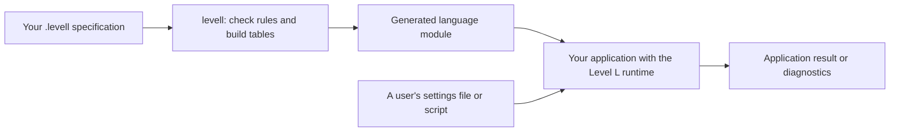
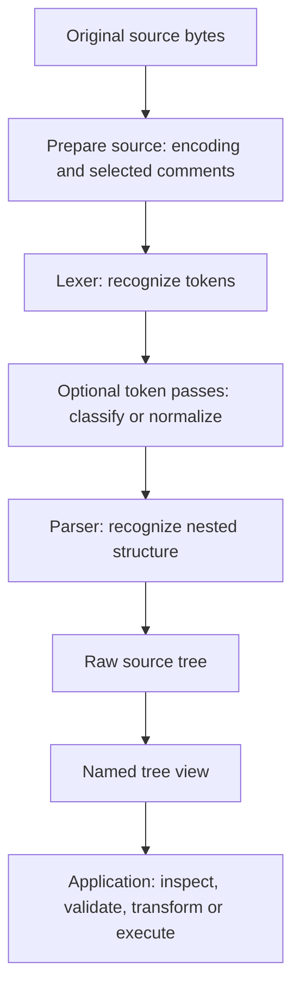

# Level L user guide

Level L turns a Rexx-style language specification into a reusable lexer and
parser for cREXX programs. Describe the tokens and grammar once, generate a
module, then use that module to tokenize text or produce a tree with original
source locations. Your application gives the tree meaning: evaluating a
script, reading configuration, compiling code or inspecting a source file.

This guide describes the **`levell` review implementation**, checked on
12 October 2026. Product routes connect DFA lexing to LR(1), LL(1), ordinary
packrat PEG, Earley forests and Pratt expressions, with a checked Pratt/LR
region provider. Named captures, authored messages, optional host budgets,
pinned Unicode properties and explicit record recovery have native functional
coverage. The complete common-surface programme remains in progress; see the
plan for the exact profiles and open obligations.
RexxScript 1 is a larger example, not a dependency of the general library.

**Next approved scope:** the initial supported toolkit will include DFA,
LL(1), canonical LR(1), ordinary packrat PEG, Pratt and Earley. LL(1) and Earley
are initial requirements, not deferred options. Shared surface, diagnostics,
resynchronization and composition work is tracked in
[the authoritative plan](../../../research/level-l/PLAN.md#approved-initial-backend-set-and-common-surface-checkpoint--11-october).
The [surface/Unicode/composition discussion](../../../research/level-l/SURFACE.md#common-surface-unicode-and-composition-review--11-october)
contains proposed new spellings; the runnable reference below remains the
current implemented subset. Selection of a backend does not establish that
all its proposed features are already delivered.
The surface must remain simple to learn: a small grammar gets useful default
trees and diagnostics, with easy bespoke messages and optional advanced
Unicode, recovery, backend and composition declarations. These usability
requirements are tracked as LANG-AC13–14 rather than left to later guide polish.

Start with the overview to understand the components and the shapes of their
inputs and outputs. Then build the worked example. The remaining sections are
the authoring and API reference. For the measured quality of diagnostics and
proposed improvements, read the [diagnostic assessment](diagnostics.md).
For the Level B foundation, L0/L1/L2 build and Unicode compatibility contract,
read [Building Level L from Level B](bootstrap.md).

## Contents

- [Overview: from a language description to a useful program](#overview-from-a-language-description-to-a-useful-program)
- [How RexxScript IF statements get their structure](#how-rexxscript-if-statements-get-their-structure)
- [How to divide a language problem into components](#how-to-divide-a-language-problem-into-components)
- [Choose a backend and understand competing paths](#choose-a-backend-and-understand-competing-paths)
- [Grow one settings grammar](#grow-one-settings-grammar)
- [Build and run a complete example](#build-and-run-a-complete-example)
- [Build an end-to-end calculator](#build-an-end-to-end-calculator)
- [Write the language specification](#write-the-language-specification)
- [Define lexical rules](#define-lexical-rules)
- [Define parser rules](#define-parser-rules)
- [Compose token stages](#compose-token-stages)
- [Use the generated language](#use-the-generated-language)
- [Read trees and retain source](#read-trees-and-retain-source)
- [Understand errors and recovery](#understand-errors-and-recovery)
- [Generate artifacts and integrate builds](#generate-artifacts-and-integrate-builds)
- [Limits, costs and ownership](#limits-costs-and-ownership)
- [Troubleshooting and further examples](#troubleshooting-and-further-examples)

## Overview: from a language description to a useful program

A language tool has two broad jobs: **recognize structure** and **do something
with that structure**. Level L supplies reusable machinery for the first job.
Your cREXX application supplies the meaning and any resulting actions.

For a settings file, recognizing structure means finding assignments and their
names and values. Using that structure might mean constructing a configuration
object and rejecting duplicate names. For a script, recognizing structure means
identifying expressions, IF branches and loop bodies. Using it means validating
the program and executing the selected operations. The same parsing machinery
can serve both applications.

### Generate the language once, then process many inputs

There are **two different source files** involved. You write a language
specification, such as `settings.levell`. A user supplies a document in that
language, such as `settings.txt`. They enter different parts of the system:



**At build time**, `levell` reads your specification, checks whether its rules
fit the selected backends, and constructs the lexer and parser tables. The
generated module packages those tables, rule/token names and declared token
stages. Its RXAS output describes this reusable language machinery; it does not
contain the executed meaning of a future user's script.

**At run time**, the application loads the generated language definition and
uses it on input documents. The grammar tables are not regenerated for each
document. A new parse request holds that document's source, tokens and result.
An interpreter can retain a parsed program and execute it repeatedly with fresh
application state.

The current lexer backend is a **DFA**, a table-driven state machine that
recognizes token patterns. The default parser backend is **canonical LR(1)**, which uses
a table and stack to recognize how tokens form nested grammatical structures.
The LR(1) table uses one token of lookahead. These algorithms implement the
rules; they do not decide the meaning of an assignment or an IF statement.

### The shape of a specification

A `.levell` file describes several connected things. The parser grammar is one
part of that file. Here is the layout using declarations from the tutorial;
the comments marked “more” stand for the omitted declarations:

```rexx
options levell
namespace levell_settings

/* Vocabulary: names for the kinds of token the parser will see. */
identifier: token = 1
number: token = 2
/* More token declarations. */

/* Optional source preparation. */
notes: comments nested '/*' '*/'

/* Spelling: how source bytes become those tokens. */
scan: lexer input utf8bytes
  digit: charset = U+0030 to U+0039
  number.rule: rule = digit+ then emit number
  /* More lexical rules, including whitespace policy. */

/* Structure: how tokens combine into a complete input. */
parse: parser semantics contextfree input tokens start settings
  settings: rule = separator settings | assignment tail | ''
  /* More parser rules. */

/* Optional tokenstage/transform declarations follow here. */
```

The complete, runnable specification appears in the tutorial below. The
declaration groups answer different questions:

| Part | Question it answers | Example |
|---|---|---|
| Tokens | What vocabulary does the parser receive? | `identifier`, `number`, `equals`. |
| Lexer rules | What spelling produces each token? | One or more digits produces a `number`. |
| Source preparation | What must happen before ordinary token recognition? | Validate UTF-8; mask explicitly selected nested comments. |
| Token stages, when needed | Does limited context change a token's role? | Treat `SAY` as a statement keyword but allow `say = 7`. |
| Parser rules | How do tokens form larger structures? | A name, equals sign and value form an assignment. |
| Application code | What does that structure mean? | Store a setting, evaluate an expression or emit another language. |

`rule` appears in both lexer and parser sections: the header and placement
determine which language it describes. Lexical rules match bytes; parser rules
here match token kinds. An expression rule referring to another parser rule
does not create another parser or a new pass over the file. The references
together form one grammar, compiled into one parser table.

The file's layout is therefore not a list of instructions executed from top
to bottom on every input. In particular, token-stage declarations can be
written after the parser rules even though their transforms run before parsing.
Declaration order does matter for lexer tie-breaking and first-match token
transforms, as explained in the reference sections.

### Follow one assignment through the system

Consider this complete input, with no final newline:

```text
retries = 3
```

The ordinary path is:



The settings language needs no token passes. Its lexer skips the two spaces
and emits:

| Token kind | Original text | Original byte span |
|---|---|---|
| `identifier` | `retries` | `[0,7)` |
| `equals` | `=` | `[8,9)` |
| `number` | `3` | `[10,11)` |

These are **three tokens, not three evaluated values**. The numeric token still
refers to the source spelling `3`. The parser has not converted it to an
integer. Each span begins at its first byte and ends just after its last byte.
Skipped text remains in the owned source, so locations and original spelling
are preserved.

The parser uses these rules, among others:

```rexx
assignment: rule = name.value equals value
name.value: rule = identifier
value: rule = number | string
```

They establish that the first token is the assignment's name and the third is
its value. The `settings` start rule determines how assignments and separators
form a whole document. Successful parsing requires the whole token stream to
fit that start rule; matching a valid prefix is insufficient.

### The three tree shapes to distinguish

There are two supplied representations and one optional application design.
An **abstract syntax tree (AST)** is a tree shaped around the application's
constructs, such as assignments and calls, rather than all the grammar's
intermediate rules:

| Representation | Who provides it? | What it contains |
|---|---|---|
| Raw derivation tree, `.llcore..tree` | Parser runtime | Named rules and token matches plus internal nodes used to represent sequences, alternatives and repetition with at most two child links. |
| Named tree view, `.lltree..view` | Level L library, when the consumer requests it | The same selected structure with internal normalization wrappers flattened; authored rules and named terminals remain. A node can have many children. |
| Application AST or domain objects | Your application, if useful | A representation chosen for the job, such as an assignment with named `name` and `value` fields. |

For `retries = 3`, the **actual named tree** is:

```text
settings
├── assignment
│   ├── name.value
│   │   └── identifier       "retries"
│   ├── equals              "="
│   └── value
│       └── number          "3"
└── tail                    empty
```

The empty `tail` is present because the authored grammar gives that empty
suffix a name. Punctuation such as `equals` is also present because it is a
named terminal. By contrast, the raw tree's helper nodes used to join several
children are hidden in this view. Child order follows the grammar/source
order: `assignment` child 1 is its name wrapper, child 2 is `equals`, and child
3 is its value wrapper.

“Named view” does **not** mean that every single-child rule is removed or that
the library invents semantic field names. For example, RexxScript's many
expression-precedence rules remain visible even for a one-token expression.
The grammar's organization therefore affects the tree a consumer sees.

An application could turn the assignment above into the following conceptual
AST or configuration record:

```text
Assignment(name="retries", value=Integer(3), sourceSpan=[0,11))
```

That is a possible application result, not another automatically generated
Level L object. Such a pass would discard grammar scaffolding, convert the
number's text and retain source locations for later errors. The tutorial's
reader uses the named tree directly; it does not need this extra representation.
Optional `tree rule ... kind ... arity ...` declarations now configure an
explicit `request.projection()` pass. The initial projection keeps selected
rules with checked arities of zero, one or two and preserves their source
origins. It does not interpret values or replace the default named view.

### What a tree walk does

A tree walk visits nodes according to an application's purpose. It operates
on structure already recognized by the parser. It does not normally re-read
the token stream or decide again which ELSE belongs to an IF.

The tutorial walks the named tree, finds every `assignment` node and prints
the text of children 1 and 3. A configuration loader could instead build a
map and check duplicate names. A compiler could produce a smaller AST, resolve
names and emit code. These are different consumers of the same parsed shape.

**Walking does not necessarily create another tree.** An inspecting walk can
read nodes, a validating walk can accumulate errors, a transforming walk can
produce a new representation, and an interpreter can execute selected nodes.
A simple consumer may combine inspection and validation in one traversal.

For control flow, traversal order is part of the language's meaning. An IF
interpreter evaluates its condition and visits only the selected branch. It
must not perform effects by blindly walking both branches. A validator may
inspect both branches before execution; a compiler may emit code for both with
a conditional jump. The parser itself recognizes both branches regardless of
which one will run. Thus even an unchosen branch must be syntactically valid.

## How RexxScript IF statements get their structure

RexxScript illustrates three separate decisions: recognizing keyword tokens,
attaching ELSE to the correct IF, and choosing a branch during execution.
Keeping these responsibilities separate makes the grammar powerful without
requiring a sequence of reparsing passes.

### Keyword classification supplies the vocabulary

The raw lexer recognizes words such as `IF`, `THEN`, `ELSE` and `SAY` as
identifiers. The declared finite token stage changes appropriate words into
`ifword`, `thenword`, `elseword` and `sayword`. For example, a statement-start
guard preserves `say = 7` as an assignment, while `say 7` starts a SAY statement.
This stage knows a small finite context; it does not match arbitrarily nested
IF statements. The parser handles that nesting.

### Open and closed statements encode ELSE attachment

Here are the actual relevant rules:

```rexx
statement: rule = closed.statement | open.statement
closed.statement: rule = simple | block | if.closed
open.statement: rule = if.open | if.continued
if.closed: rule = ifword expression thenword closed.statement elseword closed.statement
if.open: rule = ifword expression thenword statement
if.continued: rule = ifword expression thenword closed.statement elseword open.statement
```

Here “open” and “closed” describe a **grammatical property**, not a runtime
state and not an open file or parenthesis:

- A **closed statement** has no exposed trailing IF available to take a
  following ELSE. A simple statement or an explicitly delimited `DO ... END`
  block is closed. An IF whose two branches are closed is also closed.
- An **open statement** has a trailing IF that can still take an ELSE. This
  includes an IF with no ELSE of its own (`if.open`), and an IF whose ELSE
  branch ends in another open IF (`if.continued`).

These are categories within **one LR parse**. Level L does not first parse
closed statements, then scan again for open ones. Each rule constrains what
tree the single parser can accept.

Consider:

```rexx
if a then if b then say "yes" else say "no"
```

The rule structure makes the ELSE belong to the inner IF. The important part
of the resulting tree is shown below; expression and statement wrappers are
omitted here for readability:

```text
if.open                         outer IF has no ELSE
├── condition: a
└── then: if.closed              inner IF has both branches
    ├── condition: b
    ├── then: say "yes"
    └── else: say "no"
```

Why cannot that ELSE belong to the outer IF instead? To use `if.closed` for
the outer IF, its THEN branch would have to be a `closed.statement`. But the
proposed THEN branch `if b then say "yes"` is open. It cannot satisfy that
requirement. Attaching the ELSE to the inner IF makes the inner statement
closed, so the outer `if.open` rule can contain it. The grammar expresses the
“nearest unmatched IF” policy structurally, without a later tree fixup.

The third rule, `if.continued`, matters for:

```rexx
if a then say "A" else if b then say "B"
```

The outer IF already has an ELSE, but its ELSE branch is an open IF. The whole
statement is consequently open at its right edge. Appending `else say "C"`
closes the inner IF. This is why “open” is more precise than simply “this node
has no ELSE”. An explicit `DO ... END` group closes a boundary and prevents
an IF inside that group from taking an ELSE outside the group.

This is a useful grammar-writing technique: give different rule names to
structures with different syntactic properties, and let recursive rules carry
those properties through nesting. Here the property is whether the right edge
can accept an ELSE. The parser stack handles the nesting; the finite keyword
stage does not have to remember every outstanding IF.

### Execution uses the tree the grammar has already chosen

The actual named `if.closed` node has six immediate children:

```text
1 ifword   2 expression   3 thenword
4 closed.statement       5 elseword   6 closed.statement
```

`if.open` has the first four positions, with `statement` at position 4.
`if.continued` has six positions, with `open.statement` at position 6.
This common arrangement lets RexxScript's interpreter handle all three forms
with one routine: evaluate child 2, execute child 4 when true, otherwise
execute child 6 if it exists. The interpreter does not search forward for an
ELSE or repair attachment after parsing.

The same separation applies to expression precedence. Rules such as
`expression`, `additive`, `multiplicative` and `primary` describe nested
structure within one grammar. The evaluator subsequently uses that structure
to calculate values. They are not separate parser passes.

### RexxScript does have real stages around that one parser

The complete implemented path is more involved than the settings example:

| Order | Component and owner | Input → output; reason for the step |
|---|---|---|
| 1 | Level L source preparation, selected by the grammar | Original bytes → validated/comment-masked scanning bytes; retain original source. |
| 2 | Generated DFA lexer | Scanning bytes → raw tokens, with identifiers still including keyword spellings. |
| 3 | RexxScript layout code | Raw tokens → normalized tokens; handle physical newlines, continuation and parenthesis context before keyword state changes. |
| 4 | Generated `classify` token stage | Normalized tokens → contextual keyword/control tokens. A continued line must not accidentally become a new statement start. |
| 5 | RexxScript concatenation code | Classified tokens → parser tokens with explicit synthetic blank/abuttal operators where required; preserve function-call adjacency. |
| 6 | Generated LR parser | Final tokens → raw derivation tree, including the selected IF/ELSE nesting. |
| 7 | Level L named view | Raw tree → accessible named children; no new parsing decision. |
| 8 | RexxScript validator and interpreter | Named tree → checks, then execution with fresh state. For example, reject `LEAVE` outside a loop before execution. |

Steps 3 and 5 are currently handwritten consumer code in
[RexxScriptProgram.crexx](../../../rexxscript/RexxScriptProgram.crexx).
Step 4 comes from declarations in
[rexxscript.levell](../../../rexxscript/grammar/rexxscript.levell).
Step 8 is in [RexxScriptExecution.crexx](../../../rexxscript/RexxScriptExecution.crexx).
This distinction matters: not every stage in this pipeline is generated from
the grammar today.

For a simple language, `request.parse()` runs source preparation, lexing,
declared token stages and parsing. RexxScript instead calls `lex(0)`, performs
layout work, calls `classify_tokens(...)`, performs concatenation work, and
calls `parse_tokens(...)`. The explicit calls insert its own work at the
required boundaries. The following named-view construction and application
walks are consumer choices, not additional operations hidden inside
`request.parse()`.

## How to divide a language problem into components

Start with the smallest path that expresses the language: lexer, one grammar
and a consumer of its named tree. Add stages to solve specific problems with
clear input/output contracts. A stage should say what it preserves, including
source locations, and why the next component receives the right language.

| Problem you need to solve | Put it here first |
|---|---|
| Recognize digits, identifiers, punctuation and strings | Lexer rules. |
| Handle nested comments | Explicit source-preparation counter, with an appropriate quote/layout policy. |
| Distinguish a word's role using finite local context | Declared token stage. |
| Normalize layout requiring parenthesis depth or richer state | Explicit consumer token pass; preserve spans and document its ordering. |
| Match nested blocks, operator precedence or IF/ELSE attachment | Parser rules. |
| Hide internal parser scaffolding | Standard named tree view. |
| Obtain a stable, compact domain model independent of grammar wrappers | An application AST projection, if the benefit justifies another representation. |
| Check names, types, duplicate declarations or control-flow legality | Application validation with source locations. Some checks require symbol tables or more than one walk. |
| Execute, transpile, compile or populate application objects | Application consumer, following the chosen semantics. |

For a new language, work in this order:

1. Write several accepted and rejected input examples, including the nesting
   or ambiguity you care about. Decide what useful result the application needs.
2. Define token spellings and inspect the resulting kinds and original spans.
   A parser cannot reliably compensate for incorrect token classification.
3. Write the grammar and inspect the actual named tree for those examples.
   Choose rule names deliberately; changing wrappers can change consumer paths.
4. Add contextual/layout passes only where needed, checking both their input
   and output streams. Keep grammar categories separate from actual passes.
5. Implement a visitor or AST conversion, then semantic checks and actions.
   Keep validation and execution policies explicit, especially for effects.
6. Exercise malformed input and report errors at the component that understands
   them. Strict parsing stops at the first error. Add explicit recovery only
   after choosing safe boundaries; stages alone do not provide recovery.

A lexer-only tool can stop at tokens. A source browser can stop at a named
tree. A configuration loader may walk that tree once. A compiler may need an
AST, name resolution, type checking and emission. Level L supplies common
representations so these different tools can share infrastructure without
requiring every application to use the same number of passes.

The common surface admits different algorithms under explicit contracts.
RexxScript currently uses one DFA and one LR parser; its extra stages above
do not imply several parser backends in that consumer. Automatic
composition, specialized regional parsers and generated richer tree passes
remain separately qualified research work. Begin with the working components
described here rather than assuming those experiments are already product APIs.

## Choose a backend and understand competing paths

Begin with the language's intended meaning, then choose a backend that can
implement it. **Use DFA plus the default LR(1) for an ordinary structured
language; use Pratt for a small operator-expression language or a checked
expression region.** LL(1) is a useful simpler choice when prediction is
straightforward. PEG is appropriate when priority is part of your intended
rules. Earley is useful when you need general CFG exploration or to inspect
ambiguity. This is a starting recommendation, not a speed ranking of unmeasured
workloads.

| Component | Good starting use | Important consequence |
|---|---|---|
| DFA lexer | Words, numbers, punctuation, regular strings, line comments, binary records | Longest match wins; authored priority breaks equal-length ties. It does not recognize arbitrary nested structure. |
| LL(1), `backend ll1` | Predictable commands, small configuration/format grammars | Choices must be predictable from one next token, including empty alternatives and following context. This implementation refuses left-corner cycles and overlapping predictions. Factoring may help. |
| Canonical LR(1), `backend lr1` (default) | Structured statements, left-recursive lists, expressions written as precedence rules | The parser combines its stack context with one lookahead token. A build conflict means this grammar is not admitted; it does not alone prove ambiguity. Tables can be large. |
| Ordinary packrat PEG, `semantics ordered backend packrat` | Languages whose alternatives deliberately have priority, useful lookahead/predicates | A locally successful choice commits. Left recursion and nonprogressing repetition are refused. Memoization consumes storage; unlimited lookahead does not mean arbitrary grammar acceptance. |
| Pratt, `backend pratt` | Calculator, operator DSL, bracketed expressions inside an outer LR language | Declare the implemented atom/group/prefix/infix profile. It is not a backend for arbitrary statement rules. Current prefix operators bind tighter than every infix operator. |
| Earley, `backend earley` | General CFG prototyping, grammars outside deterministic admission, investigating multiple parses | A unique finite parse can become a tree. Multiple/cyclic derivations remain an explicit forest result. This runtime has chart/forest/work safeguards; broader grammar acceptance does not imply cheap parsing. |

CFG alternatives describe possible derivations; PEG alternatives describe
prioritized recognition. That distinction is fundamental in
[Ford's PEG definition](https://pdos.csail.mit.edu/~baford/packrat/popl04/).
The separate distinction between a parser-class conflict and proven ambiguity
is also illustrated in the
[Bison counterexample documentation](https://www.gnu.org/software/bison/manual/html_node/Counterexamples.html).
The Level L examples below verify this implementation's actual admission and
results; other generators' defaults are not implicitly Level L policies.

### Small examples where the choice matters

These are complete [runnable grammars](../examples/backends/), with an
[inspection program](../examples/backends/inspect.crexx) that prints the
selected tree or reports the forest. Names such as `a` below are **token names**,
whose spellings are declared in each file.

| Example | Rules that matter | Observed lesson |
|---|---|---|
| [Predictable commands](../examples/backends/predictive.levell) | `command = readword identifier \| writeword identifier number` | LL/LR/Earley admit the CFG. Explicitly ordered PEG also accepts these tested commands because the first tokens are disjoint. `read port` and `write port 3` have one selected tree. |
| [Left-recursive list](../examples/backends/left-recursive-list.levell) | `list = list comma identifier \| identifier` | LR/Earley accept `a,b,c`. LL(1)/ordinary packrat refuse the left-corner cycle. An equivalent `identifier (comma identifier)*` may fit them, but changes the derivation-tree shape; check your consumer. |
| [Ordered prefix](../examples/backends/ordered-prefix.levell) | `root = fragment stop`; `fragment = a \| a b`, with `stop` spelling `c` | The CFG admits `ac` and `abc` in LR/Earley. LL(1) refuses the common prediction. Ordered PEG admits `ac` but rejects `abc`: `fragment` succeeded on `a` before the caller needed `c`. In this small example, explicitly changing priority to `a b \| a` admits both. |
| [Even palindrome](../examples/backends/palindrome.levell) | `palindrome = a palindrome a \| b palindrome b \| ''` | Earley accepts `abba` with a unique finite tree; this grammar is refused by the current LL/LR routes. This illustrates a general-CFG use beyond deliberately ambiguous input. |
| [Ambiguous arithmetic](../examples/backends/ambiguous-arithmetic.levell) | `expression = expression plus expression \| expression times expression \| number` | Earley accepts `2+3*4` but returns a forest: the grammar allows both `2+(3*4)` and `(2+3)*4`. LR refuses a conflict. LL/ordinary packrat refuse this recursive profile. |

The palindrome row describes admission of **this grammar**, rather than claiming
that every grammar for a similar language has been classified. The PEG prefix
repair is specific to these rules; “put the longest alternative first” is not
a general proof that CFG and PEG recognize the same language. The lexer has
already made its separate longest-match decision before these token rules run.

For arithmetic, the usual repair is to write precedence/association rules or
the operator declarations used by the calculator below. If your language
intentionally permits multiple interpretations, keep a forest and apply a
separately specified semantic selection rule. Do not select whichever tree is
first in storage. A semantic constraint may leave zero, one or several valid
interpretations; only one supports a consumer that requires a single tree.
A general declarative forest-selection service is still open work.

### Successful paths and failed paths are different facts

Several alternatives may share a prefix without producing several complete
parses. A complete successful tree means the entire input fits the start rule.
A failed alternative explored on the way is not an error in that input. For
CFG semantics, **two complete derivations of the same input** establish
ambiguity for that input; unrelated continuations or failed choices do not.
PEG suppresses grammar ambiguity through priority, but that does not establish
that the chosen interpretation is the language designer's intended one.

Earley request status **5** means accepted input without a unique finite tree.
Inspect `request.forest()` and `request.forestroot()` instead of executing a
tree visitor. In the inspection lesson:

```text
STATUS|5
DERIVATIONS_CAPPED_AT_2|2
FOREST_VALID|1
LL_FOREST: accepted input has no unique finite tree; inspect the forest and choose an explicit policy
```

The count is capped: 2 means **at least two**, not exactly two for every input.
`forest.derivations(root,cap)` returns -1 for a reachable derivation cycle and
-2 for traversal exhaustion; neither should be rendered as an ordinary finite
count. A cycle is also not a demonstrated successful infinite execution.

When the whole parse fails, many speculative paths may have failed too. There
is no universal “right failed path” to select. Level L reports the backend's
failure position/expectations and applies your rule message only when its
context is applicable. If several contexts compete, generic expectations are
more accurate than an invented construct name. PEG predicate/alternative
failures must remain speculative until they contribute to final failure.
Resource exhaustion is a separate outcome; it says neither “invalid language”
nor “ambiguous input”. The regression panels check that these distinctions
survive backend changes; identical repair choices or wording are not required.

To work out why a grammar fails: first check the diagnostic category, then its
named rules/lookahead and related locations, then minimize the grammar/input.
For a CFG conflict, trying Earley on the same rules can expose complete competing
derivations. Finding only one tree for a small corpus does not prove the grammar
unambiguous. Switching to ordered semantics solely to silence a conflict can
silently change what your language accepts.

Run the teaching regression panel from the repository root:

```sh
python3 lib/rxfnsl/tests_functional/check-teaching-examples.py \
  cmake-build-levell-product research/level-l/build/teaching-review
```

It builds isolated current imports, executes both VMs with optimized/unoptimized
consumers, and verifies admission refusals, full-input errors, forest results
and the calculator. Its retained review receipt records the exact qualification
scope; it is not an automatically selected backend or a new broad-suite gate.

## Grow one settings grammar

The numbered files in [examples/settings](../examples/settings) develop the
same language. They use the existing [settings reader](../examples/settings-reader.crexx);
no application callback is needed to customize a syntax error. Start with
[01-basic.levell](../examples/settings/01-basic.levell).

```rexx
identifier: token
number: token
equals: token
scan: lexer
  digit: charset = '0' to '9'
  number.lex: rule = digit+ then emit number
  /* The complete file also defines names, strings and separators. */
parse: parser start settings
  assignment: rule = name.value equals value
  name.value: rule = identifier
  value: rule = number | string
```

The short headers have fixed defaults: `lexer` means `input utf8 backend dfa`;
`parser start settings` means `semantics contextfree input tokens backend lr1`,
with complete-input recognition. Automatic token IDs follow declaration order;
explicit IDs remain available for interoperability. The default named tree
retains the rules you named and their ordered children. There is no mandatory
tree schema, operator table or pipeline declaration for this small language.

### Add your own wording

[02-messages.levell](../examples/settings/02-messages.levell) adds one declaration:

```rexx
value.error: diagnostic rule value =
  'Expected a number or quoted string; found {found}.'
```

For `workers = many`, the reader reports the filename, line 1, column 11,
original byte 10, a source excerpt and:

```text
value.error: Expected a number or quoted string; found 'many'.
```

For `workers =`, `{found}` becomes `end of input`. The other initial fields
are `{expected}` (the parser's expected token names) and `{rule}` (the rule
name). Use `{{` and `}}` for literal braces. Unknown or unclosed fields fail
generation. Substituted input is data: braces inside a lexeme are not expanded
again, and control characters are escaped.

A message changes wording, not recognition. It does not insert a token, commit
a PEG alternative, enable recovery or change a valid tree. A completed value
followed by an unexpected word is a separator error, so it must not receive the
value message. When the backend cannot identify one applicable authored
message, it retains the generic explanation instead of choosing by declaration
order. Captured-name and related-opener fields are still open work; unsupported
fields are rejected rather than fabricated.

### Admit Unicode names deliberately

[03-unicode.levell](../examples/settings/03-unicode.levell) changes only the
identifier character classes. Its [input](../examples/settings/unicode.settings)
includes `café`, a decomposed `cafe` plus U+0301, `温度`, `Δ`, and supplementary
U+10400. The lexer matches scalars; tokens and trees retain original byte spans.
The example's sets are deliberately explicit, not a Unicode XID definition.
The seventh lesson below supplies pinned property sets. Comparison keys remain
checkpoint work.

The two spellings of café remain different spellings. Neither the lexer nor
the parser silently normalizes or folds them. An application may use a declared
comparison policy later while retaining the original spelling for messages.
String contents already accept Unicode in the first lesson: extending names
does not require rewriting the string or parser rules.

### Select an algorithm only when needed

The same CFG settings rules can select `backend ll1` or `backend earley`.
LL(1) refuses a grammar whose choices cannot be predicted with one token;
Earley may return a forest with multiple derivations. A request returns status
5 if it accepts the input but has no unique finite tree; inspect `forest()`
and `forestroot()` instead of calling an ordinary tree visitor. It never picks
the first alternative silently.

An ordered grammar says `semantics ordered backend packrat` explicitly.
Changing CFG alternatives into ordered choice is a language-design decision,
even when this particular settings grammar recognizes the same inputs.
Ordinary packrat rejects left recursion and nonprogressing repetition at
generation. Finite work/depth limits are separate from syntax failure.

### Continue after a damaged setting

[04-recovery.levell](../examples/settings/04-recovery.levell) adds:

```rexx
read.errors: recovery rule settings sync separator
```

The declaration makes a recovery policy available; ordinary `request.parse()`
is still strict. The [recovery reader](../examples/settings-recover.crexx)
explicitly creates `.llrecover..request(definition,source)`. It reports a bad
record, skips through the next separator token and tries the remaining input.
It preserves the original bytes and exposes skipped error nodes separately.
A semicolon inside a quoted string is part of that string token, so it cannot
act as a separator.

For the [damaged input](../examples/settings/damaged.settings), `first = many`
and `second =` receive separate value messages. `third` and `fourth` remain
available for inspection. The request returns **1, recovered**, rather than 0.
The application must not execute or commit a recovered document. The existing
RexxScript path uses strict parsing and still refuses syntax errors.

This initial policy is deliberately bounded: whole records are skipped, with
a default limit of 16 errors; it does not search for globally optimal edits or
invent missing values. Resource exhaustion, an unsafe/missing contract and an
unrecoverable boundary have separate statuses. Strict parsing stops at malformed UTF-8. Explicit recovery retains bad byte
regions and skips their containing record; an unclosed target comment still
stops preparation. Token-stage recovery requires a
checked state-reset contract and is rejected at generation in this profile.
These are explicit limits of the delivered increment, not the full recovery
checkpoint's acceptance boundary.

The proper Level L readers also recover specification syntax at lexically
recognized `name:` declaration boundaries, collect up to 16 errors and retain
valid later declarations for inspection. Any error prevents artifact generation.
L0 remains the small first-error seed. The proper readers also retain later
declaration candidates after lexical quote/comment/UTF-8 damage, while the
original document stays failed. Complete cascading semantic-error suppression
remains open work.

### Put an expression parser inside the settings parser

[05-composite.levell](../examples/settings/05-composite.levell) retains the
previous rules and adds bracketed arithmetic values, such as
`workers = [2 + 3 * 4]`. The new declarations are:

```rexx
arithmetic: operators atom number group lparen rparen
sum: infix arithmetic plus precedence 10 left
product: infix arithmetic times precedence 20 left
negative: prefix arithmetic minus
math.region: region token expression using arithmetic
  open lbracket close rbracket
```

The full file declares those tokens and their spellings. `expression` is a
virtual token: the lexer must never emit it. The region provider owns `[` and
`]`, sends the interior tokens to Pratt, and sends one virtual expression token
to the outer LR parser. It then joins the two trees, retaining their original
source spans. Parentheses belong to the inner expression parser and are distinct
from the region delimiters.

The named tree beneath `value` has this structure:

```text
expression                 [2 + 3 * 4]
└── sum                    2 + 3 * 4
    ├── number             2
    └── product            3 * 4
        ├── number         3
        └── number         4
```

This describes precedence; it does not evaluate arithmetic. The visitor is
still responsible for meaning. Larger binding numbers bind more tightly;
this operator profile requires one associativity per level, and prefix
operators bind tighter than every infix operator. Unsupported mixed profiles
fail generation. A standalone expression language can use
`parser start arithmetic backend pratt` with the same operator declarations.
CFG engines can consume their explicit CFG lowering where admitted; ordinary
PEG does not silently reinterpret that lowering.

The initial regional provider uses an LR outer parser and one Pratt component.
Generation rejects overlapping delimiter ownership, a missing operator
component and a lexer that emits the reserved virtual token. An invalid inner
expression reports the unexpected input and relates it to the opening region;
a missing closer cannot
be mistaken for a successful partial expression. Recovery ignores separator
tokens inside the declared region and preserves the failure status.
Multiple/nested language components, richer operator forms and general named
pipelines remain open parts of the wider composition checkpoint.

### 6. Give useful children names

[06-fields.levell](../examples/settings/06-fields.levell) extends the same
assignment rule:

```rexx
assignment: rule = name.value as name equals value as contents
```

The optional `as` clause names a source-owning field. The
[field reader](../examples/settings-fields.crexx) uses:

```rexx
name = tree.field(assignment,'name')
contents = tree.field(assignment,'contents')
say tree.text(name) || ' -> ' || tree.text(contents)
```

The result is a node handle, with the same text/range methods as other nodes.
A missing field returns zero. `fieldcount(node,name)` and
`field(node,name,occurrence)` expose repeated fields in source order;
`(identifier as item)*` produces zero or more `item` fields. In contrast,
`identifier* as items` names one container around the complete repetition.
An absent optional capture has no occurrence; a capture of an explicitly
empty expression has a zero-length occurrence. Lookups stay within the named
node, so a nested rule's fields cannot accidentally satisfy its parent's
request. Field-name lookup is case-insensitive.

Raw and named trees retain an `@field.name` wrapper for each captured
occurrence. Thus adding captures changes the explicitly requested tree shape,
while leaving recognition unchanged. Parser-rule messages still refer to the
surrounding grammar rule. Lexical captures are rejected: tokens already carry
their spelling and original range. General application node/list shaping and
captured-name message placeholders remain work in progress.

### 7. Use pinned Unicode identifier classes

[07-properties.levell](../examples/settings/07-properties.levell) grows the same
field/expression grammar by replacing its illustrative character ranges:

```rexx
letter: charset = unicode.XID_Start | '_'
continuation: charset = unicode.XID_Continue | '_'
name.lex: rule = letter continuation* then emit identifier
```

Property references belong inside charset expressions. Use a named charset in
a lexical pattern, exactly as with explicit ranges. The parser rules, captures,
recovery declaration and Pratt region stay the same. The 12 October checks cover all 45 property sets and 12,523 lexer inputs
across both VMs, generated optimization modes and complete optimized/unoptimized
Level L builds. Exact table/spelling/span evidence is retained in the plan.

The data is pinned to Unicode **17.0.0**, compiled by Level B and checked against
raw-file checksums. `language.unicodeversion()` retains that version even when
source comments are stripped from bytecode. A host's locale or installed Unicode
library does not change recognition. `unicode.XID_Start` and
`unicode.XID_Continue` are building blocks: each language chooses its identifier
policy and additions such as underscore. Level L's own declaration names and
RexxScript's current identifiers retain their existing contracts.

The available sets are `XID_Start`, `XID_Continue`, `Alphabetic`, `Lowercase`,
`Uppercase`, `Default_Ignorable_Code_Point`, `White_Space`, `Pattern_White_Space`,
the thirty general categories (`unicode.gc.Lu`, `unicode.gc.Mn`, etc.), and seven
category groups (`unicode.gc.L`, `unicode.gc.N`, etc.). Names are case-insensitive.
An authored charset with the same name takes precedence over a builtin
property reference; no authored declaration is silently ignored.
All sets contain Unicode scalars: `unicode.gc.Cs` is known but empty because
surrogates are excluded. Unknown properties and use under `bytes` or `utf8bytes`
fail generation; there is no fallback to ASCII or to a host database.

Recognition preserves original spelling and byte spans. `café` and `cafe` plus
a combining acute accent can both be valid names while remaining different
spellings. Property selection does **not** request normalization or case folding.
Comparison keys remain separate LANG-AC03 work. Selecting Unicode whitespace
also does not add new statement terminators; the grammar still owns them.

## Build and run a complete example

The tutorial reads a small settings language:

```text
retries = 3
greeting = "café"
note = "say ""hello"""
```

Names contain ASCII letters, underscores and subsequent digits. Values are
unsigned integers or double-quoted strings; a doubled double quote represents
a quote inside a string. A newline or semicolon separates assignments. Blank
lines and a final separator are allowed. This is a deliberately small language,
not a JSON, TOML or complete Rexx implementation.

The three complete sources are
[settings.levell](../examples/settings.levell),
[settings-reader.crexx](../examples/settings-reader.crexx) and
[settings.txt](../examples/settings.txt). The reader prints each assignment's
original name and value text. It does not decode strings or evaluate values.

### Prepare the tools

Use this checkout's configured `cmake-build-levell-product` build. From the
repository root, the relevant targets are:

```sh
cmake --build cmake-build-levell-product --target levell_cli rexxscript1_cli --parallel 4
```

This assumes a working cREXX CMake build with its normal native compiler and
dependencies already configured. The retained review build is macOS ARM64
Debug. The commands below use its `bin/` tools and libraries together; do not
mix them with older installed imports. New-host setup follows the repository's
build instructions; this tutorial is not independent installation proof.

### Generate, assemble, compile and link

Run the following from the repository root in a POSIX shell. Stop if any command
fails. The generated namespace is `levell_settings`, so that is also the output
module's basename.

```sh
task_bin="$PWD/cmake-build-levell-product/bin"
task_work="$PWD/research/level-l/build/user-guide"
mkdir -p "$task_work"

cmake -DLEVEL_L="$task_bin/levell" \
  -DSPEC="$PWD/lib/rxfnsl/examples/settings.levell" \
  -DOUTPUT="$task_work/levell_settings.rxas" -DFORMAT=rxas \
  -P lib/rxfnsl/tools/generate.cmake

"$task_bin/rxas" "$task_work/levell_settings"
"$task_bin/rxc" -x --no-exe-import -i "$task_bin;$task_work" \
  -o "$task_work/settings-reader" lib/rxfnsl/examples/settings-reader.crexx
"$task_bin/rxas" "$task_work/settings-reader"
"$task_bin/rxlink" -o "$task_work/settings-reader-linked" \
  "$task_work/settings-reader.rxbin" "$task_work/levell_settings.rxbin" \
  "$task_bin/rxfnsl.rxbin" "$task_bin/library.rxbin"
"$task_bin/rxtvm" "$task_work/settings-reader-linked.rxbin" \
  -a lib/rxfnsl/examples/settings.txt
```

Expected output:

```text
retries -> 3
greeting -> "café"
note -> "say ""hello"""
```

The same linked image runs with `rxbvm`. Both VM runs, the toolchain commands
and deliberate failures are retained in the
[tutorial receipt](../../../research/level-l/evidence/bootstrap/user-guide/receipt.json).
The bounded [audit script](../../../research/level-l/cases/check-user-guide.py)
recreates the tutorial and diagnostic probes using the configured tools.

## Build an end-to-end calculator

The [calculator grammar](../examples/calculator/calculator.levell),
[Level B evaluator](../examples/calculator/calculator.crexx) and
[input](../examples/calculator/example.calc) form a complete small interpreter.
This is a second useful endpoint for the same Level L concepts, alongside the
progressive settings example and the larger RexxScript interpreter.

The language has decimal number spellings, `+ - * /`, prefix minus and
parentheses. Its `(* ... *)` comments can nest. Multiplication/division bind
tighter than addition/subtraction; infix operators associate left; prefix
minus binds tightest under the current operator profile. The grammar chooses
Pratt explicitly:

```rexx
parse: parser start arithmetic backend pratt
arithmetic: operators atom number group lparen rparen
sum: infix arithmetic plus precedence 10 left
difference: infix arithmetic minus precedence 10 left
product: infix arithmetic times precedence 20 left
quotient: infix arithmetic divide precedence 20 left
negative: prefix arithmetic minus
```

For `2+3*4`, the named tree is:

```text
arithmetic
└── sum
    ├── number    "2"
    └── product
        ├── number    "3"
        └── number    "4"
```

The parser creates this structure; the evaluator computes 14. It walks children
before their parent, stores decimal values by node handle, and handles `sum`,
`difference`, `product`, `quotient`, `negative` and `group`. The start-rule wrapper
`arithmetic` passes its child's value through. There is no second expression
parser hidden in the evaluator. The decimal conversion/arithmetic policy is
this application's choice, subject to the cREXX runtime's decimal limits;
Level L itself neither evaluates literals nor promises arbitrary precision.

Run these commands from the repository root after preparing the tools as above:

```sh
task_bin="$PWD/cmake-build-levell-product/bin"
task_work="$PWD/research/level-l/build/calculator"
mkdir -p "$task_work/imports"
cmake -DLEVEL_L="$task_bin/levell" \
  -DSPEC="$PWD/lib/rxfnsl/examples/calculator/calculator.levell" \
  -DOUTPUT="$task_work/levell_calculator.rxas" -DFORMAT=rxas \
  -P lib/rxfnsl/tools/generate.cmake
"$task_bin/rxas" "$task_work/levell_calculator"
cp "$task_bin/library.rxbin" "$task_bin/rxfnsl.rxbin" \
  "$task_work/levell_calculator.rxbin" "$task_work/imports/"
"$task_bin/rxc" -x --no-exe-import -i "$task_work/imports" \
  -o "$task_work/calculator" lib/rxfnsl/examples/calculator/calculator.crexx
"$task_bin/rxas" "$task_work/calculator"
"$task_bin/rxlink" -s -o "$task_work/calculator-linked" \
  "$task_work/calculator.rxbin" "$task_work/levell_calculator.rxbin" \
  "$task_bin/rxfnsl.rxbin" "$task_bin/library.rxbin"
"$task_bin/rxtvm" "$task_work/calculator-linked.rxbin" \
  -a lib/rxfnsl/examples/calculator/example.calc
```

The documented input `2 + 3 * (4 - 1)` prints `RESULT|11`. Run the same image
with `rxbvm`. The private import directory prevents old linked examples from
supplying obsolete prototypes. Generation must succeed before assembly; the
CMake wrapper preserves a previous artifact if generation fails.

The whole file is parsed before evaluation. `2+*3` reports `CALC_PARSE` at byte
2 with the unexpected `*`; `7/(3-3)` reports `CALC_DIVIDE_BY_ZERO` at the
denominator's original byte 2. Neither prints `RESULT`. `7/0 +` reports the
syntax error before any attempted division. Parser resource/contract statuses
are returned unchanged; decimal conversion/arithmetic failures use `CALC_VALUE`.
This calculator requires a clean tree and does not execute recovered input.
The teaching panel checks all these paths, precedence/association, exact
`0.1+0.2=0.3` in this decimal evaluator, comment nesting/Unicode/newlines and
both emission formats. This decimal example is distinct from RexxScript's
Level G rule that unsuffixed fractional literals use binary floats.

## Write the language specification

The complete tutorial specification is:

```rexx
options levell
namespace levell_settings
identifier: token = 1
number: token = 2
string: token = 3
equals: token = 4
separator: token = 5
notes: comments nested '/*' '*/'
scan: lexer input utf8bytes
  letter: charset = U+0041 to U+005A | U+0061 to U+007A | U+005F
  digit: charset = U+0030 to U+0039
  space: charset = U+0020 | U+0009
  cr: charset = U+000D
  lf: charset = U+000A
  body: charset = U+0020 to U+0021 | U+0023 to U+00FF
  identifier.rule: rule = letter (letter | digit)* then emit identifier
  number.rule: rule = digit+ then emit number
  string.rule: rule = '"' (body | '""')* '"' then emit string
  equals.rule: rule = '=' then emit equals
  separator.rule: rule = cr lf | cr | lf | ';' then emit separator
  whitespace: rule = space+ then skip
parse: parser semantics contextfree input tokens start settings
  settings: rule = separator settings | assignment tail | ''
  tail: rule = separator settings | ''
  assignment: rule = name.value equals value
  name.value: rule = identifier
  value: rule = number | string
```

Each declaration has the form `name: kind ...`. Indentation makes the file
readable; it does not create a scope. Names are global within the specification.
Put tokens first, lexical declarations between the lexer and parser headers,
parser rules after the parser header, and optional token stages last. Use one
lexer and optionally one parser. A lexer-only specification produces a
definition usable through `request.lex()`; `request.parse()` rejects it with
`LL_NO_PARSER`. Forward rule references are supported.

Authored names and keywords are ASCII and case-insensitive. Names begin with a
letter or underscore and may contain digits and internal dots. A trailing dot
or two consecutive dots is invalid. Use meaningful names such as
`assignment`, `call.arguments` and `expression.sum`: names appear in trees and
some error messages. Use consistent spelling when looking up names in runtime
APIs; do not assume every runtime string lookup folds case.

Single or double quotes delimit UTF-8 literals. Double the chosen quote to put
it inside the literal. Backslash escapes such as `\n` are not interpreted;
write a charset containing `U+000A` for a newline. Nested `/* ... */`
comments are allowed in the specification itself. Whitespace separates authored
tokens; the next `name:` begins a declaration. Do not add Rexx statement
semicolons to the specification.

Named `diagnostic` declarations supply messages for special `malformed` and
`otherwise` lexer actions; `diagnostic rule name` attaches a parser message as
shown in the growing example. `eof then emit` records EOF metadata;
its token must have ID 0. The common token stream itself does not contain an EOF
record; a lexer ABI adapter may append a zero-length record when required.
`tree rule ... kind ... arity ...` declarations configure a separate
`request.projection()` pass. Call its `run()` and check its status before
using the returned tree; arity mismatches are errors, never truncated children.
The default named view remains useful without any tree declarations.

## Define lexical rules

The lexer maps source bytes to named tokens. IDs range from 1 to 255. Use
`name: token` for automatic allocation, or `name: token = 7` for an explicit ID.
The parser supplies end of input internally. An optional `eof: token = 0`
declaration with an EOF lexical action is metadata for lexer ABI adapters;
do not append it to a parser token stream. Token names, rather than their numbers, should appear in your parser
rules and application code.

| Declaration | Purpose |
|---|---|
| `digit: charset = U+0030 to U+0039` | A scalar or byte set, according to the input profile; combine ranges or single values with `\|`. A one-scalar quoted literal is accepted. |
| `digits: pattern = digit+` | Reusable regular expression that does not emit a token by itself. |
| `integer: rule = digits then emit number` | Match and emit the named token. |
| `whitespace: rule = space+ then skip` | Match without emitting a parser token. Original source remains available. |

Expressions support references, literals, grouping, sequence, choice and
postfix repetition:

| Form | Meaning |
|---|---|
| `'abc'` | These exact three bytes. |
| `a b` | Sequence. |
| `a \| b` | Either alternative. |
| `(a b)` | Grouping. |
| `a?`, `a*`, `a+` | Optional, zero or more, one or more. |
| `a{n}`, `a{n,}`, `a{n,m}` | Exact, at least, or bounded repetition; finite counts are limited to 256. |
| `''` | Empty expression; useful in parser rules, invalid as an entire token match. |

Postfix operators bind more tightly than sequence; sequence binds more tightly
than choice. The lexer chooses the **longest match**, then the **earliest
declared emitting/skipping rule** when lengths tie. A keyword rule before an
identifier rule wins an equal-length match; `ifname` still matches the longer
identifier. Literal matching is case-sensitive. For case-insensitive keywords,
use a declared token stage or explicit character alternatives.

Every emitting or skipping rule must consume at least one byte. A nullable
rule fails admission with `LL_NULLABLE_TOKEN`. Lexical definitions must be
acyclic. Recursive lexical references fail with `LL_LEX_RECURSION`, even when
a particular recursive formulation could describe a regular language. Rewrite
it with repetition where equivalent; use an explicit separate stage for
nonregular structure such as nested comments.

### UTF-8 and binary input

Choose the lexical units explicitly:

| Profile | Rule meaning |
|---|---|
| `input utf8` | Unicode scalars, lowered to canonical UTF-8 byte sequences. U+00E9 matches `é`. |
| `input utf8bytes` | Validate UTF-8, then match byte rules in 0..255. U+00E9 is byte E9. This preserves the earlier PoC behavior. |
| `input bytes` | Raw byte rules without UTF-8 validation. |

Scalar charsets support ranges, union, references, grouping and subtraction:

```rexx
scan: lexer input utf8
  line.character: charset = scalar except (U+0000 | U+000A | U+000D)
  comment: rule = '#' line.character* then skip
```

`scalar` excludes surrogates. Positions remain zero-based byte offsets even
when rules match scalars. NUL is data; only the explicit buffer boundary is EOF.
Quoted literals may contain Unicode. Pinned property charsets such as
`unicode.XID_Start` are available as shown in lesson 7; identifier recognition
still needs an authored rule and does not automatically normalize/fold names.

The tutorial and RexxScript retain their earlier byte patterns under the
explicit `utf8bytes` compatibility profile. Binary formats should keep slices
as `.binary` rather than converting arbitrary bytes to strings.

### Comments and layout

`notes: comments nested '/*' '*/'` selects a counter stage before the DFA.
It masks each comment byte with a space and retains the original source.
Declare whitespace handling in the lexer. The built-in shielding recognizes
single/double-quoted strings with doubled quotes; it is not configurable for
every target language's quoting convention.

**Newlines inside comments are masked too.** They do not become separator
tokens. Thus `a=1 /* comment */` followed by an external newline works, but
putting the only newline inside the comment does not separate `a=1` from
`b=2`. Languages that count comment-contained newlines as statement boundaries
need a deliberate layout stage. Neither layout nor indentation is inferred.
An unclosed nested comment is reported at its opening delimiter.

The delimiters are not fixed to Rexx spelling. The calculator uses
`notes: comments nested '(*' '*)'`; the same stage supports other nonempty,
distinct pairs. Only **one nested pair** is stored in the current language
definition. The current frontend does not yet reject every duplicate comment
declaration, so declaring several pairs must not be used as a supported way to
combine styles.

Line comments can already be ordinary regular lexer rules, for example:

```rexx
line.character: charset = scalar except (U+000A | U+000D)
hash.notes: rule = '#' line.character* then skip
slash.notes: rule = '//' line.character* then skip
```

The complete [line-comment example](../examples/backends/line-comments.levell)
combines both forms with quoted strings. Its tests cover CRLF/EOF, markers
inside strings, doubled quotes, Unicode comments and a later lexical error on
all four grammar engines. It deliberately has no pre-DFA nested-comment stage.

The original CR/LF remains for the lexer to classify. Each rule progresses
because its marker is nonempty, and matches to EOF when no newline follows.
String tokens shield their own contents only when their lexical match/priority
wins; no global “everything after #” substitution is implied. Nonnested block
comments are regular too, but their pattern must exclude the **first complete
closing delimiter**, not merely its individual characters. Character classes
are sets of scalars/bytes, not sets of strings.

There is an important current composition limit: the nested-comment preparation
stage runs **before** line-comment DFA rules. A block marker inside a line
comment may therefore be interpreted by preparation. Likewise the built-in
quote shielding does not adopt arbitrary target-language escapes. For coherent
multiple styles and configurable shielding/newline preservation, the
[generalized-comment proposal](../../../research/level-l/SURFACE.md#generalized-comments-proposal--12-october-2026)
extends the same `comments` family with `line`, `block` and `nested`. It is for
review, not accepted executable syntax. Use only the documented current profile
until that shared coordinator is implemented.

## Define parser rules

`parser semantics contextfree input tokens start settings` requests a CFG over
the declared token kinds. A successful parse consumes the complete stream.
`a | b` means CFG alternatives, not “try a first and commit”. Reordering
alternatives is not a conflict-resolution policy.

Use **named tokens**, for example `equals`, in a token grammar. A nonempty
quoted spelling such as `'='` is rejected with instructions to declare/emit
the token and use its name. It is never reinterpreted as a numeric token ID.
The empty quoted literal `''` writes an empty production.

Left recursion is supported when the resulting grammar is admitted as LR(1).
Express precedence and associativity in the rule structure. For example, with
the corresponding tokens already declared:

```rexx
sum: rule = sum plus product | product
product: rule = product times atom | atom
atom: rule = number | leftparen sum rightparen
```

This makes multiplication tighter than addition and gives the recursive
operators a left-associated tree. Alternatively, use the operator declarations shown in the growing example.
There are no embedded semantic actions; the separate tree visitor implements meaning.
Do not repeat a nullable expression: constructions such as an optional rule
inside `*` can introduce nonprogress or ambiguity.

The generator constructs canonical LR(1) tables and rejects conflicts. An
`LL_LR_CONFLICT` identifies the lookahead token and competing operations/rules.
Check whether you intended different precedence, genuinely different
alternatives or a factored common structure. **A conflict alone is not proof
that the language is ambiguous.** An unambiguous grammar can still fall outside
this deterministic backend's supported class.

There is no automatic fallback to PEG, Pika, Squirrel or Earley. Choosing an
ordered interpretation can change the accepted language. The research engines
and broader common analysis are documented in the
[research programme](../../../research/level-l/README.md), separately from this
product command.

## Compose token stages

A finite token stage can classify keywords, merge a bounded pair of tokens,
skip a token or copy it. It runs after lexing and before parsing. Stages cannot
inspect an unbounded parse stack or replace arbitrary semantic analysis.

This fragment, adapted from the working
[RexxScript grammar](../../../rexxscript/grammar/rexxscript.levell), assumes
tokens `identifier`, `equals`, `separator` and `kw.say` have been declared:

```rexx
keywords: tokenstage start 1
say.keyword: transform stage keywords state 1 take identifier text "SAY" unless next equals emit kw.say next 2
after.separator: transform stage keywords state 0 take separator emit copy next 1
ordinary.word: transform stage keywords state 1 take identifier emit copy next 2
```

State 1 here means “at a statement start”; state 2 means “inside a statement”.
State 0 in a rule matches any current state. The first matching declaration
wins. The ASCII `text` guard compares the first token's original text without
case distinction. `unless next equals` lets `say = 3` remain an assignment.
Unmatched input copies through without a state change.

`take` accepts one or two named token kinds; `any` is a wildcard there. An
`emit TOKEN` replacement spans all consumed tokens. `emit copy` keeps the
first token's kind, with the consumed span; `emit skip` emits nothing. `next`
sets a positive integer state. A stage has 128 declarations by default (`stage.rules`). Stages run in their
declaration order and preserve source coordinates. They do not create an
unbounded fixed-point transformation.

RexxScript also has an explicit application layout/concatenation pass between
raw lexing and keyword classification. Its presence is not evidence that Level
L automatically derives such passes. Each composition needs a clear input,
output, termination and language-preservation contract.

## Use the generated language

Import the generated namespace and the Level L API modules. The generated
`levell_settings..language()` procedure returns an owned
`.lllanguage..definition`. Construct a fresh request for each source:

```rexx
definition = levell_settings..language()
request = .lllanguage..request(definition,source)
status = request.parse()
if status <> 0 then do
  say llsource..diagnostic(source,request.offset(),'SETTINGS_PARSE',request.error())
  return status
end
tree = .lltree..view(request.tree(),request.root())
```

`source` is `.binary`. The complete reader checks `tree.error()` as well.
Keep application validation and effects after successful parsing. Grammar
acceptance says nothing about duplicate setting names, valid ranges, types,
variable existence or whether a requested operation is permitted.

### Request operations

| Operation | Contract |
|---|---|
| `parse()` | Validate source, mask selected comments, lex, apply declared token stages, then parse. |
| `lex()` | Validate/prepare and lex, including declared token stages; no parser run. |
| `lex(0)` | Return raw lexer tokens, without declared token stages. |
| `classify_tokens(tokens)` | Apply declared stages to this supplied stream; requires the same original source bytes and a valid stream. |
| `parse_tokens(tokens)` | Parse a supplied token stream against the generated table. Does not lex, validate UTF-8 or apply token stages for you. |
| `tokens()` | Owned token stream from the most recent operation. |
| `tree()`, `root()` | Owned raw tree and selected root; consume as a successful result only after status 0. |
| `offset()`, `error()` | Failure location and message; the location is a zero-based original byte offset. |

Treat requests as single-use pipeline objects. In particular, lexing is cached:
calling `lex()` after `lex(0)` does not retroactively classify the stream.
Use `classify_tokens()` explicitly when implementing that pipeline, then call
`parse_tokens(request.tokens())`.

| Runtime status | Meaning and caller action |
|---|---|
| 0 | Success; continue to tree/application validation. |
| 1 | Invalid input; report the error and stop this request. |
| 2 | Resource/work limit; report the limit distinctly from syntax rejection. |
| 3 | Contract or configuration failure; inspect the stream, artifact and API usage. |

These are runtime request codes. Generator exit codes and lower-level research
engine status enums are not the same interface.

### Lexer-only applications

Use `request.lex(0)` to inspect raw lexer tokens, or `request.lex()` to include
classification. For token index `i`, from zero to `tokens.size()-1`, retrieve:

```rexx
kind = tokens.symbol(i)
first = tokens.start(i)
last = tokens.finish(i + 1)
text = binsubstr(source,first + 1,last - first)
```

`finish(i + 1)` is intentional: the stream's `finish` takes the boundary after
a token count. `start` takes a token index. Spans are half-open `[first,last)`
in bytes; cREXX `binsubstr` is one-based. `definition.tokenname(kind)` gives
the declared token name. Skipped whitespace/comments remain in the source but
are absent from the stream.

The library and CLI support lexer-only specifications: omit the parser header
and parser rules. The emitted definition reports `hasparser() = 0`; call `lex()`
to obtain tokens. Calling `parse()` on that definition returns `LL_NO_PARSER`.
The TinyExpr and gennorm2 specifications under `lib/rxfnsl/grammar` are complete
examples. No special artifact switch is needed.

### Existing token producers

Use `.llcore..stream.tokens(source)` to own the original bytes, then append
tokens with `append(kind,start,finish)`. Check each append's Boolean return and
the stream's `error()`. Normal tokens have ordered, nonoverlapping, nonempty
spans; gaps are allowed. Use the generated definition's `tokenid(name)` rather
than duplicating token numbers. A missing token name returns -1.

Pass the completed stream to `request.parse_tokens(tokens)`. The request checks
that its source bytes match the stream's; the parser checks stream validity.
If your producer needs generated classification, call `classify_tokens(tokens)`
first and parse the resulting `request.tokens()`. Source decoding and any
external lexical policy remain your producer's responsibility.

## Read trees and retain source

The raw `.llcore..tree` is a source-owned binary derivation tree with rule and
terminal labels. It contains normalization structure useful to the runtime.
For most consumers, `.lltree..view(raw,root)` exposes an easier named tree with
any number of children, hiding normalization wrappers while retaining named
rules and named terminals.

| View method | Result |
|---|---|
| `error()` | Empty on successful projection; otherwise report and stop. |
| `root()` | Selected node identifier. |
| `name(node)` | Rule or terminal label. |
| `count(node)` | Number of immediate named children. |
| `child(node,index)` | Child at one-based index; zero for an out-of-range index. |
| `start(node)`, `finish(node)` | Original half-open byte span. |
| `text(node)` | Original span converted to a string; use only with suitable text encoding. |
| `source()` | Complete owned original bytes, including skipped trivia. |

Node IDs belong to that tree/view; do not reuse them with another parse. A rule
name is retained even when it wraps a single child. In the tutorial an
`assignment` has three children: `name.value`, `equals`, `value`. The reader
walks node IDs in source order and prints children 1 and 3. Quoted value text
therefore still includes its original delimiters and doubled quotes.

The tree is not automatically an application AST. Build your own values or AST
after checking the syntax, preserving source spans for later semantic errors.
Use `source()` for exact whole-file reproduction: a root span need not include
leading or trailing skipped trivia. Ordinary source-tree mutation invalidates
previous structural validation; the low-level API has `validate()` and revision
tracking. The tutorial does not require mutation.

Ownership is explicit. Definitions, requests and returned trees are values;
public returns may copy them. An iterative visitor over node IDs, as in the
example, avoids passing the complete view by value on every recursive call.
Do not assume a weak reference or arbitrary long-lived borrow is safe merely
because internal table lookup uses a scoped borrow.

## Understand errors and recovery

There are two independent audiences:

| Audience | Current reporting | Current resynchronization |
|---|---|---|
| Grammar author running `levell` | Located syntax errors, or a named semantic/backend admission failure. | Proper readers collect syntax errors at recognized declaration boundaries and retain later declaration names. Invalid builds produce no usable artifact; lexical and semantic recovery remains limited. |
| Application user providing target text | Strict requests stop at the first failed stage; rule messages can customize parser explanations. | Explicit `llrecover.request` skips damaged records at the declared token boundary and retains later structure with nonzero status. See the growing example for limits. |

For example, the tutorial reports:

```text
SETTINGS_PARSE at line 1, column 8 (byte 7): unexpected input at byte 7; expected number, string
  first =
         ^
```

The complete reader prefixes the input filename. An unterminated string
currently produces a less helpful `LL_LEXICAL: unmatched byte at offset 8`
at the opening quote. An unclosed nested comment has a specific message.

`llsource..diagnostic(source,offset,code,message)` formats original text with
one-based line/column and a zero-based byte offset. It handles CRLF, CR and LF
target-source lines and uses a hexadecimal excerpt for malformed UTF-8. Columns
count Unicode scalars. The default escaped excerpt renders tabs, controls and
non-ASCII characters as ASCII escapes, placing its caret by rendered length.
The optional fifth argument `'unicode'` keeps Unicode glyphs; font-dependent
cells and grapheme clusters are not that view's scalar-column contract.

The generated grammar frontend handles LF, CRLF and CR consistently. Syntax
errors use the source formatter's caret treatment. Semantic errors such as
undefined names still report line/byte coordinates without a caret, and
filename reporting is not yet consistent across all diagnostic paths.

LR expectations are checked against a copy of the actual state stack,
including reductions before a possible shift. They describe admissible next
tokens, not a promise that every following suffix will parse. LL(1), PEG and
Earley provide their own named expectations; an ambiguous diagnostic context
keeps generic wording. Whole-source preparation and lexing precede strict
parsing. The recovery request can collect lexical and syntax damage, but its
profile can retain malformed UTF-8 as located damage and skip its record. An
unclosed target comment remains unrecoverable under this profile.

**Resynchronization means continuing after a damaged region to find later
errors or useful structure.** The generated recovery policy enables a separate
request; it does not change strict parsing or turn a damaged result into
success. Never execute a partial or repaired script merely because some
subtrees exist. RexxScript 1 rejects syntax damage before execution. The current
record-skipping policy is bounded and explicit, not a minimum-edit repair
search or a general solution to nested-language recovery.

## Generate artifacts and integrate builds

The standalone command is:

```text
levell specification.levell [--rxas|--graph] [--limit name=count]
levell --limits
```

| Mode | Output |
|---|---|
| `--rxas` | Packed DFA/LR constants and a small assembly loader exporting `namespace..language()`. Recommended product route. |
| No switch | Level B-compatible cREXX source implementing the same generated definition. Useful for inspection and comparison. |
| `--graph` | Frontend parser-graph dump for analysis. It does not establish DFA or LR admission. |

`rxas` assembles RXAS; `rxlink` links the generated module, consumer, `rxfnsl`
and ordinary runtime library. Level L does not write RXBIN directly. Changing
your specification requires regenerating and relinking its consumer; it does
not require modifying the Level L library.

The CLI exits 0 on success, 1 on specification/admission failure, and 2 on
usage/I/O failure. It currently writes both generated output and its principal
error messages to stdout. Check status before treating captured bytes as an
artifact. A failed command may have emitted explanatory comment lines followed
by an error.

Use [generate.cmake](../tools/generate.cmake), as in the tutorial, to write a
temporary file and rename only on success. Direct `> existing.rxas` truncates
the old file before generation succeeds. The wrapper's `FORMAT=crexx` selects
source emission; compile that output with `rxc`, then assemble and link normally.

For a CMake custom command, declare the specification, generator executable,
owning runtime inputs and wrapper as dependencies. Assemble the resulting
RXAS in a following dependent step. A native executable that embeds bytecode
also needs the runtime image files as dependencies: a target-order dependency
alone does not force relinking when an embedded library changes. The existing
[RexxScript integration](../../../rexxscript/modern.cmake) is the larger
working example.

## Limits, costs and ownership

These are the current defaults, including the 12 October policy increment, not mathematical limits
of all languages:

| Resource | Bound |
|---|---|
| Prepared source, including specification ingress | 1,048,576 bytes |
| Authored scanner tokens / expression nesting | 8,192 / 128 |
| Common grammar graph | 512 clauses per graph |
| Generated NFA / DFA | 65,536 / 4,096 states by default |
| Productions / canonical LR states | 4,096 / 8,192 by default |
| LR items per state / production RHS | 16,384 / 2,048 symbols |
| Finite token stage | 128 declarations by default; positive integer states |
| Scanner / parser default work fuel | 10,000,000 / 1,000,000 |
| Token-stage work / named-tree projection | 1,000,000 each |

### Why these limits exist

The numerical ceilings above are **current implementation policy**, not
mathematical limits of the selected algorithms. Most were introduced as bounded
research safeguards; their exact default values have not yet been justified
by a workload/memory calibration. In particular, 4,096 LR states is neither an
LR(1) theorem nor an inherent 12-bit field in the packed image.

| Limit family | Actual reason | What exceeding it means |
|---|---|---|
| 512 clauses / 4,096 productions | Bound shared analysis and lowering. The current reachability pass has quadratic storage and cubic worst-case loop structure. | Analysis/construction exhaustion; not an invalid language. |
| Default 8,192 LR states / 16,384 items per state | Bound canonical construction's potentially large state/item sets. State count alone is not a byte-memory budget. | No admission result within this build budget; not proof of ambiguity or non-LR(1). |
| 65,536 NFA / 4,096 generated DFA states | Bound regular-expression expansion and subset construction. Determinization can expand substantially. | Lexer construction exhaustion; not proof of nonregularity. |
| 1 MiB source / work fuel / tree-map entries / error count | Bound request size, counted operations, result expansion and repeated attempts. | An explicit resource outcome; not a clean or repaired parse. |
| 128/512 recursive depth | Protect the current recursive implementation. This is not a grammar nesting theorem. | Stack-oriented implementation budget; raising it needs a stack assessment or an iterative executor. |
| Token IDs through 255, with 256 used internally for EOF | Fixed terminal-alphabet conventions in shared analysis, token passes and table lookup. Unicode scalars are lowered to byte sequences before DFA matching. | A representation change is needed to support more token kinds; this does not limit source text to Latin-1. |
| Token stages: one/two-token consumption | The current provider's finite-pass profile; state names are positive integers and rule count is host policy. | A profile refusal for wider lookahead; raising `stage.rules` allows more rules. |
| LL conflicts / unsupported PEG left recursion / unsafe region boundaries | Recognition semantics and the implemented provider's admission obligations. | More memory or fuel does not fix the conflict or justify a semantic conversion. |

The optional `lllimits..policy` supplies build/request safeguards. Basic grammars
have no budget declarations. Run `levell --limits` to list every supported
setting, its default and its representation ceiling. Unknown or malformed
settings fail immediately; accepted settings are connected to actual checks.
The first six settings have retained optimized/unoptimized functional coverage;
the expanded construction/recovery panels cover the 12 October implementation.
An advanced build can use `levell file.levell --rxas --limit lr.states=12000`.
The setting limits work on that host; it is not embedded as a semantic property
of the generated language. A larger successful budget produces the same artifact.

| Host setting | Default | Applies to |
|---|---|---|
| `lr.states` | 8,192 | Canonical states constructed while building LR tables. |
| `source.bytes` | 1,048,576 | Original bytes accepted by source preparation, including specifications. The caller or CLI has already read the source. |
| `scan.work` | 10,000,000 | Counted DFA transitions for one scan. |
| `parse.work` | 1,000,000 | Counted operations for one parser or token pass, including its diagnostic work. A regional parser shares this allowance with its inner and outer parsers. |
| `earley.cells` | 8,000,000 | Earley's dense chart and forest index domains. These are index capacities, not a byte-memory allowance. |
| `tree.entries` | 1,000,000 | The application projection returned by `request.projection()`. A separately constructed named view takes its own explicit entry limit. |
| `grammar.clauses` | 512 | Authored parser graph and shared analysis. |
| `spec.tokens` | 8,192 | Tokens in the authored specification, including the reader's EOF marker. |
| `cfg.productions` | 4,096 | Productions after CFG lowering, for LR construction and Earley requests. |
| `nfa.states` / `dfa.states` | 65,536 / 4,096 | Expanded regular construction and subset construction. |
| `lr.items` / `lr.rhs` | 16,384 / 2,048 | Items in one LR state and maximum production length. |
| `recovery.errors` | 16 | Collected target/specification errors; an explicit legacy target-error argument is an additional cap when a policy is supplied. |
| `recovery.declarations` | 512 | Declaration intervals inspected while recovering a damaged specification. |
| `stage.rules` | 128 | Rules built for one finite token pass. Loaded generated passes retain their admitted rules. |
| `grammar.repeat` | 256 | Largest finite authored repetition count before lowering. |
| `lexer.clauses` | 65,536 | Byte/scalar lexical graph, separate from the parser graph used by dense shared analysis. |

Each token pass and each recovery retry receives its own operation allowance.
Consequently `parse.work` is not a cumulative limit on the entire recovery
request or pipeline. Recovery also has a maximum error count. Use these settings
as explicit safeguards, not a wall-clock or total-memory guarantee.

For example, a deliberately small `lr.states` setting produces:

```text
LL_RESOURCE_LIMIT: lr.states budget 1, required at least 2. Increase the host budget or reduce the workload.
```

The required count is a lower bound observed during construction, not an
estimate of the final table size. The grammar can still have a conflict after
more resources are provided. Fixed recursive-depth failures instead identify
an implementation bound; increasing `parse.work` cannot remove them.

An application can configure its own requests:

```rexx
limits = .lllimits..policy()
ok = limits.set('parse.work',2000000)
request = .lllanguage..request(language,source,limits)
```

Check `set()` for an invalid/unknown setting, then check the request result as
usual. A failed setting leaves the policy invalid; construct a fresh policy
after correcting it. This prevents a later valid setting from hiding an earlier
configuration error. The third argument is optional. Recovery accepts the same policy after
its maximum-error argument. LR image loading validates the encoded dimensions,
index widths and reserved accept action independently of the generating host's
default state cap. The new 8,192 default accommodates the specification grammar's
full field-name vocabulary; it remains an engineering default, not a measured
memory guarantee. A raised default is not a mathematical improvement to LR.

Construction/recovery counts above now use named policy settings. Recursive
stack ceilings remain explicit implementation constraints: authored and lexical
lowering use depth 128; recursive PEG/LL/Pratt and forest traversals use depth
512. Increasing a work budget cannot safely change those stack ceilings; an
iterative implementation and qualification are needed. Token IDs 0..255 and
packed integer/action encodings remain format constraints.

Budget values are checked against representation ceilings before allocation:
LR state actions reserve 999999 for accept, item keys have 22 bits for the dot
position, and the current item membership layout has a checked 32-bit byte
extent. Defaults are conservative engineering choices, rather than measured
maximums or promises about elapsed time/memory. For example, 16,384 LR items
use a 262,168-byte membership buffer while a state is being constructed; a
4,096-state NFA has 1,114,112 bytes of packed node payload, excluding other
objects. Shared analysis also has quadratic reachability storage. The policy currently
uses a common positive signed-32-bit count envelope for its general settings;
that is a conservative implementation profile, not a theorem limiting input
languages. LR actions, item keys and membership-buffer layout have the more
specific checked ceilings listed by `--limits`. Raising a
count raises its possible costs. The full XID worked example constructs 2,993 DFA states; the 4,096-state
default accommodates it without an advanced setting. This is workload evidence,
not a theorem about every Unicode grammar. Default calibration remains open in LANG-AC10.

DFA/LR loaders validate actual packed dimensions and graph identity independently
of the generator's default construction budgets. Thus raising a build budget
does not create an artifact that can only be loaded on that generating host.
Interpreted backends still perform analysis/lowering at request time and use
that request's host policy.

Earley's current dense-index bound illustrates a genuinely calculated check.
For input length `n` tokens, its required index domain is proportional to
`K * (n + 1)^2`, where `K` is computed from the lowered grammar's nonterminals
and production positions. It checks that expression against its cell budget
before chart construction, using division to avoid an overflowing product.
This predicts admission to that storage layout; it does not predict successful
recognition, unambiguity, elapsed time or resident memory. Its default
8,000,000-cell budget is still a policy choice. A sparse implementation could
have a different practical limit without changing Earley's language power.

Exhaustion means the selected construction or request exceeded a bound. It
does not prove ambiguity, nonregularity or impossibility. The high-level request
uses ordinary defaults unless an explicit host policy is supplied. Lower-level
API budgets and the remaining fixed bounds are documented separately.

Runtime DFA transition lookup is constant-time. Ordinary forward longest-match
scanning may rescan failed suffixes, so that fact alone does not prove linear
total lexing time. Sparse LR lookup takes logarithmic time in the row width;
for a fixed admitted grammar, parser work is linear in tokens plus emitted
derivation work, within fuel. Tree projection can require more than linear
work for some shapes and has its own bound. These claims exclude application
visitors, semantic actions, BIF calls and research repair searches.

Generated tables stay packed. LR loading adds a 16-byte directory per state;
it does not expand the whole action table into boxed integers. Internal
synchronous read-only `arg expose` helpers borrow table storage during a
lookup, avoiding a full image copy or reference creation per action. Request
initialization and public owned returns can still copy. The implementation
does not yet promise shared zero-copy storage across all live requests.

Portable images use explicit little-endian `<at..i32>` fields. Host-local
`<packed..int>` storage is a different representation. Use the generated
factories rather than constructing object layouts yourself. Loaders check
structural integrity and grammar identity; generated modules remain trusted
code, and those checks are not a sandbox for malicious artifacts.

## Troubleshooting and further examples

| Symptom | First check |
|---|---|
| Undefined symbol or duplicate declaration | Global declaration names, spelling and the reported source line. |
| Empty token/progress failure | Replace nullable emitted/skipped expressions with consuming ones; keep optionality in parser structure. |
| Recursive lexer refusal | Use an equivalent acyclic regular expression, or an explicit stage with a separate contract. |
| LR conflict | Inspect the two named rules and lookahead; encode the intended grammar/precedence before changing algorithms. |
| Expected punctuation is never matched | Use its declared token name in the parser, not a quoted byte literal. |
| Line-separated statements fail around comments | Check whether the only separator newline was masked inside a comment. |
| Keyword used as a variable is rejected | Check lexer priority and token-stage state/guards; CFG parsing cannot reverse a wrong token classification. |
| Correctly spelled text fails at a high byte | Check UTF-8 validity and the explicit byte patterns; Unicode identifiers are not automatic. |
| Tree declaration seems ignored | Call `request.projection()` and its `run()` explicitly. The default named view is independent of that schema. |
| A later error is not reported | Check whether you used strict parsing, whether a recovery boundary exists, or whether preparation hit an unrecoverable error. |
| Old behavior after a grammar change | Regenerate, assemble and relink; confirm imports and embedded-runtime file dependencies. |

For the smallest existing grammar, see [the comma-list example](../tools/example.levell).
For expression tiers, contextual keywords, layout and an actual interpreter,
see [RexxScript's grammar](../../../rexxscript/grammar/rexxscript.levell) and its
[modern user guide](../../../rexxscript/doc/user-guide.md#rexxscript-1-modern-level-l-review-implementation).
Its Level G conformance finding RS-F01 is closed after develop integration; see
the [integration receipt](../../../research/level-l/evidence/develop-integration/README.md). It did not affect this
integer/text inspection tutorial.

The [tool implementation notes](../tools/README.md) cover packed artifacts and
existing product checks. The [authoritative plan](../../../research/level-l/PLAN.md)
tracks the wider research and remaining qualification. This guide establishes
what can be used and reviewed locally, not closure of those broader obligations.
