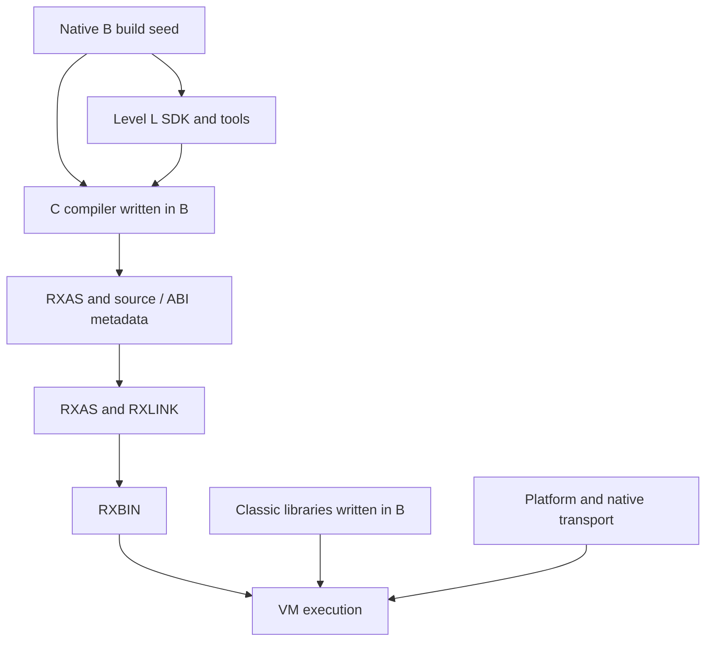
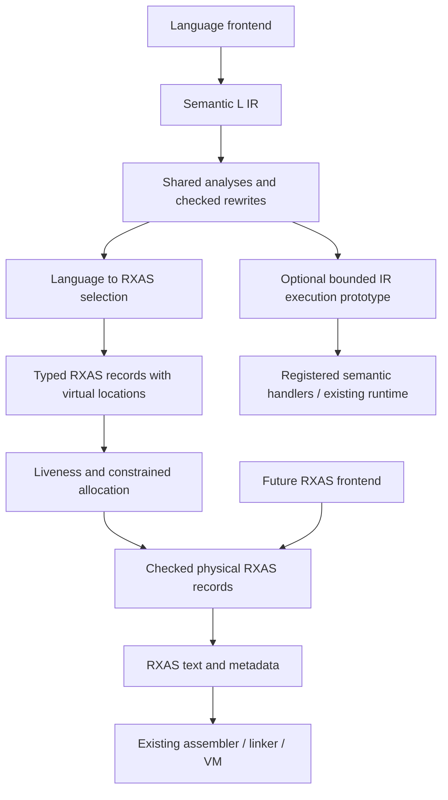

# Level C compiler architecture

**Target architecture approved by Adrian, 19 October 2026.** Current source
implements the context ABI, complete-template ARG over the finite PARSE profile,
and static named LEAVE/ITERATE. The [plan](../PLAN.md) owns instruction status,
remaining work and complete-C acceptance;
[requirements](levelc-requirements.md) map coverage and
[agent work packages](agent-work-packages.md) define implementation assignments.
“Current” below means inspected source, not fresh execution qualification.
Approval establishes the ownership and delivery direction, not implemented
capability. Exact new public API/schema/ISA contracts retain their step gates.

## Outcome

Deliver one complete, explicitly selected Classic Level C compiler implemented
in Level B with Level L grammars/services; independently useful Level L analysis
and optimisation; shared Classic runtime libraries written in B; and justified
RXAS/VM improvements for Classic workloads. INTERPRET completes the sequence.
New B/G coverage and self-hosting are outside this delivery. Existing consumers
and signed B/G interoperability remain regression obligations. Default compiler
replacement is a separate decision after qualification.

Native B remains the build seed. New source requests cannot invoke native source
compilers/backends. RXAS, RXLINK, VM, platform services and native transport
providers remain legitimate dependencies. A native primitive executes a defined
operation; it must not hide a second Classic parser, lowerer or BIF implementation.

Native compiler source changes in this delivery are limited to evidenced defects
in the Level B build seed, with focused regressions preserving the existing
language contract. New Classic compiler features remain in this B/L implementation;
shared runtime behavior remains in `lib/rxfnsc/`. Native Classic parsing, lowering
and feature work are outside this delivery.

## Current implementation review

| Inspected surface | Current facts | Target consequence |
|---|---|---|
| Native `compiler/rxcpcscn.re`, `rxcpcpar.c`, `rxcpcgmr.y`, `rxcpcval.c`, `rxcp_levelc_lower.c`, `rxcc.[ch]` | Separate Classic parsing/lowering feeds the common native backend. `rxcc_parse` owns an exact-length parsed/mapped unit, not a complete compile service. | Reuse requirements/fixtures, not the native implementation as a dependency. Parse success proves neither execution nor INTERPRET. |
| Native architecture/worklist | 24 admitted instruction reviews closed with exceptions; INTERPRET rejected; host/source/configuration/lifecycle obligations open. | Native closure never automatically closes the new compiler. |
| Native direct-BIF table | 70 catalogue names, LOWER/UPPER and 23 Unicode extension names have entries. | Integrate and test every name; entry presence is not conformance. |
| `levelc/levelc.rxl`, `llcparse`, `llcfrontend` | Generated Unicode-variable lexer/LR grammar and C token policy; bounded DROP/SELECT/static DO/named LEAVE/ITERATE and seven-source PARSE/complete-template ARG lowering, limited operators, shared source-unit entries/constant-symbol labels, ordered PROCEDURE EXPOSE and ordinary CALL/direct shared BIF bindings. | Qualify each instruction increment; PARSE condition/TRACE/platform obligations and wider source/instruction coverage remain open. |
| `llcir`, `llcrxas`, `llccompiler`, `llrxc-c` | Independent C family/selector/service/CLI; neutral ABI attributes still use `crexx.g` type names. Owned RXAS output and explicit limits. | Preserve separation; neutral ABI types belong in compiler-common contracts, not typed semantics. |
| `levelc/llccallemit.crexx` | Private finite delayed CALL adapter over admitted immutable handler rows. | Shared B owns pending delivery, suppression, activation and CONDITION state; no target compiler dependency. |
| `levelc/llctraceemit.crexx` | Private emitted frame-local TRACE observer, checked existing B service signatures and retained scalar event metadata. | Reuse B option/controller/output owners; keep raw parent-register reads in the direct handler and compiler code outside the target closure. |
| `common/llcompilercontracts.crexx` | Retains existing B exposed/optional formal qualifiers independently of bare names; C/G emitters preserve them. | Metadata recognition does not expand either source-call profile; owning admissions retain required by-value contracts. |
| `lib/rxfnsl/rexx/llflow.crexx` | Checked AST-role graphs, structured loops/branches, condition facts and finite definite assignment already exist. | Reuse this foundation; distinguish source-AST analysis from executable IR analysis. Its short-circuit roles cannot model eager Classic AND/OR. |
| `lib/rxfnsl/rexx/llir*` | Frozen modules/schemas, block-local values, cross-block slots, revision-bound facts, checked rewrites and bounded local optimisation. | Add exceptional/resumable edges, generic analyses and liveness before relying on them. No immediate SSA rewrite. |
| `levelc/llcparseprogram.crexx` | C-owned LCP1 construction and independent packet admission reuse the compilation-owned source index and existing strict text codec. | Keep runtime envelope ownership in shared B and generic descriptor execution in the cursor kernel. |
| `levelc/runtime/llctarget.crexx` | One 36-export B target delegates contextual expressions/BIFs, DO state, PARSE acquisition and error bridges to shared B bodies, alongside literal/pool/packet/result helpers; no per-operation default config/pool or copied activation. | Preserve live owners and shared algorithms; complete later operations/BIF host contracts and prove any specialization's state/failure/observation equivalence. |
| `lib/rxfnsc` | B implementations own values, pools, activation, DO state, PARSE execution, BIFs and streams; package imports include classlib, B Unicode core, cstream/fs. | Extend existing owners; retain independent Unicode/provider delivery and Classic policy. |
| Maintained `examples/step06/walk-c.after.rxas` | Borrowed root owners and result packets remain; exact literal branches prune dead arms while retaining runtime truth. Checked context/entry dispatch selects one shared source body; clause IDs remain zero (full TRACE is open). | Named conservative costs remain C-OPT-01–03/05/06; review includes wrappers, cold handlers and helper bodies separately. No minimal-frame or speed claim. |
| RXAS sources, `binutils/include/rxops.h`, VM guide, `interpreter/rxvml.h` | Existing peephole/procedure analysis and decimal/context/call/PARSE primitives. Public load-file/load-buffer/context-destroy, no individual-module unload. | Prefer existing operations. Dynamic code needs continuation and reclamation, not merely a bounded lookup cache. |

Some old BIF/reference paragraphs still describe DATE/TIME refresh and streams
as missing despite later code/worklist corrections. Resolve using current code
and the owning contract; reconcile stale prose in the corresponding increment.
Do not import historical statuses into the new requirements ledger.

## Ownership and permitted dependencies

| Owner | Responsibility | Excluded responsibility |
|---|---|---|
| `research/level-l/compilers/levelc/` | C tokens/grammar/AST, binding, clause/control rules, C IR semantics, specialisation legality, selector, service/CLI | Generic graph algorithms, duplicate BIFs, VM loader internals, typed frontend |
| `lib/rxfnsl/rexx/` | Generic source/tree/CFG records, facts/effect interfaces, worklists, checked rewrites, liveness/interference, bounded output | C keywords/numeric defaults/pool rules/BIF names or target opcodes |
| `langtools/` | Level L specification compiler/generation, rxlang, generic tool services, guides/examples and independent SDK tests | C application main or another Level L subtree |
| `compilers/common/` | Shared cREXX ABI/metadata interpretation and target utilities with real common users | Language-dispatch main, hidden C/G policy, speculative universal frontend |
| `lib/rxfnsb/unicode/` (shared B component) | Unicode algorithms, pinned data and B procedural API used by G/C; optional runtime image | G collection facade, C BIF/error policy, compiler bootstrap dependency |
| `lib/rxfnsc/` | Classic values, pools, activation, conditions/state, BIFs and parse/stream adapters | Source parsing, IR or dependency on research compiler modules |
| `assembler/`, `binutils/`, `disassembler/`, `linker/`, `interpreter/` | ISA/encoding, machine optimisation, execution, generic owned code images | Classic grammar/AST, BIF-name dispatch or source-level EXPOSE rules |
| `platform/`, RXPA providers, `ports/single-threaded/` | OS transport, codecs, clocks, maintained CMS/TSO profiles | Compiler language decisions or duplicate runtime algorithms |

Foundational execution capabilities follow the
[built-in VM service principle](../../../../docs/ai-context/RXVM_INTERPRETER.md#built-in-vm-services):
mandatory core availability, existing native bindings/lifetime and one semantic
owner. An ISA extension requires justified instruction-level support and its
own exact-contract approval; this does not move compiler or Classic policy
into the VM.



Arrows describe build/use flow, not reverse import permission. Generated C
programs depend on Classic libraries; the compiler host reads their ABI metadata
as data. SDK/tool libraries cannot import research/compiler modules. C-only
configuration cannot generate/link a typed/G frontend. Shared changes retain G
regressions without requiring new G features.

`llctarget` may temporarily remain an ABI shim, but lasting runtime semantics
belong in rxfnsc. Remove obsolete adapters after consumers migrate. Unicode
packaging follows the shared B foundation below. Preserve public G namespaces
and existing consumers; directory movement alone does not prove independence.

### First foundation increment

The active slice preserves existing public APIs. C-only dependency controls
stage separate compiler-host and static-target roots; static C links the
existing `library`, `rxfnsc`, `llctarget`, `classlib` and B Unicode core images explicitly.
The collection library supplies variable-pool storage. Generic IR definite
assignment indexes predecessor edges once and schedules changed exits through
a bounded worklist; it does not introduce a C analysis engine or liveness API.
Unicode ownership below preserves private ABI, public procedure bodies and G classes.
Remaining work and complete-C acceptance belong to the active plan.

## Shared Unicode foundation in Level B

The shared component packages the existing algorithms and 23 public
`rxunicode` procedures in `rxunicode-core.rxbin`. C adapters compile against
that exact B metadata. G includes the same B members in its aggregate and
retains its collection/iterator classes. No duplicate procedure body, extra
forwarding layer or second Unicode algorithm is introduced.

CLC-STEP03b preserves namespace, signatures, argument presence, bodies and
documentation. Adrian approved the
[exact public contract](../../../../lib/rxfnsb/unicode/README.md#public-b-interface)
after independent verification that minimal B and L bootstrap remain upstream
of this optional component. Property/simple-mapping and other new interfaces
remain later exact-contract gates; the plan tracks their remaining work.

| Owner | Content and contract |
|---|---|
| `lib/rxfnsb/unicode/` | Shared B runtime source/templates and canonical pinned Unicode/legacy-codec data; separately selectable `rxunicode-core.rxbin` (selectable component image). No dependency on the G facade or C libraries. |
| `tools/unicode/` | Component-specific table compilers/generators, their Level L grammar and build adapters; use `rxlang` as a tool. Generated code/tables remain build outputs. No source compiler algorithm is moved here. |
| Shared B procedural facade | STEP03b preserves the existing 23 `rxunicode` version, normalization/full mapping/folding, direct grapheme and codec procedures. Property/simple mapping remains a separate STEP03 contract. Private numeric selectors stay private. |
| `lib/rxfnsg/rexx/unicode.crexx` | Preserve G collection/iterator classes and their private helper calls; the aggregate explicitly includes the B-owned procedures to preserve its old public surface without duplicate bodies. Source compatibility and doc tags remain required. |
| `lib/rxfnsc/` | Preserve Classic BIF names, argument presence/checking, text/ordinal conversion and Classic error translation. Call the B facade directly. No second normalization, segmentation or codec implementation. |
| `lib/rxfnsl/` | Consume pinned property data or a minimal independent property table for recognition; no import of G/C and no requirement to load the full Unicode runtime. |

Do not merge all large tables into the seed `library.rxbin`. Bootstrap order is
minimal B library → L bootstrap/tool → optional Unicode generation → B Unicode
runtime → G facade/C runtime. L's own property generation must use minimal B
and pinned source data without depending on this optional runtime image. One
canonical source-data owner can feed different generated indexes needed by L
and runtime algorithms; do not create a graph cycle or conflate those indexes.

The current B interface uses `.string`, `.binary` and ordinary scalar results;
its grapheme positions count extended graphemes. It preserves existing value
ownership and family-specific errors. It adds no public traversal, simple-map
or budget API. Those possible shared scanner/pool services remain later
STEP03 contract work; G-only iterator objects stay in G and locale/configuration
overlays remain C-owned. Existing
ordinary text remains exact codepoints, without implicit normalization, folding
or grapheme indexing. Explicit full casing may expand; ordinary Classic symbol
casing must use its simple-mapping contract. Stream codec choice never changes
the fixed Classic ordinal bridge.

Validate the extraction with direct B consumers, unchanged G facade fixtures,
all C Unicode BIFs/streams, UCD conformance inputs, embedded NUL/high scalars,
malformed bytes, replacement controls and both engines. Compare linked constant
ownership and RXAS so the split does not duplicate tables or introduce wrapper
copying. Test C-only and G-only clean/incremental/installed builds, missing and
changed generated inputs and no-op freshness. Preserve data provenance/licenses,
API doc tags and code-shape assertions. These tests close ownership; no new
Unicode version or semantic expansion is implied.

Select one provider aggregate per linked image: standalone B core for C-only
applications or the existing G aggregate containing those B members for
combined products. The linker rejects overlapping providers; no deduplication
change is proposed. Exact import roots and autoload-origin checks must prove
the C path's independence, rather than relying on broad installed-directory
search order. Existing embedded/G consumers retain a focused compatibility
check with the standalone core physically absent.

## Compilation pipeline

1. **Owned request.** Exact UTF-8 bytes, logical source ID and physical mapping,
   mode, explicit imports, options and work/storage limits. File I/O and atomic
   destination replacement belong to the command adapter; the service cannot
   exit, spawn a source compiler or use ambient import fallback.
2. **Recognition.** Level L engines plus C contextual token policy handle words,
   labels, continuation, comments, radix suffixes and blank/abutment. Preserve
   byte spans separately from Unicode positions; do not translate C into B.
3. **Named C AST.** Source constructs, explicit fields/lists/optionality,
   spelling and clause identity. Bind entry identities and validate static
   errors throughout unreachable source before optimisation.
4. **C semantic IR.** Explicit blocks, ordered effects, values/slots, context
   use, control/completion edges and source observations. Keep pool operations
   until C legality analysis proves a narrower representation.
5. **Generic analysis.** Level L computes def/use, reachability, liveness and
   finite-domain facts from registered C summaries. C supplies numeric, pool,
   alias, call and TRACE semantics. Rewrites invalidate revision-bound facts.
6. **Target lowering.** Choose existing VM instructions or checked runtime calls;
   every operation has a conservative executable route. Typed target records
   precede physical register assignment and retain source origins.
7. **Registers/emission.** Generic liveness/interference consumes use/def/edge
   records. The target owns aliases, call windows, clobbers, reserved registers,
   cleanup and legality. Render through Level L's writer. RXAS independently
   owns machine optimisation, separately switchable from compiler optimisation.
8. **Assemble/link/run.** Existing tools validate RXBIN and explicit imports.
   Keep separate file stages. Later in-memory assembly must use the same
   assembler contract and prove diagnostics/output equivalence.

### Representation contracts

Names describe proposed records, not committed public identifiers.

| Record | Required content/ownership | Validation |
|---|---|---|
| CompileRequest | Owned bytes, logical identity/map, module/routine/interpreted-group mode, imports/profile, limits, optimisation policy | Exact length including NUL, valid options/encoding, no ambient mutable compiler state |
| CompileResult | Status, owned diagnostics, optional frozen AST/IR, RXAS chunks/source map, runtime ABI requirements | No executable after recovery/error/limit; earlier results survive later failure |
| C AST | Kind, named fields/lists, source span, clause, spelling, generated origins | Grammar/schema plus C static checks; no overloaded anonymous fields |
| IR operation | Typed inputs/results, attributes, ordered effects, normal/exceptional/resumable edges and origin | Generic structure plus C meaning; unknown effects prohibit speculation |
| Analysis result | Owner/revision, domain/version, explicit absent versus false, budgets | No stale/foreign facts; transformation declares invalidation |
| Target record | Opcode ID, typed operands, use/def/clobber, failure/normal edges and observations | Validate before/after allocation and rewriting; strings are output, not optimisation IR |
| Runtime ABI | Namespace/signature, presence, ownership/borrowing, context, effects/errors | Separate producer/consumer, metadata and malformed-import tests |
| Completion/continuation | Kind, result presence/value, destination, condition, owned code handle/PC and live spills | Generation/lifetime/cleanup checks; no raw expired caller pointers |

Retain current block-local values and cross-block slots. SSA is not a prerequisite.
Reuse existing `llflow` AST analysis and `llirservices` IR passes rather than
introducing competing generic engines. Their graphs answer different questions:
source structure before lowering versus explicit executable edges after it.
Only proved mapping adapters may transfer facts; Classic eager logical evaluation
must not inherit `llflow` short-circuit AND/OR behavior.
Make exceptional/resumable edges and clause observations explicit before global
passes cross them. Version changed serialized schemas; reject incompatible data
rather than silently assigning new semantics. Algorithm records must state
invariants, convergence/work bounds, allocation accounting and atomic failure.

## Classic activation and runtime

Start with RexxValue, RexxStem, RexxVariablePool, RexxActivationArguments,
RexxClassicConfig/State, RexxDoState and existing BIF modules. Keep their public
consumers compatible while introducing a coherent reference-based compiled-C
activation facade. A copied argument/result packet is not the live activation.

An activation owns or explicitly borrows arguments/presence and invocation kind;
result presence; the replaceable visible-pool binding and caller/exposure links;
PROCEDURE eligibility; NUMERIC/ADDRESS/TRACE/clause-clock/condition state;
source/clause and label/routine identities; active loop state; program-root
completion; and execution-owned queue, stream and host services.

Internal CALL creates an activation with defined inheritance/restoration. A
label alone creates no private pool. PROCEDURE replaces the visible-pool binding
and resolves EXPOSE in source order. Interpreted code sees that replacement
through the same binding. Create configuration at program/host entry, not per
operator. Calls, callbacks and context mutation invalidate affected facts;
process-global defaults cannot silently replace active Classic state.

Compile a source unit's label/control space into one owned code body with checked
entry identities. An internal call can recursively enter that body with a new
activation and entry ID; SIGNAL changes position within the current invocation.
Do not clone the source tail for every label or require PROCEDURE after labels.
Preserve first-label precedence, fall-through and control-stack clearing.

Existing BIF bodies and valid library qualification are reused. All 95 names
have direct binding routes; representative C calls are locally qualified, while
each whole BIF/context/host/platform obligation remains open. Reuse expected-result fixtures through the new compiler;
change library algorithms only for a demonstrated defect or named missing
contract. BIF calls share one runtime context/presence contract. Pure text entries need
not copy the entire activation; stateful entries borrow their declared context
from its authoritative owner. Numeric specialisation preserves decimal DIGITS,
FUZZ/FORM, literal spelling, exact logical tests, errors and LOSTDIGITS. Machine
integers/floats are implementation choices, not changed Classic semantics.
Ordinary text is exact Unicode codepoints with the fixed Latin-1 ordinal bridge;
external stream encodings do not change source or ordinal semantics.

### Borrowed Classic context contract

**Shared B surface and nine borrowed target adapters approved by Adrian on
19 October 2026; implemented and locally qualified.** Adrian subsequently
approved the clean selector/schema migration below and removed compatibility
requirements for earlier research C output: use one current `llctarget`
namespace/product and remove obsolete copied-context adapter bodies. The plan
owns implementation and qualification; shared B/L consumer contracts remain.
The intended outcome is one execution-owned configuration and one authoritative
activation/pool binding for the admitted bounded C subset.
Remove per-operator configuration construction and copies of live activation
state while retaining existing expression/BIF bodies and observable results.
This does not admit more source forms or close an instruction review.

The STEP03d selector migration covers scalar expressions, assignments, structured
control, NUMERIC forms, argument/result presence and LENGTH/ARG/DIGITS. The
[current PROCEDURE contract](#proposed-procedure-contract) supersedes its private
label/pool route with shared entries and executed EXPOSE. Condition handlers,
new BIF names, signed external calls, host invocation APIs and dynamic compilation
retain their owning steps. The shared runtime supplies the five-callable B bundle
and nine direct-host adapters below.
The existing Unicode procedures and algorithms are unchanged.

#### Approved shared B surface

`RexxClassicContext` lives in namespace `rexxclassiccontext`, owned by
`lib/rxfnsc/RexxClassicContext.crexx` and delivered in the existing
`rxfnsc.rxbin`. It is a reference bundle, not a second implementation of an
activation. Its only fields are references to existing caller-owned objects.
It allocates no activation, pool or configuration and stores no reference to
itself or one of its own members. Existing `rexxactivation`, `rexxpool`,
configuration and BIF exports retain their signatures and behavior.

Passing the three existing references separately would add no B class, but
would spread pool-binding replacement across every helper ABI. A copied pool
reference does not observe replacement of the caller's binding, and nested
reference containers are outside the current B surface. The bundle
provides one explicit mutable binding using existing class/reference rules.

These are the complete five approved callables. All arguments are required;
there are no defaults, optional-presence bits or exposed by-value arguments.
Types below use the existing fully qualified source identities.

| Callable | Exact parameters | Result |
|---|---|---|
| `.rexxclassiccontext..RexxClassicContext(...)` (default factory) | `activation = reference .rexxactivation..RexxActivationArguments, pool = reference .rexxpool..RexxVariablePool, config = reference .rexxclassicconfig..RexxClassicConfig` | `.rexxclassiccontext..RexxClassicContext` |
| `activation()` | none | `reference .rexxactivation..RexxActivationArguments` |
| `pool()` | none | `reference .rexxpool..RexxVariablePool` |
| `config()` | none | `reference .rexxclassicconfig..RexxClassicConfig` |
| `bindPool(pool)` | `pool = reference .rexxpool..RexxVariablePool` | `.void` |

The factory checks all three references with the existing `<refvalid>` facility
before publishing a bundle. Each getter checks its selected reference before
returning it. `bindPool` checks the replacement before changing the binding;
failure leaves the previous binding intact. Invalid or expired targets raise
the existing `REFERENCE_INVALID` condition. There is no new handle, error
category, lifetime extension, global registry or VM/object ABI.
If an existing B procedure signal handler resumes with `.signalaction.skip()`,
the rejected operation returns immediately: a failed factory returns a bundle
with empty references, a failed getter returns an empty reference, and a failed
`bindPool` preserves its old binding. This is failure recovery, not a successful
borrow; no rejected reference is installed after the signal handler returns.
Callers supply initialized instances; a live reference cell does not by itself
prove object initialization. Existing `OBJECT_NOT_INITIALIZED` behavior remains
when an uninitialized object is used. The bundle adds no profile/state inference
or eager copy of the referenced objects.

`bindPool` changes only this bundle's pool reference. It does not create or copy
a pool, apply EXPOSE, change Unicode-name policy, alter activation state or
modify configuration. Those operations retain their existing owners. C selects
UTF8 configuration and Unicode pool names at entry; the shared bundle itself
does not introduce a new character-profile policy.

#### Stable owners and copying

The C entry wrapper owns the existing root `RexxActivationArguments`, UTF8
`RexxClassicConfig`, root `RexxVariablePool` and the bundle in stable local
storage. Capture arguments and complete any by-value construction before
binding references. Helpers receive a reference to that authoritative bundle;
they do not receive copies of live activation/configuration objects.

The factory's value result can safely move into its final local because its
three references point to external caller-owned storage. Ordinary B copying
of a bundle copies these references: the referents are shared, but a later
`bindPool` changes only the copied bundle receiving that call. Generated C
therefore passes the authoritative bundle by reference and never substitutes
a value copy when a live binding is required. It must not overwrite, move,
resize away or recycle any referenced owner while a borrow is live.

Each synchronous caller owns a fresh child activation and separate bundle.
Populate arguments in source order, inherit state with existing
`inheritSignalPolicy`, then select `beginInternalCall` or
`beginInternalFunction`. The child initially borrows the caller's current pool
and root configuration. Only executing PROCEDURE creates and binds a stable
callee-owned private pool; the [shared-entry contract](#proposed-procedure-contract)
owns exact entry and cleanup rules. Every replacement must restore the supplied
binding and end borrows before its owner dies. A child NUMERIC change cannot
modify the parent's activation or VM frame.

Keep existing fresh return-presence packets for now. They contain returned
value/presence, not a copied live child activation or references to child local
storage. Their current representation cost remains explicit. Provider-local
references cannot escape into program values/results or cross a VM-context
boundary. CALL3's opaque completion carrier below may retain caller-owned weak
references, which result consumers never dereference. Stale-reference controls fail through checked references,
not extend owner lifetimes. Repeated executions own separate roots/configs.

#### Numeric frame and error contract

`RexxActivationArguments` remains the authoritative stored DIGITS/FUZZ/FORM
state. The executing C frame must also carry those settings: existing numeric
BIFs read the immediate caller's VM frame through inherited numeric clauses,
not `RexxBifCallContext.setCallerActivation`.

At root entry install the root defaults, and at child entry install the inherited
child settings in the C frame. After a successful NUMERIC statement, install
the new settings in that same frame. An existing-instruction sequence can set
FUZZ to zero, set DIGITS, set the validated FUZZ and set FORM, avoiding an invalid
intermediate DIGITS/FUZZ pair. This sequence is emitted in the C frame; calling
a B setter that changes only its own VM frame would lose the setting on return.

Validation reuses `setNumericDigits`, `setNumericFuzz` and `setNumericForm`.
They commit only after successful validation and return their existing error
text. On validation failure, raise the existing authored `CLASSIC_SYNTAX`
diagnostic and execute no VM setting instructions: activation fields and the
owning C frame retain their prior settings. Validated installs must use admitted
integer values and existing instructions, with no fallible conversion between
field commit and frame synchronisation. This is the ordinary validation-failure
atomicity contract. Resumable asynchronous conditions and observer boundaries
remain STEP02/07 obligations; this slice does not claim their closure.

When a direct numeric BIF is emitted from the C frame, its inherited clauses
read that frame. If a temporary B shim is the immediate BIF caller, the shim
must declare DIGITS, FUZZ and FORM inherited so that it receives the C frame's
settings; relying on the shim's default settings is incorrect. Returning from
the shim or child restores its caller's VM frame using existing VM behavior.
Do not change process-global RexxValue defaults or add a native numeric service.

#### Checked BIF reuse and current target

Call sites retain source-ordered values/presence and existing direct BIF entry
selection. Build a call-local `RexxBifCallContext.expression(name)`, bind the
bundle's config/pool/activation through existing setters, set arguments and call
the selected existing B entry followed by `rexxclassicbif_checked`. The name is
diagnostic context, not selection through the legacy name dispatcher. No BIF
body or error policy is copied into the compiler. Existing config getters and
argument arrays can still copy values internally; those are retained costs,
not a claim that the complete BIF path performs no copies.

**Approved clean target:** one namespace `llctarget` in the existing installed
`llctarget.rxbin`. Consolidate the completed borrowed adapters into that owner
and delete `llctarget2` and the replaced copied-context implementations. Earlier
research C images/IR are not a compatibility contract. New C output uses the
following exact borrowed-context entries. Here `V` is
`.rexxvalue..RexxValue` and `C` is
`reference .rexxclassiccontext..RexxClassicContext`; these are table abbreviations,
not additional public type names.
All parameters are required and have no defaults/expose flags.

| New entry | Parameters | Result |
|---|---|---|
| `llctarget..binaryop` | `operation = .string, left = V, right = V, context = C` | `V` |
| `llctarget..unaryop` | `operation = .string, value = V, context = C` | `V` |
| `llctarget..truth` | `value = V, context = C` | `.int` |
| `llctarget..setting` | `operation = .string, context = C, value = V` | `.void` |
| `llctarget..digits` | `context = C` | `V` |
| `llctarget..countargs` | `context = C` | `V` |
| `llctarget..existsarg` | `context = C, ordinal = V, option = V` | `V` |
| `llctarget..lengthvalue` | `value = V, context = C` | `V` |

Keep the currently admitted operation names and argument forms. Standalone ARG
uses the shared PARSE acquisition/executor, with no scalar read adapter.
`setting` mutates the borrowed activation only after existing validation; the
selector then performs the C-frame install above. `digits`, ARG and LENGTH
select their existing checked BIF entries. Existing argument construction,
literal/pool helpers and fresh result packets retain their current ABI;
argument construction finishes before the new bundle borrows the activation.
Keep only the helpers used by the clean selector: `literal`, `poolnew`,
`poolread`, `poolwrite`, `sayvalue`, `arguments`, `mainargs`, `append`, `present`,
`absent`, `requirevalue`, `setresult`, `status` and `failuremessage`. Together
with the eight entries above these form the 22-export foundation. SELECT adds
two entries under its [approved contract](#approved-select-contract), giving
24 exports. The [approved DO contract](#approved-do-contract) adds seven;
the [transfer contract](#approved-leave-iterate-contract) adds `invalidtransfer`,
giving the 32-export foundation. The [PARSE acquisition adapter](#proposed-c-parse-integration)
adds `parsesource`, giving 33 exports after ARG retires `readarg`;
the [CALL contract](#call-contract) adds three transport exports for 36. Remove
`contextnew`, the old nine bodies, compatibility bridge/build entries and
old-image/legacy-signature tests. Preserve applicable RexxDoc tags when moving
the current implementations. The private `bifcontext` remains internal.
The existing operator-name branch and conservative root setup remain named
C-OPT-01/03 work; this contract does not add direct-operation B exports or claim
that literal-only programs have no unused setup.

New generated C source-unit procedures receive a `C` reference and integer entry ID; invocation
kind and argument presence reside in its existing activation. Their existing
fresh result-packet result type remains. This internal ABI is distinct from
the unchanged VM main entry and from later signed external-call contracts.
Changed C semantic type/effect/call records use the approved C family revision
below; do not reinterpret old frozen records or change generic L record
semantics. Installed target metadata missing current `llctarget` signatures or
the bundle must cause a precise import diagnostic before publishing RXAS, preserving
the previous output. Incompatible packages must not accidentally select
an old same-name signature. No new runtime product or compiler dependency is
introduced into static applications.

<a id="current-c-family-contract"></a>

#### Approved C-family revision and generated procedure ABI

**CLC-STEP03d is locally complete; the approved PROCEDURE increment advances
C to the two-argument source-unit ABI. The current family is v22/88 with
36 target exports, including ordinary CALL, the reviewed EXIT program-root contract and
static signed statement providers, selected-queue PUSH/QUEUE, keyed explicit/active
commands, complete SIGNAL, practical TRACE and delayed CALL/clause completion.
Local instruction qualification is tracked in
the plan.** Use the following contract with one current
C target and no compatibility bridge for earlier research C programs. The five shared B callables and eight borrowed signatures
above are retained. DROP adds its approved source form and C-owned IR operation
below; no extra B callable, generic L API/transport format, RXBIN metadata
record or RXAS/VM operation is introduced. Shared-label/PROCEDURE delivery follows the approved contract below; complete
whole-C observations and INTERPRET retain their later gates.

The C selector accepts `core` version 1, neutral `crexx.g` version 1 scalar
types and `crexx.c` version 22. The neutral scalar names do not load the G
frontend. The generic LLIR text/binary format remains version 2. `crexx.c`
versions 1–21 are never reinterpreted as version 22. Within version 22, the complete C
type/operation declarations, including unused declarations and all ordered
fields and effect summaries, must match the canonical C registration before
emission. Foreign operations remain outside the C profile.

The C types are `value`, `arguments`, `result`, `context` and `parseprogram`. The first
three retain their current runtime representations: `RexxValue`, a not-yet-
borrowed argument/activation packet and an opaque completion packet. Result
consumers expose only value/presence; static external calls may return the recovered
caller-owned invocation under the closed transport contract below. They
retain the existing byte codec in the semantic registry. `context` uses that
same nominal codec registration but denotes only a live reference to an
authoritative `RexxClassicContext`; its runtime payload is never serialized in
IR. It may originate only at required function parameter 1 and flow
through reference-value copies and local slots. A context slot is bound once
in its function's entry block, from parameter 1 or an earlier proven entry
alias, before entry reads; every later/dead-block read requires that binding.
Reject nonentry/repeated stores and unproved producers. This is the narrow
C opaque-context invariant, not a general definite-assignment service; the
generic structural verifier alone does not prove slot initialization.
Reject `core.constant` and
optional/default parameters of this type, references in results, and any
unsupported producer/use. The former `numeric` and `pool` types and `pool.new`
operation remain absent. Resolve the current pool from the bundle
at each pool operation, so an observed `bindPool` replacement remains live.
`parseprogram` uses the existing byte codec solely for the immutable `program`
attribute of `parse.execute`; constants, slots, parameters and results of this
type are refused. Its [LCP1 contract](#proposed-c-parse-integration) belongs to
the shared B executor and its independent C producer/admission boundary.

The following table owns the 53 base descriptors, with the requirevalue name
attribute updated by the [CALL contract](#call-contract). The five appended v9
descriptors and entry/procedure protocol are owned by the
[approved PROCEDURE contract](#proposed-procedure-contract); the three appended
CALL descriptors belong to the [CALL contract](#call-contract). The
[EXIT contract](#exit-contract) revises `exit` and appends `program.exiting`.
The retired
scalar `arguments.read` operation remains absent. Delayed CALL appends
`call.policy`/`clause.complete` at 87/88 under the
[Group 1 contract](#conditions-observations-complete-contract), including its
strict conditional EXIT carrier. In canonical registration order DROP is 5,
SELECT is 41/42, DO is 43–50, transfer.invalid is 51 and PARSE is 52/53. Names have
the `crexx.c.` prefix; field order is significant. `V`, `C`, `A`, `R`, `B`,
`I` and `T` mean `value`, `context`, `arguments`, `result`, `core.boolean`,
`crexx.g.int64` and `crexx.g.text`. An output, when present, is named `value`.
`context` is a conservative state footprint covering reads or writes through
the bundle, including existing BIF pool-policy setters; it does not assert
read-only access. `condition` includes the existing reference, initialization,
conversion, numeric, argument and resource conditions without changing their
names or diagnostic policy. All rows terminate as `returns` except `exit`,
`select.missing` and `transfer.invalid`, which terminate as `diverges`. EXIT
uses its proved program-unwind terminal; the error operations retain the
current nonresumable C profile.
No evaluator is registered for context-dependent operations, including truth.
For exact literal bytes `0`/`1`, C construction may supply a separate derived
core Boolean to the branch while retaining the effectful runtime truth call.
Dead-arm pruning therefore preserves owner checks, pool-policy effects and
condition timing. Removing that context work remains C-OPT-03, subject to its
state/failure/observation proof.

| Operation(s) | Ordered inputs | Ordered attributes | Output | State | Failure |
|---|---|---|---|---|---|
| `add sub mul div eq ne lt le gt ge strict concat blank abut and or xor` | `left:V right:V context:C` | — | V | `context` | `condition` |
| `positive negative not` | `value:V context:C` | — | V | `context` | `condition` |
| `say` | `value:V` | — | — | `output` | `conversion.io` |
| `load` | `context:C` | `name:T` | V | `context` | `condition` |
| `store` | `context:C value:V` | `name:T` | — | `context` | `condition` |
| `truth` | `value:V context:C` | — | B | `context` | `condition` |
| `numeric.digits numeric.fuzz numeric.form` | `value:V context:C` | — | — | `context` | `condition` |
| `digits` | `context:C` | — | V | `context` | `condition` |
| `arguments.empty` | — | — | A | `none` | `resource` |
| `arguments.append` | `arguments:A value:V present:B` | — | A | `none` | `resource` |
| `arguments.count` | `context:C` | — | V | `context` | `condition` |
| `arguments.exists` | `context:C ordinal:V option:V` | — | V | `context` | `condition` |
| `return.present` | `value:V` | — | R | `none` | `resource` |
| `return.absent` | — | — | R | `none` | `resource` |
| `requirevalue` | `result:R` | `name:T` | V | `none` | `missing.result` |
| `setresult` | `context:C result:R` | — | — | `context` | `condition` |
| `call` | `arguments:A context:C` | `target:T entry:I function:B` | R | `context.output` | `condition` |
| `length` | `value:V context:C` | — | V | `context` | `condition` |
| `exit` | `result:R context:C` | — | — | `context` | `condition.resource` |
| `drop` | `context:C` | `name:T indirect:B` | — | `context` | `condition` |
| `when.truth` | `value:V context:C` | — | B | `context` | `condition` |
| `select.missing` | — | — | — | `none` | `condition` |
| `do.new` | `context:C` | `key:T name:T` | — | `loop.context` | `condition.resource` |
| `do.capture` | `value:V` | `key:T part:T` | — | `loop.context` | `condition` |
| `do.start do.advance` | — | `key:T` | — | `loop.context` | `condition` |
| `do.entry` | — | `key:T` | B | `loop.context` | `condition` |
| `do.close` | — | `key:T` | — | `loop` | `none` |
| `while.truth until.truth` | `value:V context:C` | — | B | `context` | `condition` |
| `transfer.invalid` | — | `code:T name:T` | — | `none` | `condition` |
| `parse.source` | `context:C` | `kind:T ordinal:I` | V | `context.input` | `condition.resource` |
| `parse.execute` | `context:C source:V` | `program:crexx.c.parseprogram` | — | `context.input.output.observation` | `condition.resource` |

`form` admits only the current
`scientific`/`engineering` spellings; `target`
must identify an owning source-unit function, with `entry` naming a declared
positive entry in that function. `function` is a required canonical
Boolean attribute: true selects `beginInternalFunction`, false selects
`beginInternalCall`. It is static invocation metadata, not another argument
or source-language feature. Ordered actual evaluation and explicit omitted
positions remain in the existing argument packet. Context-free constants are
limited to the currently selected literal/scalar types, never argument,
result or context packets manufactured from bytes.
PARSE source kinds and their ordinal rules, packet/name/source-origin admission,
and the typed NOTREADY caller checkpoint are specified by the integration
contract below. Standalone ARG uses those same operations with packet UPPER=1.

Every generated source-unit procedure, including `$MAIN`, has precisely:

```text
(context = reference .rexxclassiccontext..RexxClassicContext, entry = .int)
    -> .rexxactivation..RexxActivationArguments
```

Both arguments are required, with no default or expose modifier. The result
is the existing fresh presence packet; it cannot contain references to child
owners. Expression calls still use `requirevalue`; statement calls still
apply/drop `RESULT` in the caller's current pool using existing behavior.
The VM `main(argv)` entry and integer completion status are unchanged.

Root entry finishes `mainargs(argv)`, constructs one UTF8 configuration and one
Unicode-name pool in dedicated stable locals, then constructs one bundle using
their references. It passes `(reference bundle, 0)` to `$MAIN`. Internal
calls finish their argument packet, construct a fresh child activation and
separate bundle that initially borrows the caller's current pool/configuration,
and pass its admitted positive entry ID. Existing inheritSignalPolicy and
beginInternal* methods establish inherited state and eligibility. Only an
executed PROCEDURE creates a private pool; its ordered exposures and all
normal/EXIT/fatal restoration follow the
[approved source-unit protocol](#proposed-procedure-contract).

Select the existing exported class factories/methods through the independent
metadata reader. In particular, use the existing
`rexxclassiccontext.rexxclassiccontext.§factory` and getter symbols, activation
numeric/inheritance/procedure methods and pool `inheritCommandStatus` method;
do not read private attribute layouts. Validate the selected class owner,
callable identity, B flags, exact result, declared arguments and optional flags.
The selected configuration factory's `?requested_profile=.string` stays
optional in metadata and is supplied explicitly. Existing `poolnew()` owns
the explicit `.RexxVariablePool(1)` construction; no duplicate pool-factory
selection is added to the C emitter.
All current target exports retain required-only signatures. Legacy short type spellings may
match only their explicit known owner-qualified identities, never arbitrary
basenames or class/interface assignability. Preserve the existing hidden
receiver ABI: pass a live receiver alias with its established call-window
swap/restoration protocol, rather than a by-value receiver snapshot. Copy an
already-reference operand's payload; use `mkref` only on an actual stable owner,
never a reference-valued slot. End every temporary `linkref` alias before its
window is cleared. Existing general calls suffice; no new ISA is needed.

Each executing C frame selects Classic numeric standard with existing
`numsci 18,1,2`, then reads validated integer `numericDigits/Fuzz/Form` through
the borrowed activation and installs `FUZZ=0`, DIGITS, FUZZ, FORM in that frame.
After a successful void `llctarget.setting` call it performs the same integer
getter/install sequence, with no text conversion between commit and install.
Ordinary frames save all named fatal policies before installing their `sigbrv`
handlers. Protected SIGNAL frames use the canonical `core.protect` setup
defined below, with the same complete saved-stack marker for every tag.
A failed setting diverts to that C frame's checked condition/fatal path and
cannot reach numeric install or the ordinary next statement. Outward relay installs
`sighalt` before `signalorigin`: this profile is nonresumable even with an
outer B skip handler. Do not claim outer-handler recovery or alter that policy
in this migration. The unchanged direct B adapter tests prove stored-state
atomicity; generated error executions and branch-shape checks prove diversion.
Child return restores the caller VM frame; its stored activation was never
changed by the child. Same-frame FUZZ/FORM proof must use observations whose
results actually differ, including a non-multiple-of-three exponent.

| Compiler/input/target combination | Disposition |
|---|---|
| Current compiler + canonical C IR + current bundle/adapters | Two-argument shared source-unit ABI, ordinary CALL and proved program-root propagation; complete condition/TRACE, PARSE/ARG and delivery obligations remain open. |
| Current selector + earlier/unknown C IR | Refuse unsupported C-family version; no old schema/emission path or implicit upgrade. |
| Earlier emitted C programs + changed target | No compatibility guarantee or bridge; rebuild through the current compiler. |
| Current compiler + incompatible target or `rxfnsc` missing bundle | Precise import refusal identifying the missing/incompatible selected callable before publishing output. |
| Current compiler + mixed, forged, private, ambiguous, optionality/type/effect-incompatible records | Refuse before publication; never fall back to old adapters or native compilation. |

Use existing generic manifest save/load checks and reader bounds; add C-owned
whole-family/type/use and signature checks in `llcrxas`, not C policy in the
generic reader. Recheck every constant/attribute byte record with the canonical
selected codec, including unused/dead records, before any raw interpretation:
host codecs are not identified by the serialized manifest. All required entry
metadata and every selected runtime contract
must be admitted before publishing RXAS. Any refusal returns empty output and
leaves the graph and prior CLI output file byte-identical.

Implementation covers `levelc/llcir.crexx`, `llcfrontend.crexx` and
`llcrxas.crexx`, consolidation into `levelc/runtime/llctarget.crexx`, deletion
of `llctarget2.crexx`, their existing service/IR and STEP07/backend/direct-target
fixtures/checkers, and necessary build/test registration cleanup. Reuse `backend-step07.crexx`,
`check-step07.py`, `backend/{numeric,arguments,argv,calls}-c.crexx` and
`cases.json`; extend existing numeric observations for FUZZ/FORM inheritance,
restoration and failures instead of adding another scenario aggregate. Add
canonical current-C save/load and adversarial old/forged schema, constant-context,
wrong-width attributes, entry/unbound context-slot provenance, function-ABI
and selected runtime metadata refusals. Remove the old-image and
legacy-signature compatibility controls; retain independent B runtime/Classic
expectations and shared B/L consumer regressions.

Structural checks must show one root configuration per execution, one required
reference formal, no live owner snapshots/per-operation configuration, no
callee pool construction, stable child owners before borrowing, current-pool
lookup, correct call-kind/presence/result handling, safe receiver restoration
and reference-window cleanup, Classic same-frame numeric installs only on
success, existing fatal diversion, and unchanged source/error origins. Inspect
both caller and helper work; retained packet/config-getter copies stay named
costs. Qualify focused CLI/service/generated execution in compiler/IR modes and
both VMs, with separate assembler-mode controls and existing C-only restricted
roots. Reuse native controls by expected behavior, not faulty/excess native
output. Materially expanded nested tests need isolated normal Debug scheduling
measurement before registration, with generous serial timeouts. Reuse valid
sanitizer evidence for unchanged native inputs; any warranted new sanitizer
work is consolidated at final delivery under AGENTS.md. No build/test result is claimed
before implementation/qualification.

#### Review, migration and verification gates

The first public-surface approval is complete; implementation/qualification
status is recorded under CTX in the plan. These gates serve
CFC-AC02/03/06/07/09/11/12 and describe
this contract slice, not complete activation, BIF, host or C acceptance.

1. The five-callable B surface, borrowing/error contract, clean single-target
   C family revision and internal procedure ABI above are approved. Preserve all existing
   rxfnsc public class/BIF signatures and native/typed/RexxScript consumers.
2. Prove the bundle independently with existing B reference operations: external
   stable owners, safe factory-result copying, live pool rebinding, independent
   copy binding, failed replacement atomicity and `REFERENCE_INVALID` after
   owner death. Use direct B runtime tests in both modes and both VMs.
3. Reuse `testRexxActivationArguments`, `testRexxRuntimePools`,
   `testRexxClassicBifArg`, `testRexxClassicBifLength` and
   `testRexxClassicBifNumeric`. Add only missing checks for the new borrow path,
   invalid NUMERIC preserving both stored and VM state, independent roots and
   nested caller restoration. Reuse existing body expectations unchanged.
4. Migrate the admitted C selector/IR atomically. Reuse
   `tests/backend/{numeric,arguments,argv,calls}-c.crexx` and their `cases.json`
   expectations, selected independent `classic_expression_contract.py`
   expectations and `levelc_bif_numeric_context` fixtures. Extend STEP07's
   malformed-import/previous-output controls to the current surfaces. Refuse
   incompatible metadata without retaining an old-program compatibility path.
5. Inspect caller and helper RXAS: one UTF8 configuration per execution, stable
   borrowed owners, no live activation/configuration copy per operator, no unused
   callee pool reconstruction, correct inherited numeric shim frame and no new
   BIF dispatch/body. Classify retained result/argument/config-getter copies.
   Reuse the C-only exact-root/static/installed controls and existing consumer
   regressions. Measure any materially expanded nested aggregate before CTest
   registration, and qualify centrally under the repository's normal Debug
   rules. Source-only slices reuse valid unchanged-native sanitizer evidence;
   consolidate any warranted new proof at final delivery, preserving actual SAN
   obligations.

These gates do not design or implement INTERPRET, continuation ownership or
ephemeral code loading. The later mechanism must use the same live pool binding;
its exact runtime/VM contracts remain at the final STEP11 decision gate.

<a id="proposed-next-instruction-drop"></a>

### Implemented instruction: DROP

**Approved by Adrian, 19 October 2026; C v3 source/AST/admission/lowering is
locally qualified in normal Debug with independent caller/helper review.**
The [plan](../PLAN.md#current-action-drop) tracks DROP status and remaining work;
conditions/full diagnostics and TRACE retain later owners; static shared-entry
EXPOSE composition follows the current PROCEDURE contract.
Reuse the existing [Unicode symbol contract](../../../../compiler/docs/levelc_unicode_and_streams.md#ordinary-values-and-byte-compatibility)
and [pool methods](../../../../lib/rxfnsc/RexxVariablePool.crexx), including
`dropSymbol(name=.string)->.void` and
`dropIndirectList(list=.string,config_ref=reference .rexxclassicconfig..RexxClassicConfig)->.void`.
No new B/L/VM API, target export, runtime algorithm or legacy compatibility path
is needed. One current `crexx.c` family advances to version 3, retaining its
four types and one-context procedure ABI, with this 41st operation:

| Operation | Ordered inputs | Ordered attributes | Output | State / failure / termination |
|---|---|---|---|---|
| `crexx.c.drop` | `context:crexx.c.context` | `name:crexx.g.text indirect:core.boolean` | none | `context` / `condition` / `returns` |

The projected AST adds `CDrop(items:(DropDirect|DropIndirect)+)`, whose items each
carry a raw `name` text field and their original authored span. The grammar is
a nonempty, ordered list of direct variable symbols or parenthesized single
variable references; `(expression)` is not an indirect target. Emit one drop
operation per item in source order. Direct items call the current pool's
`dropSymbol` once. An indirect item reads that variable at its position,
captures `symbolValue(name).asString(0)` once, then calls the current pool's
`dropIndirectList` with that captured text and the borrowed configuration.
Never pre-evaluate all parenthesized references or substitute all tails before
earlier drops. The shared pool owns tail case, arbitrary component counts,
stem defaults/tombstones, recursive aliases, word splitting and the already
approved skip-invalid-word policy.

Shared C variable-symbol recognition for DROP and ordinary variable
read/assignment uses existing L `input utf8` and `unicode.gc.L`.
The existing authority admits
letters and `! ? _ @ # $` initially; bodies/tails also admit ASCII digits and
dots. Leading-digit and ordinary leading-dot constant symbols are not DROP
targets. Only the existing `.MN`, `.RESULT`, `.RC`, `.RS` and `.SIGL` exception
remains variable. Preserve number/string/other expression token meanings and
keyword variables such as `drop=1`; suppress inserted expression-concatenation
tokens only in DROP item lists. No XID/combining-mark/emoji expansion or NFC is
introduced. Pass raw variable spellings to pool operations: its existing simple
casing retains micro-sign U+00B5 identity. The scanner L set equals pinned
Unicode 17 `gc.L`; [the shared generator](../../../../cmake/CrexxClassicUnicode.cmake)
owns that letter authority and micro-sign case exception.
The C lexer retains `typename` only as a whole-token rejection sink, with no
C parser production consuming it. In particular, `.RCx`/`.RESULTx` must not
split into a reserved-dot variable plus another target or concatenated value;
reducing the sink must preserve that refusal and the original error position.
Preserve raw ARG destination names too; the shared PARSE executor uppercases
the captured argument without changing target/operand names. Routine/local-CALL
names admit the current identifier-token Unicode, punctuation and dotted forms,
using shared whole-name casing. Numeric/quoted labels and expanded CALL forms
remain STEP04/06 work; preserve those boundaries in shared-symbol regressions.
[L token/tree byte offsets](../../../../langtools/doc/user-guide.md#input-profiles)
and original source bytes remain unchanged. Switching to scalar `utf8` also
expands the quoted-body sets beyond U+00FF, preserving existing Greek/CJK/emoji
literals and comment contents, delimiter/newline rules and byte spans. Retain
the existing `LENGTH('α漢🙂')` regression alongside Unicode variable names.

The C grammar's generation allowance is `dfa.states=16384`, passed through the
existing `rxlang --limit` option and atomic generation wrapper; global L defaults
are unchanged. Its two full name uses and scalar quote bodies expand through
disjoint UTF-8 boxes and fresh Thompson fragments into the existing unminimized
subset DFA. Unicode name expansion can exceed the default DFA allowance;
this explicit compiler-specific limit leaves the generic default unchanged.
`L-CONSTRUCT-01` in the plan assigns later subset-key indexing/equivalent-state
reduction to generic L, with independent match/priority/Unicode/span proof.

In v3, each `load`, `store` and `drop` name attribute must be exactly one valid
C variable symbol. `dropSymbol` assumes this precondition; it is not a runtime
source-name validator. One private C-owned admission check uses the
same generated C symbol lexer rule and requires one variable token spanning
all input bytes. `llcsymbols.checked` borrows the private
`llclanguage` owner through `lllanguage.request.borrowed(...).lex(0)` and checks
kind/count and original offsets. Each checker owns its name budget/policy;
source parsing and frontend/backend admission share the same resident generated
definition under the [prepared-language contract](#proposed-prepared-language-reuse).
Symbol/error queries do not start DO graph traversal. No source-name parser or
growing linear name memo is introduced. This adds
no compiler-host `rxfnsc` dependency or duplicate Unicode classifier.
Indirect subsidiary words retain their separate existing
runtime/configuration validation. Canonical codecs, entry-bound context and
unsupported-version/previous-output protections remain unchanged.

DROP checks cover source/AST/name/schema admission; independent
ordered scalar/stem/compound/indirect observations; Unicode/configuration/
alias/private-pool behavior and errors; and caller/helper RXAS plus focused
qualification. Use the existing direct/indirect/whole-DROP native fixtures as
read-only comparison inputs, with new-C independent expectations and pool
tests. Include `drop names (names)`, subsidiary `key items.key`, invalid words
followed by valid names, arbitrary tails, dropped-versus-empty/default state,
Unicode letters/blanks/micro sign and malformed unreachable source. Prebound
context/IR tests prove alias integration alongside source EXPOSE; resumable
conditions and dynamic entries retain their owners. Distinguish `µ` from Greek `μ`/`Μ` across
assignment/read/drop; `names='names victim'; drop(names)` must retain its captured
list after dropping its carrier. A prebound lowercase compound-tail alias must
survive whole-stem DROP without affecting an unrelated parent tail. Bound DROP
list mode at inline THEN/ELSE and separators so following concatenation resumes.
RXAS must show one library drop path per
item, one capture per indirect reference, live pool/config bindings, truthful
source/clause origins and no compiler word/tail algorithm or extra configuration.

### Assignment: existing one-write contract

The [assignment review](LEVELC-INSTRUCTION-REVIEW.md#assignment-one-write-after-rhs-evaluation)
qualifies the existing C v3 operation without a new schema or API. The frontend
evaluates `Assignment(value?)` once, using empty text only when the RHS is
absent, then emits `crexx.c.store(context,value)[name]` with the raw target.
The selector borrows the current pool at that operation; `llctarget.poolwrite`
passes the exact `RexxValue` to `RexxVariablePool.setSymbolValue` once. The pool
owns post-RHS tail substitution, final classification, stem reset and alias
propagation. Compiler-side tail capture or text conversion is not required.

Source call/read-before-store checks and a test-only exported C IR body verify
that a supplied-context mutation precedes the write. Shared-entry calls and
ordered EXPOSE compose with this same live-pool route. Exact Classic diagnostics,
resumable conditions, full TRACE and dynamic entries retain STEP04/07/11 ownership.

<a id="proposed-next-instruction-options"></a>

### Approved OPTIONS contract

**Adrian approved the COptions AST and no-op specialization, introduced in C v3.**
Reuse the [approved source/runtime policy](../../../../docs/planning/release-1/levelc-compatibility-worklist.md#acceptance-criteria)
under LC-AC-66/LC-STEP-67B. The current shared
[`RexxClassicConfig.applyOptions(words=.RexxValue)->.void`](../../../../lib/rxfnsc/RexxClassicConfig.crexx)
recognizes zero runtime words and returns without scanning, conversion or state
change. C specializes that present contract without emitting a call whose body
has no work.

1. **Source AST and ownership.** Replace the bounded `Options(level:text)`
   node with `COptions(value:expression?)` for every OPTIONS clause, including
   the leading header. Its original expression tree, raw Name spellings and
   authored byte spans retain all bare header words; no new public header
   record is needed. A private C prepass selects source policy before full
   lexing, bounded by the existing `source.bytes` and `scan.work` policy. It
   uses default block-comment preparation and generated lexing of a first-clause
   candidate framed by masked CR/LF/semicolon bytes. Failed candidate lexing,
   quoted values, operators or call punctuation make it runtime-only; only a
   successfully lexed complete OPTIONS/bare-word clause selects settings.
   Header-own-line hash/dash markers are not stripped during discovery and
   cannot turn a punctuation expression into a static header. Never apply
   settings from a prefix
   such as `options levelc()` or from a later/nested clause. The leading clause
   still evaluates its expression once at its source position.
   UTF-8, resource and contract failures propagate; only an unclosed default
   comment strictly after a proven complete clause may defer discovery's error.
   The selected-policy full parse owns all source validity, including dead
   source; partial/recovered preparation is never publishable output.
2. **Existing file settings.** This C-only compiler accepts `LEVELC` and
   `NUMERIC_CLASSIC`; other level selectors and `NUMERIC_COMMON` refuse with
   located profile diagnostics. Nested block comments remain the default.
   `COMMENTS_HASH`/`COMMENTS_NOHASH` and `COMMENTS_DASH`/`COMMENTS_NODASH`
   explicitly enable/disable their line forms; `COMMENTS_NOSLASH` is accepted,
   `COMMENTS_SLASH` refused, and opposite switches for one form conflict.
   Repeated identical switches are harmless. The prepared definition remains
   read-only. Discovery and final parsing borrow it while the final request
   receives a copied local `llcomments.rules` override, preserving quote
   shielding, original bytes/spans and request isolation. No native pre-scan,
   second comment algorithm, Unicode-profile switch or B/G dispatch is added.
   Unknown bare words do not change file settings; their ordinary expression
   evaluation remains. The [transfer contract](#approved-leave-iterate-contract)
   adds request-local STRICTC for invalid-transfer policy; it does not add a
   runtime OPTIONS processor word. Wider header controls remain open under
   LC-I-05 / LC-REF-064 and source-map integration under C-SRC / LC-REF-002.
   Unsupported static SRCMAP receives a located PROFILE refusal; quoted or
   later values do not select static settings.
3. **Runtime expression.** Evaluate an operand exactly once using
   existing expression operations, including Name reads, calls, function-result
   requirements, context/failure effects and source origins; only its unused
   final value is discarded. Unknown words, embedded NUL and DBCS-specific
   values have no processor effect. Bare OPTIONS emits no empty default.
   Exactly one String or Number leaf through Group/zero-operator single-operand
   Chain wrappers is fully validated without constructing an unused IR constant
   or RexxValue helper. Unary/binary operations, Name reads, calls and required
   result checks retain their effects/errors even when the result is unused.
   Preserve normal node visits/budgets and validation of malformed unreachable
   literals/expressions. Bare/literal dead OPTIONS must not reopen a terminated
   block merely to construct an unused result. No new operation, target export,
   B/L API or family-version change was required for OPTIONS; its C v3 baseline
   had 41 operations. The current descriptors are owned by the
   [C-family table](#current-c-family-contract).
4. **Checkable closure and future gate.** Independent AST/header positives and
   located refusals cover complete-clause classification, raw words/spans,
   comment switches/conflicts, quoted markers and independent requests. Source
   cases prove once-only effects/errors in supported main/IF/group/while/private
   contexts, first dynamic OPTIONS, bare/unknown/NUL values and malformed dead
   source; prior output survives rejection. IR-off/on RXAS must retain operand
   work/errors while showing no OPTIONS processor call or unused bare/literal
   helper/default/frame growth. Focused normal Debug reuses existing tools and
   comment/runtime proofs; exact Classic diagnostics and full conditions/TRACE
   retain their later owners. Fresh-entry OPTIONS consumes eligibility under
   the current PROCEDURE contract; zero-work comparisons require consumed state. Adding any recognized word
   or other effect to `applyOptions` invalidates this specialization and requires
   C contract review, consumer regressions and recompilation before integration.

<a id="proposed-select-contract"></a>
<a id="approved-select-contract"></a>

## Approved SELECT contract

**Approved by Adrian; the bounded SELECT profile is implemented.** The
[plan](../PLAN.md#current-action-select) tracks remaining work. [LC-AC-68](../../../../docs/planning/release-1/levelc-compatibility-worklist.md#acceptance-criteria)
is the reference contract. The SELECT increment retained four types and the
required-context procedure ABI, introduced `crexx.c` **version 4 / 43 operations**,
and extended `llctarget` from 23 to **25 exports** without changing its earlier
41 operations. The [current C contract](#current-c-family-contract) supersedes that
version boundary; earlier versions are rejected rather than reinterpreted.
Generic LLIR format/core/scalar families and B/L/VM APIs stay unchanged.

| Contract | Exact approved shape |
|---|---|
| Source AST | `CSelect(clauses:(CWhen\|COtherwise\|CLabel)+)`; `CWhen(condition:expression, body:statement)`; `COtherwise(body:Sequence)`. At least one WHEN, at most one final OTHERWISE; its Sequence may be empty. Preserve ordered clauses and authored byte spans. |
| C descriptors | `when.truth` and `select.missing` retain their exact fields/effects in the [current C-family table](#current-c-family-contract). |
| `llctarget..whentruth` | `(value=.rexxvalue..RexxValue, context=reference .rexxclassiccontext..RexxClassicContext) -> .int` |
| `llctarget..selectmissing` | `(line=.string) -> .void` |

SELECT has a plain header followed by a clause delimiter, ordered
`WHEN expression THEN instruction` clauses, optional OTHERWISE instruction
list and plain END. OTHERWISE may start its first instruction on the same
clause, including nested SELECT. Preserve null clauses, nearest ELSE, keyword
variables and ordinary statement dispatch for every admitted arm. Missing,
stray, duplicate or out-of-order clauses, missing operands/arms/END and named
END receive located refusal, including dead source. Retained CLabel nodes at
legal clause boundaries are observation-only, and never callable entries that
bypass their SELECT owner; full TRACE remains open. Label-prefixed WHEN arms
use the required real payload in [CLABEL](#label-arm-prerequisite), retaining
SELECT trace-only eligibility.

Lower to ordered test edges: evaluate each WHEN once until the first exact
logical 1, execute only its body, then skip remaining tests and arms. Last false
selects the complete OTHERWISE list or `select.missing`. SELECT adds no loop
frame; LEAVE/ITERATE retain their enclosing repetitive-DO targets. Visit and
validate all authored expressions/arms at compilation. Join only structurally
open endpoints, preserving dead-block closure; exact 0/1 branch facts retain
effectful WHEN truth. Reuse `rexxclassic_expression_unary` with
`LOGICALWHENVALUE` and `rexxclassicbif_checked` for **34.2**, without copying
logical validation or changing the existing IF truth entry.

For **7.3**, `selectmissing` calls existing `rexxvalue_select_missing(line)` in a
simple B group with `on signal error as problem`. Re-raise its unchanged message
through `signalorigin "CLASSIC_SYNTAX",message,problem`. This preserves the
shared helper's raw bound module/address; it does not create a SELECT VM fault
address. The frontend supplies an exact SELECT-keyword origin; it drives the
indexed line and visible C source/diagnostic context. The selector admits only
an owned exact, source-backed, nonempty valid indexed span/location for
`select.missing`, on fresh and loaded graphs alike, before output publication.
Absent/synthetic/recovered/derived/composite or invalid origins refuse. There
is no freely serialized line attribute or extra lexical authentication pass.

The existing generated-C fatal handlers make this path nonresumable; no such
claim is made for a direct B caller that skips a signal. A divergent extension
still needs a core terminator: retain the existing EXIT convention of cold
`return.absent` plus `core.return` closure and mark the path terminated. This
structural fallback is separate from an unused join; no generic terminator or
condition-dispatch API is added.

Qualification must cover lazy marker/error order, empty/list/inline OTHERWISE,
34.2 at WHEN and visible 7.3 at SELECT, nested/private/loop-transfer placements,
all admitted arms, source refusals and keyword variables. Exact schema/import/
version and fresh/loaded origin refusals preserve prior output. Direct shims
and IR-off/on caller/helper RXAS must prove retained checks, dormant later arms
and no unused join/default construction. Reuse existing focused Debug
selectors and runtime proofs; no new aggregate or per-slice ASan campaign.
Whole SELECT retains complete expressions, dynamic transfer invalidation, exact
diagnostic/recovery and condition/SIGL/clause/TRACE dependencies. Approval covers only these AST records, C v4 operation contracts
and two target exports/signal bridge. Whole SELECT and complete C remain open
under the plan and the requirements ledger.

<a id="proposed-do-contract"></a>
<a id="approved-do-contract"></a>

## Approved DO contract

**APPROVED by Adrian on 20 October 2026; implemented and locally qualified
within the bounded static profile.** The [plan](../PLAN.md#current-action-do)
tracks remaining LC-I-08 work against
[LC-AC-65](../../../../docs/planning/release-1/levelc-compatibility-worklist.md#acceptance-criteria).
The qualified DO increment introduced **version 5 / 51 operations** and
**32 exports**, retaining the four existing C types and context procedure ABI.
The [current C contract](#current-c-family-contract) supersedes that
version boundary without changing the DO descriptors. No generic L, B runtime,
native compiler or VM API/algorithm changes are commissioned.

| Normalized source AST | Fields |
|---|---|
| `CDo` | `header:DoHeader, body:Sequence, ending:DoEnd` |
| `DoHeader` | `repetition?:(DoCount\|DoForever\|DoControl), condition?:(DoWhile\|DoUntil)` |
| `DoCount`; `DoForever` | `value:expression`; no fields |
| `DoControl` | `name:Name, initial:expression, modifiers:DoModifier*` |
| `DoModifier` | `keyword:text, value:expression`; authored TO/BY/FOR spelling and order |
| `DoWhile`; `DoUntil` | `value:expression` |
| `DoEnd` | `name?:Name`; existing `Name(spelling:text)` preserves raw spelling |

An empty header is grouping. Repetition is counted, controlled or FOREVER,
optionally followed by WHILE/UNTIL; either condition may also stand alone.
Preserve full node/operand/keyword byte spans, null clauses, contextual keyword
variables and IF/SELECT/group ownership. A named END is permitted only for a
controlled DO and must match its authored control symbol, without compound-tail
substitution, using the existing shared Classic Unicode casing (including the
micro-sign exception). A matching `ELSE` END name is retained at a following
delimiter/EOF or before a second `ELSE`; `ELSE` followed by an ordinary arm
belongs to the enclosing IF. Missing END, wrong/end-on-noncontrol names, duplicate
TO/BY/FOR and missing/invalid header operands receive located refusals, even in
dead source. END validation adds no named LEAVE/ITERATE support.

Here `C`, `V`, `T` and `B` mean the existing context, value, text and
`core.boolean` types. Every state key is nonempty valid UTF-8 text, without normalization, compared
by exact bytes within its function; the frontend supplies stable local names
such as `do.1`. Keys are attributes, never raw arena/operation IDs or runtime
values. All eight operations terminate `returns`.

The eight exact operation descriptors are owned by the
[current C-family table](#current-c-family-contract), at IDs 44–51.

`do.new.name` is empty for counted repetition or an admitted raw variable
symbol for controlled repetition. `part` is exactly `start`, `to`, `by`,
`repeat` or `for`. Grouping, FOREVER and condition-only loops construct no
`RexxDoState`. No state type, constant, argument, result, slot or escaping
reference is added to C IR.

| New `llctarget` export | Exact signature |
|---|---|
| `donew` | `(context=reference .rexxclassiccontext..RexxClassicContext, name=.string) -> .rexxdostate..RexxDoState` |
| `docapture` | `(state=reference .rexxdostate..RexxDoState, part=.string, value=.rexxvalue..RexxValue) -> .void` |
| `dostart`; `doadvance` | `(state=reference .rexxdostate..RexxDoState) -> .void` |
| `doentry` | `(state=reference .rexxdostate..RexxDoState) -> .int` |
| `whiletruth`; `untiltruth` | `(value=.rexxvalue..RexxValue, context=reference .rexxclassiccontext..RexxClassicContext) -> .int` |

The five state shims delegate to the existing
[`RexxDoState`](../../../../lib/rxfnsc/RexxDoState.crexx) factory and
`setStart/setTo/setBy/setRepeatCount/setForCount/startControl/entryAllowed/advance`
methods. Count-mode `do.start` is a protocol marker with no helper call; only
controlled state needs `startControl`. All shims inherit caller DIGITS/FUZZ/FORM. Shared ERROR signals are
relayed with unchanged message and bound event through the existing SELECT-style
`signalorigin CLASSIC_SYNTAX` bridge. WHILE/UNTIL use the existing checked
`LOGICALWHILEVALUE`/`LOGICALUNTILVALUE` entries, giving **34.3/34.4**; IF/WHEN
truth stays unchanged. Captures/counts/control checks retain **26.2/26.3** and
**41.4/41.5/41.6**. Authored origins drive visible C locations; raw shared-helper
origin remains bound. Only the generated C fatal profile claims nonresumption.

### Header order, control edges and ownership

Capture the start before evaluating modifiers. Evaluate and immediately validate
each TO/BY/FOR operand once in written order, accepting all six permutations.
Call `do.start` only after all captures: initial-control validation/assignment
therefore occurs after modifier checks, including FOR 0. Count/TO entry checks
precede WHILE, suppressing its expression and the body when entry is disallowed.
UNTIL runs after the body or a valid ITERATE, before advance; true skips the
step. LEAVE skips both UNTIL and advance. A final count-limited iteration still
advances before the next entry fails. Shared pool methods re-resolve compound
control names and read body-mutated control values at each entry/step; no cached
binding or duplicated decimal-count algorithm is introduced.

Each static `do.new` owns one hidden strong `RexxDoState` register in its C
frame, outside IR values and the disjoint call window. Initialize hidden owners
to null before installing fatal handlers or executing fallible numeric/context
entry setup. The factory returns the owning value into that register;
only a synchronous helper call borrows it with `mkref`. Never return a reference
to helper-local storage or copy mutable state. The pool owner outlives this
frame's loop state. `do.close` releases transient call references, then nulls
the hidden owner; it needs no runtime export. Re-entry reconstructs the same
inactive key. ITERATE retains its state and targets UNTIL/advance, not the body.
Normal exits/LEAVE close the selected loop's state on incoming edges, retaining
outer states; a state-free inner loop does not close its enclosing state.
RETURN first forms its owned
result packet, then closes active states inner-to-outer. EXIT closes this frame's
states before process termination; VM teardown owns other terminating frames.
Fatal diversion releases call-window aliases and all hidden owners, deepest
first, while preserving bound signal `r0` and diagnostic state. Explicit cleanup
is required because frame recycling alone does not immediately tear down values.

### C-owned protocol admission

Run this read-only check before writer publication on fresh, loaded and final
post-transform graphs. Generic LLIR verification remains the owner of record,
type, block-local-value and terminator integrity; it supplies no DO lifetime
proof. Bound private tables and work before allocation using existing request
limits; exhaustion refuses atomically rather than disabling admission. Fresh
frontend validation uses its existing source-work budget, with workspace bounded
by `budget * 64`. Selector validation uses existing `output.bytes` for both
workspace and work; it adds no public limit parameter or fixed hidden work cap.

1. **All records:** check current canonical descriptors/codecs/imports, nonempty keys,
   valid names/parts and one `do.new` per key per function. Every keyed operation,
   including dead records, must resolve that constructor in its own function.
   Constructor mode fixes permitted capture parts: count permits `repeat`;
   control permits `start/to/by/for`. Source validation also
   checks all dead header forms, associations, names and expressions.
2. **Executable paths:** start each function entry with an empty owner stack,
   following both branch successors. Stack frames hold key, phase and capture
   mask. `do.new` pushes an inactive key in `Collect`; capture requires that
   top key/phase and a legal new part. Count captures exactly one `repeat`;
   control captures `start` first, then at most one each of `to/by/for`.
   `do.start` requires the complete mask and
   changes it to `Ready`. Nested construction is allowed in a parent's `Body`.
3. **Entry/iteration:** `do.entry` requires top `Ready`. Its sole Boolean use is
   the same block's terminating branch: true changes the top to `Body`, false
   to `FalseExit`. `do.advance` requires top `Body` and changes it to `Ready`.
   `Ready` admits only structural jumps to entry; `FalseExit` only jumps to
   close. `do.close` pops top `Body` or `FalseExit`. Edge-local closes make all
   ordinary loop exits converge with the same outer stack.
4. **Merges/backedges:** a block receives one exact stack/phase/mask; every
   later incoming edge must agree, including backedges. Reject disagreements,
   non-top uses, repeated start/capture, use before construction/after close
   and re-entry while active. Core return and executing EXIT require empty
   stacks. The exact known divergent `select.missing` has no normal successor;
   its fatal path clears owners. Structural cold suffixes remain verified.
5. **Finite checking/cleanup:** intern immutable stack nodes with indexed
   predecessor links; a block is transferred once and subsequent edges compare
   state identities. Derive each executable constructor's fixed parent/depth
   from its entry fact. Enumerate hidden owner registers by key, transient
   borrow slots by the existing call window, and fatal cleanup in reverse depth;
   unreachable owners remain null. There is no value/slot alias search.

Phase/LIFO proof applies only to instruction paths reachable from function
entry, stopping at the exact admitted divergent operations. Checked dead source
can have predecessorless components and edges into live headers: do not invent
active entry facts for it or claim dead phase-execution proof. Every such record
still receives the declaration/static checks above. Revalidation prevents a
rewrite from making an unchecked phase path executable. Keys survive existing
serialization/rebuild/pruning as text attributes; whole-function clones have
their own key scope. Duplicating a constructor within one function requires a
fresh key throughout its cloned region. Arbitrary owner/phase merges or general
loop rotations are not accepted merely because they might be equivalent; this
profile adds no path-sensitive lifetime optimizer.

Qualification must cover AST/order/spans and header refusals, zero/large/exponent
counts, signed/zero BY, numeric spelling/scale, source-order failures, compound
tail/body mutation, nested/main/private placements, WHILE/UNTIL/transfer timing,
normal/RETURN/EXIT/fatal cleanup, and the shared error identities. Fresh/loaded/
dead key declarations, reachable bad merges/backedges/order/close/re-entry,
post-transform admission and exact target metadata refuse without publication.
IR-off/on caller/helper RXAS must show no state allocation for state-free forms,
no repeated capture/config construction, stable owners and only required joins,
checks and cleanup. Reuse focused Debug/reference fixtures and unchanged shared
B/L proof; native EXPOSE fixtures require adapted independent expectations, not
unsupported source copying. No new aggregate or per-slice ASan is commissioned.
Unnamed transfers cover every admitted repetitive form and skip groups/SELECT;
named LEAVE/ITERATE and invalid-target delivery are separately qualified under
the [transfer contract](#approved-leave-iterate-contract). Shared
dynamic entries, full expressions/exact recovery, resumable conditions/SIGL and
clause/TRACE remain open; approval of this bounded increment closes no CFC criterion.

<a id="proposed-leave-iterate-contract"></a>
<a id="approved-leave-iterate-contract"></a>

## Approved LEAVE and ITERATE contract

**APPROVED by Adrian on 20 October 2026. Named LEAVE, named ITERATE and the
shared v6 foundation are implemented; the
[current plan](../PLAN.md#current-action-iterate) tracks remaining work.** Complete the bounded static-transfer behavior of LC-I-09, then
LC-I-10, using the qualified DO ownership protocol. The shared decision is
**C v6 / 52 operations, four unchanged types and 33 target exports**, refusing
v5 without a compatibility path. No generic L, shared B runtime, native compiler
or VM API/algorithm change is commissioned.
The original v7 PARSE extension added its own type/operations/export while
preserving these transfer descriptors and the established context ABI.

Extend existing `Leave` and `Iterate` with `name?:Name`; retain every raw symbol
and instruction/name byte span. A name is one variable symbol, never an
expression or pool lookup. Resolve within the current source routine only:
unnamed transfers select the innermost repetitive DO; named transfers select
the innermost controlled DO matching the authored symbol under shared Classic
Unicode casing, including the micro-sign exception. Never substitute compound
tails or normalize the stored spelling. Groups, IF and SELECT are not targets;
an inactive caller loop is unavailable. Malformed names and surplus same-clause
operands receive located compile-time refusals under both policies; wider exact
diagnostic/recovery obligations remain with C-SRC.

Keep existing actual-owner nearest-ELSE disambiguation: eligible inline
`if f then leave else; say x` is bare LEAVE followed by an ELSE arm. A raw ELSE
target remains valid outside that ambiguity or inside an explicit group; optional
transfer names do not gain the matching-END lookahead exception.

### Static policy and the error operation

The existing complete-first-bare-OPTIONS-clause classifier recognizes ASCII
`STRICTC` for this C request, for example `OPTIONS LEVELC STRICTC`. Each parse
starts with strict policy off. A private linked output carries the fully
validated header choice; read-only `parsed.strictc() -> .int` publishes 0/1 only
with successful parsing (0 on failure). The frontend reads it after parse
success. Duplicate STRICTC is idempotent; quoted, later, call-shaped or otherwise
non-static expressions do not enable it. Existing comment/numeric compatibility
checks remain transactional, and the leading COptions expression still executes
once. SRCMAP and the rest of the open header contract are unchanged.

Ordinary C refuses every source-provable invalid target, including dead source.
STRICTC validates syntax everywhere but raises an invalid-target error only if
the instruction executes. No repetitive loop gives LEAVE **28.1** / ITERATE
**28.2**, even with an authored name. A name that misses the available controlled
loops gives **28.3 / 28.4**. Retain the authored name unchanged for diagnostics.

The [current C-family table](#current-c-family-contract) owns descriptor 52,
`crexx.c.transfer.invalid`. Its target export is
`llctarget.invalidtransfer(code=.string, name=.string) -> .void`, with both
arguments required.

All records, including dead/loaded records, require one of the four exact codes.
A nonempty name must be one admitted raw symbol; 28.3/28.4 require a nonempty
name, while 28.1/28.2 also permit a valid authored name. The shim calls existing
`rexxdostate_invalid_transfer(code,name)` and relays its unchanged message and
bound ERROR event with `signalorigin CLASSIC_SYNTAX`. It adds no error-message
algorithm, context argument, target search or serialized line. Authored transfer
origin drives the visible C location; raw shared-helper origin remains bound.

### Transfer edges, cleanup and acceptance

Valid targets use existing core jumps and edge-local `do.close`, with no new
runtime transfer operation. LEAVE closes crossed states inner-to-outer including
the selected loop, then jumps to its continuation. ITERATE closes only crossed
inner states, retains the selected state in Body, and jumps to its normal
UNTIL/advance point. Thus LEAVE skips checks/steps; ITERATE preserves their DO
order. State-free crossed loops contribute no owner. Keep all source visits and
structural terminators. The invalid operation stops protocol transfer like
`select.missing`, with the existing cold absent/core.return closure; common fatal
diversion releases borrows and all owners. It creates no normal cleanup edge or
resumable transfer claim. Recheck fresh and post-transform graphs before output.

| Separate acceptance IDs | Checkable closure |
|---|---|
| `LEAVE-AC01`; `ITERATE-AC01` | Raw optional-name AST/spans and independent nearest/named/shadowed/compound/Unicode targets, group/IF/SELECT wrappers and private-call isolation; malformed and dead syntax refuses. |
| `LEAVE-AC02`; `ITERATE-AC02` | Default invalid targets refuse even dead; STRICTC signals the instruction's two exact identities only when reached, preserving prior output. Same-process default/strict and quoted/later header controls prove request isolation. |
| `LEAVE-AC03`; `ITERATE-AC03` | LEAVE preserves control values and skips all crossed end work; ITERATE closes inner owners and preserves selected UNTIL/step/count/entry timing. Nested stateful/state-free and repeated private-call cases prove lifetime boundaries. |
| `LEAVE-AC04`; `ITERATE-AC04` | Exact v6/52-op/33-export and code/name admission, atomic fresh/loaded/post-transform refusal, ERROR-origin bridge, and IR-off/on caller/helper RXAS. Valid transfers add only required closes/jumps; focused existing Debug fixtures, docs and cleanup qualify each instruction separately. |

`CLC-STEP05.LEAVE1–3` delivered the shared AST/header/schema/bridge and qualified
LEAVE with independent fixtures. `CLC-STEP05.ITERATE1–3` separately qualified
ITERATE using the same approved ABI and existing DO end path. Reuse unchanged
DO/B/L proof; no new aggregate or per-slice
sanitizer campaign is commissioned. SIGNAL/INTERPRET loop invalidation,
resumable conditions, exact recovery and clause/TRACE retain their
owners. All complete-C criteria remain open and INTERPRET remains last.

<a id="parse-machinery-review"></a>

## PARSE machinery review — shared cursor approved

**The shared cursor and finite C PARSE/ARG integration are implemented.
Complete conditions/TRACE and real-platform acceptance remain open.** LC-I-19 / LC-81-01–07 retain the seven
agreed sources (ARG, PULL, SOURCE, LINEIN, VERSION, VALUE and VAR), optional UPPER,
arbitrary comma/empty templates, targets/dots, literal and variable patterns,
and absolute/relative positions. The accepted initial EXTERNAL/NUMERIC exclusions
remain; the existing [LC-GAP-05 ledger row](levelc-requirements.md), rather than
this review, owns their final Release 1 disposition.

| Existing investment | Reuse and ownership boundary |
|---|---|
| Native [PARSE design](../../../../compiler/docs/levelc_working_architecture.md#610-parse-and-templates), LC-81 criteria and maintained fixtures | Carry source, template, order, error and Unicode expectations into independent B/L tests. Native closed rows are controls, not new-C passes or a compiler dependency. |
| [Frozen PARSE kernel/instructions](../../../../docs/ai-context/RXVM_INTERPRETER.md#frozen-parse-execution) | Retain codepoint positions, literal/relative anchors, pending fields, validation and existing exact/whole-plan consumers. One engine must own cursor semantics. |
| [B PARSE exit](../../../../compiler/exits/parse/Parse.crexx) | Existing exact paths include ordered assignment/operand evaluation for supported shapes; the general v2 path preloads external operands and writes targets after the whole plan. Neither is an unqualified complete live-pool route. |
| Shared B values, pools, activation and configuration | C/B owns source acquisition, once-only text capture/UPPER, argument presence/comma selection, live operand reads and ordered raw-name pool writes. Preserve aliases, compound tails, conditions and source; do not put Classic pool policy in the generic kernel. |

### Confirmed live-pool ordering gap

This minimal proposed regression has independent expected output
`N|left|right`: absolute position 2 completes KEY before the later delimiter
lookup, so `patterns.key` must then resolve through the newly assigned `N`.
[IBM's variable-pattern rules](https://www.ibm.com/docs/en/zos/2.5.0?topic=parsing-variable-patterns)
allow a variable assigned by an earlier completed template section to supply a
later pattern.

```rexx
options levelc
key='OLD'
patterns.OLD='!'
patterns.N=':'
parse value 'Nleft:right' with key 2 piece (patterns.key) rest
say key || '|' || piece || '|' || rest
```

The native lowerer reads `PATTERNS.KEY` before `parseplan`, then writes KEY
afterward, producing `N|left:right|`. The v2 completed-capture shortcut matches an earlier
target name; it cannot represent this indirect dependency through the live pool.
This is a native lowering limitation, not an oracle to copy or a request to
change native C. The snippet and expected result own the future regression;
the diagnostic files are disposable.

A distinct section boundary is apparent from source inspection: for source
`x:y z`, authored template `a b ':' rest` requires `a='x'`, `b=''`,
`rest='y z'`. Native normalization emits `ABS(1), TARGET(a), WORD(6), TARGET(b),
LITERAL(':'), TARGET(rest)`. Packed kind 6 closes a word against the current
source before the later literal search, producing `x:y`, `z`, empty. Merely
delaying the pool writes cannot repair those already captured fields. Preserve
that existing packed-opcode behavior independently of Classic normalization.

### Approved engine direction

The approved prerequisite exposes a minimal resumable/checkpoint surface over the **existing** generic
kernel, with completed-field events and live external-operand requests. It must
expose earlier completed writes before later reads, yet request a dynamic
delimiter against the old pool when that delimiter is needed to finish the
current field. Static lookahead must not read future operands early. Source,
cursor, capture/relative/literal anchors, pending sections and drops remain
engine-owned; C must not replay prefixes or implement a second cursor machine.

**Field completion means packed-plan completion, not automatic completion of an
authored Classic section.** A concrete C composition captures each maximal
target run as one outer packed target, keeping explicit patterns/positions in
order and omitting kind 6 within that run. On its section Field, apply a constant
word-only plan through the same kernel/existing word primitives, then perform
authored raw-name writes before advancing the outer cursor. For `x:y z`, the
outer plan captures `x` and `y z`; a word-only plan on `x` yields `a='x', b=''`.
The earlier absolute-2 example's first section writes `N` before the later Input; an Input
closing an unfinished section still reads the old pool first. This requires no
C cursor arithmetic, second algorithm or prefix/suffix replay. Cost is outer
capture plus bounded section copying and one word pass per section; authored
backward ranges may revisit text, without repeatedly copying an unconsumed
tail. The independent B composition consumer qualifies this prerequisite's
forward section/word route; full backward/anchor equivalence belongs to the
later C normalization gate.

Existing exact instructions remain useful. Compiled segments are an alternative
only if their full state/order equivalence can be demonstrated without replay
or duplicated algorithms; no such general route is presently established.
[PERF-DEC-06](../../../../performance/DECISIONS.md) retains the existing compiled
route; the reproduced semantic gap justifies this review, not automatic opcode
or runtime-API approval.

The concrete [cursor contract](#proposed-parse-cursor-contract) below records
the exact prerequisite approved on 20 October 2026. C AST/IR/target integration has a later
contract gate; ARG shares the eventual executor. Wider host/condition/TRACE and
all CFC criteria remain open.

<a id="proposed-parse-cursor-contract"></a>

## Approved generic PARSE cursor contract

**Approved and implemented; real-platform acceptance remains open.** Expose the existing PARSE kernel through one shared cursor
primitive, allowing a consumer to apply completed fields before resolving later
live operands. This is a built-in VM service using native RXPA bindings:
`rxparse.cursor`, source type `.rxparse..cursor`. Existing bindings supply
factory/method dispatch, metadata and resource lifetime; the shared VM kernel
owns parsing. RXPA is the binding interface, not optional/dynamic packaging or
the source of parsing semantics. Field/Input checkpoints serve observable
write/read ordering, without a speed claim. The service parses no template
source and knows no Classic pool, target name, C source span or TRACE formatting
policy. Its inputs are text and an existing packed v1/v2 descriptor; no new
descriptor version, ISA/RXBIN feature, RXPA host service, callback or generic L
API is proposed.

### Exact public surface and events

Both factory operands and the supply operand are required. The default factory
has no receiver; methods use the existing hidden receiver ABI.

| Callable | Result | Contract |
|---|---|---|
| `*(source=.string, plan=.binary)` | `.rxparse..cursor` | Own snapshots, validate the whole descriptor/source and publish a Ready cursor only on success. |
| `next()` | `.int` | Advance from Ready; acknowledge the current Field then advance; return `0` Done, `1` Field or `2` Input. Input without supply is an error. Done returns `0` repeatedly. |
| `item()` | `.int` | Nonadvancing, 1-based packed item ordinal for the current event. |
| `slot()` | `.int` | Field: 1-based stored-result index, or `0` for a drop target. Input: 1-based external-operand index. |
| `text()` | `.string` | Field only; lazily return a fresh owned copy of its completed text. Repeated reads do not acknowledge the event. |
| `supply(text=.string)` | `.void` | Input only, exactly once: snapshot/convert this occurrence's operand, clear the event and return Ready. |
| `close()` | `.void` | Nonraising and idempotent for a successfully constructed current-VM cursor; close its shared resource and every alias. |

Phases are Ready, Field, Input, Done, Failed and Closed. `item`/`slot` return
zero in Ready/Done/Closed; Failed retains the failing item/slot for diagnosis.
Wrong-phase `next`, `text` or `supply` signals `INVALID_ARGUMENTS`: a live
Ready/Field/Input cursor becomes Failed, while Done/Failed/Closed stay terminal.
Only Done's repeated `next` is valid. `close` clears event IDs/text from every
phase; ordinary uninitialized/foreign/forged receiver guards still apply.

Every completed packed target, including a drop, yields Field in descriptor
order. Drop uses slot zero: a consumer that ignores it allocates no result
string and performs no target write. Lazy `text` leaves future
[placeholder observations](https://www.ibm.com/docs/en/zos/3.1.0?topic=trace-format-output)
possible without replay; their formatting remains with the C
TRACE owner. A Field is acknowledged only by the next `next` call, after the
consumer's visible write/observation, rather than at an arbitrary internal store.

An Input identifies one physical external-reference occurrence. Internal
lookahead may reuse that occurrence's supplied snapshot, but each distinct
occurrence requests anew even when its slot repeats. Static kind lookahead
must not request future live values. Fields completed by earlier controls are
yielded/acknowledged before a later Input; an Input needed to finish the current
section occurs before that section's Fields. Cursor, pending word/section,
capture start, literal/relative anchors, shared-item reuse, backward movement,
drops and lookahead remain in the one kernel. Valid completed-capture references
resolve internally. A later C consumer must use live external requests unless
the full pool/alias equivalence of a capture shortcut is proved.

### Validation, failures and ownership

Construction checks the entire descriptor before publication or any event:
version/header/flags, nonzero item count, all boundaries and declared counts,
exact trailing length, literal byte/character counts and text, numeric encodings,
external indexes and references to already completed captures. Source and
literals retain the current build's `.string`/`parseplan` units: strict UTF8 and
codepoints in Unicode builds, existing byte units under NUTF8. This adds no
profile switch or Unicode table; C's Unicode platform capability remains a
separate delivery obligation. Each supplied operand receives the corresponding
text/conversion checks before use.

Malformed plans, protocol misuse and forged/foreign receivers signal
`INVALID_ARGUMENTS`; the ordinary uninitialized receiver guard signals
`OBJECT_NOT_INITIALIZED`. Invalid Unicode text signals `UNICODE_ERROR`,
unrepresentable storage extents/products `OUT_OF_RANGE`, and allocation or
publication failure `FAILURE`. Dynamic numeric conversion retains the existing
shared v2 policy/message owner: flagged plans signal `CLASSIC_SYNTAX` /
`RXC-LC-26.4`, otherwise `CONVERSION_ERROR`. Preserve the bound native event.
The first failure is terminal; later fields do not execute, and already
acknowledged visible writes are not rolled back. A consumer's pool failure is
outside the engine: close the successfully constructed cursor, then preserve
and propagate that original failure. Item IDs support later authored attribution
without placing source/Classic error policy in the generic object.

Native storage owns source/plan bytes, capture spans/indexes and only still-needed
operand/anchor snapshots. Retain no RXPA register/value/string-view handles
across calls. Returned text copies survive source/plan mutation, supply, next
and close. Copies of the cursor share one session-affine, refcounted resource;
there is no fork or worker transfer. Independent cursors interleave without
shared progress. Explicit close covers normal/abrupt/fatal cleanup; last-owner
finalization releases leftovers without promising prompt lexical cleanup.
A failed factory releases partial storage and publishes no initialized cursor;
cleanup must not close an unconstructed result and mask its original failure.

Check subtraction/division and representation before allocation/products,
including source offset plus one. Existing descriptor item/result/dynamic counts
remain 16-bit and literal byte/character counts 32-bit. Work follows finite
byte/item/event progress, with no prefix replay or repeated copying of the
unconsumed tail. Cursor memory consists of one source/plan snapshot, an
O(codepoints) offset index for non-ASCII Unicode source, bounded item/capture
state and active operand bytes; caller-owned text copies have
ordinary VM lifetimes. Existing allocation/OOM and dispatch HALT behavior apply.
There is no new configurable work/space quota or promise of prompt interruption
inside one native call. Finite bounds are not a formal speed claim.

### One engine and mandatory delivery

Factor existing PARSE helpers/state from `rxvmintp.c` into one private
interpreter C kernel/header. The existing `parseplan` opcode driver and cursor
driver use that kernel; `parsewords3`, `parsepos2` and `parsewords3d` remain.
Preserve existing whole-plan/direct contracts and their regressions. Do not
duplicate a cursor in compiler-generated code, replay plan prefixes, call back
to B from native execution or add a runtime textual template parser.

Use the documented [native RXPA object bindings](../../../../docs/ai-context/CREXX_LIBS.md#constructing-and-binding-objects-entirely-in-c)
and session/refcounted payload pattern in
[`rxpa_objects.c`](../../../../tests/rxpa/rxpa_objects.c). Kernel/binding are
mandatory core sources in `RXVM_CORE_OBJECT_SOURCES` and the single-threaded
`vm_sources` manifest, with explicit idempotent catalogue initialization through
`rxinimod_common` for CLI/embedding and constructorless CMS/TSO. Native compiler
declarations use `DECL_ONLY` and existing metadata retention/freshness; avoid
duplicate full/declaration initializers. Preserve 31-bit size checks, text/binary
ownership and constructorless/no-TLS registration. This is not an optional
desktop plugin or a B forwarding class and creates no B/L dependency cycle.

Later C integration owns source acquisition/UPPER, normalized template records,
compile-time constant binary descriptors, raw-name live pool reads/writes,
authored diagnostics and all-path cursor cleanup. Its AST/IR/target contract
must be reviewed and approved separately; no C-family revision or target export
is invented in this prerequisite. Empty/omitted templates create no cursor,
while required source acquisition/consumption and comma-position effects still
occur. ARG then uses that same executor.

### Acceptance and implementation steps

The cursor and mandatory bindings are implemented. Real-platform acceptance
under AC05 remains open. The [plan](../PLAN.md#current-action-parse) tracks
remaining work; the criteria below define the enduring contract.

| ID | Checkable closure |
|---|---|
| **PARSE-ENGINE-AC01** | Exact seven-callable metadata and event/phase tests prove packed Field/drop order, one Input per external occurrence, same-slot rereads, old-value triggering versus earlier completed writes and terminal behavior. An independent live-pool consumer produces `N\|left\|right` for the confirmed counterexample; no early lookahead read or prefix replay. |
| **PARSE-ENGINE-AC02** | Complete malformed/truncated/trailing/count/flag/index/capture/Unicode/overflow and protocol controls refuse before publication as specified. Dynamic conversion checks both existing policies, preserves earlier acknowledged writes and prevents later events; consumer failures preserve their original bound event after close. |
| **PARSE-ENGINE-AC03** | Source/plan/supply/text snapshot controls, copy/alias close, two interleaved cursors, repeated use and normal/abrupt/fatal/teardown paths prove current-VM ownership. Failed construction publishes no cursor or leaked storage; uninitialized/foreign/forged receivers refuse. |
| **PARSE-ENGINE-AC04** | Checked representation/allocation products and finite item/event progress cover large/edge inputs without wrap, replay or growing tail copies. Retained state and lazy drop text have checkable bounds; document ordinary OOM/HALT and platform limits without quota or prompt-native-interruption claims. |
| **PARSE-ENGINE-AC05** | Source/build review proves one kernel and mandatory normal/static/embedded/single-threaded delivery, exact `DECL_ONLY` metadata, retention/freshness and idempotent initialization. Source/manifests and local constructorless/NUTF8 simulations establish their local boundaries; real CMS/TSO/Windows guest proof remains open until separately observed. Preserve 31-bit/text ownership checks, with no optional-provider or native frontend fallback. |
| **PARSE-ENGINE-AC06** | Independent B consumers outside the C compiler include the section/word composition above; unchanged frozen/direct PARSE regressions and focused toolchain/both-engine tests qualify the implementation. Readable caller/helper RXAS checks required protocol/ownership work and simple static baselines without a broad benchmark. Documentation retains contracts, scheduling requirements and known limits; qualification results belong in conversation; this does not close C PARSE/ARG or CFC. |

1. **PARSE-ENGINE-STEP01 — Approved/complete (AC01–06):** exact API,
   independent order/error expectations and platform boundary were reviewed;
   Adrian approved the shared cursor prerequisite on 20 October 2026.
2. **PARSE-ENGINE-STEP02 — Implemented (AC01–05):** one private kernel serves
   the opcode and built-in cursor with owned state, checked failures and
   mandatory bindings/declarations.
3. **PARSE-ENGINE-STEP03 — Platform acceptance open (AC01–06):** retain
   independent consumers, opcode/direct regressions, both VM engines and
   applicable sanitizer checks. Real 31-bit/CMS/TSO/Windows and Linux
   LeakSanitizer acceptance remain open.
4. **PARSE-ENGINE-STEP04 — Local delivery complete (AC01–06):** retain current
   source/RXAS contracts, regression fixtures and platform limits. C PARSE
   integration owns its separate normalization and acceptance contract.

<a id="proposed-c-parse-integration"></a>

## Approved complete C PARSE integration

**Approved and implemented in the finite fatal-error profile. CPARSE-STEP05
conditions/TRACE and full delivery/platform acceptance remain open.**
Approval covers the exact contracts below, shared cursor/B-library reuse,
focused tests, actual RXAS review and scoped local commits, using the agreed
Sol 6.1 Extra High workers. The integration uses the seven-callable shared
cursor. Its outcome is all seven agreed PARSE sources and complete templates,
including live dependencies, backward/equal/zero movement, empty patterns,
Unicode/configured blanks and arbitrary representable comma positions. ARG
uses this executor; its instruction acceptance is separate. PULL
also has its own instruction review. EXTERNAL/NUMERIC retain the current
exclusion and final Release 1 decision; INTERPRET remains last.

### Why a versioned section mode is needed

The committed cursor fixes event ordering, not Classic section normalization.
The forward outer-section/inner-word proof above is valid within its tested
scope. Read-only probes with the existing cursor, and independent authored
expectations checked with Regina where its dialect agrees, expose additional
gaps. For source `one two three`, `1 a 1 b` must yield the whole source twice;
`a b +0 rest` must yield `one|two three|one two three`; and `a b '' rest` must
yield `one|two three|`. The existing packed route instead captures only a word
at a backward/equal numeric boundary and reverses the empty-pattern sections.
For source `aa:bb cc`, `a ':' +1 b` must yield `aa|bb cc`; the current outer
composition yields `aa|b cc`. A raw-target flag alone cannot correct the
control-only anchor transition. These are retained future regression inputs,
not authority to repair native C or change v1/v2 behavior.

**Approved minimal generic addition: packed descriptor version 3, section
mode, through the existing cursor API and one shared kernel.** Its 12-byte
header is `0x50,0x03`, LE16 header length 12, LE16 item count, LE16 stored
section count, LE16 external count, policy byte, zero byte. Policy bit 0 retains
the Classic numeric-error policy; every other bit is zero. Each item begins
with u8 kind/u8 flags. Kind 1 denotes a raw section target, with only flag bit
0 store and no payload. Kind 2 has flags zero, LE32 literal byte count,
LE32 codepoint count, then literal bytes. Kinds 3/4/5 are ABS/PLUS/MINUS,
flags zero plus LE64 nonnegative movement no larger than RXINTEGER_MAX.
Kinds 7/8/9/10 are dynamic LITERAL/ABS/PLUS/MINUS, flags zero plus LE16
zero-based external index. Kind 6 and numeric overlay flags are invalid in v3.
Dynamic flags must be zero: v3 admits external operands only, not completed
capture shortcuts. Targets permit only the existing store bit; result indexes
are assigned in stored-target order, drops use zero. Nonzero item counts,
16-bit item/result/external counts, 32-bit literal byte/scalar counts, exact
length and full text/reference validation remain mandatory. Adjacent section
targets without a separating control are invalid; arbitrary consecutive or
targetless controls are valid. Empty templates are represented outside the
kernel, which still rejects a zero-item descriptor.

The exact v3 state is source length `n`, prior match start `m` and end-exclusive
`e`, initially `m=e=1`, with positions clamped to `[1,n+1]`. A target's closing
control determines its capture start `s`: relative plus/minus uses `m`; every
other closing control uses `e`. This is a kind test, never early evaluation of
a later operand. A nonempty string control searches from `e`; a match at `p`
of length `l` captures `[s,p)` and sets `m=p,e=p+l`. No match, or an empty
literal/dynamic pattern, captures `[s,n+1)` and sets `m=e=n+1`. Absolute numeric
control computes `p=clamp(max(1,value))`; relative plus/minus computes
`p=clamp(m +/- value)` using checked/saturating arithmetic before narrowing.
Movement values retain the existing nonnegative whole-string conversion and
Classic `26.4` policy. Numeric control captures `[s,p)` when `p>s`, otherwise
`[s,n+1)`, then sets `m=e=p`. At template end a pending target captures
`[e,n+1)`. Every control updates state even without a pending target; a pending
target yields exactly one Field before a later control's Input. A control
needed to close that target requests its Input before that Field.

The equations are the approved interpretation of the
[IBM positional-pattern rules](https://www.ibm.com/docs/en/cics-ts/6.x?topic=parsing-templates-that-contain-positional-numeric-patterns)
and [string/relative special case](https://www.ibm.com/docs/en/zvm/7.2?topic=parsing-combining-string-positional-patterns-special-case),
supported by 22 existing-cursor probes and 31 bounded Regina controls. The
cursor probes used `rxc -n`, `rxas -n`, explicit `rxlink` and `rxbvm
--no-autoload`; these are feasibility observations, not v3 implementation or
new-C qualification. Temporary probe files were deleted.

All matching, codepoint indexing, movement, anchors and section spans remain
in `interpreter/rxvmparse.c`, reusing its storage/search/conversion helpers.
V1/v2 and existing direct instructions preserve their exact transitions and
regressions. V3 is admitted only by the cursor factory; the existing `parseplan`
opcode driver explicitly rejects v3 before publishing results. Both drivers
retain one private kernel, without an additional opcode contract. No opcode,
RXBIN feature, RXPA host service, callable, callback or generic L API is added.
This descriptor contract received separate approval on 20 October 2026;
it was not part of the earlier cursor approval. Native product qualification applies to its
eventual implementation; local design review is no runtime/platform proof.

### Source AST, acquisition and comma normalization

Use named C AST nodes, not a runtime template parser. `Parse` has required
`source`, `templates`, and semantic Boolean `upper`. The generic AST physically
stores `upper` as text from the optional UPPER token (empty or its authored
ASCII spelling); the C frontend validates/canonicalizes that text. Source kind
and position mode similarly retain authored token text before C-owned enum
conversion; no new generic AST field type or tree-copy API is needed.
Physically, `ParsePosition.mode` is its original optional prefix text
(`''`/`=`/`+`/`-`), and `ParseLiteral.value` is an existing String child;
the frontend supplies decoded literal text and canonical position mode to the
packet producer without rewriting the source tree.
`ParseSource` has canonical `kind`
ARG/PULL/SOURCE/LINEIN/VERSION/VALUE/VAR, zero or one expression `value` only
for VALUE, exactly one raw `Name` for VAR, and neither for the others.
An omitted VALUE expression lowers to an empty value with a truthful zero-width
origin at the VALUE/WITH boundary, so `PARSE VALUE WITH target` is admitted.
`ParseTemplates.items` contains at least one `ParseTemplate`, including empty
ones. Each template has ordered `items`: `ParseTarget(name)`, `ParseDrop()`,
`ParseLiteral(value,spelling)`, `ParseVariablePattern(name)`, or
`ParsePosition(mode,operand)` with mode ABS/PLUS/MINUS and exactly one authored
numeric literal or raw variable name. These nodes retain original half-open
byte spans, scalar columns, clause IDs and decoded/spelled literal distinctions.
The C source policy recognizes PARSE/source/UPPER/WITH only in their grammar
positions; WITH is required only for VALUE. Validate the complete tree,
including unreachable text, malformed tails, unsupported sources and invalid
radix/position/name forms, before publishing IR/output. Do not generalize a
parenthesized variable operand into an arbitrary expression.
Retain contextual source/missing VAR/missing WITH/malformed-template diagnostics;
EXTERNAL/NUMERIC and unagreed LOWER/CASELESS spellings receive invalid-PARSE-type
diagnostics rather than aliases. Static and dynamic position conversion errors
retain their distinct authored tokens and the agreed runtime `26.4` identity.

| Source | Once-only producer, before any target write |
|---|---|
| ARG | New `parse.source(context; kind=ARG, ordinal)` calls the current activation's raw `argument(ordinal)` for each selected comma position; omissions/missing positions parse as empty while presence bits and originals remain unchanged. Empty templates advance ordinal without a read or cursor. Standalone ARG uses this same raw acquisition with the executor UPPER flag; the former scalar arguments.read/readarg shortcut is removed by the approved v8 increment. |
| VALUE | Ordinary C expression lowering, exactly once even with an empty template; an omitted expression supplies an empty value. Retain effects and resulting value before parsing. |
| VAR | Existing C `load(context; name)` once, preserving raw-name/tail lookup and source aliasing before any write, even with an empty template. |
| PULL | Existing configuration `pullText()` once, selected queue first then its default-input route, including an empty first template. No duplicate queue/input implementation. |
| LINEIN | Existing `rexxclassicbifstream.rexxclassicbif_linein` with zero actual arguments and caller-owned `RexxBifCallContext` bound to current config/pool/activation. The C caller immediately checks its error and NOTREADY fields as specified below; do not lose them in an adapter-local context, substitute `lineinText()` or consume a queued entry. |
| SOURCE | Emit SOURCEINFO in the generated C procedure, then `config.sourceText(info,activation.programSourceMode())`. Calling SOURCEINFO inside the adapter would describe the adapter. Preserve root COMMAND/FUNCTION/SUBROUTINE, logical source identity and spaces. |
| VERSION | Existing configuration `versionText()` once; no compiler-host version constant. |

For non-ARG sources the first comma template receives that acquired value;
every subsequent position receives empty text, without reacquisition or replay.
An empty first template still consumes/evaluates the source. Each invoked
template executor snapshots `source.asString(1)` once in the inherited numeric
frame and, when UPPER is set,
uses the checked existing Classic `rexxclassicbif_upper` with the borrowed
configuration. This uses shared simple casing, never expanding full casing or
normalization. UPPER changes only the captured source, never literal/dynamic
patterns, the original variable or the activation's original arguments.
An empty program performs required source conversion/UPPER then
returns without a cursor. Omitted empty ARG positions need no executor.

### Exact approved C IR and B target surface

The original integration advanced `crexx.c` to **version 7, 54 operations**,
preserving its prior 52 declarations and adding the C-owned `parseprogram`
type with the existing `.llir..bytescodec`. The current
[ARG contract](#proposed-arg-contract) removes only the scalar shortcut in
v8/53; the two PARSE declarations below are unchanged.
It may occur only as the `program` attribute below, never as a value,
parameter, result, constant operation or slot. The generic LLIR format stays
v2; neutral scalars stay `crexx.g` v1. V6 is rejected rather than reinterpreted.

| Operation | Exact ordered inputs | Exact ordered attributes | Result / effects |
|---|---|---|---|
| `crexx.c.parse.source` | `context:C` | `kind:T ordinal:I` | `value:V`; state `context.input`, failure `condition.resource`, termination `returns` |
| `crexx.c.parse.execute` | `context:C source:V` | `program:crexx.c.parseprogram` | none; state `context.input.output.observation`, failure `condition.resource`, termination `returns` |

Each listed field occurs exactly once, in that order, with no extra attribute
or input. `kind` is exactly uppercase ARG/PULL/LINEIN/SOURCE/VERSION;
`ordinal` is positive for ARG and exactly zero otherwise. No generic
string dispatch or source-kind value is accepted. Both operations are
effectful and have no evaluator: no folding, deletion, duplication or motion
across pool, I/O, condition or observation effects. Admission verifies the
entire canonical family, opaque-context provenance, enum, program and every
dead operation before allocation/emission. Malformed input preserves the
graph and previous output and produces no partial RXAS.

These are the complete new required B signatures; no defaults or optional
arguments are permitted. Both declare inherited DIGITS/FUZZ/FORM when calling
existing checked BIF bodies. The producer metadata and C selector's independent
expected signatures must agree exactly. Construct each `RexxBifCallContext`
using its current configuration **before** binding caller pool and activation,
so the pool's Unicode-name policy is never reset by a BYTE-default context:

```text
llctarget.parsesource(
  context = reference .rexxclassiccontext..RexxClassicContext,
  kind = .string, ordinal = .int, caller_source = .string,
  source_state = reference .rexxclassicbifs..RexxBifCallContext)
    -> .rexxvalue..RexxValue

rexxclassicparse.execute(
  context = reference .rexxclassiccontext..RexxClassicContext,
  source = .rexxvalue..RexxValue, program = .binary) -> .void
```

`parsesource` is the one justified acquisition adapter. The original PARSE
integration gave `llctarget` 34 exports; ARG's scalar retirement leaves the
33-export PARSE/ARG baseline; the current CALL contract has **36 exports**. Its SOURCE case receives the C caller's SOURCEINFO result,
the other cases require an empty `caller_source`. Its located failure belongs
to the source AST. `execute` is a direct shared `rxfnsc` export, with no second
`llctarget.execute` forwarding body. The selector loads `program` as an RXAS
binary constant (`load rN,0x<hex bytes>`) and makes one counted call with the
three required arguments. Both exports are ordinary procedures (no receiver),
with metadata language flag `b`, exact result, ordered type/arity and all
optional flags false. Independent metadata refusal controls include missing,
wrong-arity/type/result/language/optional declarations. `execute` returns void;
`parsesource` returns a detached value, never a cursor/context/BIF reference.
Their metadata is checked through explicit runtime artifacts; neither adapter
nor target bytecode is linked into the compiler host. No native C parser/backend
service is a dependency.

The selector reserves/clears stable typed `source_state` storage for each live
source-operation window and passes its reference as argument 5; that value may
be uninitialized on first use. The adapter first checks `<refvalid>` and, before
any method/attribute access or binding, replaces that caller-owned value through
its reference with the existing
`.rexxclassicbifs..RexxBifCallContext.expression(kind)` factory result, never the
default factory that allocates unused owned pool/config objects. This is
exactly one lean factory/reset per source call,
with no redundant caller-side factory. The reset is necessary even on reuse:
`setConfig` on a previously bound
context may dereference its old, now-stale pool after `bindPool` replacement.
Direct factory assignment replaces the weak token of the linked value. The
adapter obtains a fresh reference from that same caller-owned linked storage
after reset, and forwards the fresh token to LINEIN; it never forwards the
expired incoming token. After the call the C selector reads its stable owner
directly and releases the temporary call-window token.
The exact existing factory metadata identity is
`rexxclassicbifs.rexxbifcallcontext.§factory.expression`, language `b`, result
`.rexxclassicbifs..rexxbifcallcontext`, one required `.string`, no receiver.
The acquisition adapter's producer build explicitly imports that factory;
the C selector imports the existing context class/checkpoint methods, without
emitting or binding an unused factory call in the C caller. On every
call the adapter then uses `clearError()` (which clears condition fields),
`setArguments(empty_values,empty_presence)` (both arrays have count zero),
`setConfig(bundle.config())`, `setCallerPool(bundle.pool())`, then
`setCallerActivation(bundle.activation())`; LINEIN uses this same object and
other kinds return it cleared. It retains only references to stable bundle
owners, never adapter-local objects. After return, before conversion or template work,
the C caller inspects `hasError()/errorDetail()` and raises the existing
authored CLASSIC_SYNTAX if needed. Then it reads `conditionId()` and
`conditionDescription()`: nonzero conditions use existing
`activation.queueCallCondition(id,description,authored_line)` and enabled
`signalPolicy(id)>0` emits the existing typed
`.rexxclassicconditionevent..RexxClassicConditionEvent(id,description)` through
`signal CLASSIC_CONDITION,event` **in the C caller**, at the source operation's
origin. This preserves NOTREADY data and source before the context is reused;
no new class, result packet or signal ABI is required. CALL delivery remains
at its authored clause checkpoint; handler transfer/resumption CFG and actual
TRACE behavior retain CPARSE-AC07. Clear call-window references after return and
null `source_state` after its checkpoint or on fatal/unwind before its borrowed
owners expire. Before release, snapshot error detail/condition fields into
ordinary value/string locals so queue/raise never dereferences a cleared state.
Required imported members are `hasError()->.boolean`, `errorDetail()->.string`,
`conditionId()->.int`, `conditionDescription()->.string`,
`queueCallCondition(.int,.string,.int)->.boolean` and
`signalPolicy(.int)->.int`, with their existing receiver metadata. The existing
event factory is `rexxclassicconditionevent.rexxclassicconditionevent.§factory`,
language `b`, result `.rexxclassicconditionevent..rexxclassicconditionevent`,
two required arguments `.int .string`, no receiver. Test this transport now with a prebound activation/pool and
injected EOF/NOTREADY/error producer: verify OFF, CALL and SIGNAL policies,
first-use uninitialized storage, cleared reused/rebound state, pending CALL
fields/causing line, typed SIGNAL payload and original
caller source before any template execution. Source SIGNAL/CALL syntax is not
needed to exercise the producer contract through a direct harness. A finite
string relay never substitutes for this object-payload path.

### Immutable template-program byte format

The shared B `rexxclassicparse` executor owns the **LCP1 version 1** runtime
envelope below; the C compiler is its producer and independently validates
that contract. This is one packet per comma template, not a new generic L
serialization or mutable runtime object. All integers below are
unsigned little-endian, with no padding. Every length is a byte count unless
named otherwise. Header offsets and widths are fixed:

| Offset | Width | Value |
|---|---|---|
| 0 | 4 | ASCII `LCP1` |
| 4 | 2 | packet version `1` |
| 6 | 2 | flags: bit 0 UPPER, all others zero |
| 8 | 4 | exact total packet length |
| 12 | 4 | 1-based comma-template ordinal |
| 16 | 4 | origin count, at least one |
| 20 | 4 | section count |
| 24 | 4 | dynamic input occurrence count |
| 28 | 4 | outer v3 descriptor byte length |
| 32 | 4 | original compilation-unit source byte length |
| 36 | 4 | logical-source-ID byte length |

After the 40-byte header come, in order: the nonempty strict-UTF8 logical ID;
`origin_count` fixed 20-byte origin records; the outer descriptor; section
records; and input records, ending exactly at total length. An origin is five
u32s: zero-based byte start/end-exclusive, 1-based scalar line/column, and
1-based clause ID. Origin 1 is the complete template, including a truthful
zero-width empty-template boundary. IDs refer to this table, never addresses
or host paths.
The clause ID is a stable source-unit grouping key: the owning PARSE
instruction's zero-based start byte plus one, shared by all its sources,
templates and items. It is not a dense clause ordinal and does not close the
wider C-OBS clause inventory.
Origins 2 through `outer_item_count+1` map every outer item in descriptor order,
including static/targetless controls. Additional origins belong to input names
or individual authored targets and must be referenced; section origins equal
their outer item's origin. Empty programs have only origin 1. Source compilation
checks truthful byte/scalar mapping against its owned source bytes. Loaded IR
checks structural spans and retained provenance against available source
records; if original bytes are absent it cannot certify source authenticity
and must not reopen host paths or invent missing source text.

A section record is `(u32 outer_item, u32 origin_id, u32 target_count)` followed
by that many targets. A target is `(u8 kind, u8 zero, u16 zero, u32 origin_id,
u32 name_bytes, name_bytes of raw UTF8 name)`, with kind 0 drop/1 store.
Drops have zero name bytes; stores require a valid nonempty raw C variable
symbol. Sections occur in outer-target order and cover every outer target
exactly once; `target_count` is positive and includes drops. The outer target
store bit is set iff the section has a store target; all-drop sections remain
lazy Fields. This ordered target list is the word-distribution program; no
ASCII inner-cursor descriptor is stored or executed.

An input record is `(u32 outer_item, u32 origin_id, u32 name_bytes, raw UTF8
name)`. It covers one dynamic operand occurrence, in outer-item order; each
receives a distinct 1-based external slot even when names repeat. The descriptor
stores that record's ordinal minus one as its LE16 external index and must
refer to exactly these occurrence slots in order, with no capture flags
or unmatched/unused references. Input kind is determined by its descriptor
item, not duplicated in the packet. Control-only/targetless templates still
carry their controls and input maps. Empty templates alone have zero outer
bytes/sections/inputs. Static-only patterns/positions and all-dot runs are
valid without dynamic records.

Packet size/source offsets fit u32 and the current checked VM/host extent;
descriptor items/sections/inputs retain the 65,535 bound; authored-target and
origin totals are u32 and additionally bounded by packet length, host extent
and existing request work/storage limits. Check subtraction/products before reads or
allocation, reject trailing bytes, unknown flags/versions/kinds, invalid names,
Unicode/literal counts, missing/duplicate maps, unsorted or out-of-range IDs
and mismatched descriptor counts. No truncation, quota default or new platform
exclusion is inferred. Compiler admission and the shared executor independently
validate packets before a cursor or pool effect. The direct executor requires
the current configuration's UTF8 profile; BYTE is refused rather than silently
reinterpreted. Runtime names use existing
`rexxclassicdatatype.rexxclassic_datatype_symbol_kind(value,config)` with that
configuration and the exact source target/operand restrictions; the BYTE-default
`rexxclassic_symbol_kind` shortcut is unsuitable. Compiler names use the
generated-language symbol authority already used by `llcdoprotocol`.
The compiler's packet builder/admission share one C-only codec. The B executor
has its own trust-boundary envelope/map decoder and depends on no compiler/L
module. This duplicated boundary validation is not a second parsing algorithm;
generic descriptor validity/execution remains the kernel's authority. The
frontend reuses one lazily created request-owned source index across all comma
packets; source-backed selector admission uses its existing per-source index.
The internal `builder.useindex` / `checked.indexed` paths require an index for
the same already strict-UTF8-validated compilation-unit bytes; they transfer
that trust, not source identity inferred from a filename. Standalone codec
routes perform strict validation using the existing text codec before building
their index. Every origin also receives a constant-time continuation-byte
boundary check: the generic diagnostic index permits arbitrary byte offsets
and alone cannot certify a scalar boundary. These internal paths
avoid rebuilding a full compilation-unit index per template or validation.
With original bytes, execute admission also binds packet clause/template spans
to its exact owning-instruction origin; missing original bytes permit structural
validation only and never cause host-path lookup. In either case, packets sharing
one positive operation-origin ID must agree on its clause key; conflicting
ownership refuses before output construction. Associated setup operations reuse
that admitted key without changing their source spans.
The executor owns its packet snapshot during execution and borrows bundle roots;
cursor construction separately validates/snapshots
the outer descriptor/source. Earlier user output remains intact on refusal.

### Shared executor ordering, word policy and observations

The compiler groups each maximal authored target/dot run into one outer v3
section target; authored controls remain ordered and are never pre-evaluated.
`rxparse.cursor` owns the complete outer state. On Input, resolve that physical
occurrence's raw name through the **current** `context.pool().symbolValue`,
convert once with `.asString(1)` in the inherited numeric frame and supply;
do not cache names, tail resolutions or values across occurrences. On Field,
retain one owned section text snapshot and distribute its ordered targets
before calling the next outer `next()`. If the entire section consists of
drops and no observer requests text, acknowledge without `text()`, a section
copy, a word scan, `RexxValue` allocation or pool write. If a drop observer
needs individual fields, materialize the section once and use the same scan.

Word distribution belongs privately to shared `rexxclassicparse`, reusing
`rexxclassic_find_text_nonblank(text,start,other_blanks)` and
`rexxclassic_find_text_blank(text,start,other_blanks)` from
`RexxClassicCharacterScan`. That existing owner supplies Unicode White_Space
plus `config.textOtherBlanks()`; no Unicode table or scan loop is copied into
the compiler/VM. C retains its UTF8/codepoint profile. The legacy kernel's
ASCII-only word operations, `RexxValue.parseWordTemplate` and repeated
WORD/SUBWORD calls cannot establish this contract.

For one target, use the whole raw section. For `k>1`, each of the first `k-1`
targets skips all leading configured blanks, captures the maximal nonblank
word, then advances past **exactly one** following separator; exhaustion yields
empty. The final target receives the untouched suffix, including remaining
leading/trailing blanks. Use monotonic zero-based scalar offsets into the
single snapshot, not repeatedly copied shrinking tails. Dots consume identical
fields; an unobserved drop needs no `RexxValue` or pool write. Each store wraps
its field and calls current `pool.setSymbolValue(raw_name,value)` immediately,
resolving compound tails at that moment. Thus repeated targets, stem aliases
and earlier writes affect later names and dynamic reads. The current B pool
owner supplies tail rules; the executor adds no private variable cache.

Private authored checkpoints are: source acquisition; conversion/UPPER;
before each Input read/supply; before each target write; and after each
store/drop observation before acknowledgement. Packet origin/ordinal is the
lookup key. The existing C source/clause owner emits one statement anchor;
these checkpoints must survive optimization. TRACE's owner later consumes
field text and raw target/drop identity at these points, using lazy drop text
only when requested. No observer callback, trace formatter or generic signal
ABI is introduced here. Pool `resolveSymbolName` suppresses tail NOVALUE and
`symbolValue` currently does not produce final-read NOVALUE; retaining raw names
alone cannot prove that condition. Its actual producer/handler integration is
a C-POOL/C-OBS dependency, not permission to implement a second pool. Actual
configured TRACE output, NOVALUE production,
typed conditions and resumed handlers remain explicit STEP03/07 dependencies;
retaining hooks is not a passing TRACE/condition test or whole-PARSE closure.

### Failure, cleanup and code-shape contract

For the current nonresumable text-error profile, the exact named relay set is
CLASSIC_SYNTAX, DIVISION_BY_ZERO, CONVERSION_ERROR, INVALID_ARGUMENTS,
OBJECT_NOT_INITIALIZED, REFERENCE_INVALID, UNICODE_ERROR, OUT_OF_RANGE and
FAILURE. Extend generated C's current four-name fatal bridge to this set and
test every added name; CLASSIC_SYNTAX needs an explicit handler rather than
relying on a catch-all. Retain the original bound signal and original message
bytes and the active origin/physical-item/action IDs, then close the constructed
cursor before any diagnostic formatting. On failure only, format the suffix
` [PARSE logical-id:line:column template=N item=M action=A]`, where `A` is
`input#J`, `target#J`, `control` or `source`; N/J are 1-based template/occurrence
or authored-target ordinals, M is the 1-based physical item, and M=0 is reserved
for validated-program conversion/construction before an event exists.
Pre-event failures use template origin 1, never a fabricated item span.
The suffix is bounded by logical-ID bytes plus 128, with
checked size arithmetic. Relay with static
`signalorigin "NAME",original_message || suffix,problem`.
The original message is a byte-identical prefix; the full relayed message is
intentionally annotated. Name and raw module/address remain those of the
bound event; authored context does not replace raw helper fault provenance.
Invalid packets without a validated item map retain the caller clause/default
context. On invalid numeric supply retain `CLASSIC_SYNTAX`/`RXC-LC-26.4` and the
operand origin. Earlier acknowledged writes survive; no later read/write runs.
Every generated C procedure installs these nine bridges, including procedures
without direct PARSE operations: their callees may raise the same names while
the caller still owns context/loop references requiring cleanup. Typed
CLASSIC_CONDITION remains a separate object-payload path. The admitted added
cost and helper frame/inlining counts are recorded with actual RXAS review in
the current plan; no call-graph optimization or speed claim is implied.

Track a cursor as live only after successful construction. Close it on Done,
every admitted caught failure, and every explicit abort before relaying the
original event; failed construction must not trigger a close on an uninitialized
result. Release section/reference temporaries after the last use. A relay
followed by a direct B caller's skip returns immediately, never re-enters the
loop or writes later targets. This finite text relay is implementable with
existing instructions; there is no catch-all dynamic-name/payload-preserving
`signalorigin`. Do not flatten CLASSIC_CONDITION object payloads, pretend to
resume NOVALUE or promise generic resumable cleanup. Those wider protocols
retain their exact gate and full PARSE acceptance remains open until integrated.
Existing `rexxclassic_signal_record` recognizes a Classic error code only when
the message starts with `RXC-LC-`; the suffix preserves that identity. A direct
B harness must pass the relayed event through the existing recorder and verify
RC/.MN, in addition to raw origin and exact original-message prefix. The C
fatal profile may add its existing clause context after this shared relay;
the later full condition owner intercepts before fatal decoration. This proof
does not close complete handler/resumption behavior or add a signal ABI.
VM last-owner/session teardown remains fallback for uncaught HALT/fatal paths,
with no prompt native-interruption or lexical-finalization claim.

Readable RXAS must show one source acquisition, no C-host absolute path,
compile-time binary packet loads, one shared executor call per invoked comma
template, no cursor machinery in generated C and no eager dynamic-operand
vector. Inspect helper work too: one outer cursor, at most one live section
snapshot, monotonic existing scans, ordered raw-name writes and all named
cleanup/relay paths. Simple whole-source, one word run, static position,
all-dot, live-pattern and backward cases have structural checks in both
compiler modes with RXAS optimization separately on/off and both concrete VMs.
No target-count acceptance switch, prefix replay, growing-tail copies or
unconditional per-field source/clock update is permitted. Necessary snapshot,
validation/call/scan costs are stated; static counts are not speed claims.

### Integration acceptance and implementation steps

The acceptance contract below is **approved**. The bounded compiler/runtime
integration is implemented; complete condition/TRACE/platform obligations remain
open under AC07/08. The current plan tracks status and remaining work. These
criteria refine CLC-STEP06.PARSE3 and
serve CFC-AC01–04/06–12 without closing those complete-C criteria.

| ID | Checkable pass condition |
|---|---|
| **CPARSE-AC01** | Independent AST/admission fixtures cover seven sources, UPPER, empty/leading/trailing/repeated comma positions, arbitrary target/dot/control runs, literal/radix/dynamic operands and located malformed/dead source; previous output survives refusal. Exact current C-family declarations/metadata/packet malformed controls refuse atomically. |
| **CPARSE-AC02** | Direct generic B consumers prove cursor v3 transitions, control-only anchors, backward/equal/zero/oversize positions, empty/missing/repeated patterns, Unicode/NUL and Input/Field order. Direct assembly proves `parseplan` rejects v3 atomically and unchanged v1/v2/direct consumers pass. No duplicated matcher, callable or opcode is introduced. |
| **CPARSE-AC03** | Direct shared-B and independent new-C tests prove earlier writes/later live reads, old-value operands that close pending sections, repeated/compound/stem/drop/alias targets and exact final remainders with Unicode White_Space/configured blanks. No eager lookahead, shrinking tails or prefix replay. |
| **CPARSE-AC04** | Seven-source state/effect tests prove once-only acquisition/conversion/UPPER, queue versus LINEIN distinction, exact raw ARG values/presence, non-ARG extra commas receiving empty, SOURCE root mode/logical path/spaces and VERSION runtime identity. Empty templates still consume required sources without a cursor. Direct prebound source-state tests prove LINEIN error/NOTREADY under OFF/CALL/SIGNAL, first-use uninitialized storage and exactly one reset, clean reuse/rebinding, pending CALL line and typed SIGNAL transport before template execution without a new condition ABI. |
| **CPARSE-AC05** | Every named text failure retains identity/raw provenance, the byte-identical original-message prefix and exact bounded authored suffix, earlier writes and no later effects. Direct B recorder checks prove Classic RC/.MN survives this shared relay. Failed factory, drop-only, normal/error/skip/teardown and repeated/interleaved executions prove close-before-format, ownership/cleanup and unchanged packet/source snapshots, checked size/work limits and recovery. |
| **CPARSE-AC06** | Complete caller/helper RXAS structural checks cover simple/static/dynamic/backward/drop cases, separate compiler/assembler modes and both VMs. Measured focused Debug aggregates are serialized with evidence-based generous timeouts; tests use independent expectations, classifying native disagreements rather than copying them. |
| **CPARSE-AC07** | Source/clause/field/drop observations and required configured errors, NOVALUE, typed conditions and resumed handlers are integrated with their STEP03/07 owners. Positive/failure/resumption TRACE checks establish the agreed practical contract. A current fatal-profile slice or checkpoint inventory alone leaves this criterion and whole PARSE open. |
| **CPARSE-AC08** | Explicit C host/runtime manifests, required metadata/freshness, direct/linked/service/install routes and declared platforms prove no native source-compiler or target-runtime host dependency. Native v3 changes receive applicable normal/sanitizer/platform proof; existing engine platform and CFC gates remain open until observed. ARG/PULL gain separate instruction acceptance using the same executor. |

1. **CPARSE-STEP01 — Approved/complete (AC01–08):** Adrian approved exact v3,
   v7, packet, two B signatures, ownership, qualification and stage boundaries
   on 20 October 2026 before product edits.
2. **CPARSE-STEP02 — Locally qualified; real platforms open (AC02/05/08):** implemented v3 in the
   single kernel with independent non-C consumers, legacy compatibility,
   mandatory delivery and applicable native qualification; no C source logic.
3. **CPARSE-STEP03 — Locally qualified; shared B executor (AC03–05/07):** packet
   validation, existing-scan word distribution, live writes/reads and finite
   relays have direct B proof. Keep complete typed-condition/TRACE integration visibly
   open until its owner supplies qualified contracts; no replacement ABI.
4. **CPARSE-STEP04 — Locally qualified; C integration (AC01/03–06/08):** named AST,
   source acquisition adapter, v7 registration/admission, constant packet
   construction and direct calls have independent seven-source, malformed-import,
   emitted-shape and focused toolchain proof. Full delivery remains STEP05.
5. **CPARSE-STEP05 — Open/later; complete instruction review (AC01–08):** separately
   integrate/verify remaining conditions/TRACE and declared platform/delivery
   obligations, then review LC-I-19. Schedule ARG and PULL as individual
   instruction assignments reusing the executor; retain all twelve CFC criteria
   and last-stage INTERPRET until their own complete proof.

<a id="proposed-arg-contract"></a>

## Approved standalone ARG contract

**Exact AST/IR/export contract approved and implemented. Shared acceptance
under ARG-AC05 remains open.** This LC-I-11 increment applies the agreed `ARG [template_list]`
meaning, `PARSE UPPER ARG`, through the locally qualified cursor/LCP1/shared-B
executor. This section owns the ARG contract and required checks; the
[current plan](../PLAN.md#current-action-arg) tracks its status and remaining
work. Complete CFC, PARSE observations/platforms and last-stage
INTERPRET retain their existing acceptance and owners.

### Exact public C-owned changes

| Surface | Previous scalar contract | Approved current replacement |
|---|---|---|
| Standalone ARG raw AST | `CArg(items:ArgTarget+)`; each `ArgTarget(name:text)` is empty or one scalar name. | `CArg(templates:ParseTemplates)`, exactly one required child. Reuse existing `ParseTemplates(items:ParseTemplate+)` and every existing `ParseTarget`, `ParseDrop`, `ParseLiteral`, `ParseVariablePattern` and `ParsePosition` shape. Remove `ArgTarget` and old `CArg.items`; no shim or alternate projection. |
| C semantic family | `crexx.c` v7, five C types, 54 operations including `arguments.read`. | V8, the same five C types, 53 operations: remove only `crexx.c.arguments.read`, retaining the exact order/fields/effects of all other declarations. `parse.source`/`parse.execute` become operations 52/53. Reject v7 explicitly rather than reinterpret it; LLIR v2 and neutral `crexx.g` v1 are unchanged. |
| Target surface | `llctarget` has 34 exports, including `readarg(context,ordinal)->RexxValue`. | Remove that export, metadata and body, leaving 33 exports. Existing `parsesource(context,kind,ordinal,caller_source,source_state)` and `rexxclassicparse.execute(context,source,program)` keep their exact signatures. |

No generic L AST field/copy API, runtime packet version, opcode, native frontend
or matcher changes. Generic `block.readarg` reads a function's ABI argument and
is unaffected. The separate test-only `test.classic` family is not a product
contract and does not provide a compatibility path. Update actual schema,
admission, target-inventory, argv-helper and maintained IR/RXAS consumers;
tests/example snapshots are the shortcut's remaining users, not a reason to
retain obsolete code.

The new CArg span is the complete authored ARG instruction, beginning at the
ARG token. `ParseTemplates`, including each empty template boundary, and its
items/names/literals/operands retain the same original half-open byte and scalar
positions as PARSE templates. The clause key stays `CArg.start()+1`. CArg has
no fabricated ParseSource or authored UPPER token: the C frontend supplies
source kind ARG and semantic upper flag 1 privately. Ordinary Parse continues
to retain its optional authored UPPER spelling and source node unchanged.

### Semantics, token policy and lowering

Use the current `parse.templates` grammar directly after `argword`. At an
instruction ARG head, token classification enters template mode immediately;
THEN/END/WITH/UPPER/ARG remain raw template names in their template positions,
parenthesized names remain raw operands, and only a real nearest IF owner
admits a depth-zero ELSE boundary. A variable/assignment named ARG remains
ordinary source. Joining suppresses expression concatenation inside ARG
templates and applies the existing adjacent constant-symbol guards. Contextual
38.1/38.2 template errors and semantic numeric/radix checks cover malformed and
unreachable ARG source; no arbitrary expression is admitted as a pattern or
position. Diagnostics retain the authored ARG byte/scalar location and the
previous output survives compilation refusal.

One private lowering routine serves both Parse and CArg. For each nonempty
ARG template, acquire its ordinal's raw activation argument once, construct
one immutable LCP1 packet with UPPER bit 1, then call the existing executor
once. Empty leading/trailing/repeated comma positions only advance ordinal;
bare or comma-only ARG emits no acquisition, packet or executor. All-drop and
targetless-control templates are nonempty and retain source/control work.
Classify all-empty CArg before reopening a terminated block, while still
visiting/checking its syntax, so post-EXIT/RETURN ARG adds no dead epilogue.

The executor snapshots/converts the selected source once and applies the
existing checked simple UPPER once before parsing. It never uppercases
patterns, raw target/operand names or originals in the activation. Missing and
omitted values parse as empty while explicit empty remains present; repeated
ARG and subsequent PARSE ARG/presence queries see the original packet. One
target receives the whole uppercased source, including outer blanks; earlier
word targets and the final exact remainder use the existing shared word policy.
Positions remain Unicode codepoints, including NUL and width-changing simple
case mappings, without full-casing expansion or normalization.

The executor owns live raw-name reads/writes: an operand closing a pending
section is read before that section's writes, while later operands/compound
tails observe earlier acknowledged writes. Retain backward/equal/zero movement,
empty/missing patterns, configured blanks and exact error/source/cleanup
behavior already specified for PARSE. Native C's eager dynamic-operand capture
is a classified comparator limitation, never an expected new-C result. The
current nine-name fatal bridge and shared annotation may say PARSE internally,
but must preserve the authored ARG clause, template/item/action and raw fault
provenance. Complete NOVALUE/resumption/TRACE is still ARG-AC05 work.

### Required focused proof and ownership

Required checks include independent raw AST/negative, activation/presence, live-order,
Unicode/NUL and runtime/error oracles; actual readable caller/shared-helper RXAS;
v8/53-operation/33-export admission and explicit v7 refusal; affected existing
PARSE/DROP/argv/call consumers and regenerated maintained views. Bare/comma-only
ARG versus blank controls cover main, IF, post-EXIT and private post-RETURN
contexts in both IR modes. Nonempty simple, word/drop, static/variable pattern,
position/backward and arbitrary-comma cases show exactly one source/executor
per invoked template, constant packet loads, no `arguments.read`/`readarg`, no
caller pool writes/UPPER splitter/eager operand vector and stable logical source
identities. Reuse unchanged executor/cursor/finite-relay proof rather than run a
new native/sanitizer campaign for this source-only increment.

WP-05/06 own the serial source writer; WP-10 owns required schema/export/view
integration through that writer, and WP-12 reviews independent expectations,
final diff and RXAS. Builds are scheduled by the coordinator in normal Debug;
an expanded nested aggregate is measured in isolation before its retained
serial/generous timeout is accepted. Approval also commissions a scoped local
commit after qualification, with no push or hosted wait. Whole LC-I-11 remains
open until ARG-AC05's configured observation/delivery owners supply their
proof; native or direct-B passes never substitute for new-C coverage.

<a id="proposed-procedure-contract"></a>

## Approved PROCEDURE and shared-entry contract

**Approved static/fatal profile implemented and locally qualified; whole LC-I-12 remains open.**
Deliver LC-I-12's static bare PROCEDURE and ordered direct/indirect EXPOSE on
one source-unit body. Internal calls start with a fresh activation sharing the
caller's current pool; only executing PROCEDURE creates a private pool. This
replaces the research compiler's per-label private routines. The complete
instruction retains later configured-condition/TRACE, host/callback, platform
and INTERPRET obligations. Native C is a read-only control, never the oracle or
a source-compilation dependency.

### Source AST and placement

```text
CProcedure(exposes: ProcedureExposes?)
ProcedureExposes(items: (ProcedureExposeDirect | ProcedureExposeIndirect)+)
ProcedureExposeDirect(name: Name)
ProcedureExposeIndirect(name: Name)
```

Bare PROCEDURE has no `exposes` child. EXPOSE requires at least one item;
parentheses contain exactly one raw variable Name. Preserve authored spelling
and instruction/list/item/Name byte spans and scalar columns; the indirect
item includes its parentheses and the list includes EXPOSE. Do not resolve
compound tails or capture subsidiary words in the AST. Existing generated C
variable recognition, keyword context and nearest-ELSE ownership remain the
source authorities. No arbitrary list-length limit is introduced.

Static placement and execution eligibility are separate checks. A PROCEDURE
must be the first instruction lexically following an authored label, ignoring
comments/null clauses; THEN/ELSE/OTHERWISE and another instruction end that
source window. Misplaced clauses refuse with authored 17.1 even in dead or
uncalled source: `p: nop; procedure` and `if 0 then procedure` are invalid.
`p: nop; q: procedure` is source-legal: calling q succeeds, while reaching it
after p's NOP raises runtime 17.1. Main fall-through and a second reached
PROCEDURE likewise fail at the authored clause before allocation or exposure.
A group label may reopen the lexical window, but cannot become an entry that
bypasses its executed DO/SELECT. The [CLABEL prerequisite](#label-arm-prerequisite)
owns required label-prefixed arms and eligible IF-arm entry landings.

### One body, names and entry ABI

Every source-unit IR function and its generated RXAS procedure has exactly:

```text
(context: reference .rexxclassiccontext..RexxClassicContext, entry: .int)
    -> .rexxactivation..RexxActivationArguments
```

Both arguments are required without defaults/expose modifiers; `entry` uses
existing `crexx.g.int64` in C IR.
The source compiler emits one `$MAIN` function containing the complete unit.
Raw C IR may contain several such unit functions; each owns an independent
entry map, context/entry slots and cleanup. Existing explicit export metadata
uses this same signature; no per-label callable wrappers or cloned source tails.

Entry 0 is the main-position sentinel with `name=''`, entered by the root
wrapper or deliberate direct unit callers with an ineligible activation.
Positive IDs are dense 1..N, assigned to eligible first occurrences of distinct
canonical labels in source order. Lexical DO/SELECT labels are trace-only; IF
nesting alone does not exclude a label. Select the first name before eligibility:
a trace-only first match blocks later duplicates and unquoted invocation with
16.3. Adjacent labels with one payload/continuation can share a body position.
Later duplicates retain natural fallthrough; trailing eligible labels reach the
ordinary absent-result epilogue. No group label bypasses loop construction.

Admit the existing generated C identifier-token label/local-call surface,
including its Unicode, punctuation, dotted and reserved-dot identifier forms;
remove the old ASCII-undotted guard. Canonicalize the literal whole label with
existing `rexxclassic_unicode_upper`; do not substitute tails, normalize text,
use ASCII-only uppercasing or add a Unicode algorithm. Numeric and constant
symbol labels retain their exact spelling; quoted label declarations are not
admitted. Wider CALL forms retain C-SRC/LC-I-13 ownership. Source `$MAIN:` is an
ordinary positive label: its namespace is distinct from the unit function and
empty-name entry-0 sentinel. Reserved-dot label names never access pool state.

### Approved C v9 schema

Keep the five existing C types, core v1, neutral scalar family v1 and LLIR v2.
Advance only `crexx.c` to **v9 / 58 operations**: retain the 53 v8 descriptors
in order, change `call` as below and append these five descriptors in table
order. Retain the **33 target exports**; select existing B methods directly
through checked metadata. V8 and earlier refuse rather than migrate. No new
B public API, generic L service/transport, RXBIN record or VM opcode is proposed.
`C`, `I`, `T`, `B`, `A`, `R` denote context, int64, text, core.boolean,
arguments and result; new operations have no result unless shown.

| Operation | Ordered inputs | Ordered attributes | Output | State / failure / termination |
|---|---|---|---|---|
| Existing `call`, revised | `arguments:A context:C` | `target:T entry:I function:B` | `value:R` | unchanged `context.output / condition / returns` |
| 54 `entry.test` | `context:C entry:I` | `id:I name:T` | `value:B` | `context / condition / returns` |
| 55 `entry.invalid` | — | — | — | `none / condition / diverges` |
| 56 `procedure.consume` | `context:C` | — | — | `context / condition / returns` |
| 57 `procedure.enter` | `context:C` | — | — | `context / condition.resource / returns` |
| 58 `procedure.expose` | `context:C` | `name:T indirect:B` | — | `context / condition.resource / returns` |

`call.target` names the owning unit function; `entry` must be a declared
positive ID in that function. The frontend resolves source local names to that
pair; every call constructs a fresh child activation and bundle. `function`
continues to select existing beginInternalFunction versus beginInternalCall.
Argument evaluation/presence and fresh result packets retain their existing
contract. Source internal calls never enter 0 or reinterpret it as a routine.

`entry.test` first compares integers directly. A mismatch returns false without
reading context. On a match it checks existing `procedureEligible()`: entry 0
requires false, a positive entry requires true. This exposes the conditional
reference/state/error effect honestly; it is not a pure generic comparison
with a hidden guard. No constant evaluator is registered. A mismatched
activation signals existing INVALID_ARGUMENTS with detail
`LLC-ENTRY: activation does not match entry kind`. Exhausted dispatch reaches
`entry.invalid`, which signals INVALID_ARGUMENTS with detail
`LLC-ENTRY: invalid source-unit entry identity`. Both are generated-ABI invariant
errors, distinct from missing SIGNAL/handler label16.1, reached ordinary
missing-routine43.1 and authored PROCEDURE17.1;
the current finite fatal profile cannot resume them. As for existing divergent
C operations, entry.invalid retains a generated cold absent-result/core.return
closure solely to satisfy ordinary IR block structure; it cannot execute.

The function entry binds one read-only entry slot from required parameter 2,
like the existing context slot from parameter 1. A generated setup block binds
them and jumps to a separate first dispatch block, preserving the loads through
generic same-block forwarding. Each dispatch block loads
those slots, performs its one entry.test and branches on that result: true to
the declared entry block, false to the next ID, with the final false edge to
entry.invalid. This ordinary CFG exposes every entry to generic analyses.
The map is finite, dense, ordered, function-local and has unique canonical
positive names; slot writes after binding, foreign blocks and other entry.test
uses refuse. Dispatch has generated provenance, not a fabricated source clause.
The matching entry check validates the eligibility needed by this static ABI;
it does not claim host-authenticated provenance beyond the caller contract.

### Eligibility, ordered effects and admission

`procedure.consume` calls existing consumeFirstInstruction. A reached ordinary
instruction consumes eligibility, including NOP, bare/literal OPTIONS, empty or
comma-only ARG and bare DO; comments, labels and null clauses do not. Place the
transition on the fresh entry edge before the first source instruction or its
operand effects; ordinary fall-through can join after that edge. Thus adjacent
labels can share one transition, already-consumed paths need no repeated calls,
and otherwise non-emitting instructions gain only their necessary eligibility
effect. A trailing empty entry uses a generated absent-result/return epilogue
without inventing an executed instruction. Dead no-ops retain static validation
without added blocks, helpers or frame demand. Elision requires proof that
eligibility is already consumed; future handlers/INTERPRET invalidate any
assumption that source entries alone are the activation's entry points.

`procedure.enter` first calls the existing enterProcedure method, which checks
eligibility, raises CLASSIC_SYNTAX 17.1 on failure and consumes eligibility on
success. Preserve that event with the authored C clause; allocate no pool before
success. Construct one stable private owner, call
`privatePool.inheritCommandStatus(savedEntryPoolRef)`, bind the authoritative
bundle to the new owner with existing bindPool and mark the binding committed. `procedure.expose` calls that pool's existing exposeSymbol
or exposeIndirect with the immutable immediate-caller pool reference and current
configuration. Exposures are consecutive, left-to-right operations after their
enter in the same block, allowing only necessary context loads between them;
each retains its authored item origin and enclosing PROCEDURE identity. Multiple
source-legal PROCEDURE groups are allowed; a second reached enter fails at runtime.
Enter and consume carry the owned exact source origin of their authored clause;
expose carries its owned exact item span within the same source/enter span.
The selector derives the enclosing clause identity from that enter, without a
serialized line/identity attribute or source reparse. Invalid/mismatched origins
refuse even in dead records. Existing B metadata signatures remain unchanged:
exposeSymbol takes `(name:string,parent:reference pool)`, exposeIndirect adds
`config_ref:reference config`, and bindPool takes `(pool:reference pool)`;
all return void.

Admission checks canonical schema/types/attributes/names/origins and contiguous
exposure groups in every record, including dead records. A bounded C-owned
reachable-CFG protocol tracks unions of FreshShared, ConsumedShared and Private:
matched positive entry seeds FreshShared, main seeds ConsumedShared; consume
maps FreshShared to ConsumedShared and retains the other states. No semantic
operation or operand construction may precede consume/enter on a FreshShared
path, except declared dispatch setup or the generated empty-entry epilogue.
That epilogue is only generated return.absent immediately consumed by terminal
core.return, with mechanical context loads/cleanup allowed but no intervening
semantic operation or successor back into the body; it does not consume
eligibility. The frontend proves the empty source position, and admission
checks this terminal shape.
Enter's successful continuation is Private; ConsumedShared/Private paths signal
runtime 17.1, not a compilation rejection. Expose requires the successful
Private continuation and its structural group. Joins preserve possible states.
Keep existing DO phase/stack checks on every admitted entry edge; no entry can
arrive with an unconstructed loop owner. The frontend proves source nesting,
first-label order and erased no-op obligations; raw IR that omits a source NOP
is a different IR program. The selector validates declared IR invariants without
reparsing source to invent missing source semantics. Run the same bounded checks
on fresh, loaded and transformed graphs before atomic publication. Check workspace
and name-byte products before allocation; use existing graph/work/byte/register
limits, with no new public budget. The three-state unions grow monotonically;
charge traversed records/edges/names and bound changed-state queue storage.
Exhaustion refuses atomically without publishing output or mutating input.

### Owners and exit cleanup

The call window owns the child argument/activation and separate child bundle,
borrowing the parent's configuration/current pool. Call inheritSignalPolicy,
then the selected beginInternal method; do not call enterProcedure, poolnew or
inheritCommandStatus at the call site. Never pass the parent's authoritative
bundle as the child: its pool replacement must remain independent.

Only units containing procedure.enter need hidden saved-entry-pool, private
owner and committed-binding flag storage. Initialize owner/flag before fallible
entry setup. Capture the checked entry pool once into a stable reference; a
flag-zero cleanup must not read uninitialized storage after an earlier failure.
One owner suffices because at most one enter can succeed. Keep parent owners
live across synchronous children; all pool operations resolve the bundle's
current binding, so PARSE/ARG and BIF helpers observe replacement immediately.

The VM cold unwind restores call-window swaps and preserves receiver links;
the selector must unlink both receiver locals before clearing their storage.
Every explicit/default/EOF RETURN, proved program-root EXIT unwind and all nine finite
fatal paths must end transient call/parse/BIF/DO borrows, restore the bundle to
its saved entry pool if committed, clear the flag, then release references and
the private owner. RETURN forms its owned presence packet, and EXIT preserves
its completion value, before cleanup.
Construction failures before binding leave the old binding intact; failures
after binding must restore it before owner expiry. Normal direct callers can
reread the bundle after return without a stale reference or changed parent view.
Fatal cleanup preserves the original raw event, signal discriminator and
authored location in dedicated stable storage before any cleanup call; those
calls must not use
invoke's default scratch destination and overwrite the discriminator. Restore
before formatting/relaying the original signal, without replacing its identity
or provenance. The current fatal profile stays nonresumable: use subprocess
identity/origin/no-later-marker checks plus structural cleanup ordering, not an
outer B handler that continues after failed C. Resumable restoration remains
with the later condition owner.

### Acceptance and implementation ownership

**CPROC-AC01–06 are locally qualified for this approved static/fatal profile.
CPROC-AC07 and whole LC-I-12 remain open.** These criteria serve
CLC-STEP06.PROCEDURE1–4 and CFC-AC02/03/06/09/11 without closing complete C.

| ID | Checkable contract / required inspection |
|---|---|
| **CPROC-AC01** | Exact ordered AST/spans and contextual names; malformed EXPOSE/parentheses/nonvariable tails and dead source refuse at authored locations. Distinguish static misplaced 17.1 from legal main/late/second runtime 17.1; include group labels and nearest-ELSE boundaries. |
| **CPROC-AC02** | One body, deterministic checked entries, Unicode/dotted/$MAIN/reserved-dot names, adjacent/duplicate/trailing labels, fall-through, recursion and fresh/shared activations. Group labels cannot be called or bypass owner construction; direct IR multi-unit/exported-zero and wrong-activation controls cover the declared ABI. |
| **CPROC-AC03** | Independent pool expectations cover private isolation and direct/indirect scalar/stem/exact-compound aliases, source-order tail dependencies, captured lists/configured blanks/invalid-word continuation, duplicates, Unicode/NUL, nested aliases and stem assignment/DROP propagation. Reuse existing pool algorithms and keep originals/argument presence intact across ARG/PARSE. |
| **CPROC-AC04** | Stable owners and flag-zero/committed paths survive recursion, normal/absent return, EXIT and all finite fatal relays; ordinary bundle rereads remain valid. Checked-reference controls exercise precommit and committed exposure failures; constructor/allocation cleanup is inspected structurally, without allocation-fault injection or resumption claims. Inspect restore-before-release and preserved raw event/tag/location; fatal tests assert identity/origin and no later effects without claiming resumption. |
| **CPROC-AC05** | Exact entry/PROCEDURE descriptors and two-argument metadata within the [current C contract](#current-c-family-contract); earlier/forged/dead schema, bad maps/slots/IDs/names/context/kind, detached exposures and missing consume before semantic work refuse. Bounded all-record/reachable checks preserve DO ownership, input graphs, previous output and resource-limit atomicity on fresh/loaded/transformed IR. |
| **CPROC-AC06** | Full caller/helper RXAS in representative compiler/IR/assembler modes and both VMs: one source body, direct integer dispatch, no runtime name search, no pool allocation on shared calls, pool/expose work only when reached, necessary once-only consume, truthful logical source and ordered cleanup. Include label-free/shared-only/simple private cases. Linear checked dispatch and existing context/numeric/window/register costs are explicit bounded baselines, not speed claims. |
| **CPROC-AC07** | Keep whole LC-I-12 open for configured errors/NOVALUE, complete conditions/resumption/SIGL/clause/TRACE, callback/host and declared service/install/platform proof, and later INTERPRET eligibility/transfers. Preserve ARG-AC05, CPARSE-AC07/08 and every CFC criterion; native or direct-B results never substitute for new-C acceptance. |

The single C writer owns frontend/schema/selector integration; independent
workers own assigned fixtures/review and audit shared B metadata read-only.
After approval use focused normal Debug, the relevant existing correctness and
consumer routes, full caller/helper inspection and the product build. Measure
any expanded nested aggregate before serial/generous scheduling is accepted;
reuse unchanged native/B/L qualification, with no automatic per-slice sanitizer
or broad hosted campaign. Report results in conversation. The
[work packet](agent-work-packages.md#procedure-assignment-packet) assigns paths;
[PLAN](../PLAN.md#current-action-procedure) owns the four steps and delivery queue.

<a id="proposed-prepared-language-reuse"></a>

## Approved prepared-language reuse

**CPREP-AC01–05 are locally qualified under the ownership and platform scope below.** Reuse the generated C
language's validated packed DFA, LR tables, production index and metadata
through source parsing, frontend/backend symbol checks and later requests in
the same compiler worker. Do not reload, revalidate or copy those large objects
at request/reader boundaries. Keep source, comments, limits, tokens, trees,
diagnostics and IR admission request-local. Existing owning L constructors
remain valid general-purpose APIs; research C migrates to the borrowed route.
No native frontend, VM operation, Unicode algorithm or serialized format changes.

The [L borrowed API](../../../../langtools/doc/user-guide.md#proposed-borrowed-language-requests)
owns the exact factories, read-only scalar queries, supported LR1 route and
borrower failure/lifetime contract. C introduces no public L policy or mutable
reference getters.

A private C module owns one strong definition, constructed by
`llcgrammar.language()` in its module initializer. Publish it only after the
existing loaded-image and generated-definition construction checks succeed;
failed initialization leaves no usable prepared owner. Module initialization
runs once per mutable VM overlay/worker. C modules pass its private reference
internally to parsing and name admission; no source-C/runtime/public compile
service API exposes a mutable owner. The initializer never replaces or mutates
the published definition. The owner is pinned to its loaded C module/grammar instance and is never
retargeted. A new owner instance or worker prepares and validates its own tables;
advancing an unrelated program generation need not replace an unchanged module
overlay. Changed grammar artifacts require a new prepared owner, not implicit
invalidation or a VM generation hook. Imported metadata and runtime artifact
freshness remain separate per-request checks. Direct raw frontend/backend
requests use this same C owner. Move the existing C name-lexing check out of DO
protocol execution: a symbol/error query must not trigger an extra DO traversal;
retain the normal source/frontend/backend DO and PROCEDURE proofs per input.

One bounded generated definition remains resident per compiler worker. Existing
request source/scan/parse/name/IR work and allocation limits still apply; source
or graph failure does not poison the prepared owner. New or changed external
images still pass existing `loaded` validation before any borrow. Each source
and each fresh/loaded/transformed IR graph retains its normal admission checks.
This contract does not remove the separate DO/PROCEDURE proofs or authorize an
unchecked cache, global cross-worker handle or INTERPRET owner protocol.

The independent `ts_llborrowed` fixture and generic RXAS checker own the
reader/lifetime/diagnostic contracts. C prepared-language and PROCEDURE fixtures
own repeated source/name/IR admission and policy isolation. Per-worker storage
is inherited from the unchanged VM module-overlay lifecycle and inspected C
initializer; this profile adds no concurrent C-worker or new platform matrix.

| ID | Checkable acceptance |
|---|---|
| **CPREP-AC01** | One complete preparation per worker/owning module instance; later parser/frontend/backend name requests borrow the same physical DFA/LR/CFG storage. Inspect readable RXAS and loading instrumentation for no hot-path heavy-object copies, repeated `loaded` calls or production/grammar copies. |
| **CPREP-AC02** | Interleaved default/hash/dash comment requests and different limits keep independent policies, tokens, diagnostics and byte spans; source/name acceptance and OPTIONS/STRICTC behavior stay unchanged. |
| **CPREP-AC03** | Live owners outlast readers; expired definition/DFA/table references refuse atomically. Request-owned tokens/AST/output remain valid after readers end. Separate workers have separate owners; no mutation/rebinding is permitted during borrowing. |
| **CPREP-AC04** | Malformed/incompatible images never publish an owner; valid changed images require fresh validation/preparation and cannot reuse an old artifact owner. Ordinary resource refusals and previous output remain intact. Source and raw IR admission still run per input; no lexical/Unicode/name or error algorithm is replaced. |
| **CPREP-AC05** | Independent non-C DFA/LR consumers exercise borrowed and owning APIs in focused Debug checks; C simple/shared/private and request-policy regressions prove integration. Compare cold preparation with later requests without treating timings as formal performance proof. Preserve existing PROCEDURE acceptance and qualify only affected scopes. |

1. **CPREP-STEP01 — approved/complete:** exact APIs, ownership and supported-backend
   contract approved by Adrian.
2. **CPREP-STEP02 — complete:** generic L borrowed readers and scalar CFG queries,
   private C prepared owner and request-local comment overrides implemented.
3. **CPREP-STEP03 — complete local profile:** focused generic/C acceptance and
   full caller/helper inspection; retain the declared lifecycle/platform scope.

<a id="group2-calls-host-proposal"></a>

## Group 2: calls and host integration proposal

**Proposed, awaiting Adrian's approval before product implementation.** This
section records the requested ownership principles and the complete Group 2
design boundary. It extends the locally delivered CALL3 profile; it does not
claim that arbitrary typed calls or complete host invocation already work.
[PLAN](../PLAN.md#group2-calls-host-plan) owns the acceptance criteria, steps
and current status. INTERPRET and automatic Classic source invocation remain
last. Native C frontend sources remain read-only.

### Callee contracts and shared capabilities

The callee owns its declared argument/result ABI, defaults, behavior and required
services. A Classic caller evaluates arguments and adapts values to that
contract; it does not manufacture a Classic activation, variable pool, shell,
clock or other capability for an ordinary typed callee. Access to a caller pool
or host service requires an explicitly declared, enabled protocol. That rule
applies equally to B/G bytecode and native RXPA procedures.

**Confirmed by Adrian:** B/G exposed module/global variables are invisible and
inaccessible directly to a Level C caller. Importing a callable does not import
its exposed globals into the Classic pool, permit global reads/writes or create
EXPOSE aliases. The callee may use its own module state normally and provide
explicit callable accessors under its declared interface. This visibility rule
is separate from `arg expose` writable formals, whose temporary-cell adaptation
is described below; it does not reset or isolate the callee's module globals.

| Call domain | Existing owner and proposed integration |
|---|---|
| Local Classic label | Existing shared source body, child activation and live pool binding; preserve recursion, PROCEDURE/EXPOSE and RETURN/EXIT semantics. |
| Classic BIF | Existing direct BIF body plus call-local `RexxBifCallContext`, with actual presence and borrowed Classic config/pool/activation. This special context is an explicit BIF ABI, not a universal function ABI. |
| Precompiled Classic routine | Existing signed activation-packet protocol and recovered completion presence, extended to expression calls. Its declared `.void` transport does not imply an absent Classic result. |
| Ordinary typed procedure | Export metadata determines conversion and ordinary VM CALL arguments/result. No hidden Classic context. |
| Native RXPA procedure | The same checked typed procedure route, preserving manifest provider identity, `.provider` requirements and normal VM native dispatch/session policy. No fabricated bytecode body or filename-derived native identity. |
| Process-backed callable | Proposed explicit process binding; ordinary argv strings, with result convention stated below. Reuse exactly the shared child-process/byte-channel services used by ADDRESS. |
| ADDRESS command / shell | Existing environment protocol over those same process/byte-channel services. Command status, output and routine return retain their separate policies. |
| Classic source file | Dynamic compilation/execution and its resolver belong to STEP11/INTERPRET. No automatic `.rexx` source search or fallback in Group 2. |

Generic metadata acquisition/projection belongs below source-language policy.
`llbinmeta` remains the RXBIN envelope/export/classification owner. The complete
decoded signature/type grammar already belongs to binutils `rxcontract` and
`rxsignature`; the current selected B signature adapter is narrower. Introduce
only a thin bounded generic B/RXPA projection over that owner where required,
retaining argument order, expose, optional, vararg, literal-default and complete
type identities. Do not grow a second complete signature parser in C lowering
or depend on the native compiler AST/frontend. Preserve existing B-facing
consumers through an adapter. Native manifest acquisition must preserve its
actual trusted provider identity and remain separate from RXBIN envelope
parsing. Any new public projection interface requires its exact input/output,
ownership, bounds and failure contract before implementation.
This compile-time metadata projection must not pull native source-compiler
services into requests or add its decoder to emitted static applications or the
neutral Level L/bootstrap dependency closure.

Generic Level L retains graph/type/effect/call records, checked transformations
and RXAS construction. Classic name precedence, value conversion policy,
activation/result rules and diagnostic attribution remain C-owned. Shared B
runtime owns RexxValue, pools, BIFs and Classic state. VM/platform owners supply
typed dispatch, worker lifetime, exact text/byte transport, processes, clocks
and interrupts. A missing platform capability is reported by that owner;
the compiler must not silently emulate it with a different operation.

### Proposed ordinary typed-call contract

Use the existing explicit provider selection and prepared bounded snapshot for
both statement and expression calls. Unquoted names retain local-label, direct
BIF, then explicit-provider precedence; quoted names bypass locals and retain
the existing external-import casing convention. Quoting alone does not select
a process or shell. Classic, ordinary typed and explicit process bindings share
one external alias namespace; a process binding owns its executable path and
direct-argv policy. No automatic OS PATH fallback is inferred for an unresolved
routine. Duplicate and ambiguous selected exports/aliases
fail at build time, including dead source. A genuinely unselected name retains
reached Classic 43.1 after actual effects; a selected but unavailable linked
provider retains the existing typed provider/loader error.

| Declared type / formal | Proposed Classic boundary |
|---|---|
| `.string`, `.binary`, `.int`, `.float`, `.decimal`, `.boolean` | Convert each present RexxValue through existing value/cast services, using the declared type. Preserve exact text/bytes; numeric and boolean conversion can raise existing runtime conditions. Do not substitute IF/WHEN logical validation for a typed boolean cast. |
| Canonical `RexxValue` | Pass/return the existing scalar value representation, without a competing wrapper or algorithm. |
| `expose T`, for admitted scalar `T` | Convert into a bridge-owned temporary cell, pass it through the ordinary exposed-argument ABI, then discard updates. Never alias a Classic source variable or write it back. |
| Optional fixed formal | Preserve absence and let the callee execute its own default. No caller evaluation or reconstruction of default expressions/literals. |
| Scalar vararg tail | Use ordinary argument-count and repeated-cell ABI. Reject an authored omitted vararg position at build time; do not invent a meaning for holes. |
| `.void` result | Absent routine result: statement CALL drops RESULT/.RESULT. Proposed expression policy preserves Classic required-result checking: execute the call, then raise reached 44.1 if no value exists. |
| Arrays, arbitrary objects, true `reference T` values, methods/factories/tasks | No implicit scalar mapping or fabricated receiver, array, object, reference or task context. Require an explicit callable adapter with an admitted scalar contract. |

The compiler knows the selected signature and each source call's positional
presence. Wrong fixed arity, missing required positions, surplus arguments
without varargs and unsupported declared conversions are build-time errors,
including dead source. A value-dependent conversion error remains a runtime
condition at the authored call. Evaluate supplied actuals exactly once, left to
right, before conversions; complete all conversions before entering the callee.
Each call owns its temporary cells until normal or exceptional completion.
Pad omitted/trailing fixed positions with ordinary no-value cells and preserve
the normal fixed/vararg count convention. There is no default-value synthesis.
These static checks apply to ordinary typed signatures. A BIF's one-context
metadata signature is not its source arity: retain callee-owned CheckArgs
validation unless the BIF owner publishes reusable source-rule metadata.

Wrap each successful scalar result back into RexxValue; explicit empty text and
NUL-containing text are present results. Use existing CALL result application
and expression `requirevalue` behavior. A Classic packet callee instead supplies
its own result-presence bit. Preserve original conversion/provider condition
tags, typed payload and source origin through the existing CCOND/host boundary;
do not translate every error into missing-function 43.1 or invent new Classic
trap mappings. Borrowed arguments cannot escape their synchronous lifetime.

`rxvml_call_procedure_descriptor` is not a universal native-procedure trampoline:
its current procedure path requires bytecode. Generated ordinary CALL already
dispatches bytecode/native procedures through the owning VM services and is the
proposed C-to-typed/RXPA route. RXPA provider/thread/session/lifetime rules
continue to apply unchanged.

### Activation and host lifecycle

Preserve already qualified internal recursion rather than reopening it as a
missing feature. Extend entry/completion boundaries with this explicit state
table; a copied packet is never authority for a live pool binding.

| Entry | Pool / state / completion |
|---|---|
| Internal label CALL/function | Fresh child activation, initially shared caller pool; executed PROCEDURE installs a callee-owned pool with ordered EXPOSE aliases. Inherit documented numeric/ADDRESS/TRACE/condition state; restore parent frame and binding on every exit. Internal EXIT retains the existing program-root behavior. |
| Precompiled external Classic program | Fresh program root, private pool/config and source-local control space. Inherit numeric/ADDRESS/TRACE settings through existing services; normalize condition scope so no foreign handler ordinal is executable. Ordinary external entry has all seven policies/pending events off; an explicitly delivered CALL handler retains only the validated C/D/E/I/DELAY suppression contract. Its EXIT completes this external root. |
| Ordinary typed/RXPA procedure | Ordinary callee entry and declared ABI. No implicit Classic pool, PROCEDURE eligibility, Classic handler labels or invented configuration; explicit BIF/Classic packet protocols retain their separate contracts. |
| Host COMMAND/FUNCTION/SUBROUTINE | Host supplies mode, ordered value/presence spans, initial services/configuration and admitted trap overrides. Each invocation owns a root and distinguishes absent result, present result, condition, resource failure and unable-to-continue completion. |

Host invocation must carry exact byte lengths and positional presence separately:
omitted, present empty and present NUL-containing UTF8 text are different.
Completion owns its result/condition data after activation teardown and retains
source identity. Distinguish host API failure, Classic completion and command
integer status. Preserve current command-entry integer status as a compatibility
adapter, not the representation of every result. Fresh/reused contexts and
nested same-thread callbacks must restore caller state and detach every borrow
on normal RETURN, EXIT, conversion/provider failure, HALT and resource failure.
Foreign-thread use or stale/expired invocation data must fail without mutating
another worker. Use existing VM execution/interrupt/provider lifetime owners.

Pool services operate only during explicitly enabled synchronous callback
windows. They delegate to the live shared pool owner: substituted and direct
set/value/drop, other-pool access and visible-name iteration/reset retain their
distinct contracts. Window identity includes owning execution and invocation;
close it on every completion/transfer, restore an outer window after nested
entry and reject foreign, disabled, expired or retained access. Supplying a
generic typed function argument grants no implicit pool access. Configuration
hooks retain explicit trap overrides, replacement, null-result fallthrough and
failure semantics; no process-global configuration substitutes for an invocation.

The current RXVML/CREXXSAA main length API handles present NUL text but not this
complete mode/presence/completion contract. Current native ADDRESS callbacks
still contain terminated strings, so they cannot prove exact NUL transport.
The proposal is a shared B request/result facade and generated ordinary typed
host export, called through existing RXVML factory/method/procedure descriptors.
The runtime owns mode, argument presence, configuration/resources/traps and
completion; the host constructs objects through checked factories/methods,
never hardcoded field ordinals. Existing length-bearing string setters/getters
carry UTF8 spans. Capture Classic domain completion and condition data inside
the facade before it escapes. Current escaping RXVML signals expose a transport
failure and generic error text, not a structured tag/payload/origin outcome.
Keep those failures separate; demonstrate any missing generic outcome transport
before extending the native boundary. Existing entry points stay compatible.
If a new native interface is needed, its exact versioned declarations,
allocation/release rules, callback
reentry and failure behavior remain an explicit approval gate; this proposal
does not pre-approve an unspecified RXVML/CREXXSAA ABI or new ISA operation.

### Processes, I/O, clocks and interrupts

Shell and process support already exists for B/G through ADDRESS and is reused
by C. `SYSTEM`/`COMMAND`/`CMD` use the platform command processor, `SHELL` the
configured shell, `PATH` direct executable dispatch, and `CREXX` the shared
portable command environment. `CREXX run :argv[]` already preserves an argv
vector. The source string is command text for that explicit environment;
quoted CALL remains routine lookup, including an explicitly selected
process-backed callable. No new G syntax is needed: a generic shared process
adapter can serve typed B/G callers too.

**Required by Adrian:** executable CALL and ADDRESS use the same low-level
capabilities. The process-backed callable must submit to the existing shared
child-process/byte-channel provider path, including argv, logical cwd/environment,
streams, cancellation, waiting, resource limits and cleanup. It must not flatten
argv into ADDRESS command text, add another launcher, use a separate `system` /
`popen` path or recreate process ownership in Classic runtime/compiler code.
This remains true for compiled Classic executables.

The proposed binding maps an external routine alias to an executable path and
direct-argv policy; external aliases obey existing duplicate/ambiguity and
quoted-name rules. A present Classic actual converts to one platform text argv
element, preserving empty text and spaces. Reject authored omitted positions
at build time for this selected process binding rather than silently dropping
them or turning them into empty strings. OS NUL refusal happens before launch.
The executable supplies no metadata arity, so no invented typed signature or
argument-count promise is made. Shell parsing requires explicit shell/ADDRESS
selection. An absent routine binding retains reached 43.1; a selected executable
that is missing/unlaunchable retains the shared process-provider failure and
diagnostic, not a fabricated missing-routine result.

**Executable result convention approved by Adrian:** normal completion returns
present decimal exit-status text. Stdout/stderr inherit the current host streams,
normally the console or destinations established by host/OS redirection; neither
stream is captured as the routine result. CALL adds no redirection operands or
shell parsing. Existing ADDRESS redirection remains its separate explicit
surface. CALL applies RESULT/.RESULT without implicitly assigning command
RC/.RC/.RS. Nonzero exit status is an ordinary returned status;
launch/cancel/resource failures retain the process provider's distinct outcomes.

A compiled Classic executable is launched like any other executable: ordinary
platform strings, environment/cwd and standard byte streams; it supplies no
in-process pool aliases or Classic return-presence protocol. The child exit
status feeds existing command RC/.RC/.RS and ERROR/FAILURE rules when invoked
as an ADDRESS command. Stdout/stderr
remain streams, captured only through explicit existing redirects; they do not
silently become a function result. Existing child/byte-channel providers own
bounded launch, cancellation, wait, close and cleanup. Reuse their current
channel path, not retired SPAWN mnemonics.

Exact internal text may contain NUL. An OS executable path, argv element or
environment name/value cannot contain NUL on the existing platform contract;
reject it before launch instead of truncating it. Raw child/stream payloads use
byte endpoints and explicit codecs. Connect Classic's existing queue, stream,
ADDRESS and I/O services to the selected execution-owned resources, covering
EOF, position, close, failure, queue order and context isolation without a new
I/O algorithm. Explicit user/host execution of a `.rexx` file through an external
driver remains an ordinary process operation; automatic Classic source
resolution, compilation and live invocation are deferred to INTERPRET.
Current child-channel configuration refusal can raise `CHANNEL_ERROR`; establish
the exact shared ADDRESS-to-Classic condition/cleanup mapping with current
fixtures rather than assuming a former spawn-path FAILURE transcript applies.

Real clocks already exist: shared Classic clause state uses MTIME/TIME/XTIME,
and the VM/platform layer owns their producers. Preserve frozen clause samples,
UTC/local/offset interpretation and the existing UTC-derived TIME(E/R) elapsed
origin. A future monotonic duration/deadline facility is generic VM/platform
work and must not silently change Classic elapsed semantics. Group 2 integrates
and tests real clock production; it does not assume a new clock opcode.
Current clock instructions do not yet check all platform clock failures, and
public embedding has no compiled-activation clock-injection surface. Resolve
required host clock selection/failure handling at the shared owner with explicit
capability outcomes; a required new public control API retains its exact gate.
Likewise real HALT must enter through the existing execution-local pending
interrupt and designated OS target, then reuse CCOND clause delivery/buffering.
Do not add a second global HALT queue or make every worker an OS signal target.
The existing research C selector has no real `POSIX_INT` ingress adapter and
the public embedding headers have no context-targeted asynchronous HALT request.
Supply the C condition adapter and, if required, a lifetime-safe generic host
interrupt ingress under an exact reviewed API contract; controlled typed HALT
tests do not qualify this missing producer.

### Decisions and qualification boundary

Adrian confirmed that true `reference T` values remain behind explicit adapters;
there is no implicit temporary-reference construction. He also confirmed that
B/G exposed globals are inaccessible to the Level C caller. Both distinctions
remain separate from the proposed writable scalar argument temporaries.

External routines written in another language are part of Classic CALL through
the host's calling interface; that does not prescribe a universal arbitrary
executable protocol. The [IBM CALL reference](https://www.ibm.com/docs/en/zvm/7.2.0?topic=instructions-call)
requires the system-dependent external-routine interface. As a contrasting
host convention, [REXX/imc section 2(d)](https://www.cs.ox.ac.uk/people/ian.collier/Docs/rexx_tech/whole.html)
supports Unix executable lookup with argv input and newline-delimited stdout
results. Existing cREXX CALL contracts deliberately provide no OS-command
fallback. The ordinary typed/RXPA bridge supplies one non-REXX routine interface;
the explicit process binding above supplies another through exactly the ADDRESS
low-level services. Its exit-status result and inherited stdout/stderr are
approved; binding lookup, argument/omission and failure rules remain part of
the overall architecture proposal for approval. Automatic
Classic source execution remains deferred to INTERPRET regardless.

The proposed void expression policy, scalar/default/vararg rules and preservation of current
clock semantics are part of the design presented for approval.

After approval, implement Group 2 as one coordinated increment with Sol 6.1
Extra High workers. Start from maintained native C fixture sources and checked
expectations, shared B/RXPA/host controls and independent supplements for these
new contracts. Review coherent source and an early simple typed-call RXAS,
then batch material fixes. Use one prepared normal Debug configuration and
rxbvm, focused metadata/conversion, invocation, callback-window, I/O/process,
clock/HALT and failure/cleanup controls plus directly affected consumers. A
new shared public library boundary needs one real compile/assemble/link/run
consumer. Additional native ownership checks depend on actual changed code.
Full compiler/mode/platform/sanitizer campaigns are not part of this development
increment. Preserve every declared platform/capability and later delivery gate
as unverified until exercised; unavailable facilities require an explicit
disposition, not an inferred scope exclusion. Commit reviewed authorized paths
locally after selected checks; no push. Formal QA and final INTERPRET follow
their existing gates.

<a id="call-contract"></a>

## CALL and required-result contract

The standing pre-INTERPRET authority covers this design and its reviewed local
feature commits. CALL2's ordinary static profile is locally qualified for
CCALL-AC01–04/07; signed statement providers and
delayed traps retain CALL3/4 ownership. Whole LC-I-13 and complete C remain open.
The source contract is LC-75-01–06, with shared RETURN semantics from LC-76.

Targets are static symbols or decoded strings, including X/B string literals.
Decoded quoted target text, including empty/NUL-containing text, remains exact.
An unresolved name fails43.1 when reached after actual effects; absence of a target
token is source19.2. Provider-symbol representability does not change source validity.
There is no dynamic `CALL VALUE` form: VALUE is an ordinary callable name.
Unquoted names use existing shared whole-name simple uppercase and resolve
local first occurrence, then the direct shared BIF catalogue; statement CALL
may subsequently bind a visible signed provider. External function expressions
remain outside the accepted native integration boundary. Quoted spelling stays exact and skips locals. Numeric,
constant-symbol and period-starting targets/labels retain their Classic lexical
rules; signs inside exponent targets do not make a callable local label.
Invoke/Call preserve the raw name field; InvokeQuoted/CallQuoted distinguish
decoded string targets without replacing source spelling. Constant expression
nodes retain spelling and lower through shared whole-name casing to literal text.
Group labels remain observation-only and cannot bypass active DO/SELECT owners.

Evaluate supplied actuals once left to right before dispatch or missing-target
failure; preserve omissions and explicit empty text, including trailing omitted
positions. Local calls retain fresh child activation/shared pool semantics.
At internal label entry, ordinary SIGL is the invoking line after actual evaluation
and before entry; direct BIF/missing calls leave SIGL unchanged. Leave
reserved .SIGL to its existing owner. A private callee sees SIGL only through
EXPOSE. Statement completion uses existing applyCallResult for RESULT/.RESULT
presence/drop without assigning RC. Missing ordinary calls raise 43.1 when
reached; missing delayed handlers raise 16.1. A bare RETURN in a function raises
45.1 at the authored RETURN, while EOF/no result raises 44.1 with target identity
at the invoking expression. Explicit empty strings remain present.
Diagnostic target text uses existing `_trace_escape_text`: Unicode is retained,
controls such as NUL are displayed as escapes and literal backslashes doubled.
Lookup/IR name bytes remain exact. The [complete SIGNAL contract](#signal-complete-contract) includes preserving
length-bearing typed payloads through SIGNALORIGIN; this shared transport
correction is not a source-name restriction.

### Ordinary-call interface additions

The CALL increment appends the three descriptors below and adds required
`name:crexx.g.text` to requirevalue. The [current C contract](#current-c-family-contract)
owns the complete family inventory, including malformed or unused declarations.
Older schemas are refused. No generic L/VM or
shared B API changes are required. Every row returns normally unless its existing
condition transport diverts; no evaluator is registered.

| Operation | Ordered inputs | Attributes | Output | State / failure |
|---|---|---|---|---|
| `return.empty` | `context:C` | — | R | context / condition.resource |
| `bif` | `arguments:A context:C` | `name:T` | V | context.input.output.observation / condition.resource |
| `call.missing` | `arguments:A context:C` | `name:T` | R | context / condition |
| `requirevalue` (changed) | `result:R` | `name:T` | V | none / missing.result |

C-owned `llcbifs.entry(name:string)->string` returns the exact named shared
entry or empty; `llcbifs.activation(name:string)->int` identifies ARG, ADDRESS,
CONDITION and TRACE's second activation argument. It is one binding catalogue,
not a second BIF dispatcher/algorithm. Both frontend and selector validate the
named signature from current rxfnsc metadata. Raw/loaded/dead IR must name a
catalogued BIF and preserve canonical context provenance and source origins.
Existing exact LENGTH/ARG/DIGITS specializations remain valid where their full
argument forms agree with the shared entry; other forms use the generic binding.

The target grows from 33 to 36 exports. `emptyreturn(context:reference
RexxClassicContext)->RexxActivationArguments` checks existing isFunctionCall,
raises 45.1 before completion, then returns an absent packet. Generated EOF and
structural closure keep pure absent(). `requirevalue(result:RexxActivationArguments,
name:string)->RexxValue` reports 44.1. `missing(name:string)->RexxActivationArguments`
reports reached 43.1. `bifarguments(context:reference RexxClassicContext,name:string,
values:reference RexxValue[],presence:reference int[])->RexxBifCallContext` reuses expression(name),
binds config before caller pool and activation, and forwards raw values/presence
arrays through setArguments; argumentCount() is not raw BIF arity. C validates
current META_ATTR field types/options and positive distinct ordinals through
llbinmeta.field(12,...,4), then LINKATTR1/MKREF/UNLINK creates scoped vector
references into the stable packet. The compiler-common nominal signature reader admits the exact trailing `[*]`
vector spelling (including references), while each selected call still checks
its exact type. Malformed dimensions/void vectors are refused; this does not
admit source array syntax. No ordinal is hardcoded. The helper retains
no vector borrow in its result; existing setArguments owns its snapshots. Generated
code calls the selected named entry, passes current activation only for its
four declared entries, then reuses rexxclassicbif_checked. No legacy name-based
shared dispatcher is used. End helper borrows before normal/fatal owner cleanup;
all helper calls participate in ordinary frame/call-window sizing.

<a id="call3-static-provider-contract"></a>

### CALL3 static statement providers

Implement after the independently qualified [generic classifier](../../../../langtools/doc/user-guide.md#selected-callable-classification).
Statement CALL considers explicit providers after local labels and exact direct
BIFs; expressions retain their existing missing-call route. Source providers are
prebuilt by their owning B/G/C pipeline. No bare source-file import, runtime
search, native source delegation, callback resolver or new loader is introduced.

| C-owned interface | Exact boundary |
|---|---|
| `llcbindings.binding(artifact:string, callable:string)` | Own explicit artifact stem/export identity; read-only `artifact()`/`callable()`. Reject empty/NUL stems, colon, either path separator and exact `.`/`..`; never infer export from filename. |
| `llcbindings.prepared(root:string, bindings:binding[], bytes:int, work:int)` | Own checked selections/aliases. `status()/error()/root()`, `find(name)->int` (0 missing, -1 ambiguous, positive index), indexed `artifact(index)`, `callable(index)`, `signature(index)->llcompilercontracts.signature`. |
| `llccompiler.request(... existing eight arguments ..., ?providers:binding[], routine_export:string='')` | Preserve positional callers. The empty default performs no provider acquisition/classification. |
| `llcfrontend.request.bound(source:binary, providers:reference prepared, filename:string='<source>', budget:int=1000000, nesting:int=512)` | Borrow an anchored prepared snapshot; get artifact root from it. |
| `llcrxas.compilation.bound(graph:llir.module, providers:reference prepared, bytes:int=67108864, registers:int=65536, routine_export:string='')` | Same selection for source/raw/loaded/transformed input; optional routine wrapper. |

CLI: repeat `--provider <artifact-stem> <qualified-callable>` under existing `-i`;
`--routine <qualified-export>` selects routine output after existing strict
metadata-name validation; no whitespace/NUL/padded identity is admitted. Duplicate
full selections use generic metadata identity, while C full/basename lookup uses
the existing Classic whole-name fold and retains real export bytes. Duplicate
canonical selections refuse even identical repeats; A.run/B.run coexist, while a colliding
short RUN is ambiguous, never first-wins. An authored ambiguous CALL refuses
in dead source too unless local/BIF priority selected another route. Quoted
lookup skips locals, keeps decoded diagnostic bytes and uses the existing caseless
external-import convention; empty/NUL quoted names remain valid missing calls.

Group selections once per artifact. C-private bounded `freadb` acquisition checks
remaining allowance before growing a buffer. One
`llbinmeta.catalog.bounded(reference image, remaining_bytes, remaining_work)`
classifies all requested exports in the group. Require ordinary `procedure`,
flags `b`, `.void` and one required by-value RexxActivationArguments, retaining
existing short/qualified type aliases. Reject hidden-owner methods/factories,
reference/optional/extra arguments and wrong results. Own checked signature
records, then release reader/input; retain no image/catalog for later revisits.
Acquisition, reader counters, owned records/aliases and query/copy work debit
one monotonic aggregate including reserved/failed work, with no per-image reset
or refund. These are logical payload/work limits, not RSS/temporary-allocation
claims. Default metadata work is the service byte ceiling, not parser1M. Later
requests reread artifacts; no global/path cache is added.

The additive pure namespace utility `llbinmeta..validname(name:string)->int`
owns the existing exact byte-name rule without a catalogue allocation. Its
existing catalogue method retains work reservation then delegates; snapshots,
routine-export validation and the common signature reader use the scalar utility.
It changes neither name casing nor the rule.

The signature reader's formal names follow existing metadata byte spelling:
letters/digits/non-ASCII, `_ ! ? $ @ #` and dots; nonempty, no leading digit,
NUL or whitespace. Remove only the existing optional `?` marker first; duplicate
identity uses strict folded bytes. No component-first-letter rule, type/default
syntax expansion or source-language change is introduced. Required/nonreference
provider admission remains exact. Existing runtime/member/factory imports keep
their qualified lookup/field admission; provider selection alone uses classify.

The service anchors its strong snapshot before creating borrowed children,
lazily during execution, never referencing a factory-local/movable self field.
A shared private frontend-preparation path serves both `run()` and `graph()`:
`graph()` prepares the anchored snapshot/frontend but does not run optimisation
or selection; `status()`/output still use the complete run. No accessor reads an
uninitialised frontend or borrows a factory-local owner. The owner remains live
and unreplaced through synchronous frontend/selector work; expired/uninitialized
owners refuse `LL_COMPILER_IMPORT:` with empty output. Completed graph/output
own their data. Snapshot payload is immutable; accounting/failure state is local.

C v12 retains five types and adds operation63:
`call.external(arguments:A,context:C){target:T}->value:R`,
`context.input.output.observation / condition.resource / returns`, no evaluator.
Target is the canonical selected export. Validate every record, including dead,
loaded and transformed records, for current schema, authored CALL origin,
canonical context and matching snapshot. Preserve/prove closed A creation through
arguments.empty/append and typed spills: no A constants/unit parameters/foreign
producers or R-to-A reinterpretation. Unseeded raw input cannot justify skipping
activation resets. A slot load resolves its nearest earlier same-block store,
never a future/final store. Only already-proved private internal-call false
continuations may transport unresolved entry loads across their unique predecessor;
general joins or arbitrary jumps are outside this raw-IR profile. Bounded indexed
empty/append/load closure and versioned boundary/value memoization reject unseeded
paths and cycles, including dead records. Current local forwarding/pruning/ID
normalization remains admitted; later condition continuations need their own proof.
Failed admission/limits preserve input and earlier output.

The caller privately owns the packet, inherits policy, captures caller pool and
begins a distinct external program root. Constructor invariants give absent
completion, function0 and PROCEDURE-ineligible state; avoid redundant resets.
The C snapshot transports each already-charged classified result into a precharged
typed vector with existing payload MOVE, then ends scoped borrows before releasing
that group. It constructs checked C copies only after debiting and releasing the
reader/image; no competing allowance is spent while the reader is live.

A dedicated counted call SWAPs invocation into argument1, marks it768, calls the
selected void export, then inverse-SWAPs before any helper/window NULL and moves
the recovered invocation to R. Include sizing; ordinary invoke clears too early.
Fatal cold unwind never inverse-SWAPs twice: detach borrows and clear surviving
window/owner storage. R consumers read completion value/presence only; core
transport/return exposes no activation references. Recovered caller-owned weak
refs may expire, but no provider-local pool/config reference may enter that R.

Routine output has one ordinary `b/.void/required by-value frame` export, no
`.main`, root status bridge or competing public body export. Mirror native named-
COPY/disposable-SWAP binding. Each private callable's metadata identity is
`export.$BODY.N` with its function index; executable local `llfN` and authored
debug routine names stay unchanged. This prevents linked provider/caller bodies
from sharing the command-mode `llprogram.$MAIN` identity. Own
fresh private pool/UTF8 config and reserved
command-status aliases, with inherited numeric/ADDRESS/TRACE settings. Complete
SIGNAL/CCOND invokes `beginExternalConditionScope` once before entry0: ordinary
external policies/pending state are off; explicit CALL handlers retain only
their validated delivered condition and suppression, never foreign ordinals.
Consume eligibility once before body0; leading PROCEDURE stays17.1, positive
internal entries unchanged. Do not reset caller-prepared root/source mode:
Classic parent gives SUBROUTINE; unparented B frame keeps COMMAND. Transfer only
unit value/presence into incoming frame before releasing owners and returning
void. Child EXIT completes this distinct root; no parent-program EXIT guard follows.

Absent inventory retains reached43.1 after actual effects. Selected but unlinked
provider retains core FUNCTION_NOT_FOUND. Only units with actual external
operations add its cleanup/relay, preserving original event/name and authored
CALL location without mapping it to43.1. CCOND supplies CALL4 checkpoints;
shared host/platform obligations remain open.

1. **CEXT-AC01:** independent selection/precedence/quoted/dead/duplicate/ambiguity
   controls and exact kind/signature refusals; generic formal byte-name tests.
2. **CEXT-AC02:** once-only omissions/empty/Unicode/NUL and bare/EOF/child EXIT
   survive private wrapper cleanup and inherited settings. Reuse unchanged
   BG-RESULT provider built separately B/G and namespace-alias source, plus
   qualified EXIT/numeric foundations; no duplicate BIF/numeric matrix.
3. **CEXT-AC03:** absent43.1 versus selected-unlinked FUNCTION_NOT_FOUND, including
   a private caller, retain event/completion/source ownership; routine PROC17.1.
4. **CEXT-AC04:** grouped aggregate limits, expired owners, A/R provenance and
   fresh/dead/loaded/transformed admission fail atomically; default requests
   avoid provider work and completed output outlives request/provider owners.
5. **CEXT-AC05:** focused complementary CLI/service/product checks and actual RXAS
   prove768 recovery before clear, sole void export, normal/fatal cleanup and
   no status/VM EXIT/heavy image copies. Close only local CCALL-AC05/07; broader
   host/platforms, external expressions and whole CALL/C stay open; CALL4 is
   delivered by CCOND.

**CEXT-STEP01–03 are complete for local CEXT-AC01–05.** The independent
`tests/call/external` source/provider/host, metadata/raw-IR and readable RXAS
controls own this profile. Local CCALL-AC05/07 statement integration is delivered;
complete host/platforms, external expressions and whole CALL remain open.
CCOND supplies delayed handlers. The proposed Group 2 extension above has not
yet replaced this current statement-only admission profile.

### Acceptance and feature boundaries

1. **CCALL-AC01:** symbol/quoted/constant targets, exact AST spelling/spans,
   local priority/quoted bypass and dead malformed source have independent
   positive/error controls. Dynamic CALL is not inferred.
2. **CCALL-AC02:** source-order once-only actuals, raw omissions/present-empty,
   recursion/shared/private pools and SIGL survive nested calls. Exact RESULT
   pair/drop and unchanged RC are observed, including aliases.
3. **CCALL-AC03:** all 95 names bind exact existing direct signatures; representative
   string/numeric/Unicode/pool/activation BIFs execute. Raw trailing omissions
   retain shared argument errors. Full BIF host semantics keep their ledger owners.
4. **CCALL-AC04:** reached missing43.1 follows actual effects; dead missing is safe.
   Bare function RETURN45.1 preserves the authored callee origin; EOF44.1 preserves
   the caller origin and target text. Exact routine/message traceback remains
   LC-REF-072/STEP07–08/CFC-AC03 work. Normal/fatal shared/private cleanup and
   atomic failed compilation remain.
5. **CCALL-AC05 (CALL3):** visible source/binary signed providers use exactly one
   required by-value RexxActivationArguments and void result, fresh private pool
   and UTF8 config with inherited numeric/ADDRESS/TRACE settings and normalized
   external condition scope,
   host services, result/error restoration and static missing-provider boundary.
   Source-produced providers use prebuilt owning-compiler metadata imports,
   never request-time native source delegation. This covers statement CALL and later delayed
   handlers only; external function expressions, general late provider search,
   source loading/native callbacks and a new host resolver remain deferred.
6. **CCALL-AC06 (CALL4):** four-condition CALL ON/OFF replaces SIGNAL policy,
   delayed clause checkpoints, suppression/buffered HALT, SIGL/CONDITION data,
   nested restoration and local/BIF/external handlers use existing B owners.
   Missing ADDRESS/I/O/host producers remain with their instruction/host rows.
7. **CCALL-AC07:** independent focused normal Debug/raw/loaded/transformed admission,
   readable caller/helper RXAS and necessary CLI/service/product consumers cover
   the changed feature. No per-label clone, runtime text BIF dispatch, fresh
   table load or avoidable repeated source record. Native C is a read-only control;
   future conditions/TRACE/platform/INTERPRET acceptance remains open.


<a id="return-contract"></a>

## RETURN source and completion contract

This locally delivered LC-I-14 profile completes bounded
source continuation and contextual RETURN diagnostics while reusing the existing
return.present/return.empty/return.absent packets, activation completion, private
pool/DO cleanup and signed64 programReturnCode boundary. It adds no grammar,
schema, target, B/L/VM API or result/status algorithm. Whole LC-76 remains open
for the shared conditions, exact traceback, host and platform owners.

One linear layout-token pass in the main C token stream precedes
keyword/concatenation classification. Leading OPTIONS header discovery retains
its separate OPTIONS/STEP04 source-policy owner, including continued headers.
Remove a comma followed by physical LF, CR or CRLF only when a significant token
follows. Keep the final authored comma at EOF, including after trailing blanks,
comments or null separators. Existing masked lexer tokens own comment handling:
block-comment internal newlines are hidden, line-comment EOL remains visible.
Do not rescan comments or change original bytes/spans. Treat CRLF as one break;
preserve other blank lines. A semicolon never qualifies as continuation.

Retain original token gaps so a continued or spaced function-like form cannot
become an adjacent invocation. `CALL p a,;` keeps its omission; in `CALL p a,,`
or `PARSE ARG a,,` followed by a physical newline and another token, remove only
the final continuation comma and preserve the argument/template delimiter.
Lexer/comment failures retain precedence. Malformed RETURN expressions report
35.1 at the bad token or final authored comma, including dead source; ordinary
RETURN names, assignments, function calls and labels retain contextual meaning.

1. **RRET-AC01:** LF/CRLF/comment continuations and continued function gaps have
   independent positive controls with original AST byte/scalar spans.
2. **RRET-AC02:** live/dead incomplete or surplus RETURN tails produce contextual
   35.1 and atomic failed output, including comma+LF+EOF and trailing comments.
3. **RRET-AC03:** once-only Unicode/NUL/empty/absent results and private-loop
   restoration use existing owned packets and cleanup, with source/RXAS controls.
4. **RRET-AC04:** a tiny B host/test-only exported entry0 checks the exact signed64,
   nonwhole and absent main-status boundary without an OS8-bit-status assumption.
5. **RRET-AC05:** reuse CALL2 fresh/loaded/transformed context/origin refusals and
   PROCEDURE lifetime proof; inspect result-before-DO-close and restore-before-
   owner-release RXAS. Bare45.1 retains authored origin; caller44.1 additionally
   retains target text. LC-REF-072/STEP07–08/CFC-AC03 remain open.

The maintained `tests/return` source, AST, host and RXAS controls own this local
profile. Delayed-handler policy, exact traceback, external expressions, general
host text-result exchange and EXIT program-root propagation retain their
separate owners.

<a id="exit-contract"></a>

## EXIT program-root contract

The internally reviewed LC-I-15 increment uses the existing activation program
root and exit-request/result APIs. Its `exit`/`program.exiting` descriptors use
the [current C family](#current-c-family-contract), retaining five types and the
36 target exports without B/VM API changes.

| Operation | Ordered inputs | Output | State / failure / termination |
|---|---|---|---|
| `exit` (changed) | `result:R context:C` | — | context / condition.resource / diverges |
| `program.exiting` | `context:C` | core.boolean | context / condition / returns |

Neither operation has an evaluator. Explicit EXIT first creates an owned
present/absent packet, records its value/presence on the existing program root,
then performs common program-unwind cleanup and returns that same packet.
Bare EXIT uses absent(), never return.empty(). Only the root status bridge
narrows the completed result; source-unit bodies do not emit VM EXIT.

After each internal call, preserve its result in a typed carrier and query the
canonical live context before any requirevalue, RESULT update, later actual,
operand, condition or PARSE write. A visible core.branch selects an unwind
return of the same owned packet or the normal continuation. Reuse existing
expression/argument spills; only the result carrier is new. C admission proves
the call/carrier/query/branch and return ownership using bounded indexed facts,
accepting the existing L forwarding, pruning and renumbering normal forms.
Keep generated guard provenance distinct from the authored invoking operation.

The admitted normal forms are precise:

- A call result has one use: a store into a fresh result-typed slot with one
  static writer in its function. Repeated loop execution of that writer is
  valid. Only this store and a canonical context load may separate the call
  from its `program.exiting` query; the query directly controls its block's
  terminal branch and its Boolean has exactly one use.
- The false successor is a private continuation with one incoming edge, from
  that branch. Carrier loads occur only there or on the paired unwind path.
  The true successor starts a private, acyclic chain with one predecessor per
  block, containing only carrier loads and jumps, ending in a return of the
  same carrier. Paths cannot be shared between guards, admit outside incoming
  edges or perform semantic work. The frontend emits one load/return block;
  current L forwarding, dead pruning and record renumbering retain admission.
- Explicit `exit(R,C)` is immediately followed in the same block by
  `core.return(R)`, with exactly the same value identity and canonical context.
  This pair is one logical terminal: EXIT records the existing root request;
  the structural return performs forced cleanup and emits one RET. There is no
  extra unreachable packet or return sequence.
- Guard transport/query/branch and unwind operations have owned derived or
  synthetic origins with exactly one parent, the invoking call's origin, and
  the same source-record identity and first/last boundaries. The explicit
  EXIT tail is similarly derived from its authored EXIT. Compare arena fields,
  never recopy or rescan the full source per guard. Existing indexed source
  admission and generic L origin validation remain authoritative. Owned
  generated calls are permitted; their guards retain the same parent rule.

The existing private `llcprocedureprotocol.checked` proof owns immutable query,
neutral-transport and terminal facts. It indexes uses, slot writers/consumers
and predecessors once, reusing its canonical-context facts. Each unwind block
is claimed and walked once across all guards. Reserve arrays before allocation
and charge every record, edge, origin-parent and name comparison against its
existing byte/work limits; no call may rescan the whole CFG. Validate every
record, including dead declarations and detached misuse. Refusals use
`LL_COMPILER_LOWERING: program-exit ...`; budget refusals use
`LL_COMPILER_LIMIT:` and publish no partial output.

The C-private `llcdoprotocol.checked.withprogram(graph_ref, proof_ref, bytes,
work)` factory borrows that stable proof through synchronous admission. Its
ordinary constructor and standalone DO rules stay unchanged. Both integrated
frontend and selector keep the proof owner live and unreplaced. The selector
retains the parent activation reference already acquired by an internal call
only through the proved mechanical store/context-load suffix to its query;
no helper can clobber that work register. It calls the existing
`programExitRequested`, unlinks the receiver and drops the retained reference
immediately. Fatal cleanup still detaches receivers before clearing all work
references. No-call units gain no eager root/config setup.
Proved mechanical guard/unwind operations retain their generated source records
while sharing the invoking call/EXIT diagnostic location and clause. Read that
anchor from the existing proof map; reuse the source index and avoid a diagnostic
location toggle within the same mechanical suffix.

Only proved program-unwind terminals may discard DO owners in any phase,
including a partly evaluated Collect/Ready header. Reuse deepest-first fatal
DO teardown, then pool restoration and private-owner release, even in units
without PROCEDURE. A separate normal program-unwind cleanup mode bypasses only
the initial no-private-pool shortcut, clears windows/work/PARSE/DO first, then
retains the existing no-saved-pool return. Fatal-only receiver detachment remains
separate. Result carriers are semantic slots allocated before scratch/window/
private cleanup storage and survive all of these clears. The DO phase checker
consults proved neutral-path/terminal facts before Ready/FalseExit restrictions;
only proved unwind terminals may discard Collect/Ready owners. Ordinary
RETURN/do.close admission is unchanged. External
provider-root isolation uses the CALL3 local statement profile; delayed-handler
checkpoint-before-exit ordering remains STEP07 work.

1. **CEXIT-AC01:** optional presence, once-only full scalar results, root status
   and contextual source35.1 have independent positive/error controls.
2. **CEXIT-AC02:** propagation precedes result observation and remaining evaluation,
   including nested calls and partially evaluated DO headers.
3. **CEXIT-AC03:** owned packet/borrow/pool/DO cleanup and existing B root isolation
   have lifetime controls; checked-reference failures retain event and origin.
4. **CEXIT-AC04:** current schema and raw/dead/loaded/transformed guard admission
   preserve context, ownership, limits and atomic output.
5. **CEXIT-AC05:** readable RXAS proves no unit VM EXIT/status narrowing, unchanged
   exports and bounded caller/helper/window/source cleanup.
6. **CEXIT-AC06 — open shared scope:** complete provider lifecycle, STEP07 handlers,
   STEP08 host completion and declared platforms retain their separate gates.

**CEXIT-STEP01–03 are complete for the local AC01–05 profile.** The maintained
`tests/exit` source/host/raw-IR controls and caller/helper RXAS checks own its
independent qualification. AC06 and whole-instruction/full-C acceptance remain
open; the CALL3 local provider profile does not close broader lifecycle or
STEP07 delayed-handler obligations.

<a id="pull-contract"></a>

## PULL shared-parser contract

The reviewed LC-I-16 route adds `CPull(templates:ParseTemplates)` and contextual
PULL classification/template joining. Lower through the existing PULL source
adapter and UPPER parse executor; no IR/target/B/L/VM API or parsing algorithm
changes. Bare or empty-first PULL consumes PROCEDURE eligibility and acquires
one source packet even without a cursor. Never apply CArg's nonemitting shortcut.
Later comma templates receive empty text without another queue/input read.

1. **PULL-AC01:** contextual forms/templates and source spans preserve independent
   queued/default-input/EOF controls and malformed/dead-source atomic refusal.
2. **PULL-AC02:** bare/empty-first forms acquire once, with queue depth and later
   comma-template empty sources observed independently.
3. **PULL-AC03:** shared UPPER/template semantics preserve Unicode/NUL and live
   private/EXPOSE pool effects using existing source/execute ownership.
4. **PULL-AC04:** focused admission/cleanup and readable RXAS reuse PARSE proof;
   no duplicate read, alternate executor or new runtime transport.
5. **PULL-AC05 — open shared scope:** configured NOTREADY/host behavior, conditions,
   TRACE and declared platforms remain CPARSE/STEP07–08 obligations.

**PULL-STEP01–03 are complete for the local AC01–04 profile.** The maintained
`tests/pull` source, queue/host, error and RXAS controls own independent
qualification. The schema and target exports are unchanged. Whole LC-I-16
remains open for AC05; shared runtime evidence does not close those obligations.

<a id="push-contract"></a>

## PUSH selected-queue contract

LC-I-17 evaluates its optional expression once and inserts its Classic text at
the front of the execution-selected queue. Bare PUSH supplies an owned empty
value. Reached forms consume PROCEDURE eligibility, including bare insertion;
untaken source does not insert. CPush(value?:Expression) and contextual PUSH
preserve assignment/label/call ownership, existing expression precedence,
physical continuation and original byte/scalar origins. Invalid live or dead
operand tails report contextual35.1 after existing lexer/comment/PARSE priority.
An operand's internal-call EXIT guard runs before conversion or insertion, so a
program exit cannot insert or execute later source.

PUSH appends operation64, `push(value:V,context:C)->void`, under the
[current C family](#current-c-family-contract), with no attributes/evaluator, state
`context.output`, failure `condition.resource`, and termination `returns`.
The target remains 36 exports. Generic schema verification and current C
admission inspect every record, including dead/loaded/transformed records.
The context must load the existing once-bound canonical context slot, through
`llcprocedureprotocol.slot`; a substituted load reports the existing
`LL_COMPILER_LOWERING: entry dispatch uses a different bound slot` diagnostic.
PUSH requires an owned exact, nonempty source-backed origin at Unicode
boundaries through the indexed selector checks. Refusals retain the existing
`LL_COMPILER_LOWERING: PUSH requires ...` / `LL_COMPILER_SOURCE: PUSH ...`
classes and preserve prior output; no source reparse or new CFG proof is added.

A private selector routine copies the V operand into its existing disposable
call window and invokes metadata-checked `RexxValue.asString(1)` once. The text
survives that window's cleanup. Borrow the current config from canonical C,
invoke its checked `RexxClassicConfig.pushText(string)` once, then detach and
clear the text/config temporaries. Normal/fatal cleanup retains the existing
window/work/receiver discipline and original signal/source. No target helper,
B/L/VM API, queue algorithm, config clone or name dispatcher is introduced.
The selected queue belongs to execution/module state and is shared across
nested/shared/private/external program roots; wider host selection/isolation,
configured failures, conditions/TRACE and declared platforms remain STEP07/08.

1. **PUSH-AC01:** contextual optional/bare expressions, continuation, Unicode/NUL,
   once-only effects and malformed/dead35.1 retain exact source/atomic output.
2. **PUSH-AC02:** independent source and B-host controls prove front insertion,
   empty text, order/count/nonconsumption, selected-queue sharing, live/private
   pool restoration and operand EXIT with no insertion or later effects.
3. **PUSH-AC03:** a small independent raw fixture admits the exact descriptor and
   canonical positive, refuses substituted context/dead provenance and stale
   family revisions, and repeats fresh/loaded admission without the general raw matrix.
4. **PUSH-AC04:** readable opt/noopt RXAS proves one conversion/selected config
   method, scoped borrows, finite normal/fatal cleanup, truthful source and no
   new queue dispatcher/target export. Complementary compiler/assembler/VM and
   IR cells reuse unchanged runtime/schema algorithms and affected consumers.
5. **PUSH-AC05 — open shared scope:** configured host failures, full conditions/
   TRACE, host selection/isolation and declared platforms retain STEP07/08 gates.

- **PUSH-STEP01:** record and internally review this exact contract and independent
  fixture/shape expectations before implementation; AC01–05.
- **PUSH-STEP02:** contextual CPush/source35.1, append-only C descriptor,
  canonical-context/source admission and direct existing config selection;
  AC01–04. Reuse the unchanged lexer capsule only after generator/key checks.
- **PUSH-STEP03:** focused independent source/host/raw/refusal and RXAS proof,
  measured serial complementary registration, final scope review and local
  feature commit; AC01–04. Keep AC05 and complete C open; QUEUE follows separately.

**PUSH-STEP01–03 are complete for the local AC01–04 profile.** Maintained
`tests/push` source/host/refusal controls, neutral `tests/queue-insertion` raw
admission and representative RXAS checks own independent qualification. AC05 and
whole LC-I-17 remain open.

<a id="queue-contract"></a>

## QUEUE selected-queue contract

LC-I-18 has PUSH's optional-expression, empty-text, once-only conversion,
PROCEDURE consumption, continuation, contextual35.1 and operand-EXIT contract,
but appends at the tail of the execution-selected queue. CQueue(value?:Expression)
and contextual QUEUE preserve ordinary variable/assignment/label/call ownership.
Use the same B queue owner: consumed physical slots must not change active
count/order, and older entries, PUSH front insertions and QUEUE tail insertions
remain ordered without consuming values during QUEUED/peek observations.

The C family becomes **v14, five types and 65 operations** by appending
`queue(value:V,context:C)->void` as operation65; PUSH stays operation64.
Its empty attributes/results, no evaluator, `context.output` state,
`condition.resource` failure and `returns` termination match PUSH. The current
canonical-family check refuses stale v13, even when QUEUE is unused. All-record
canonical context loads and owned exact/nonempty/Unicode-boundary source spans
use the existing PUSH admission pattern, labeled QUEUE. Substitution keeps
`LL_COMPILER_LOWERING: entry dispatch uses a different bound slot`; provenance
uses `LL_COMPILER_LOWERING: QUEUE requires ...` / `LL_COMPILER_SOURCE: QUEUE ...`.
Fresh, loaded, transformed and dead records receive the same checked boundary;
no new CFG/source parser or generic analysis is added.

One private selector queue-write routine serves both operations. Its compile-time
operation name chooses the checked config member (`pushText` or `queueText`);
no runtime name dispatcher is emitted. Retain PUSH's disposable V conversion
window and one `RexxValue.asString(1)`, stable text, checked current-config borrow,
one chosen insertion call and normal/fatal receiver/work cleanup. Reuse existing
expression spills and program-exit guards before insertion. No target export,
shared B/L/VM API, queue algorithm or activation-owned queue is introduced.
The target remains 36 exports. The selected execution/module queue stays shared
across nested/private/external roots; wider host isolation and observations
retain their existing owners.

1. **QUEUE-AC01:** optional/bare/contextual expressions, continuation and exact
   Unicode/NUL/empty text execute once; malformed live/dead35.1 and prior-output
   atomic refusal preserve original source bytes and scalar locations.
2. **QUEUE-AC02:** independent source/B-host expectations prove tail/FIFO order,
   consumed-slot reuse, old/head/tail interaction, nonconsuming count/peek,
   selected-queue sharing/private restoration and operand EXIT without insertion
   or later effects, including an owned result after helper expiry.
3. **QUEUE-AC03:** one neutral insertion probe checks exact current schema and
   each selected operation, canonical positive/wrong-context/dead-origin/stale13
   fresh+loaded refusals and bounded atomic output. Reuse generic admission and
   unchanged PUSH controls; do not clone their broad matrices.
4. **QUEUE-AC04:** complementary compiler/assembler/VM/IR source/host/refusal and
   readable RXAS prove one conversion/chosen member, no copied config/dispatcher,
   operand-EXIT dominance, truthful source and finite normal/fatal lifetime.
   Compare a tiny appropriate native B/G/C insertion control independently.
5. **QUEUE-AC05 — open shared scope:** configured failures, full conditions/TRACE,
   wider host queue selection/isolation and declared platforms remain STEP07/08.

- **QUEUE-STEP01:** record/internal review of this exact delta, ownership and
  independent expectations before implementation; AC01–05.
- **QUEUE-STEP02:** contextual CQueue/source diagnostics, append-only descriptor,
  canonical/source admission and shared direct selector; AC01–04. Reuse only a
  matching lexer capsule. Neutral test helpers/probe have thin PUSH/QUEUE entries.
- **QUEUE-STEP03:** focused source/host/raw/refusal/RXAS qualification, measured
  serial registration, current-schema consumers, scope review and local feature
  commit; AC01–04. Preserve AC05/whole C and stop-before-INTERPRET authority.

**QUEUE-STEP01–03 are complete for the local AC01–04 profile.** Maintained
`tests/queue` source/host/refusal controls, neutral insertion admission and
representative RXAS checks own independent qualification. QUEUE-AC05 and whole
LC-I-18 remain open; no queue runtime algorithm or target export was added.

<a id="address-b-binding-bridge"></a>

## ADDRESS shared B binding bridge prerequisite

Before C ADDRESS/implicit-command integration, extend the existing B command
adapter so it can project a checked lexical binding plan into the current
`_rxsysb` environment object/request/response protocol. This prerequisite adds
no C syntax/IR/target export, native callback protocol or new queue/environment
algorithm. Keyed C command ownership, source-token anchor collection and C
warning records have their separate exact contract and qualification.

The additive public interfaces are:

- `RexxClassicAddressCommand.withBinding(kind:string,name:string)->void` records
  ordered VAR/STEM kind/name descriptors only. The supported names follow the
  existing binding convention (scalar name or stem basename); the C frontend
  supplies checked lexical names. Reuse existing protocol normalization and
  matching. No pool read, command-string scan, snapshot or dispatch occurs here.
  An invalid normalized kind signals `INVALID_ARGUMENTS` before changing the
  retained descriptor plan.
- `_address_apply_response_var_ref(response:reference addressresponse, name:string,
  target:reference string)->int` applies the existing VAR matching/last-update
  loop to a scoped linked target and returns 1 only when an update matched.
- `_address_apply_response_request_stem_ref(response:reference addressresponse,
  request:reference addressrequest,index:int,name:string)->void` applies the
  existing STEM matching loop to the selected request binding.

Keep the old by-value/expose helper signatures as compatibility delegates to
these workers. Preserve their existing matching/alias/order semantics and all
source doc tags. Workers first-bind scoped dereference aliases; no whole
request/response copy is made per binding, no new matched result is added to the
STEM worker, and no borrow escapes the run. Matching remains the existing
O((VAR+STEM descriptors) × response updates) scan; no new generic index/cache.

Each `run()` builds strong local request/response and counted-stem owners. Keep
the existing trace-inhibit early return before binding reads/count validation/
dispatch. Existing WITH endpoint validation retains precedence; after it,
snapshot each descriptor once, in descriptor order, before dispatch. VAR uses
the existing raw variable-pool value. STEM uses `stemSymbolValue` on literal
`0..count`, the existing whole/nonnegative count54.1 policy and a standard
address stem. Construct the request and attach its snapshots before the built-in
empty-command branch, so the skipped dispatch still has initialized owners.
Repeat runs take fresh snapshots; the command retains only its descriptor plan.

After dispatch, retain the existing WITH output/error application, then apply
bindings in descriptor order before the existing RC/.RC/.RS finalization. VAR
writes to the live pool only when the new worker returns 1, preserving an unset
variable when there is no update; an explicit empty update remains a real write.
For every STEM, merge response updates into its request stem, validate final
literal0 before any writes for that stem, and **always copy final literal0..count**
back through `setStemValue`. This includes direct request-stem mutations without
response binding records, as used by existing providers. The counted projection
can materialize those numeric cells; it preserves stem default/nonnumeric/out-of-
count cells and EXPOSE aliases. Do not gate STEM copyback on a response-match
flag, add mutation hashes/counters, resnapshot the initial stem or enumerate
arbitrary tails. Status, condition, redirect and original failure ownership
remain with the existing shared B adapter; full C handlers/host scope remain open.

1. **ADDR-B-AC01:** old helper ABI/behavior and new borrowed workers have
   independent no-match/empty/Unicode/NUL/alias/last-match controls. Response
   ownership is unchanged; request mutation is limited to the selected stem.
2. **ADDR-B-AC02:** one in-process B provider checks real dispatcher snapshots,
   matched-only VAR writes/unset preservation, ordered EXPOSE effects and multiple
   counted stems. No native/OS provider implementation is introduced.
3. **ADDR-B-AC03:** response updates and no-response direct stem growth/shrink
   reach final literal0..count; default/other tails and aliases survive. Invalid
   snapshot/final counts report54.1 before that stem's copyback.
4. **ADDR-B-AC04:** trace inhibition skips binding work/dispatch, built-in empty
   commands have valid owners, repeated runs snapshot afresh, and existing
   RC/.RC/.RS/condition/redirect behavior remains checked.
5. **ADDR-B-AC05:** representative readable RXAS proves scoped reference workers
   and callers avoid per-binding full-container copies, retain local stem owners
   through dispatch and end borrows before release. Normal Debug compiler/asm/VM
   cells and directly affected old protocol controls qualify the additive API.
6. **ADDR-B-AC06 — open C/shared scope:** C source anchors/keyed command admission,
   warnings, handler/resumption/TRACE, native relay and declared host/platform
   closure retain their separate STEP07/08 contracts and gates.

- **ADDR-B-STEP01 — complete:** record/internal review of exact interfaces,
  ordering and independent expectations; AC01–06. QUEUE qualification/commit
  precedes B writes.
- **ADDR-B-STEP02 — complete:** worker owns only the two shared B sources,
  old/new independent library tests and owning B API docs. Integrator owns CMake/architecture/PLAN;
  one explicitly leased worker owns all builds/tests while this prerequisite is
  prepared. No simultaneous C preparation or native compiler/VM edits; AC01–05.
- **ADDR-B-STEP03 — locally qualified for AC01–05:** inspect the actual producer
  closure before preparation, report genuine lexer/generator identity invalidation
  before a long C run, and qualify focused B/toolchain/RXAS and compatible old
  helpers before the reviewed local
  prerequisite commit; AC01–05. Preserve source hashes/freshness and the temporary
  build-metadata pin; no broad old C matrix or per-slice sanitizer campaign.

<a id="address-c-command-contract"></a>

## C ADDRESS and implicit-command contract

Deliver LC-I-20 selection/swap, transient commands and WITH resources through
the existing activation state and shared B command adapter, followed by the
separate LC-I-21 implicit-command increment. Both use the current environment
object/request/response protocol, exact Classic values and the live variable
pool. The B binding bridge above is a prerequisite, with its own commit and
qualification. The following exact C interface/proof contract has independent
internal review; C source/preparation follows the B prerequisite commit and
build-lease release. Whole ADDRESS/implicit-command closure also needs
the named condition, TRACE, host and platform work; a static local profile does
not close those obligations.

### Source and evaluation

`CAddress` retains authored environment, optional command and ordered connection
children. Bare ADDRESS swaps the current/alternate settings. A symbol or quoted
environment with no command makes a lasting selection; VALUE expression or a
parenthesized expression computes a lasting environment once. A fixed symbol or
quoted environment followed by an expression executes a transient command and
does not change the active settings. VALUE consumes its whole expression, never
an additional command. Fixed environments include every admitted single-symbol
token (including numeric/constant/dot spelling), without numeric evaluation or
normalization. VALUE may be omitted before an existing unary `+`, `-`, logical
not or grouped expression; ordinary word NOT remains a symbol. Lasting selection resets connections through the existing
B setter, then applies WITH children in source order. Bare ADDRESS WITH is not
an environment-free connection form.

WITH accepts distinct INPUT, OUTPUT and ERROR clauses in source order. INPUT
accepts NORMAL or STREAM/STEM resource; OUTPUT/ERROR accept NORMAL or an optional
APPEND/REPLACE before STREAM/STEM resource. Omitted output/error position means
REPLACE. Resources are raw variable symbols; a STEM resource has exactly one
trailing dot, and a STREAM resource reads its variable when the ADDRESS clause
executes, retaining that filename in the connection. No resource expression,
function call, quoted resource or postfix position is added. The resource phase
owns its next variable symbol even when it spells OUTPUT, INPUT or another
contextual WITH word. Preserve the
existing `19.1` missing VALUE expression, `25.5/6/7/14/8/9` WITH-position errors,
`53.1` STREAM resource, `53.2` STEM resource and `53.3` simple-stem errors at their
authored tokens,
including dead source and failed-output atomicity. Shared lexer/comment and
existing PARSE diagnostics keep precedence; contextual completion failures keep
`35.1` where applicable.

Extend the C layout classifier with ADDRESS-tail phases for environment/value,
command, WITH direction, position/type and raw resource. Contextual words remain
ordinary names in assignments, labels, calls, EXPOSE, other expressions and DO
headers. Preserve closed/open IF ownership, continuation gaps and original
UTF8 byte/scalar spans. SIGNAL, TRACE and INTERPRET retain their existing profile
fences. The `CCommand(value)` alternative covers valid expression-only
clauses. Promote only a nonassignment clause head where needed to distinguish
it from Assignment, then retain the existing adjacency/blank/abut rules.
The private classifier inserts one zero-width `commandword` before an otherwise
unowned expression-start token at a real clause boundary. It retains the
original expression token and gaps. Existing keyword/label/profile decisions
precede this insertion; an unquoted symbol token followed by `=` keeps its
assignment/refusal ownership, including numeric/constant/dot symbols. Grouped
equality and quoted expression heads retain ordinary expression syntax. The
marker is never an authored anchor or warning span.

An explicit command evaluates its expression once before constructing its
adapter, then reads/applies transient resources in source order. An implicit
command evaluates and converts its expression before capturing the active
environment and lasting connections. Both consume executed PROCEDURE
eligibility once. Operand internal CALLs keep their current EXIT guard: true
returns the same owned packet before creating or running a command; false
continues normally. No additional evaluation or string conversion is hidden in
anchor discovery.

### Keyed operations and ownership

The explicit ADDRESS family is C15 with the existing five types and 72 operations;
append these seven void operations to the current 65, with no evaluator:

| Operation | Inputs / attributes | State / failure |
|---|---|---|
| `address.swap` | `context:C` | `context` / `condition.resource` |
| `address.select` | `environment:V,context:C` | `context` / `condition.resource` |
| `address.connection` | `context:C`; `option:T,position:T,kind:T,resource:T` | `context` / `condition.resource` |
| `command.new` | `command:V,context:C`; `key:T,environment:T` | `context` / `condition.resource` |
| `command.connection` | `context:C`; `key:T,option:T,position:T,kind:T,resource:T` | `context` / `condition.resource` |
| `command.binding` | `context:C`; `key:T,kind:T,name:T` | `context` / `condition.resource` |
| `command.run` | `context:C`; `key:T` | `context.input.output.observation` / `condition.resource` |

All terminate normally. The separate implicit-command increment uses C16/73,
appending `command.active(command:V,context:C){key:T}->void`, with the same
constructor state/failure and the existing five types. It enters the same
configuration/binding/run protocol. `command.new` stores the exact decoded fixed
environment bytes; existing B normalization owns runtime environment identity.
The backend selects the existing checked activation setters and
`RexxClassicAddressCommand` factory/methods directly. No target export, copyable
command type, generic L effect convention, native parser service or runtime
command-name dispatch is introduced.

Connection attributes admit exactly I/INPUT/{NORMAL,STREAM,STEM},
O|E/REPLACE/NORMAL and O|E/{REPLACE,APPEND}/{STREAM,STEM}; APPEND+NORMAL refuses.
NORMAL has an empty resource. Binding kind is exact VAR/STEM and name is an existing checked ASCII
anchor name/basename. Canonical context and selected exact descriptors are
checked on all records, including dead, loaded and transformed graphs. The
resource attribute is empty for NORMAL, with no value allocation/conversion;
a checked raw variable symbol for STREAM, read once from the live pool and
converted with `asString(1)` at this connection operation; or a checked simple
one-trailing-dot STEM literal, with no pool read. No arbitrary resource V or
extra SSA provenance premise is admitted.

One C-private bounded command proof owns per-function/key constructor and use
indices, with no command handles in L values or slots. Each nonempty key has
one static constructor, ordered connection configuration, then ordered binding
descriptors, and exactly one consuming run. Loop executions may repeat that
static segment. No second constructor, configuration after bindings, use after
run, detached consumer or ordinary CFG join/branch may split it. The only
cross-block transport is an already-proved private internal-CALL false
continuation; the paired true program-unwind path discards the pending command.
Future resumable checkpoint edges require their own reviewed proof.

Build operation order/predecessor/key indices once and charge/reserve every
record, edge, key byte and retained proof cell before use. Assign each normal
segment operation once; reject revisited/cyclic/overlapping segments rather than
rescanning a CFG per constructor. Reuse the live same-graph procedure/program
proof, including its canonical context, private false predecessor and true
unwind facts. Validate owned exact origins from the existing indexed source
facts: constructor/run share their authored statement; configuration/binding
origins belong to the same source and lie within that statement. Preserve exact
subspans and generated CALL guards without fetching whole Unicode source per op.
The C selector retains each validated source and source index once in private
typed cells; scoped references serve admission and emission. Reserve their
combined payload before storing them, and test both span endpoints directly
against those borrowed UTF8 bytes. No generic source-index interface changes.
Failures use `LL_COMPILER_LOWERING: command ...` or the corresponding LIMIT
prefix, before output publication.

The selector plans one private strong owner per static command key only in
functions that need it. The constructor borrows the live context pool/activation
and owns command text through run. Configuration uses scoped checked receivers;
the normal consuming run checks the adapter's syntax/condition fields while the
owner remains live, then clears it before any condition transfer. Fatal and
proved program-unwind cleanup
clear every pending command before restoring the pool/releasing private owners,
including no-PROCEDURE units. Result carriers remain outside those ranges.
There is no eager per-function ADDRESS/config machinery in command-free code.
Existing B code owns request snapshots, matching, redirect/status semantics and
the registered environment. Typed events follow the existing parse-source
producer route; complete resumed handlers and whole-event relay remain STEP07.

### Lexical binding plans and warnings

Collect anchors only from original, successfully admitted command-expression
tokens, using their already-lexed boundaries. Scan `${name}`/`${name[]}`/
`${name.}` in every such token and `:name`/`:name[]`/`:name.` only in literal
string tokens, with the existing safe-dot/double-colon/name rules. Inspect
authored spelling rather than decoded radix bytes or runtime values. Do not
extend lexical syntax to admit braces or interpolate commands. The C parsed
owner retains one original lexer stream only after clean parse, with its
payload reserved once. A C-private reference accessor supplies a scoped,
first-bound frontend alias while that owner stays unchanged and live; no stored
factory-self reference, value-returned stream per command, second lexer or new
generic L API is needed. One advancing token cursor maps the source-ordered,
nonoverlapping command-expression spans, excluding environment/WITH/synthetic
tokens. Charge token/name traversal, deduplicate
kind/name keys without rewalking prior source, and retain first-seen order.
The resulting ordered plan calls the B bridge only; it never snapshots a pool
at compilation time. Each runtime run takes fresh snapshots.

Implicit commands expose owned C-only
`llcdiagnostics.warning` records and `warnings()->warning[]` on frontend and
compiler request. Records have read-only `severity/code/message/filename/first/
last/line/column/text` getters; first/last are zero-based UTF8 byte bounds and
line/column are one-based scalar coordinates. Severity is `warning`, code is
`RXC-LC-IMPLICIT_ADDRESS`, and message is `Implicit ADDRESS command`. `text()`
formats filename, stored line/column, severity, code and message without keeping
a source copy. Returned arrays/records remain owned after request expiry; no
indexed compiler accessor or new out-of-range policy is added.
Its exact text is `filename:line:column: warning RXC-LC-IMPLICIT_ADDRESS: Implicit ADDRESS command`.

After a clean parse and before lowering/optimisation, visit every authored
CCommand, including dead source, once in source order. Unwrap Group and
zero-operator Chain and follow concatenation's left head; only String suppresses
the warning. Retain the head's exact token span. Do not warn for ADDRESS,
assignments, accepted instructions or string-headed commands. Source heads lie
inside disjoint clauses. Reuse the source index for the first warning on a line,
cache its bounds/column, and advance through disjoint UTF8 gap slices for later
heads on that line; no full-prefix rescan or per-record source copy.
After AST head classification, select the original lexer token at that head's
start: `MAKE()` warns on `MAKE`, a prefix warns on its operator, and a nonconcat
chain warns on its first token. A separate monotonically advancing warning-token
cursor and the binding-plan cursor together visit at most twice the raw stream.

Reserve pending record/payload and coordinate work under the frontend budgets.
Use the existing work ceiling and derived byte ceiling (`64 * budget`), with
warning/index payload sharing the frontend's retained workspace accounting.
Reserve each monotone byte gap and source-index search bound before coordinate
work; charge the same-line scalar-gap conversion once. Build a local pending
array and publish it only when collection completes.
On collection exhaustion, publish no partial list and fail sticky
`LL_COMPILER_LIMIT: warning diagnostics exceed frontend byte budget` or
`LL_COMPILER_LIMIT: warning diagnostics exceed frontend work budget`. Once
collection completes, preserve the list across later lowering/selection failure.
`warnings()` may prepare frontend work only, matching graph-first lifetime
rules. No-warning requests return an empty array. The CLI prints each record
once to stderr through existing lineout, retaining success/status and atomic
output behavior; no warning suppression, recovery or warn-as-error API is added.

1. **CADDR-AC01:** authored forms, contextual ownership, LF/CRLF/comments,
   continuations and the stated dead/live diagnostics retain exact AST/source
   spans and atomic output; independent source/AST/refusal controls.
2. **CADDR-AC02:** selection/swap, VALUE once-only and resource snapshot timing
   agree with ADDRESS() and inherited/restored internal, private, recursive and
   signed-provider state; source/B-host controls reuse existing CALL ABI proof.
3. **CADDR-AC03:** one in-process B environment verifies explicit/transient and
   implicit commands, ordered WITH resources, RC/.RC/.RS, empty/unknown
   behavior and lexical VAR/counted-STEM snapshots/writeback; reuse ADDR-B tests.
4. **CADDR-AC04:** operand EXIT skips command dispatch/later effects and preserves
   same owned packet/root/private pools; normal/fatal paths end command borrows
   before restoration. Actual caller/helper RXAS and independent host controls.
5. **CADDR-AC05:** tiny fresh/loaded/transformed/dead raw probes cover exact schema,
   canonical context, key/provenance/segment mutants, actual forwarding/pruning/
   renumbering and bounded atomic failure; no broad old-matrix replay.
6. **CADDR-AC06:** implicit-command warnings have exact head/span/Unicode/CRLF,
   dead-source, no-warning, ownership, graph-first and later-failure controls;
   tiny byte/work limits expose no partial list or output.
7. **CADDR-AC07:** representative compiler/assembler modes show one conversion,
   constructor/run and existing shared dispatcher, truthful source/clauses,
   checked cleanup and no unused command machinery; native B/G/C controls are
   independent comparisons, not acceptance oracles.
8. **CADDR-AC08 — open shared closure:** configured ERROR/FAILURE/NOTREADY and
   delayed-handler resumption/suppression, TRACE, whole-event relay, native
   host/NUL transport and declared platforms remain STEP07/08. Preserve
   LC-HOST-ADDRESS-NUL and whole LC-I-20/21/full-C criteria explicitly.

- **CADDR-STEP01 — complete:** exact source/IR/key-proof/warning contract review
  and the separately delivered B bridge prerequisite; AC01–08.
- **CADDR-STEP02 — locally complete:** ADDRESS C15 keyed explicit profile, with
  independent source/host/tiny raw/RXAS controls and scoped consumer checks;
  AC01–05/07 explicit scope, preserving AC08. Normal producer identities govern
  grammar reuse; no timestamp/freshness bypass.
- **CADDR-STEP03 — locally complete:** implicit C16 command source and owned
  warning projection use the same command owner/run, with independent source,
  host, warning-lifetime/limit and tiny raw controls; AC01–07 local profile,
  retaining AC08 and INTERPRET-last.

<a id="numeric-form-diagnostic-prerequisite"></a>

### Shared NUMERIC FORM diagnostic prerequisite

Keep one FORM validator in `RexxActivationArguments.setNumericForm`. Its
invalid-value result must begin `RXC-LC-33.3:`, as specified by
[X3J18 section 8.3.15.2](https://www.rexxla.org/rexxlang/standards/j18pub.pdf#page=99).
Correct the shared diagnostic identity before extending the C source route;
there is no C-only remapping or second validator. Accepted first-character S/E
handling, method signatures, mutation timing and numeric algorithms stay the
same. This prerequisite does not change native compiler source, FUZZ rounding,
configured conditions, TRACE, host/platform scope or full NUMERIC acceptance.

1. **NUM-B-AC01:** invalid FORM returns `33.3` through the sole shared setter;
   independent direct B success/failure controls check first-character handling
   and unchanged DIGITS/FUZZ/FORM after rejection.
2. **NUM-B-AC02:** the existing C target adapter relays that message unchanged
   as CLASSIC_SYNTAX, preserving stored activation and the caller VM frame;
   existing target-context numeric-frame controls cover the compatibility path.
3. **NUM-B-AC03:** existing native B compile/assemble/link/VM producers and
   complementary fixture modes remain warning-free; inspect the small setter
   output and keep the normal shared runtime build boundary explicit.

- **NUM-B-STEP01 — complete:** source/specification review and minimal direct
  reproduction; AC01–03. Exact scope is the shared setter, its existing
  activation test, the target-context expectation and owning contract/status.
- **NUM-B-STEP02 — complete:** correct only the diagnostic identity and add
  direct atomicity coverage; AC01/02.
- **NUM-B-STEP03 — locally complete:** focused existing producer/tests and
  emitted-code review cover AC01–03. No broad compiler matrix or new runtime/API
  is required. C NUMERIC integration and shared condition/platform scope remain
  separate.

<a id="numeric-c-contract"></a>

### NUMERIC source completion

Complete the bounded static C NUMERIC route through the existing shared B
activation setters and executing-frame install. Dynamic FORM must evaluate
once, inherit/restore with ordinary calls and preserve the same error/ownership
behavior as DIGITS/FUZZ. This is the C17 source-integration profile, following
the separate NUM-B diagnostic prerequisite; complete conditions, TRACE and
platform acceptance remain open.

`NUMERIC DIGITS [expression]` and `NUMERIC FUZZ [expression]` retain defaults 9/0.
FORM accepts SCIENTIFIC, ENGINEERING, VALUE expression or an omitted suffix
defaulting to SCIENTIFIC. The
[approved X3J18 errata, section 6.3.2.68](https://www.rexxla.org/document.rsp?base=rexxlang/standards&doc=stan_err&title=The+Rexx+Language+-+ANSI+Rexx+Standard+Errata)
explicitly permits that default; native refusals of bare FORM and omitted VALUE
are not acceptance oracles. VALUE may be omitted only when an existing expression
starts with an admitted special-character token: parenthesis, plus, minus or
logical not. Symbol/string starts require VALUE. Reuse the existing expression
grammar, original spans/gaps, continuation and contextual IF/ELSE ownership.
NUMERIC, DIGITS, FUZZ, FORM, VALUE, SCIENTIFIC and ENGINEERING retain ordinary
name/assignment/label/call/template ownership outside their contextual positions.

Append private token85 `numericvalue`, used only at the classified FORM suffix;
it must not change PARSE's expression/template state. A zero-width numericvalue
before an admitted special-character start implements omitted VALUE. Keep
`CForm(form)` for fixed/default forms and add `CFormValue(value)` for the dynamic
expression. Both instruction nodes cover the complete authored NUMERIC clause.
Fixed/default forms produce one owned V constant; dynamic FORM uses its existing
expression/EXIT-guard lowering before the setting operation.

Only after successful shared lex/comment processing and an LR failure, decorate
the classified NUMERIC prefix in one bounded pass. Preserve PARSE-specific
diagnostic precedence. Invalid/missing NUMERIC subkeywords use25.15; a present
invalid FORM fixed suffix or extra fixed-form operand uses25.11; missing or
malformed FORM VALUE expressions and malformed admitted DIGITS/FUZZ expressions
use35.1. A present bad FORM suffix/fixed trailing operand points to its first
bad token. An invalid NUMERIC subkeyword points to that token; a missing one
points to the owning NUMERIC keyword. Missing FORM VALUE operands point to
VALUE. At EOF/EOC a malformed expression points to its last operator; otherwise
retain the actual LR bad-token offset. A classified, owned IF ELSE is a clause
boundary; an unowned ELSE remains an ordinary operand name. Bare DIGITS/FUZZ/FORM are valid.
Never classify by a raw NUMERIC spelling inside another instruction or a name.

The C17 family keeps five types, 73 operations and 36 target exports.
Revise the existing `numeric.form` descriptor in place to
`numeric.form(value:V,context:C)->void`, with no attributes and unchanged
`context`/`condition`/`returns` effects. DIGITS/FUZZ already have those inputs.
All three require canonical context slot input2 and owned exact nonempty
authored source origins on every record, including dead, loaded and transformed
graphs. Reuse the existing C procedure/source proofs and borrowed source index;
no optional generic analysis, old-family upgrade or new evaluator is added.
Earlier C-family versions refuse before output publication.

Select all three uniformly through `llctarget.setting(setting,context,value)`.
The shared setter alone validates/commits. After normal success, install the
stored integer settings in the executing C frame in the existing order:
FUZZ0, DIGITS, FUZZ, FORM. A failed helper cannot reach that install or a later
statement. Do not rebuild configuration per operator or add C rounding/form
validation. DIGITS must be positive, exceed current FUZZ and respect the shared
999 ceiling; FUZZ must be nonnegative and below DIGITS. Bare DIGITS still
validates against current FUZZ. FORM uses the shared first translated E/S
character rule and invalid33.3 identity; other existing failures retain26.5,
26.6,33.1 and33.2. No trimming or full-keyword comparison replaces that rule.
The configured whole-number validators and bounded conversion remain shared;
no fractional-rounding acceptance or second numeric algorithm is introduced.

1. **NUM-C-AC01:** independent source/AST and atomic-refusal controls cover
   fixed/default/dynamic/omitted-VALUE forms, contextual names, dead source,
   LF/CRLF/comments/continuations and exact25.11/25.15/35.1/lexer precedence.
2. **NUM-C-AC02:** operands evaluate once before validation; default and dynamic
   success use the shared setters, invalid FORM reports33.3, and existing
   NUM-B/target-context controls retain stored/VM-state atomicity. Operand EXIT
   bypasses the setter/install and preserves its owned result/private cleanup.
3. **NUM-C-AC03:** source/B-host controls verify current settings, internal,
   private and recursive inheritance/restoration and caller frame isolation.
   Reuse the unchanged CALL3 signed numeric-state proof without another matrix.
4. **NUM-C-AC04:** representative arithmetic, comparison, notation and numeric
   BIF observations use the current settings; reuse the existing numeric
   backend and shared Numeric/BIF controls rather than retest all95 bindings.
5. **NUM-C-AC05:** tiny fresh/loaded/dead raw controls check the revised FORM
   descriptor, all three canonical contexts, source/provenance and priorC16
   refusal; a genuine typed-spill rewrite changes bytes, and bounded output
   failure leaves earlier output owned. No full old raw-matrix replay.
6. **NUM-C-AC06:** actual compiler/assembler controls show one setting call,
   success-only frame install, no dynamic FORM literal reconstruction, truthful
   logical source and normal/fatal cleanup. Native comparisons distinguish the
   bare-FORM gap from the agreed language behavior; static counts are not speed.
7. **NUM-C-AC07 — open shared closure:** configured LOSTDIGITS/SYNTAX and
   resumption, practical TRACE, broader diagnostics/host/platform and full
   LC-I-22/CFC criteria retain STEP03/04/07/08 owners.

- **NUM-C-STEP01 — complete:** exact source/IR/runtime/diagnostic contract
  review and the delivered NUM-B dependency; AC01–07, before C source edits.
- **NUM-C-STEP02 — complete:** parser/frontend/schema/selector integration and
  independent source/host/tiny raw fixtures; AC01–06.
- **NUM-C-STEP03 — locally complete:** focused complementary execution, directly affected
  consumers and emitted-code review, measured serial registration, enduring
  documentation and reviewed feature delivery cover AC01–06. Preserve AC07,
  all complete-C criteria and INTERPRET-last.

<a id="external-condition-b-prerequisite"></a>

### Shared external condition scope prerequisite

Give a C provider its own condition-policy scope without losing an explicitly
delivered CALL condition. Ordinary external entry must start with all seven
policies off and no current/delayed event. An explicit external CALL handler
must retain its delivered CONDITION C/D/E/I and DELAY while holding no foreign
handler ordinal. Internal children may inherit suppression of that delayed
event. The activation remains the sole owner of policies, pending delivery and
HALT buffering. This separate B prerequisite adds the state/API needed by the
later C wrapper integration; it does not yet change C provider emission or add
SIGNAL/CALL ON source, checkpoints, typed-event dispatch, native relay or VM/L
exceptional edges.

Append two private integer fields, zz_entry_condition and zz_suppression_condition,
after existing activation fields and initialize both to zero. Their late-sorting
private names preserve physical ordinals under the native B class layout; source
append order alone does not. Existing field ordinals, signatures and valid/invalid
argument behavior remain unchanged. Add
only these public methods to RexxActivationArguments:

| Method | Contract |
|---|---|
| `beginExternalConditionScope()->void` | Consume the one-shot entry marker, normalize foreign policy/delivery state and retain only a validated explicit CALL delivery. |
| `delayedSuppressionConditionId()->int` | Return an ID in 2..5 only when zz_suppression_condition equals delayed_condition; otherwise zero. Current CONDITION may subsequently describe another trap. |

The lifecycle is exact:

1. A valid `beginCallTrap(condition,description)` for 2..5 clears prior
   suppression, arms zz_entry_condition and retains its existing current/delayed
   CALL recording. Invalid inputs remain no-ops. The marker describes an
   explicit entry only; it is never inherited.
2. `inheritSignalPolicy(parent)` resets the child's marker, copies the parent's
   validated suppression and retains existing policy/current/delayed and other
   activation inheritance. `beginExternalProgram()` clears the new suppression
   field while preserving the marker; its existing root behavior remains.
   Thus an ordinary external call from inside a handler is fresh, while the
   explicitly prepared handler packet can still enter its own C wrapper.
3. `beginExternalConditionScope()` first decides whether zz_entry_condition is
   2..5 and equals both current_condition and delayed_condition, with exact
   instruction `CALL`. It always consumes the marker and zeros all seven
   policies, pending fields, dispatch fields and call-dispatch error. A valid
   explicit delivery keeps its C/D/E/I and delayed ID and installs suppression;
   otherwise clear current condition data, delayed ID and suppression. Repeated
   normalization cannot reuse an old marker. No foreign negative policy slot
   is retained as an executable handler identity.
4. Existing valid policy setters clear entry/suppression and delay when their
   condition matches the corresponding stored ID; changes for another condition
   preserve them. Existing invalid setter calls remain no-ops. `recordCondition`
   does not cancel an unrelated active delayed suppression.
5. `queueCallCondition()` admits an exact nonzero validated suppression before
   its existing CALL-policy check, reading the shared getter through a scoped
   self reference rather than copying the activation. Suppressed ERROR/FAILURE/NOTREADY returns
   false without queuing. Suppressed HALT uses the existing parent
   `bufferHaltOutsideDelay` path and one-slot rules. All other events use the
   existing policy/delay/pending algorithm. ID zero must never match a zero
   suppression result. The Boolean reports whether an event was queued, not
   whether its condition was handled: false can mean suppression or an occupied
   pending slot. No policy or false queue result alone establishes unhandled HALT.
6. Both shared ADDRESS NOTREADY gates accept an existing policy or exact
   suppression ID5. Preserve ordinary unconfigured fallback/completion. Existing
   C ADDRESS/PARSE conditiontransition queues then tests positive SIGNAL policy;
   this prerequisite does not reinterpret its no-policy normal completion. A
   later general dispatcher must distinguish queued/suppressed events from
   unhandled events explicitly.

Existing CONDITION S remains delay-first; explicit handlers can report DELAY
while public callPolicy/signalPolicy are zero. Numeric, ADDRESS/TRACE state,
clocks, arguments, completion, parent/caller-pool/program-root relationships and
B/G/native entry conventions otherwise retain their existing behavior. Only
the C wrapper invokes normalization once on its owned packet before source
entry0, as integrated by complete SIGNAL/CCOND. Existing providers are not
silently assigned executable foreign handler policies.

1. **COND-B-AC01:** independent activation controls verify ordinary/explicit
   entry, all seven zero policies, C/D/E/I/DELAY preservation, cleared pending/
   dispatch/error state and unaffected arguments/results/root/numeric state.
2. **COND-B-AC02:** one-shot, invalid/stale marker, matching versus other policy
   changes, valid/invalid beginCallTrap, ordinary external-inside-handler and
   internal inheritance controls exercise the full lifecycle. Getter validity
   depends on delayed ID rather than a later current-condition change.
3. **COND-B-AC03:** existing suppression/HALT/pending tests retain their old
   expectations; normalized scopes add same-event suppression, one-extra-HALT,
   occupied-slot and nested-parent cases without another event algorithm.
4. **COND-B-AC04:** existing CONDITION BIF and pure B ADDRESS environment tests
   verify DELAY with zero policies and both NOTREADY gates; contrast ordinary
   disabled fallback, a local policy and normalized suppression. Reuse existing
   stream failures and provider protocol, with no new host hook.
5. **COND-B-AC05:** existing complementary B fixtures pass through owning
   compiler/assembler/linker/VM producers. Actual RXAS and metadata show appended
   fields/additive methods, scoped parent borrows and unchanged existing handler
   algorithm; retained consumers and RexxDoc/API contracts stay compatible.
6. **COND-B-AC06 — open C/shared closure:** C provider normalization, source
   ON/OFF/handler dispatch, clause checkpoints/clock, exact event relay, TRACE,
   host/platform and whole SIGNAL/CALL/full-C acceptance remain separate.

- **COND-B-STEP01 — complete:** exact lifecycle/API and
  independent acceptance before edits; AC01–06.
- **COND-B-STEP02 — complete:** the activation and ADDRESS gates plus existing
  activation/CONDITION/ADDRESS tests and API documentation; AC01–05.
- **COND-B-STEP03 — locally complete:** focused complementary producer/runtime
  and actual RXAS review, cleanup and separate feature delivery cover AC01–05.
  The integrator retains the exclusive build/test/commit lease. Check the real
  producer closure; an activation/rxfnsc-only change does not by itself change
  generic rxlang inputs or justify cold lexer generation.

<a id="label-arm-prerequisite"></a>

## Label prefixes and shared local entries — CLABEL prerequisite

Correct label ownership before adding SIGNAL. A label preceding an IF THEN,
ELSE or SELECT WHEN THEN arm is a transparent prefix to one required real
instruction. A false arm must skip its payload; an entered local routine must
reach that payload without evaluating the enclosing IF condition. Preserve
existing CALL, PROCEDURE and natural fallthrough behavior through one shared
source-order label inventory. This is a source/CFG correction within C17:
73 operations, five types and 36 target exports; no L, runtime, native frontend
or public provider API change. SIGNAL operations and metadata are separate.

**Source and AST.** Retain ordinary standalone `CLabel(name)` statements.
Only a nonempty arm prefix produces
`CLabelled(labels:list<CLabel>, value:required statement)`; unlabelled AST nodes
stay unchanged. Separate open/closed arm productions wrap the real payload so
nearest-ELSE ownership is preserved. Label colons, separators and comments do
not complete an arm or discard its pending IF owner. Use the same required-arm
production for WHEN THEN; OTHERWISE keeps its existing sequence form. Labels
alone after THEN/ELSE refuse with 14.3/14.4 at the owning keyword, including
unreachable source; missing WHEN THEN payload uses 14.3. Preserve prior lexical
and instruction-specific diagnostic precedence. Identifier, numeric,
constant-name, type-name and dot-label spellings retain existing symbol-label
recognition and raw spelling; quoted declarations are not added.

**Inventory and resolution.** Traverse the AST once in authored source order,
tracking lexical DO/SELECT depth. Retain every label with its source node,
canonical shared-Classic Unicode name and eligibility. IF nesting alone does
not make a label trace-only; DO/SELECT ancestry does. Select the first matching
name before testing eligibility. A first trace-only match refuses unquoted
CALL/function admission with 16.3, including dead source, and cannot fall through
to a later duplicate, BIF or provider. Quoted invocation keeps its existing local
bypass. Later duplicates retain natural fallthrough positions, but do not create
another invocation entry. Canonicalize each label once; charge the traversal,
name payload and node/name maps before retained growth, and reuse them across
lookups rather than rescanning source or copying the table per invocation.

**Landings and eligibility.** Preallocate natural source landings by label-node
identity and its real continuation, rather than root-body item offsets. An
eligible IF-prefix local entry skips the enclosing condition and earlier prefix,
executes the payload and follows that arm's ordinary join/continuation. A normal
false IF edge bypasses the whole labelled arm. Adjacent labels may share a
landing only when their following payload and continuation are identical.
Trace-only labels keep natural source positions without executable invocation
entries; no inactive DO/SELECT entry is introduced. Invocation uses the existing
fresh-entry route, anchoring any consume trampoline at the first real payload.
Labels/wrappers neither consume nor rearm PROCEDURE eligibility, and no consume
is inserted before a first PROCEDURE. A trailing label has an explicit same-label
EOF continuation sentinel and reaches the generated absent-result epilogue
without a consume; it never depends on an untyped default object cell. Natural execution retains the existing
executed-eligibility and runtime 17.1 rules. Existing canonical dispatch,
source provenance, private-pool restoration and result carriers remain owners
of their current contracts.

1. **CLABEL-AC01 — locally qualified:** independent false/true THEN and ELSE prefix controls,
   multiple labels/separators/comments, nearest dangling ELSE and one WHEN THEN
   prefix prove required payload ownership; labels-only arms report 14.3/14.4
   with exact owning source offsets and failed compilation preserves prior output.
2. **CLABEL-AC02 — locally qualified:** paired first trace-only/eligible duplicates prove
   source-order resolution, 16.3 admission, quoted bypass and retained constant/
   Unicode label identity. Migrate only the obsolete grouped-INNER 43.1 CALL
   fixture into an independent 16.3 source refusal.
3. **CLABEL-AC03 — locally qualified:** local calls into IF-prefix labels bypass conditions,
   follow correct arm continuations and preserve shared/private RETURN state;
   first PROCEDURE, natural late PROCEDURE and adjacent labels retain their
   existing fresh/executed eligibility behavior. No group-entry expansion occurs.
4. **CLABEL-AC04 — locally qualified:** focused AST/current-IR roundtrip and representative
   transformed graphs retain node landings and the C17 contract. Actual opt and
   noopt RXAS show honest core edges, truthful prefix/payload source mappings,
   existing invocation cleanup and no runtime label-wrapper/table copies.
5. **CLABEL-AC05 — locally qualified:** complementary focused source/host/error and affected
   IF/SELECT/CALL/PROCEDURE consumers pass with normal producer freshness. Reuse
   unchanged runtime/schema proof; inspect a small appropriate native control,
   measure new serial aggregate registrations and delete diagnostic scratch.
   Whole instruction, condition/TRACE, host/platform and complete-C gates remain
   open; this prerequisite does not implement SIGNAL.

- **CLABEL-STEP01 — complete:** record the exact AST/ownership/entry contract and
  independent controls before production edits; AC01–05.
- **CLABEL-STEP02 — complete:** implement grammar/classifier, one shared label
  inventory and node-based natural/invocation landings; independent source/host/
  contract fixtures and the narrow grouped-CALL expectation migration; AC01–04.
- **CLABEL-STEP03 — locally complete:** sole focused preparation, complementary execution,
  affected consumers and actual RXAS review, simple status/cleanup and separate
  local commit; AC01–05. C18 SIGNAL depends on this qualified inventory.

<a id="signal-static-contract"></a>

## Retained direct and VALUE SIGNAL transfer mechanics

Direct, decoded quoted and once-evaluated VALUE transfers stay within the current
invocation, using the qualified [CLABEL inventory](#label-arm-prerequisite).
Successful transfer sets SIGL/.SIGL, leaves active DO/SELECT control and reaches
the natural source label without a call, new activation or PROCEDURE rearm.
The mechanisms in this section are retained within the complete SIGNAL
instruction. Its condition/handler integration is specified below; complete
TRACE and INTERPRET remain
open. These transfer forms use existing shared condition transport and target
exports; the whole-instruction exception contract below owns their dependencies.

### Source, names and observations

Add `CSignal(target:Name|String)` and `CSignalValue(value:Expression)` statements.
The direct Name retains the existing identifier, type-name, number,
constant-name and dot-symbol token spellings, including `1.20` and `7E2`, without
numeric evaluation or spelling normalization. Quoted targets use the existing
literal/radix decoder; quoted label declarations remain excluded. Explicit
VALUE takes the complete existing expression. Omitted VALUE is admitted only
at an existing special-character expression start: unary plus/minus, logical
not or opening parenthesis. Contextual classification must preserve assignments,
labels, pending IF/ELSE arms and existing instruction/profile ownership. ON/OFF are extended by the complete instruction contract below and must
never become label names or implicit commands.

Bare SIGNAL refuses with 19.4 at SIGNAL; VALUE without an operand reports 19.4
at VALUE. A malformed admitted expression reports 35.1 at the actual bad token,
or its last operator when an operand is missing at clause/EOF boundary. A bad
direct target or extra direct operand reports 19.4 at the first offending token.
Existing lexical errors and an enclosing required-arm error keep their prior
ownership. The same rules apply to dead source. Owned ELSE ends the statement;
an unowned contextual name remains an ordinary operand where the existing
expression grammar admits it.

Canonicalize each declared label once through the existing shared Classic
simple Unicode uppercase owner. Use that same owner once for a direct/decoded
quoted target at compilation, or once for a dynamic target at execution. This
retains the selected Level C case-insensitive profile documented in
`docs/books/crexx_language_reference/statements.md`; the Classic reference's
case-preserving literal/evaluated-name rule is a deliberate profile difference.
Compare canonical text with length-aware strict `seq`: no numeric conversion,
blank padding or NUL truncation. `1.20` and `1.2` remain distinct. Native dynamic
loose comparison remains a native C compiler follow-up, outside this slice;
its closure control must declare `1.2` before `1.20` and select exactly `1.20`.
It is not an acceptance target for the new compiler.

Reuse the one source-order inventory of all labels, selecting the first name
before eligibility. A known static first trace-only match refuses compilation
with 16.2, including dead source. A missing direct/quoted name remains a reached
16.1 error; it does not prevent compilation. VALUE remains dynamic even when
its expression is a literal: evaluate once, finish existing CALL/EXIT guards,
convert/fold once, then resolve missing 16.1 or trace-only 16.2 at execution.
Later eligible duplicates cannot bypass the first trace-only declaration.
Existing CALL/function 16.3 and quoted invocation bypass are unchanged.

`signal.mark` runs after the VALUE expression/conversion has completed and
before lookup or a reached missing-target error. It calls the existing live
pool `setSignalLine` once with the causing SIGNAL line, updating SIGL and .SIGL.
Operand EXIT bypasses conversion, mark, lookup and transfer. A helper CALL may
already have changed ordinary SIGL; the absence of the outer SIGNAL write is
checked through the reserved .SIGL sentinel. Failed lookup performs no successful
DO close/transfer. No post-fatal resumed-state claim is made by this profile.

### IR and immutable inventory encoding

Advance only the C family to **18**, append operations **74–77**, and retain
the existing five C types and 36 target exports. `T` is existing `crexx.g.text`,
`I` is `crexx.g.int64`, `V`/`C` retain current value/context types. No Q/table
runtime type or evaluator is added. All extensions have zero successor operands;
control remains visible as ordinary core branches/jumps.

| Ordinal / operation | Inputs → result | Attributes | State / failure / termination |
|---|---|---|---|
| 74 `signal.mark` | `table:T context:C` → void | `label:I` | `context` / `condition.resource` / returns |
| 75 `signal.name` | `value:V context:C` → T | none | `context` / `condition.resource` / returns |
| 76 `signal.test` | `table:T name:T` → core.boolean | `label:I` | `none` / `none` / returns |
| 77 `signal.invalid` | `name:T context:C` → void | `code:T` | `none` / `condition` / diverges |

Every C input is the function's existing once-bound canonical context load;
type compatibility alone is insufficient. Mark/name/invalid retain an exact
owned nonempty authored SIGNAL span with UTF8-aligned endpoints. Generated
search/close/branch records derive from that same statement. `signal.test` is
pure and has no fake effect to keep metadata alive. Its result must control its
proved core branch. Invalid codes are exactly `16.1` or `16.2`; its context input
binds the checked invocation, without inventing a new context mutation.

One immutable table per source-unit function contains the first occurrence of
each distinct canonical name in source order, including trace-only records.
No SIGNAL in authored source emits no table; SIGNAL with no labels has an empty
table. Entry IDs are existing stable positive invocation identities, never
block/op IDs. Row ordinal is one-based; entry 0 means trace-only. Later duplicate
natural labels remain in the CFG and do not add rows or invocation identities.

The T payload is valid UTF8 with this exact byte framing, independent of locale:

```text
table := "CSIG2\n" uint(rowCount) row{rowCount} uint(handlerCount) handler{handlerCount}
row   := frame(canonicalName) uint(entryID) frame(logicalSourceName)
         uint(firstByte) uint(lastByte)
uint(n) := canonical unsigned ASCII decimal n followed by ":"
frame(s) := uint(UTF8 byte length of s) followed by exactly those UTF8 bytes
```

The handler framing is defined in the [whole SIGNAL contract](#signal-complete-contract).
Transfer-only units use handlerCount0; they retain the same checked label rows.

Only zero is spelled `0`; leading zeros, signs, missing delimiters, integer
overflow, invalid UTF8, truncated/extra bytes, empty names and duplicate names
refuse. Length framing admits exact text without delimiter escaping or NUL
truncation. Source names identify existing owned sources uniquely. Each row has
an exact nonempty UTF8-aligned label range within that source. Eligible rows
match canonical entry names/IDs already admitted by CPROC; every positive local
entry is represented once. Trace-only-only names receive the same canonical
label-text check once during table admission. This declares checked IR label
metadata; it does not reparse source to reconstruct syntax. Serialized names,
entry IDs and source byte anchors survive generic block/op renumbering; current
landing block IDs are derived facts only.

### Setup, full-use proof and owner lifetime

The frontend emits one generated T constant and one store into a dedicated
once-written T slot in the canonical all-entry function setup, before dispatch.
It must dominate main and every invocation entry; source.main is too late.
Semantic sites load that slot. The setup constant/store pair remains mandatory
in every admitted graph, including raw graphs. Existing generic typed forwarding
may replace a use's load with the exact same block-local constant; it does not
remove stores. A constant-only prefix is not admitted. There is no standalone
unused `labels` extension: real
mark/test input dependencies preserve the table through pure DCE.

Admission has this one-way order, including raw/loaded/transformed rendering:

1. Generic L verifies the frozen graph. CPROC checks its existing function,
   entry, canonical name/context, invocation/EXIT and eligibility contracts. Its
   sole added setup allowance is the finite generated pure T-constant/unique
   T-slot-store prefix before canonical dispatch; it records the exact prefix
   IDs/writer without interpreting or semantically approving arbitrary T data.
   CPROC success alone is not complete SIGNAL admission.
2. New C-private `llcsignalprotocol.checked` imports and borrows completed CPROC
   facts; CPROC does not import it. Signal admission validates/decodes the table,
   transport, all uses, source landings and private segments. Every complete C
   frontend/selector path invokes this stage, including no-use/orphan metadata;
   there is no path that renders a permissively admitted setup prefix alone.
3. DO and command admission borrow those completed facts as needed. Existing
   core-edge stack propagation and pending-owner constraints remain authoritative.
   Only after all stages succeed may selection allocate registers or publish
   output. There is no CPROC↔signal or signal↔DO dependency cycle.

The table closure is exactly one constant, its mandatory unique slot/store and
loads, and checked same-function mark/test uses. Reject another writer, a mixed
table, foreign function use, escaping argument/return/ordinary consumer, stray
prefix transport or unproved slot/value alias, including dead records. A
forwarded constant has the same complete-use obligation. A fully validated
canonical orphan prefix with zero mark/test uses is admitted and erased whether
fresh/raw or produced by pruning. Its exact payload/setup/once-writer/full-use
shape must pass independently of construction history; no historical marker or
trust is required. This is not blanket acceptance of arbitrary unused T setup.

Facts belong to one frozen `module.identity()`. The frontend retains its CPROC
and signal objects as strong request fields, constructed only after its graph
field is stable; private reference accessors lend completed facts. The compile
service retains that frontend while a selector borrows facts for the same
identity. Internal prechecked selector construction takes explicit references
to both proof owners; existing ordinary/raw constructors build and retain their
own proof fields against their owned graph. A copied immutable module may reuse
facts only with live retained graph/proof owners, matching frozen identity,
unchanged sealed data and clear graph/proof errors. A semantically failed proof
is never reused. Loaded or transformed graphs have
their own identity and construct fresh facts. Identity mismatch never reuses
old operation indices. Narrow C proof ownership checks use this existing frozen
identity contract; no generic L generation API or process-global cache is added.
Each proof retains scalar actual logical byte/work charges. Prechecked borrow
construction checks those charges once against the selecting request's limits
and refuses with a selecting-request-local LIMIT diagnostic if either exceeds
its limit, without poisoning a successful retained proof;
it does not decode again or charge each later query a second time. Narrower
selection limits therefore cannot bypass admission or expose partial output.

There is one decoded/interned inventory owner per admitted graph identity within
the request. Selector sizing and output passes borrow it; queries return scalar
IDs or scoped cell references, never a copied aggregate/table fallback. The
graph and all borrowed proof owners remain strong until the last query returns.
Eligible canonical-name facts are inherited from CPROC rather than uppercased
again. Dynamic operand folding is one execution operation, not per-target work.

Reserve table bytes, decoded names/source projections and graph/slot/use/edge/
segment indices before retaining/growing them; parse lengths with remaining-
budget division/subtraction checks before multiplication or slicing. Charge
each decoding byte and indexed graph/use/edge visit, canonical validation and
each emitted test/close once under existing compiler workspace/work budgets.
Use indexed name/entry/use/predecessor maps, not pairwise table scans or repeated
whole-CFG searches. Propagate sticky LIMIT/SOURCE diagnostics without rewriting
them as lowering errors. Table/proof failure publishes no partial executable
and preserves input graph and earlier owned output. No new public quota API.

### Real edges, successful transfer and selection

Mark label >0 names an eligible table row. Its structural continuation consists
only of matching generated deepest-first `do.close` operations then a core.jump
to that row's natural source block. Label -1 is a static absent target, followed
by the exact canonical missing-name constant and invalid 16.1; admission proves
that constant has no strict name match in the admitted table. Label 0 starts a
dynamic segment after one `signal.name` result. That segment tests every table
row in first-source order, once each, using the same immutable table/name.
Because L values are block-local, a dynamic name crosses search blocks through
one private once-written T slot and its segment-local loads. The conversion,
slot and loads belong to one unique mark/search segment; conversion sharing
between distinct SIGNAL sites is not admitted. Direct generic
forwarding within a block is also admitted. Full-use proof permits only this
segment's test/invalid consumers; reject another writer, foreign load or escape.
This owned runtime name slot is distinct from the erased compile-time table
slot. Its owner clears on the successful transfer edge after its final test,
or through existing fatal scalar cleanup after a failed lookup.
The selector maps this proved private slot and all its loads to one stable owned
runtime name register: tests/invalid read it directly, rather than selecting a
generic whole-text COPY for every load/candidate. This specialization depends on
the complete once-writer/segment-use proof and adds no generic L alias rule.
Each test uniquely controls a core.branch: an eligible true arm closes DOs and
jumps to the natural landing; a trace-only true arm diverges with 16.2; false
continues to the next row, with final false invalid 16.1. Empty tables go directly
to invalid 16.1. Unknown/trace errors preserve the actual canonical dynamic name.

Derive eligible landings from the matching same-function canonical entry.test
name/ID and its admitted true edge. Unwrap only an existing proved canonical
context-load/procedure.consume/core.jump entry trampoline; a first PROCEDURE
entry is already natural. NOP, adjacent and EOF labels keep their exact admitted
landing. Do not infer the landing from origin equality alone or serialize a
block ID. SIGNAL success bypasses invocation consume/dispatch, so it cannot
restore Fresh eligibility or reopen PROCEDURE. Natural continuation follows the
target's existing CFG, including IF-arm joins.

Each generated search/unwind/error block belongs to one private SIGNAL segment.
Validate indexed predecessors: no ordinary entry into the middle, no foreign
segment edge or shared search block. The only shared successful destination is
the final natural source landing. Branch result uses, row sequence, error code,
same statement provenance and mark dominance follow the closed finite shape;
no general dominator analysis or hidden selector-only predecessor is introduced.
VALUE operand calls and their existing false continuations finish before this
segment starts; their true EXIT path bypasses it entirely.

Reuse existing explicit `do.close` proof: it pops only the actual top Body/
FalseExit owner and core edges propagate the exact remaining stack. Add only a
signal-completion fact requiring the successful transfer edge to have empty
DO state and the exact proved natural destination. No arbitrary jump resets a
stack. Pending Collect/Ready DO construction, argument collection and open
command keys cannot cross an unproved transfer; reject them rather than using
RETURN/program-unwind cleanup to discard them. Failure uses existing fatal
owner cleanup. `signal.invalid` joins the finite recognized diverging terminal
set without weakening other terminal/merge checks.

After closure proof, erase only the validated table constant/store/load transport
from runtime register/slot allocation and emission, including a proved orphan.
Preserve semantic authored source mappings on mark/test/error/real target edges;
generated search/close/transfer records retain their generated flags and
provenance while sharing the proved owning SIGNAL clause and authored diagnostic
anchor. Their block entries do not replace that diagnostic with a generic-code
location or toggle an unchanged clause. Generated pure setup has no authored
statement to discard. Dynamic name selects
one existing RexxValue.asString(1), one shared uppercase and owned scalar T.
Each test selects `seq` against the admitted canonical literal, with no V factory,
runtime table parser/copy or repeated fold. Mark uses the live current pool;
success uses existing DO-close owner cleanup and core edges only. It retains
activation, arguments, current private/shared pool and numeric settings: no
beginInternalCall, result packet, pool restoration, frame numeric setup or VM
EXIT on successful transfer. Temporary text/receiver borrows end on normal and
fatal paths without clearing an owned return/failure carrier.

The [complete SIGNAL contract](#signal-complete-contract) owns the unified
CSIGNAL-AC01–07 and STEP01–03. Retain the mechanisms above without separate
partial-delivery or complementary-rerun tasks; qualify the whole instruction.

<a id="group4-infrastructure-proposal"></a>

## Group 4: reusable IR, proofs, RXAS and execution

**STEP01–08 are locally delivered for their recorded profiles; full G4/C acceptance remains open.** Adrian selected
Group 4 as the next enabling work and clarified that Level L can offer specific
RXAS/instruction and cREXX IR facilities while remaining useful to unrelated
infrastructure. The [existing plan](../PLAN.md#group4-infrastructure-plan) owns
G4-AC01–10 and STEP01–08; this section owns the architecture. Existing
contracts remain authoritative until their precise replacements are reviewed.
No new language feature, opcode, assembler replacement or INTERPRET source
implementation follows from recording this proposal.

### STEP01–06 implementation contract

The neutral analysis modules are `llirgraph` and `llireffects`, separately
packaged as `rxfnsl-analysis`. They depend on the existing core `llir` image;
neither optional analysis nor RXAS support enters grammar bootstrap or static
application runtime closures. Existing `llirservices` APIs and IR wire version 2
remain unchanged. The optional `rxfnsl-rxas` image owns `llrxascatalog` and
`llrxas`; compiler hosts explicitly select these packages. There is no new ISA,
language-family or source-compiler service dependency.

`llirgraph.index(reference module,work=1000000,bytes=67108864)` binds the exact
owner/revision and atomically indexes function entities, block predecessors and
successors, operation positions, value definitions/uses and slot reads/writes.
Queries include reachability, RPO, immediate dominators and dominance. Demanded
`loops(work,bytes)` returns SCCs, irreducible entry classification and natural
backedge/header membership; `liveness(work,bytes)` returns value and slot
before/after and block entry/exit facts. Results expose status/message and
owner matches; failed work publishes no usable facts and a later request may
retry. Logical retained-byte budgets do not claim a bound on VM heap/RSS.
Functions containing `protect`, unknown continuation or undeclared resumable
effects conservatively pin storage and report all relevant function storage as
live, rather than exposing ordinary two-edge liveness as an executable proof.
This is an executable conservative profile,
not proof of reuse across invocation-wide exception protection. `llflow` keeps
its separate source-role semantics.

`llireffects.summary(inputs,results,version=1)` explicitly describes opaque
domain reads/writes/observations/allocation/release, value/borrow/escape operand
modes, normal/conditional/unknown result availability and failure/transfer/resume.
`model(reference module,profile,version=1,entries,bytes)` snapshots sealed
summaries, exact arity and the schema/owner/revision into a fresh model identity.
Core slots and external domains never alias by name alone. Missing extension
summaries remain unknown. `proof(reference index,reference model,rule,from,to,
domain,result,work)` has no caller setter for a proved conclusion: `preserves`
checks ordered invalidators only within one acyclic block and refuses foreign
blocks or cyclic paths, `available` checks dominance and normal result
availability, and `cells` distinguishes actual core slot identities. Unknown,
conditional, failure/resumption, alias/borrow/escape and cleanup premises refuse
the relevant rewrite. C adapters retain CPROC/SIGNAL/DO/CLAUSE proof owners and
their ordering, including C22's conditional result checks; effect declarations
are trusted premises, never inferred from arbitrary `facts.put` entries.

`llrxas.program(virtualLocals,registerBudget,workBudget=1000000)` records a
single function. `record(mnemonic,operands='',origin=0)` immediately admits
typed operand fields against the canonical catalogue before allocation. This
is the selector migration adapter, not a parser of final rendered RXAS.
Quoted literals, symbols, local/argument/global cells, labels, source directives
and numeric TRACE register observations remain distinct. All expanded helper,
call/window, receiver restoration and cleanup instructions pass through this
record boundary. Existing quoting and RXBIN metadata owners remain unchanged.
The build-time `generate-rxas-catalog.c` reads the owning native metadata APIs;
freshness includes `rxops.h`, `rxopeffects.h`, `rxopsignals.h`, `rxdefs.h` and
`rxopmeta.c`. It emits the checked B view, without duplicating component or
signal algorithms or adding a native service to compile requests.

The default allocation retains unique cell identity. `candidate(virtualRegister,kind='integer')`
admits only proved plain integer/Boolean cells; `pin(virtualRegister)` wins.
Whole-cell identity, object/text ownership, borrowed/addressed/reference storage,
call windows, reserved/scratch registers and unknown observations keep distinct
cells. A pinned cell may be renamed as a whole before execution; `fixed(v)`
instead retains an exact ABI physical index (`r0` by default). Pinned cells keep
their original relative order, and call windows retain contiguous cells and
count/argument separation. Numeric indirect local addressing selects the exact
identity fallback. The independent checker verifies uniqueness, fixed indices
and window contiguity as well as interference.
Conservative inclusive target intervals overlap at the same instruction,
including input/result and read-modify-write operands. Backedges and exceptional
or indirect control pin uncertain intervals; no speculative cross-loop reuse,
component packing or memory spills are introduced. Reuse initialization must
preserve ignored-failure values, payload/status and existing finalization points.
`finish(reuse=1)` returns an atomic `allocation` with error/valid, locals,
record text/origins and assigned virtual-cell queries. An independent constraint
and interference check precedes rendering and register-budget admission.

C and the existing typed selector consume the same target service and indexed
function entities. C-OPT-01–06 retain the ownership table below: direct alias,
setup/copy and per-function construction defects are repaired at their producer;
language/context mutation, calls, cleanup and numeric obligations remain proved
or conservative. Required costs and later opportunities stay explicit rather
than being called fully optimized. B-SEED-ALIAS remains a separate native repair.
Independent graph/effect/constraint cases and selected native flow/instruction
and C condition fixtures establish this increment in one Debug/rxbvm lane.
These static services do not require the optional IR runner. INTERPRET, full
compiler QA and production speed claims remain outside this local integration.

<a id="group4-package-closure-contract"></a>

### STEP08 package and C integration contract

Preserve the existing normal SDK distribution: `rxfnsl`, `rxfnsl-analysis`,
`rxfnsl-rxas` and `rxfnsl-execute` are separately named images installed by
their existing owners. Optional means explicit import/link/runtime selection,
not a new default-install feature switch. `stage-l-libraries` must prepare all
four delivered images, and public/research product inventories must name their
actual producers. The individual `rxfnsl` target, grammar bootstrap and generic
tool import roots remain core-only. No duplicate image producer, SDK source
move, wire/schema change or native frontend edit is required.

The focused closure checker reads actual prepared import/link manifests and
owning source imports. Core and bootstrap admit only their existing base/core
closure; analysis admits core/library; RXAS admits library and the generated
canonical ISA view; execution admits core/analysis/library. C/G hosts select
analysis/RXAS by actual module selectors and exclude execution and the other
source frontend. The static C adapter/runtime excludes every L/compiler image.
Catalogue freshness continues to use the canonical native owner inputs.

Reuse the delivered C migration: `llccompiler` transforms through existing
`llirservices`, refreshes owner-bound protocol proofs after graph change, and
`llcrxas` consumes the indexed graph, checked C22 context/effects and typed RXAS
records/allocation. Root, body, provider, delayed CALL and TRACE helper
instructions share that target service; metadata/declarations keep their
existing writer. No new C optimizer or semantic migration is commissioned
without an actual integration defect. The STEP07 runner stays outside static C.

An independent public witness compiles the maintained RXAS guide's complete
producer using only `library` and `rxfnsl-rxas`, then assembles/links/runs its
four-cell target without SDK/compiler images and checks hand-derived output.
A core-only client and missing-package admission refusals establish the public
selection boundary. Use isolated import/runtime roots and explicit tools;
neither native source-compiler fallback nor executable-directory imports are
allowed for the new C or public closure requests.

Review coherent manifests/source and first representative C body/helper RXAS
early, including simple SAY. Reuse unchanged STEP02–07 component proof and
prepared images; qualify the existing C infrastructure contracts and maintained
condition/SAY/numeric/private-recursion/TRACE sources, one affected typed
calls/scalars control, and the new package/public witness in one normal Debug
opt/IR-on/rxbvm lane. Preparation consists of small consumer builds and selected
fixture compilation, not another bootstrap or compiler-wide QA cycle.

STEP08 closes this development integration increment under the recorded
conservative control/lifetime/allocation profiles. C-OPT opportunities and both
native B seed defects retain named owners/closure checks. Full G4/CFC assurance,
actual installed/relocated/platform delivery and formal compiler QA remain at
their existing milestones; INTERPRET is still last.

### What exists and what does not

| Inspected owner | Present capability | Gap relevant to Group 4 |
|---|---|---|
| `llflow` and generated source-flow mappings | Source/AST reachability, definite assignment, condition facts, loop/exit roles and diagnostic witnesses | Not the lowered IR graph, general alias proof or target register allocation. Source evaluation policy must remain explicit; Classic eager logical operators cannot inherit another language's short-circuit flow. |
| `llir` | Frozen functions/blocks, block-local immutable values, mutable typed slots, exact codecs/origins, structural verification and explicit `protect` | No general resumable execution interface or full storage/alias/effect model. Structural validity is not definite assignment or semantic equivalence. |
| `llirservices` | Revision-bound facts; bounded IR reachability/definite assignment; same-block propagation, constant callbacks, branch pruning and atomic reconstruction | Arbitrary fact insertion states a premise without proving it. Existing APIs remain compatible. |
| Optional `llirgraph` / `llireffects` | Indexed entities/def-use/dominance, demanded SCC/loops/liveness, structured effects and checked owner-bound conclusions | Protection/incomplete lifetime profiles conservatively pin storage; cross-block preserved-state and conditional-completion proofs retain their declared limits. |
| Optional `llirexecute` prototype | Whole-module capability preflight, exact values/presence, owned frames/local calls, trusted handlers and linear suspension | Admitted core/control only; `protect`, conditional results and borrowed/escaping values are rejected. It does not execute the complete C22 profile or resume a live compiled caller. |
| C/typed selectors, `llrxas` and `llrxastext` | Typed virtual target records, checked whole-cell assignment, exact quoting, distinct call windows and owned helper/cleanup observations | Initial reuse is proved plain scalar storage within one block. Object/reference storage and uncertain control remain distinct; no speculative slot reuse or spilling. |
| Native `rxas_flow_*`, `rxops.h`, `rxopeffects.h`, `rxopsignals.h` | Canonical instruction/effect/signal owners and maintained fixtures; build-time SDK catalogue uses native metadata APIs | The optional catalogue adds no native source-compiler dependency. Opcode formats alone remain insufficient for uses/defs, components, failures or identity. |
| Modern RexxScript | Level L parsing/AST/folding followed by `RexxScriptExecution` tree execution over existing value/BIF services | It does not execute `llir`. Legacy RexxScript has a separate evaluator/API and cannot be silently migrated with the modern path. |

The [IR reference](../../../../langtools/doc/ir-design.md) owns the present SDK
surface. `llir.evaluator.evaluate` is a constant-evaluation callback, not a
runtime interpreter. The small independent execution oracle in `ts_lloptimise`
demonstrates that execution is possible for its fixture family; it deliberately
rejects exceptional execution and is not a production execution engine.

### Layers and ownership

Keep a general core and optional specialisations within the Level L ecosystem.
Being part of L does not require putting every target/language rule in its core.

| Layer | Responsibility | Import boundary |
|---|---|---|
| General L core | Source/AST/IR storage, checked views, facts, transformations and semantic-service coordination | No cREXX frontend, BIF catalogue, pool algorithm or RXAS opcode switch. Independent non-Rexx consumers remain supported. |
| Optional neutral analysis | Indexed graph/def-use/dominance, demanded loops/liveness, structured effect premises and checked proofs | Depends on core IR, without cREXX or RXAS knowledge. |
| Optional neutral execution | Bounded coordinator, owned frames, checked runtime capability registry and suspension | Depends on core IR/analysis. Language-owned handlers retain numeric/value/pool/BIF and capability policy. No frontend or RXAS dependency. |
| Optional cREXX semantic package — future | Reusable typed/Classic contracts where meaning is genuinely shared | Not introduced by STEP01–06. Current C22 premises remain in the compiler-owned `llceffects` adapter; future B/G/C/O sharing needs versioned profiles. |
| Optional RXAS target package | Canonical instruction view, typed target records, ABI/register constraints, allocation validation and exact rendering | Depends on prepared ISA metadata and base B services, without requiring semantic IR, a source frontend or a Classic runtime. |
| Source compilers | Syntax, binding, dialect checks, language facts, semantic lowering and diagnostics | Use the optional packages; remain independently selected. Existing C source/handler/DO proofs retain policy ownership. |
| Runtime/VM/native tools | Existing values, pools, numeric/BIF/host algorithms; execution and ISA/encoding | Semantic handlers call existing owners. Compiler host, IR execution and static runtime remain distinct products. |

Implementation homes are core modules in `lib/rxfnsl/rexx`, neutral optional
services in `lib/rxfnsl/analysis`, execution in `lib/rxfnsl/execute`, RXAS
services in `lib/rxfnsl/rxas`, and public
guides/independent consumers in `langtools`. Their images are `rxfnsl`,
`rxfnsl-analysis`, `rxfnsl-execute` and `rxfnsl-rxas`. A future semantic package has no current
product/image claim.
Optional packages must not enter the grammar bootstrap merely because they
share the SDK repository. Move existing reusable utilities after consumers
switch; do not retain a second quotation, catalogue or allocation implementation.

Typed B/G and dynamic Classic C/O should not be forced into identical source
semantics. Useful common contracts include exact scalar values, calls/presence,
borrowing, object/reference operations, pool access, explicit completion and
observations. Different numeric, dispatch, condition and object policies remain
versioned domain profiles and runtime owners. O support here is an extension
route for a future ooRexx-oriented consumer, not a claim that an O frontend or
runtime already exists. Current `crexx.g`/`crexx.c` identities remain readable
only under their existing contracts; neutral-type cleanup needs an explicit
versioned migration, not a spelling substitution in saved IR.



The future assembler input preserves authored physical registers by default.
It may use the same target graph/analysis and approved rewrites, but must not
silently apply a source compiler's virtual-register renaming. Semantic IR and
machine records answer different questions; source ASTs remain a third, separate
representation. Retain block-local values and explicit cross-block slots; SSA
conversion is not a prerequisite for this work.

### Flow, effects and variable proofs

The optional analysis package supplies an indexed graph owner: per-function
blocks/operations, predecessors/successors and def/use lists, then reachability,
reverse-postorder/dominance, requested SCC/loop structure and backward liveness.
Build shared indices once per immutable revision. Demand optional analyses
only when a consumer needs them; do not make every compile compute a loop forest
or a dense interference matrix. Existing source-flow and IR frontends may share
mechanical scheduling/index code where appropriate, while retaining their
different graph and lattice meanings. Do not introduce a competing solver for
each compiler or target.

The structured effect contract separates reads/writes to named state domains,
observable uses, allocations/releases, possible failure/transfer, operand
borrowing/escape and result availability. A string such as `context` is not
enough to prove that a pool binding or receiver remains unchanged. Trusted
domain providers describe these premises; core algorithms operate on their
checked representation without knowing Classic names. Missing or opaque effects
invalidate affected facts conservatively. Independent semantic tests remain
necessary: interface validation cannot prove arbitrary provider code correct.

Distinguish these proofs:

- A block-local result is defined before use; a core slot is assigned on every
  relevant incoming path. These are IR storage facts.
- A source pool variable has a binding/value under a particular live pool,
  name configuration and alias state. Unassigned Classic names can have defined
  runtime/default/NOVALUE behavior; an IR definite-assignment issue is not a
  universal source-language error.
- A value or slot is live at a point, including observation and exceptional uses.
  This supports interference and reuse, not automatic permission to move effects.
- A storage cell/owner may be borrowed, addressed, escaped, released or observed.
  Value death alone does not end its identity or required lifetime.
- A result exists only on a particular completion edge. C22's conditional R
  carrier must remain unread on the false path; do not turn its null transport
  into an initialized value by assumption.

Generic alias/escape services should support proven identical, disjoint and
unknown storage, plus checked owner/borrow lifetimes. C supplies pool/EXPOSE,
DROP, compound-tail, VALUE, PROCEDURE, call/handler, callback and eventual
INTERPRET invalidators. Handler inventories and possible mutations cannot be
inferred only from setters surviving optimisation. Typed compilers supply their
own reference/object/array rules. A generic proof must not invent those rules.

The same framework can carry constant, type, argument-presence, nullness and
domain-approved range/nonzero facts. Their transfer functions must match the
language's overflow/numeric policy. A finite domain or an explicitly sound
widening strategy plus checked budgets is required for loop convergence; a
general symbolic theorem prover is not a prerequisite for useful variable proofs.

Facts/proof results bind to graph owner/revision, schema/profile and effect-model
identity. Checked transformations declare consumed proofs, ID mappings and
invalidation; reconstruct and verify before publication. A fact-map `put`, a
byte-identical foreign graph or a deserialized claim is not a trusted proof.
Keep unknown distinct from false. Resource exhaustion exposes no partial usable
analysis or executable; retrying cannot poison a previously valid result.
Document each algorithm's convergence, retained storage and work bounds.

### Exceptional and resumable control are prerequisites

`core.protect` is invocation protection, not an ordinary runtime Boolean branch.
Its current setup contract safely exposes handler reachability/assignment; its
two stored edges alone do not describe every later fault point for register
liveness. A handler's setup values may need to remain available throughout the
protected extent, even when ordinary control no longer reads them.

Specify protected extent/exit and potential failure points in a versioned
control contract. Derive the complete exceptional graph from that declaration,
including cleanup and whether writes committed before failure. Until that
contract is available, pin required protected storage or refuse the particular
reuse; never treat the exceptional entry as a one-time alternative to the normal
entry. Region declarations and their derived edges belong to shared analysis,
not an emitter-only hidden root.

Likewise model call completion, nonlocal unwind and suspension/resumption through
declared control ports and owned continuations. Runtime outcomes select admitted
destinations; a callback cannot invent arbitrary graph targets. Record values
live across a resumable boundary and owners that must survive it. C retains
SIGNAL versus CALL/DELAY, RETURN/EXIT program ownership and clause semantics.
General L supplies control/lifetime machinery, not condition-name dispatch.
Exact core/schema/wire additions require STEP01 review. Keep existing protect
and C protocol semantics intact until migration is verified.

### RXAS instruction support and register allocation

Use the canonical binutils opcode, effect and signal definitions, including
`rxopeffects.h` and `rxopsignals.h`, as the instruction-description owner.
Generate or expose a checked B-readable data view, with explicit version and
freshness checks. Do not copy opcode integers or infer all writes from operand
position/mnemonic. The native assembler's structural/use/SSA/proof contracts and
maintained fixtures supply a substantial reuse baseline, with independent L
cases and explicit classification of disagreements. A pure L compile request
does not call the native source compiler or use native assembly as hidden
instruction selection.

The target graph carries typed literals/symbols/labels and virtual or fixed
locations; each instruction also has explicit/implicit use/def, conditional
writes, affected register components, failure/control and observation records.
Pseudo instructions may represent a whole call or owner operation until expanded
into this same representation. All expanded helper instructions, receiver swaps,
call windows, scratch and cleanup must participate before allocation. Retain
maps from semantic operations and source/clause origins to their target ranges.
Render strings only after physical assignment and validation, reusing the
existing exact RXAS quoting and metadata services.

Allocate whole VM register cells first. A register has multiple payloads/status
components; scalar loads, ignored failures and read-modify-write instructions
are not unconditional whole-cell definitions. Typed content/initialization and
required clears must prevent stale payload/status reuse. Address-taken cells,
live references, receiver aliases and outstanding owners need stable identities.
`null`, `unref`, `unlink`, value overwrite and storage expiration have different
meanings; equal scalar values do not make those operations interchangeable.
Preserve required release/finalization points before attempting earlier cleanup.

Use deterministic bounded live ranges/interference and a simple linear-scan
assignment, with pinned/fixed ranges and separately checked constraints. Start
with ordinary temporary reuse; then eligible cross-block slots and copies.
Admit disjoint-path sharing only with the full CFG/lifetime proof. Calls retain
contiguous count/argument windows, exact omission flags, receiver restoration,
result separation and parallel-copy cycle handling. Treat TRACE/debug register
observations and cleanup as uses at their actual execution points. Validate the
assigned program independently of the allocator's heuristic.

No initial component packing, speculative alias coalescing or invented memory
spilling is required. VM frame registers are not a fixed hardware register file;
exceeding a request's register budget may fail atomically. Saving live state in
an owned suspended continuation is a separate mechanism from spilling under
register pressure. Preserve a conservative executable allocation profile for
mechanisms not yet eligible for reuse, with an explicit scope/closure test.
Native B's indexed-receiver alias defect remains B-SEED-ALIAS, not a reason to
change its allocator incidentally during this SDK work.

### Optional IR execution and the INTERPRET decision

An IR runner is feasible in principle: it follows explicit control, keeps frame
slots/values/argument presence, and dispatches registered operation semantics.
The useful question is whether complete effect, error, suspension and ownership
contracts make it a suitable product route. Do not reuse the constant evaluator
API: it has literal operands and folding eligibility, not live effects or calls.

Use an optional generic coordinator with a checked frame/PC stack, per-run
state, budgets and trusted runtime operation/type handlers. Scalars retain exact
encodings; objects/references use live owned values or opaque checked handles,
not serialized pointers or a second RexxValue implementation. Handlers call the
existing arithmetic, pool, BIF and host services. A module is executable only
after preflight establishes every required type, operation and control capability;
unknown services fail before target effects. Saved IR never loads callback code.

Execution outcomes need explicit normal/results, invocation, failure, suspension,
return and unwind forms, with owned result presence, condition payload/origin,
cleanup and validated continuation identity. A suspension retains only required
live values and pins, cannot borrow an expired VM frame, and can be resumed or
discarded exactly as its contract allows. Fuel bounds coordinator steps, not an
arbitrary uncooperative handler; host work/capabilities require separate contracts.
Bound call depth, values, suspended frames and resident IR/source, and exercise
cancellation and cleanup on normal/error/limit paths.

First prove ordinary execution with an independent non-cREXX family, then an
effectful call/failure/resume case. Compare the same admitted semantic graph via
the RXAS route and IR runner against independent expected behavior. Preserve a
small independent execution oracle; sharing semantic runtime bodies is useful
but does not make the two routes independent correctness oracles.

Modern RexxScript could lower its selected AST into semantic IR and replace its
control walker with the runner, retaining its operators/BIF/capability contracts.
That migration needs its own scope/parity decision; it does not migrate legacy
RexxScript or equate RexxScript, G and Classic language semantics.

For Classic INTERPRET, the same C frontend must compile interpreted-group source
to the same C semantic IR and retain every LC-87 obligation. Two implementation
routes then deserve comparison: IR execution with the C runtime handlers, or
RXAS compilation/assembly with owned ephemeral image groups. IR execution could
avoid native generated-code unloading, but still needs bounded resident plans,
pins, live caller/label/pool integration, CALL resumption, SIGNAL discard and
RETURN/EXIT ownership across compiled/interpreted frames. It is not a shortcut
around those contracts and is not a RexxScript evaluator fallback.

<a id="group4-execution-contract"></a>

#### STEP07 bounded execution contract

The optional `rxfnsl-execute` package owns `llirexecute`; the core/bootstrap,
static C targets, RXAS target package and source frontends do not import it.
It depends on the existing neutral IR and analysis packages. This prototype
admits core constants, arguments, presence, slots, jumps, branches and returns.
`protect` and unregistered control capabilities fail whole-module preflight,
including unreachable functions/blocks, before a runtime operation can act.
This does not assign Classic condition semantics to neutral `core.protect`.
No core opcode, wire version or native ABI changes are commissioned.

A trusted registry explicitly admits runtime types, named operation handlers
and direct local-call bindings. `registry.handler(name,service)` retains one
authoritative service; `operation(opname,handlerName,effects,bytes)` binds by
name. Sessions copy the handler table once, dispatch a service and explicitly
write its mutated value back to the same entry. Multiple operation names thus
share one owned pool/resource service. Type handlers are pure and immutable.
The registry constructor requires its trusted frozen `llir.contract` and
retains that exact manifest. Preflight rejects a graph with different schema,
family versions, signatures or schema effects before any runtime effect.
The registry is distinct from the constant evaluator API;
saved IR cannot install code. Sealed structured effect summaries must agree
with operation signatures and declared failure/resume capabilities. Unknown
control, borrowed/escaping operands and unsupported conditional results are
refused. Calls are coordinator-owned transfers with checked signatures and
explicit argument presence; callbacks cannot choose arbitrary PCs. Top-level
arguments support arbitrary presence. Local calls supply a present input
prefix and omit the remaining formal tail; this profile has no middle-omission
call mapping.

Values carry exact typed binary encodings and may strongly own a trusted
immutable payload. Type handlers check, materialize and charge their values;
they do not supply a second numeric, Unicode or RexxValue algorithm. The
Classic fixture uses immutable boxes containing existing RexxValue objects
and an owned pool/configuration. Borrowed BIF/context references
exist only during synchronous handler dispatch and never enter continuations.
The execution plan retains an immutable module snapshot. Per-session frames
own arguments, slots, values and pending call results, conservatively retaining
their cells rather than claiming liveness-based reclamation.

Normal, failure and explicit suspension outcomes carry checked result types,
presence, condition payload and operation origin. Suspension keeps nested call
frames and live state. A continuation is bound to the original live session
storage and generation: foreign, stale, consumed or copied-session use is
refused before state changes. Valid resume consumes it once; discard/cancel
terminalizes before cleanup. Every retained named runtime handler receives one
terminal cleanup notification per session, including failure and limits. Each
cleanup error is caught so remaining notifications still run; all frame cells
and pending payloads are released, and cleanup failure cannot publish success.
Immutable materialized constants follow the plan's lifetime.
Malformed resume input leaves a valid suspension available for correction;
malformed handler results or raised handler errors terminalize the run.

Bound preflight work/resident plan bytes and coordinator fuel, frame depth,
value cells and logical value bytes. Cells include arguments, slots, SSA values
and pending results. Frame admission and advertised handler output reservations
precede effects; resume completion and local returns must also fit their
reservation before advancing a continuation. Exceeding an advertised bound is a
trusted-handler protocol failure. These are logical resource limits, not RSS
or a bound on uncooperative callback work or external handler-owned resources.
Cancellation is cooperative between dispatches and is also effective while
suspended. No partial public result is published after terminal failure.

The independent non-cREXX graph establishes control, presence and exact bytes.
A small runtime adapter reuses existing Classic numeric/pool/BIF bodies and
establishes calls, state, failure, suspension, resume and cleanup. One admitted
semantic graph also emits RXAS through a fixture-only selector; both routes
must satisfy hand-derived values and observation order. The synchronous RXAS
host immediately services the fixture's yield, while the runner returns an
owned continuation. This is a transport/control comparison, not full C22
execution coverage. One normal Debug/rxbvm component lane, early coherent
source/representative RXAS inspection and batched material fixes qualify this
increment. Whole-compiler, platform and formal acceptance QA stay open.

<a id="group4-execution-assessment"></a>

#### STEP07 suitability decision

Retain compiled RXAS for static applications and retain the modern RexxScript
tree executor. The bounded runner is a feasible optional execution substrate;
adoption as either product backend needs a further scoped integration decision.
This prototype does not justify replacing either current route.

| Consumer | Decision and remaining proof |
|---|---|
| Independent Level L clients | The admitted profile can execute without a Rexx frontend/runtime or RXAS package. Trusted schema/type/operation services, own frames and explicit suspension form a reusable boundary. Unsupported capabilities fail preflight rather than falling back to another interpreter. |
| Modern RexxScript | Keep `RexxScriptExecution`. A selected AST-to-IR lowering and runtime profile must preserve its short-circuit/control behavior, NUMERIC_COMMON precedence, diagnostic/source origins, BIF omission/context and explicit capability allowlist, plus output/value/fuel/cancellation limits. Merely registering a Classic BIF must not grant an RS_CAPABILITY facility. Legacy RexxScript remains separate. |
| Classic INTERPRET | Keep the compiled-image design below authoritative. The IR route is plausible for owning dynamic plans/frames without generated-code unloading, but currently cannot execute unchanged C22 graphs. It needs complete runtime/control handling, conditional-result and `protect` semantics, same-C-frontend group lowering and the real mixed compiled/interpreted continuation bridge. |

The Classic bridge must preserve live activation/pool rebinding and label/routine
owners, delayed CALL resumption versus SIGNAL discard, RETURN/EXIT ownership,
numeric/condition state, retained source/TRACE and resident-plan/code-owner pins.
Keeping a runner frame alive proves none of those compiled-VM-frame obligations.
The present VM also lacks the image-group reclamation API needed by the compiled
alternative. Both routes retain the final-stage ownership/ABI decision gates;
this assessment neither adds an alternate runtime algorithm nor implements the
INTERPRET source instruction.

Cold preparation copies and checks a complete module, admits required services,
materializes exact constants and constructs graph/effect/initialization facts.
Reusing a prepared plan avoids those analyses. Each session still deep-copies
its plan/handler state, copies owned runtime payloads and conservatively retains
all function value/slot cells until return/unwind. Suspension pins the nested
frame stack and reserved completion bytes; terminal cleanup drops that storage
while immutable constants follow the plan's lifetime. These are observable
implementation costs and bounded logical resources, not a throughput or RSS
claim. Prototype work allowances are per preparation stage, with admitted peak
analysis storage; arbitrary handler work and external state remain separate.
The fixture handler has explicit input/call/write/event caps. Public execution
calls are synchronous and reject same-session handler reentry; cancellation
acts at owned boundaries and never preempts callback code.

STEP08 completes package/C integration under the recorded conservative profiles.
Any RexxScript migration needs
its own parity proof; final STEP11 retains the complete LC-87/CFC-AC05 bridge,
resource, source and platform obligations before choosing an alternative.
There is no formal research benchmark gate and no performance/replacement claim.

### Delivery order and verification boundary

Review the exact contracts first, extend analyses/proof interfaces, then expose
target records and allocation. Only then apply facts to context/setup/copy/call
costs. This is the C enabling path before the dependent Group 2/3 mechanisms.
The execution prototype is a separately bounded infrastructure increment whose
backend decision is needed before final INTERPRET, not a reason to defer useful
static compiler improvements or to broaden language scope.

Keep general SDK, optional cREXX semantics, RXAS support, compiler-host and
execution-runtime images separate, with one producer and explicit import roots.
Static applications keep runtime bodies alone; generic tools can omit target,
Rexx and execution packages. Preserve CLI/service atomic failure, logical source
identity, exact bytes and existing metadata/ABI consumers. Installation,
relocation, concrete VM/platform and full-C acceptance remain named later gates.

Each increment starts from maintained native/compiler/runtime fixtures and
hand-derived analysis/constraint cases, reviews coherent source and first
representative target records/RXAS early, batches material fixes and qualifies
one relevant normal configuration/VM. Run an affected typed control when shared
interfaces change. Do not automatically add compiler-wide, mode-matrix or
unchanged-native sanitizer campaigns. Contract review is distinct from component
qualification. Component checks qualify implementation increments; formal QA
and whole-C acceptance stay at their named later gates.

## Optimisation ownership

| Candidate | Owner/mechanism | Required negatives and shape proof |
|---|---|---|
| C-OPT-01: unnecessary setup | C requirement analysis | Constant SAY versus VALUE/host pool/TRACE/dynamic execution; safe constant-only case has no unused pool construction |
| C-OPT-02: registers and temporaries | Generic L graph/liveness; optional RXAS assignment; C context identity proof | Same-block scalar frame demand follows inclusive live constraints; context aliases coalesce across blocks under the once-bound proof. Indexed function membership and owner lists replace repeated global filtering. Protect, references, object ownership, loops, sparse owners and cleanup retain distinct storage/order. Broader cross-block reuse needs a complete lifetime/control proof; no whole-selector linearity claim. |
| C-OPT-03: arithmetic/context | C facts, direct runtime entries, existing primitives first | Mutation, recursion, conversions, overflow, LOSTDIGITS and spelling; no avoidable config construction/name dispatch per known operation |
| C-OPT-04: pool/name access | C binding/alias proof, runtime lookup | EXPOSE, DROP, compound-tail mutation, VALUE and callbacks invalidate cached binding/value facts |
| C-OPT-05: calls/BIFs | C ABI selector and existing short-call forms | Omitted/empty/RESULT, failure cleanup and hidden helper work; stateful helpers are not assumed pure |
| C-OPT-06: machine operations | RXAS peephole/procedure proof | Signal/TRACE/reference/cleanup equivalence independent of compiler-only annotations |

The simple constant-SAY path still conservatively constructs the root
activation, pool, configuration and borrowed context, installs numeric state,
checks entry eligibility and retains cold error relays. Literal construction,
owned SAY transport and EXIT presence/completion remain visible helper work.
Requirement-based setup specialization belongs to C-OPT-01, numeric/context
specialization to C-OPT-03, and shorter call/completion paths to C-OPT-05; each
must preserve its table's negatives and ownership obligations. The current
bounded allocation/context/index work does not close those optimization
opportunities or promise minimal frames. STEP08 package closure does not add
another optimizer increment.

L core supplies algorithms; C supplies language premises; RXAS proves machine
rewrites; VM executes documented operations. The optional L packages own neutral
analyses and RXAS machinery; reusable cREXX semantic packaging remains future work;
the neutral core must not hard-code Classic rules or BIF names.
Keep bounded peephole before procedure analysis. Fix direct construction/emitter
defects at their owner even with optimisation off.

Before selecting a native primitive, compare the best existing opcode sequence,
a library/selector repair and a native operation where viable. Context-aware
scalar operations and owned code regions are candidates, not approved opcodes.
Exact names/operands require a contract review, alias/lifetime/error/source and
numeric proof, both VM engines, disassembly/load and constrained-platform tests.
A public ABI/RXBIN change needs explicit version/migration approval. Pool/EXPOSE
algorithms and instruction parsing stay above the VM.

Ordinary L research uses structural and focused functional quality checks; no
formal benchmark gate is added. Production RXAS/VM performance edits retain the
first Release verdict/approval in `performance/AGENTS.md`. Static counts alone
make no speed claim. The performance roadmap records these candidates without
creating a competing delivery plan.

## INTERPRET — final implementation stage

Use the same C service in interpreted-group mode, with no native compiler or
RexxScript fallback. Evaluate the source once; validate exact text with implied
final delimiter, complete groups and no label clauses. The LC-87 obligations,
[IBM INTERPRET reference](https://www.ibm.com/docs/en/cics-ts/6.x?topic=instructions-interpret)
and [condition rules](https://www.ibm.com/docs/en/cics-ts/6.x?topic=reference-conditions-condition-traps)
require caller context and CALL-handler resumption versus SIGNAL termination.
Repository Unicode extensions and existing exceptions remain explicit.

### Proposed control protocol

1. Compile/assemble into a private image, verify imports/runtime ABI and publish
   a generation-checked code handle.
2. Enter with the **live** borrowed activation and an owned continuation, not a
   fresh ordinary private Classic invocation.
3. Run local operations as compiled code. At transfers crossing code owners,
   return a checked outcome: normal, call request, RETURN, EXIT, SIGNAL or
   condition. Spill only values live across a resumable boundary and record a
   verified continuation entry.
4. The C runtime dispatcher resolves outer routine/label identities. CALL creates
   a child activation; CALL ON runs its handler and resumes the saved fragment;
   SIGNAL discards crossed loops/continuations; RETURN/EXIT propagate to their
   defined owner. A completion tag without actual dispatch/resumption is not
   an implementation. Outer loops are inactive for interpreted LEAVE/ITERATE.
5. Unwind pins, values and resources on every path. Nested INTERPRET uses a
   bounded continuation stack and the replaceable live pool binding. Independent
   host contexts share no mutable activation state.

This is compiled control flow, not AST interpretation. Compiler owns entry/spill
layout, runtime owns Classic dispatch, VM owns code storage/safe entry. Ordinary
static bodies retain direct branches/calls where no cross-owner continuation is
needed. Final mechanism proof must demonstrate semantic equivalence of these
routes before full integration. No INTERPRET implementation precedes that stage.

### Proposed code ownership

Prefer restricted **ephemeral image groups** over arbitrary existing-module
unload. Lifecycle: private → verified → published → pinned/running → retired →
reclaimed. Handles carry owner/generation. Frames, suspended continuations,
bound entries and diagnostic/source readers pin their group. Retirement prevents
new entries; reclamation waits for zero pins. Resolver indexes, shared constant
pools, dispatch tables and source metadata must be reclaimed together. Ephemeral
pointers cannot escape into permanent imports/caches; stable dependencies can be
borrowed with explicit lifetimes.

Bound resident generated bytes as well as lookup-cache size. Cache identity
includes source, compiler/runtime/IR ABI versions, imports, options and relevant
lexical/source environment. Borrow mutable activation state at execution; never
capture an expired caller in cached code. Cache-free operation is acceptable;
loading every image forever is not. All capacity pinned means a defined resource
failure, not eviction of running code. Test nested/concurrent misses, failed
publication, stale handles, source readers and context teardown.

The current public loader has no image-group API. Compare this design with
context-lifetime retention (insufficient for bounded long-lived use) and child
contexts (do not inherently share pools/handlers). Exact assembler/VM APIs and
continuation ABI need approval before coding. Their absence remains an open
criterion, not a reason to silently weaken INTERPRET.

<a id="clause-clock-contract"></a>

## CLAUSE1: begin-only activation clock sampling

Deliver the existing shared DATE/TIME clause sample to new C: observations in
one activation's authored clause share a lazy sample, later evaluated clauses
refresh it, and nested activations retain independent samples and the existing
program-root elapsed/reset lifetime. Reuse `RexxActivationArguments.beginClauseTime`
and the DATE/TIME BIF context; no clock algorithm, grammar/AST, B runtime, generic
L, VM or target export is added. Completion/checkpoints, handlers/HALT and TRACE
implementation remain separate; the practical native TRACE ceiling still applies.

Append only `crexx.c.clause.begin(context:C){id:I}->void`: C19, 78 operations,
five C types and 36 target exports. Effects are `context.observation`,
`condition.resource`, `returns`, with no evaluator. `id` is the authored DO or
statement head's zero-based byte offset plus one; occurrence identity is the
IR operation ID. Origin is exact, nonempty, UTF8-boundary aligned and owned by
that same source. Context is the canonical current-function C slot. No role
attribute or runtime table is needed.

Ordinary owner range is its statement; IF/WHEN range ends at the condition's
finish and excludes arms. DO initial and repeated WHILE markers use
`[DO.start,header.finish)`. For UNTIL, the initial marker instead ends at
`UNTIL.start`; each bottom marker uses the full header range and the same DO id.
Thus initial capture cannot license a missing first UNTIL marker. Initial begin
and the checked DO constructor retain their exact head/operand-header origins: same
function/source, owner.first <= constructor.first < owner.last <= constructor.last.
Keep the existing DO diagnostic span; exact IR origins declare this relation,
without another source parser or keyword scan. Initial begin
precedes ordered once-only captures and first WHILE; the initial path goes to
the shared predicate without a second reset. Repeated/ITERATE WHILE begin is
before `do.advance`, while Body, then reaches that same predicate. Each UNTIL
begin precedes its evaluated test, including first/ITERATE/empty-body tests.
No predicate duplication, post-test reset or clock-only value capture is added.
Labels, null/wrapper/empty-DO/END bookkeeping create no new observed clause.
Markers are in real payload blocks after existing consume/PROCEDURE enter,
never inside a canonical entry trampoline. Natural SIGNAL landing executes its
own payload marker without invocation/rearming.

Intern owner `(function,source,id,range,canonical-C-slot)`. Only actual resolved
DATE/TIME K bindings make an owner needed: reuse existing local/quoted binding
resolution, so a local TIME/DATE routine does not count as its BIF. One final
pass selects all markers of a needed owner. Marker-only/pruned K-free owners
are validated then emit no getter/reset/copy. Owner-wide conservative repeat
invalidation for capture-only K is accepted; no role analysis is required.
Caller actuals keep their sample through proved internal-CALL false continuation;
the callee samples its own activation. Selection borrows current activation and
calls existing lazy `beginClauseTime`; it never reads the host clock eagerly.

Admission order is CPROC → SIGNAL → DO → CLAUSE, without reverse imports.
New C-private `llcclauseprotocol.checked(graph_ref,entries_ref,loops_ref,
bytes=67108864,work=1000000)` exposes `status/error/offset`, `belongs(graph_ref)`,
`emits(opid)`, `erased(opid)`, `bytesused/workused`. Queries are scalars; emits is false outside
admitted begin records. DO gains private scalar charge getters and a `belongs` check with captured
admission identity, live refs and clear graph/proof errors, matching CPROC.
Capture identity after graph validity in run, in every existing DO factory mode.
Strong graph/proof owners survive all scoped borrows. Same-identity prechecked
selection checks actual charges once against its own limits; a narrow refusal
is local and cannot poison a successful proof. Replaced/loaded/transformed graphs
rebuild facts. Borrow proof references once and scalar-forward them through
selection, never rediscover owners per operation or copy graph/proof aggregates.
Private selector `precheckedclauses(graph,entries,signals,loops,clauses,artifacts,
bytes,registers)` and its provider-bound counterpart retain these references;
existing prechecked factories remain compatible. Frontend loop/clause accessors
lend their strong request fields.

Skip unneeded begin records before register allocation, source directives and
diagnostic updates. An indexed complete-use check may also erase a canonical
context load used only by checked begins; shared ordinary uses preserve it.
Selected begin borrows the existing canonical context register directly. Thus a
K-free marker causes no reset/getter/COPY or metadata side effect. Meaningful
source/clause/provenance changes and required control-entry restorations remain;
do not surround each generated instruction with repeated records or copy the
native compiler's excess boundaries. Broader existing metadata costs are not a
new TRACE implementation or a reason to expand this slice.

One indexed, bounded scalar operation/edge pass and finite memoized predecessor
summaries establish each K's current owner. Carry is allowed only through local
mechanical prefix, generated single-jump plumbing, CPROC-proved CALL false
continuations, and finite DO entry/test plumbing already admitted by the DO
proof. Shared predicate incoming seeds must agree. No ordinary join, invocation
dispatch, SIGNAL edge or foreign source carries a sample. Check early K before
publishing a later final marker; a visiting predecessor refuses, so an unseeded
cycle or missing repeat begin cannot borrow an initial or later seed. Do not
relax Fresh/Collect/Ready or generic CFG rules. Check every raw/dead/loaded record
without AST trust. Reserve indices before growth; charge op/edge work once,
propagate LIMIT/SOURCE, and preserve input/earlier output on atomic refusal.
Use one retained arena and existing guarded opview constructor, not per-op
module.operation reference-owner discovery. No general merge fixed point,
per-K graph scan or second label/binding inventory is introduced.

1. **CLAUSE-AC01 — locally complete:** exact C19 schema/source/context and resolved-K ownership
   pass tiny fresh/loaded/transformed admission controls; wrong source/range/id,
   context, bypass/join and later-seed-cycle cases refuse atomically.
2. **CLAUSE-AC02 — locally complete:** one maintained source/host image per complementary
   mode proves caller/child/later-clause samples, header/first/repeated WHILE,
   UNTIL/ITERATE, local shadows and quoted BIFs. Reuse shared deterministic
   DATE/TIME conversion tests; four portable ordinary-command pauses execute
   once per lane, testing equality/change without short timing thresholds.
3. **CLAUSE-AC03 — locally complete:** simple and loop RXAS show lazy borrowed activation
   invalidation at exact payload/test points, no eager sample/duplicate predicate/
   runtime table or proof copies. K-free raw/marker-only unit emits no observers,
   context transport or source/diagnostic metadata side effects;
   source flags and semantic predicate spans remain truthful.
4. **CLAUSE-AC04 — locally complete:** borrowed proof lifetime/identity and narrow local-limit
   reuse controls pass; source construction/admission remain bounded and preserve
   earlier output. Reuse existing CPROC/DO/clock algorithms and guards.
5. **CLAUSE-AC05 — locally complete:** early coherent code/first RXAS review, batched material
   fixes and one frozen focused complementary pass support an exact local commit;
   scratch is removed and unrelated work preserved. Full clause/TRACE/condition,
   host/platform and all CFC closure remain open; no independent SIGNAL rerun.

- **CLAUSE-STEP01 — complete:** record/review this bounded contract, independent
  expectations and minimal private interfaces before edits; AC01–05.
- **CLAUSE-STEP02 — locally complete:** integrator owns existing schema/frontend/protocol/
  selector/service/CMake/docs; proof worker owns only new `llcclauseprotocol`;
  fixture worker owns only five `tests/clause` files. Coordinator independently
  reviews the new proof; early integration/RXAS review precedes freeze; AC01–04.
- **CLAUSE-STEP03 — locally complete:** integrator alone prepares/tests/cleans/commits the
  focused two lanes with current producer reuse; AC01–05. No native change,
  push, hosted/SAN campaign or INTERPRET is commissioned.

<a id="signal-complete-contract"></a>

## Complete SIGNAL: source, policy, conditions and transfer

Deliver SIGNAL as one instruction, including its necessary helpers, generic
control-flow representation and existing VM payload correction, then qualify
and commit the whole batch. The retained [static transfer mechanics](#signal-static-contract)
remain the foundation; they are not a separate partial delivery or pending
qualification task. Full C, delayed CALL, broader platform acceptance
and INTERPRET keep their own enduring criteria.

### Source and activation semantics

Retain every direct/decoded quoted/explicit or special-character-implied VALUE
form, once-only operands, strict canonical text equality and source-first label
inventory. Add `SIGNAL ON condition [NAME target]` and `SIGNAL OFF condition`
for SYNTAX1, ERROR2, FAILURE3, HALT4, NOTREADY5, NOVALUE6 and LOSTDIGITS7.
NAME is a static symbol or decoded quoted target, with the same shared simple
Unicode uppercase and first-match-before-eligibility rule as direct SIGNAL;
no new casing or label inventory. Default target is the condition's name.
ON/OFF are contextual keywords, preserving assignments, labels and owned arms.
Validate dead forms too. Missing/invalid ON or OFF condition owns25.3 or25.4;
missing/bad NAME target owns19.3. Earlier lexical/enclosing-arm errors retain
ownership; the offending token owns a present error, and the requiring keyword
owns a missing operand. Existing direct19.4/VALUE35.1 rules stay unchanged.

Execution updates the current activation's existing seven-slot policy using
shared setters: last executed ON/OFF wins, a delivered SIGNAL turns only its
own condition off before handler execution, and explicit rearming is allowed.
Internal calls inherit policy and condition state in their child activation;
child changes do not mutate the caller. Policy identities are compiler-owned
within the one source function. A C provider starts its own condition scope by
calling existing `beginExternalConditionScope()` once before source entry0;
never interpret another program's inherited handler ordinals. Preserve the
existing explicit external CALL-entry/DELAY suppression contract.

A reached selected handler resolves through the same source label inventory
and natural same-frame landing, never invocation dispatch/consume. It retains
activation, arguments, numeric state and the current shared/private pool. Clear
transient call windows, linked receivers, pending command/PARSE/dynamic-name
owners and crossed DO/SELECT state before the real target edge. Do not restore
or release the private pool until actual frame completion or outward failure.
A handler entering PROCEDURE has consumed eligibility and gets17.1. Missing
handlers raise16.1 at delivery, anchored to the causing event rather than the
ON statement; a first trace-only handler target is16.2 on delivery, never a later duplicate
or provider fallback. Unlike a direct transfer, ON does not eagerly reject a
missing or trace-only target: its condition must actually be delivered.

Reuse `rexxclassic_signal_record` and `rexxclassic_signal_event_id` for typed
condition validation, SIGL/.SIGL, SYNTAX RC/.MN/catalog text and CONDITION C/D/E/I/S.
Do not recreate their algorithms. Non-SYNTAX descriptions retain full Unicode
and embedded NUL. Invalid/untyped or unselected events remain their original
VM tag, payload and origin when relayed outward, not INVALID_ARGUMENTS or a
formatted string substitute. Preserve saved VM handler ownership through balanced
push/pop operations. Push every protected tag before installing any BRV handler,
so all handlers capture the same complete saved-stack marker; delivery must not
unwind another protected tag's save. Restore owned entries in reverse order.
Default unhandled Classic failure is nonresumable: after restoring saved outer
policy, install current-frame HALT for the relayed tag before SIGNALORIGIN.
This prevents a disabled child SYNTAX or consumed one-shot from reactivating
its parent's C trap. Preserve tag/payload/origin for diagnostics; wider outward
host resumption remains an enduring qualification. Normal and handled exits
restore/retain their owned policies correctly; avoid recapture loops. Queued or
suppressed delayed events must not be mistaken for unhandled events merely
because `queueCallCondition()` returned false. Delayed CALL delivery itself
remains CALL4; this work preserves its existing shared policy semantics.

### Actual producers and source attribution

Route existing shared BIF/NUMERIC/PARSE/ADDRESS SYNTAX and typed conditions
through this dispatcher. Retain ordinary unconfigured ADDRESS/PARSE completion.
Use the existing pure-B ADDRESS environment protocol for ERROR/FAILURE and
stream NOTREADY; reuse the signed event provider for controlled typed IDs2..7.
Controlled HALT proves SIGNAL delivery, not the separately unimplemented real
host/asynchronous HALT producer.

Final variable reads resolve once with shared `resolveSymbolName`, then use
`resolvedHasValue`/`resolvedValue` on that captured name under current policy6.
Compound-tail substitution stays non-signalling, assigned stem defaults count
as values, and disabled NOVALUE retains normal implicit-value behavior. Include
the existing hidden PARSE pattern/position reads and DO-control rereads: supply
the live activation/context to their shared helpers without changing default
B/RexxScript semantics or duplicating name resolution. Binary numeric operands are both captured once, left then right, before
LOSTDIGITS checks of the captured left/right values. Unary plus/minus checks its
one captured operand. Under current positive policy7 use existing
`lostDigitsDescription()` before arithmetic or non-strict numeric comparison
and raise the existing typed event for a nonempty detail. Strict comparison,
concatenation and logical NOT do not gain numeric-loss checks.
No second precision/rounding/pool algorithm and no result-digit false positive.

The shared additive methods are `RexxClassicContext.readSymbol(name:string)
->RexxValue` and `RexxDoState.bindContext(context:reference RexxClassicContext)
->void`. The latter retains the authoritative caller-owned context token;
the existing two-argument DO factory and its unbound behavior keep their ABI.
PARSE already holds that context and closes its active cursor before relaying
an unchanged typed condition.

Provider/library-raised events retain their actual original raw module/address
through cleanup and relay. C-generated guarded faults use the owning authored
operation, without adding per-instruction source records. Prefer caller-side raising when existing B contexts return error details.
For unavoidable declared internal-helper faults, hold one authored-site line
scalar and call additive shared `rexxclassic_signal_record_at_line(pool_ref,
activation_ref,event,line)->void`; only that declared path supplies nonzero.
The existing three-argument recorder keeps its compiled ABI and delegates with0
into the single algorithm; no duplicate recorder.
Provider and internal-child events use0 and their original raw source. Update
the scalar only at a meaningful operation/source transition, never for each
RXAS helper instruction. Preserve the raw event for outward relay; no new
wrapper or origin-forgery mechanism. Minor underlying helper raw-location
presentation remains a stated conformance limitation; SIGL/RC and handler
selection must be correct.

### Visible control flow and admission

Generic `core.protect` is reserved core opcode10, no inputs/results/attributes
or auxiliary payload; `block.protect(normal,exceptional)` terminates its block
with two ordered same-function successors: normal execution and exceptional
entry. Keep the existing IR wire layout/version: old opcodes1–9 retain their
meaning, current readers explicitly validate10, old readers fail closed on the
unknown reserved opcode. No new layout merely for the unchanged record shape.
Place one after canonical function/context/table setup and before invocation
dispatch. Existing generic successor traversal, liveness, pruning and renumbering
must retain both edges. An evaluator without exception support refuses this
operation explicitly; no invented constant condition or selector-only root.
The exceptional entry reads only setup-defined slots/context and initialized
compiler-private owner cells, never body-local SSA or arbitrary later slot writes.
It is not a fresh invocation and does not rearm PROCEDURE.

C-private immutable admission owns exact policy declarations, typed dispatcher,
selected-handler branches and natural landing closure. Reject ordinary incoming
edges into the exceptional segment or a private cleanup/search suffix. DO facts
allow an empty handler target state only after proved transient/DO cleanup;
ordinary exact-stack and command/argument protocols remain strict. Use bounded
indexed passes, held arena/opview and once-borrowed CPROC/SIGNAL/DO facts; no
per-op reference-owner discovery, table decode/copy or general CFG fixed point.
Validate all declarations/records including dead, fresh, loaded and transformed
graphs; preserve graph identity, prechecked-limit locality and atomic output.
C20 introduced 85 operations, the existing five C types and 36 target exports. Append
these seven descriptors in order; `T=crexx.g.text`, `I=crexx.g.int64`, `C` is the
canonical bound context and `R` the owned existing result carrier. No event
value type is added. All terminate `returns`; state/failure shown explicitly.

| Operation | Ordered inputs → result | Required attributes | State / failure |
|---|---|---|---|
| `signal.policy` | `table:T context:C → void` | `condition:I handler:I label:I name:T` | `context / condition.resource` |
| `signal.capture` | `table:T context:C → I` | `key:T` | `context / condition.resource` |
| `signal.select` | `condition:I context:C → I` | `key:T` | `context / condition.resource` |
| `signal.selected` | `selected:I → bool` | `key:T handler:I` | `none / none` |
| `signal.deliver` | `context:C → void` | `key:T condition:I handler:I` | `context / condition.resource` |
| `signal.handler.invalid` | `context:C → R` | `key:T condition:I handler:I code:T` | `context / condition.resource` |
| `signal.relay` | `context:C → R` | `key:T` | `context / condition.resource` |

The one inventory uses canonical text framing `CSIG2\n` (hex43534947320A):
existing label count/rows, then unsigned handler count; each handler row is
unsigned ordinal, condition, target label row (0missing), framed canonical name,
framed logical filename, unsigned ON first/last offsets. Unsigned integers are
canonical decimal followed by colon; frames are unsigned byte length followed
by exact bytes, no trailing data. Dense ordinals1..N and owned ON spans are
validated once, including declarations whose setters disappear after pruning.
Capture's explicit table input keeps this dependency alive even if every setter
prunes. Surviving policy operations may be sparse and must match the immutable
declarations; handler facts never require a surviving setter.

`signal.policy` owns a source-order ON ordinal, exact condition1..7 and
canonical name. Positive label is its first inventory row, including trace-only;
-1 proves strict absence. OFF uses handler0/label0/nameempty. Table input is the
explicit immutable dependency, admitted/erased with the existing closed table
transport; no runtime policy table or per-test decode. At most one protect and
one unique capture key exist per protected function. Capture is first semantic
work at exceptional entry, binds the owned VM event and returns1..7 or0 for an
unclassified event. Select consumes that exact scalar and reads the live policy.
Pure selected tests compare against declared positive handler ordinals and feed
ordinary two-edge core branches in the finite private dispatcher. Nonmatches
end in relay; there is no hidden target successor.

Deliver matches the selected policy/condition, disables it, invokes the shared
recorder and clears transient owners. A valid handler releases the event then
immediately jumps to its proved natural landing. For missing/trace-only
handlers retain the event and immediately execute handler.invalid with exact
code `16.1`/`16.2`, then core.return of its same owned R on outward resumption.
This error is raised at the captured origin while the current SYNTAX dispatcher
and private pool remain active, allowing another armed SYNTAX handler to catch
it. It must not prematurely perform fatal cleanup or restore outer VM policies.
Relay alone preserves event/payload through reverse policy restoration and
fatal cleanup, masks the relayed tag for the nonresumable C failure boundary,
and emits typed SIGNALORIGIN. A defensive cold owned absent R is followed
immediately by core.return of that same R; this is not outward C resumption.
The VM operation independently retains its existing IGNORE/SKIP contract.
Cold-path failures must not recapture themselves indefinitely.

Construction is one-way: CPROC validates finite protect setup and seeds the
exceptional successor consumed; SIGNAL borrows CPROC and proves table/policy/
owner/dispatcher/cleanup/landing closure; DO/command and clause proofs borrow
completed prior facts without cycles. Preserve existing checked factory and
accessors. New scalar facts are `protection(fn)`, `capture(fn)`, `owner(opid)`,
`handlerpolicy(opid)`, `handlerlanding(opid)` and `handlercode(opid)`:
respectively protect operationID, capture operationID, owning captureID, ON policy operationID (0when its setter was pruned), valid natural blockID
and0/161/162. `handlername(opid)` returns a scoped reference to its immutable
canonical name cell, independent of a surviving setter. Absent facts are0.
Existing transfer facts include proved handler natural jumps. Borrow proof refs
once per compilation/function, forwarding scalar references to selection.
No hidden owner lookup or aggregate copy per selected operation.

Existing `signalorigin "NAME",rPayload,rOrigin` keeps opcode660/FMT_S_R_R,
FLOW_NEXT, barrier/effects and handler-policy classification. Validate tag then
VM-bound origin exactly as today. Unknown tag remains INVALID_SIGNAL_CODE;
invalid origin remains INVALID_ARGUMENTS, both at the current instruction.
On success use existing `SET_SIGNAL_PAYLOAD(signal_name,op2R)`, retaining the
per-condition module/address assignments and one-shot override. Ordinary SIGNAL
copy semantics preserve type, nested attributes and complete length-bearing
text/binary, with no message conversion, UTF8 check or null termination. Capture
origin before copying; payload/origin aliasing is legal. Tag remapping remains
intentional. No RXPA relay, hook, new VM opcode or native frontend change.

### Whole-instruction acceptance and implementation

**Status: Complete for CSIGNAL-AC01–07 and STEP01–03**, subject to the named
real host HALT, host/platform, delayed CALL and INTERPRET
qualifications. These are shared delivery boundaries, not partial SIGNAL tasks.

1. **CSIGNAL-AC01 — complete:** all legal source forms, seven conditions, default/
   quoted NAME, dead validation and exact malformed/missing-target errors pass
   independent source/AST controls; failed requests preserve prior output.
2. **CSIGNAL-AC02 — complete:** direct/VALUE and condition transfers prove first
   labels/strict Unicode text, once evaluation/EXIT bypass, SIGL, loop discard,
   private/ARG/EXPOSE state, no PROCEDURE rearm and owned RETURN/EXIT completion.
3. **CSIGNAL-AC03 — complete:** seven-condition ON/OFF/last-wins/one-shot/rearm,
   internal inheritance/override/restoration, provider scope and CONDITION/RC
   state pass; actual SYNTAX/NOVALUE/LOSTDIGITS/ADDRESS producers are exercised.
4. **CSIGNAL-AC04 — complete:** tiny fresh/loaded/real-transformed admission controls
   prove visible exceptional edges, canonical contexts, source/dispatcher/use/
   landing/cleanup closure, dead records and atomic byte/work limits, reusing
   unchanged generic lifetime/optimizer controls rather than cloning matrices.
5. **CSIGNAL-AC05 — complete:** early representative caller/helper RXAS shows
   same-frame real edges, minimal needed handler setup, borrowed immutable
   facts, one dynamic-name owner, transient-only handler cleanup and balanced
   outer-policy restoration. K-free/handler-free paths gain no blanket runtime
   setup or metadata; retain meaningful source/control-entry mappings only.
6. **CSIGNAL-AC06 — complete:** one frozen focused whole-SIGNAL qualification covers
   complementary compiler/assembler/IR modes and both concrete VMs, typed
   payload/origin relay and affected shared/generic contracts. Include focused
   normal Debug and maintained-sanitizer checks for the changed native handler
   via `tools/asan-run.sh`; no separate prerequisite tests/commits or broad SAN
   campaign. Classify native discrepancies against independent expectations.
7. **CSIGNAL-AC07 — complete:** every SIGNAL helper/dependency above is implemented
   and accepted before SIGNAL is marked complete and committed once locally.
   Reuse unchanged B condition/catalog/numeric/provider tests. Clean scratch and
   preserve unrelated work; record minor practical TRACE/presentation deviations
   without extending the native practical scope. Overall C, real host HALT,
   declared platform qualification, delayed CALL and INTERPRET remain explicit
   enduring qualifications rather than unfinished SIGNAL subdeliveries.

- **CSIGNAL-STEP01 — complete:** freeze/review this whole contract, exact
  representation and independent expectations before production edits.
- **CSIGNAL-STEP02 — complete:** implement source/policy/producers, visible CFG,
  cleanup and native payload preservation together; early coherent code/RXAS
  review, batch material fixes, then freeze the complete source and fixtures.
- **CSIGNAL-STEP03 — complete:** one consolidated focused qualification, enduring
  status/cleanup and one local complete-SIGNAL commit; AC01–07. No push.

<a id="trace-complete-contract"></a>

## Complete practical TRACE

LC-I-24 implements the approved native practical scope in
[TRACE requirements](../../../../docs/ai-context/CREXX_TRACE_REQUIREMENTS.md)
and the [conformance profile](levelc-conformance.md#practical-trace-target).
This is one instruction, including its necessary source, runtime and observation
dependencies. It does not commission INTERPRET or native C frontend changes.

The C-owned grammar admits bare TRACE, one static symbol/string/integer or signed
integer option, and TRACE VALUE expression, including contextual arms and dead
source validation. Bare TRACE supplies empty text (Normal). Malformed operands
use 19.6 (a missing VALUE expression uses 35.1); unsupported/invalid options use
24.1 at their authored source, while
the existing TRACE BIF retains 40.28. Static first-letter admission is compiler
syntax policy; `RexxTraceState` remains the sole execution option parser.

C21 appends operation 86, `trace(value:V,context:C)->void`, with
`context.observation` state, `condition.resource` failure and `returns`
termination; no evaluator or target export. Evaluate VALUE once, including its
ordinary abrupt/EXIT path, convert the retained RexxValue through its shared
text service and call the activation's existing `setTraceOption`. TRACE() keeps
its existing frame binding and returns the old setting. Successful updates
synchronize the existing shared controller, with no second option engine.

The compiler-common metadata adapter must retain the existing B formal grammar
`[expose whitespace][?]name=type` from
[metadata conformance](../../../../compiler/docs/metadata_conformance.md).
TRACE's existing raw-context and pending-value services use exposed formals.
Read that qualifier into a private signature flag, retain bare `paramname`,
validate duplicate names independently of qualifiers and serialize exposure
before optionality. C and G keep their existing source-call admission limits:
understanding metadata does not authorize new exposed source-call forms.
Focused positive/negative signature controls and the real TRACE imports qualify
this necessary shared dependency; no native reader or runtime ABI is changed.

One private generated BREAKPOINT handler owns frame-local `metalinkpreg` reads;
an extra wrapper at that read would inspect the wrong frame. A C-owned emitter
reuses shared B trace contexts, metadata lookup, event batching, modes, output
and escaping. No VM/ISA change or runtime dependency on compiler/L code is
introduced. Save/restore the enclosing BREAKPOINT policy and controller state
across entry, internal/external returns, caught failures and root teardown.
The handler has a module-local procedure reference and no global callable
metadata: independently compiled C units must link without sharing its identity.
Child activations inherit settings; child changes never replace their parent's
state. Keep signal/PROCEDURE/DO/command ownership and existing fatal relay intact.

Source records use stable logical filenames and authored clause identities,
without making TRACE turn on DATE/TIME clocks. Retained scalar events are
metadata attached after their producer, naming the actual live RexxValue:
assignment `A` and read `V` use R/I mask 6; literal `L`, binary `O`, prefix `P`
and function `F` use I mask 4. Do not reconstruct removed values or trace
compiler-created context/packet work. Group classic source display by authored
clause, while preserving executed loop/branch entries. Event coverage remains
partial within the approved ceiling; every displayed Unicode/control/NUL value
must be truthful and escaped onto one line.

The new-C text observer omits native `>  >` file-transition markers; LLM retains
the logical filename. Multiline composite clauses can produce extra truthful
source records. These are accepted presentation deviations, not permission to
display an incorrect value, origin or execution path.

`!` uses the existing ADDRESS inhibition before binding/dispatch and produces
RC zero. `?` changes reported state without input; signed counts are validated,
zero selects Off and nonzero counts are not enacted. Labels is quiet; SCAN is
rejected. ENV uses Classic E; ASM/LLM retain their existing extensions. N/E/F
keep the documented coarse command classification. Ordinary unexported source
without TRACE instruction/BIF or external calls gets no trace-only setup.
As in native C, this includes command-only startup: initial N activation state
alone does not activate the shared controller, so those command records are
absent until explicit TRACE/setting synchronization. This inherited partial
record coverage is retained rather than introducing a separate command engine.
Exported entries and external-call units retain bounded observer setup and
restoration at their call boundary: incoming settings and foreign B providers
can change the shared controller. There are no per-expression runtime
instrumentation calls/conversions for scalar events. A proved direct empty
TRACE() argument packet skips redundant synchronization; other packet flows
retain conservative synchronization until operand absence is proved under
C-OPT-01. Disabled execution uses no breakpoint
delivery; metadata is not an executable instrumentation cost.

1. **CTRACE-AC01:** all source forms, contextual/dead forms, first-letter options,
   prefixes/counts and exact static/dynamic/BIF errors have independent oracles.
2. **CTRACE-AC02:** instruction/BIF state, old-setting result, once-only VALUE,
   internal/provider inheritance and parent restoration survive normal/abrupt
   completion; no prompt or count behavior is invented.
3. **CTRACE-AC03:** inhibition and C/N/E/F command reporting use the existing
   command owner, with no inhibited host/binding work and correct RC/state.
4. **CTRACE-AC04:** representative source/value observations have truthful
   logical origins, actual Unicode/NUL text, ordering, loop/branch behavior and
   material error/control/state/cleanup semantics; document minor deviations.
5. **CTRACE-AC05:** early coherent source and representative caller/helper RXAS
   review verifies live event registers, frame reads, handler/controller cleanup
   and disabled cost. No duplicate runtime algorithm or native frontend change.
6. **CTRACE-AC06:** selected component checks pass in one normal configuration
   and VM, with necessary affected contract updates and reused prepared inputs.
   Full compiler/platform/delivery acceptance remains formal later QA.
7. **CTRACE-AC07:** all helpers/dependencies above are delivered together,
   enduring docs/status are current, scratch is removed and TRACE is committed
   once locally. No push; INTERPRET remains last and requires its own approval.

- **CTRACE-STEP01 — complete:** record the whole contract and independent
  expectations, with internal coordinator review before product edits.
- **CTRACE-STEP02 — complete:** implement the whole instruction and dependencies;
  review coherent source/first RXAS early, batch material fixes, then freeze.
- **CTRACE-STEP03 — complete:** focused component qualification, lasting docs/status,
  cleanup and one local commit; keep complete-C acceptance open.

<a id="conditions-observations-complete-contract"></a>

## Complete Group 1: conditions and observations

Deliver the complete Group 1 implementation from PLAN in one increment:
delayed CALL policy/delivery, clause completion, configured producer integration,
condition/source state, and actual PARSE/ARG/PULL field/drop observations.
Existing SIGNAL and practical TRACE remain delivered foundations. Reuse native
`rxcp_levelc_lower.c` contracts and checked native fixture sources/expectations;
new C requests still use only the B/L pipeline. Shared B remains the algorithm
owner. Native source/compiler services, INTERPRET, new host APIs and real
asynchronous host HALT are outside this increment; host producers/platform
acceptance retain Group 2 and formal QA owners.

### Source, policy and handler lifecycle

Admit contextual `CALL ON condition [NAME target]` and `CALL OFF condition`
for ERROR2, FAILURE3, HALT4 and NOTREADY5. NAME is a bare identifier symbol or decoded
quoted name; the default is the condition name. Retain source-first local label
precedence, simple Unicode uppercase and existing ordinary ON/OFF names.
Malformed/missing conditions own 25.1/25.2; bad NAME/ON tails own 19.3; surplus
OFF operands own 21.1. Validate dead forms without replacing lexical/enclosing
errors. Handler resolution is local, then direct BIF, then the existing signed
static provider; reached missing/trace-only local targets own 16.1/16.2, with no
search past the first local label and no eager missing-handler error at ON.

Use existing `setCallPolicy`, `setSignalPolicy`, `queueCallCondition`,
`takeCallCondition`, dispatched fields, `beginCallTrap`, pending-dispatch-error
services and external-scope normalization. SIGNAL/CALL/OFF replace only their
condition's policy. A false queue result includes suppression or an occupied
slot and is never an unhandled-event test. ERROR/FAILURE/NOTREADY suppress their
own delayed event; reuse the one-extra-HALT ancestor buffer and drain pending
events after a handler returns. No second policy, queue or condition engine.

A handler gets a fresh zero-argument activation, inherited policy and
numeric/ADDRESS/TRACE state, and `beginCallTrap` before entry. Internal handlers
borrow the interrupted current pool until PROCEDURE; signed external handlers
retain their existing fresh program scope. Handler RETURN values are discarded;
the interrupted RESULT/.RESULT and CONDITION data survive. Ordinary SIGL gets
the causing line via existing `setCallTrapSigl`; reserved .SIGL retains its
existing value, as the native CALL contract specifies. Handler private-pool,
receiver, argument and provider owners end before ordinary execution resumes.
Internal-handler EXIT propagates the interrupted program root and exact optional
value; signed external-handler EXIT completes its existing distinct external
program root before caller resumption.
SIGNAL keeps its existing same-frame transfer and cleanup rules.

A source-less direct BIF handler retains a fresh child for its CALL/DELAY state.
Its stream completion belongs to the interrupted source dispatcher, matching
native lowering. Same delivered-condition events use the existing child queue
for DELAY suppression and HALT buffering; other conditions queue or SIGNAL on
the source parent, then drain through the same finite dispatcher. Do not leave a
pending event on a discarded BIF child or invent a separate child SIGNAL entry.
BIF argument errors remain deferred to the authored source checkpoint.

### Authored clause completion and C22 admission

Preserve native semantic checkpoint placement. Ordinary statements, NOP,
OPTIONS, ARG and policy changes checkpoint after effects; PROCEDURE checkpoints
after ordered EXPOSE. IF/WHEN capture truth before a checkpoint and then execute
the selected arm. Completed IF/SELECT/simple DO wrappers checkpoint after their
children. Counted/controlled DO captures/start-control precede its initial
checkpoint; each reached WHILE/UNTIL decision and an empty repetitive iteration
has its required checkpoint. Labels, OTHERWISE and END bookkeeping are not new
independent clauses. LEAVE/ITERATE checkpoint before transfer; RETURN captures
its packet before checkpoint/return; EXIT captures its value before checkpoint
and program-exit request. Handler mutation cannot change an already-captured
decision, loop header, transfer target or completion value.

C22 has 88 operations, the existing five C types and 36 target exports. Append
`call.policy(table:T,context:C){condition:I,handler:I,label:I,name:T}->void`
with context/condition.resource/returns, then
`clause.complete(table:T,context:C){id:I}->R` with
context.input.output.observation/condition.resource/returns. Neither has an
evaluator. CSIG3 adds immutable SIGNAL/CALL mode to the existing shared source
label/handler inventory; do not infer mode from surviving/pruned setters or
decode a second label table. One module-local finite dispatcher per source
function handles delayed calls; no per-clause handler expansion, runtime name
search, compiler dependency in targets or global private-helper callable name.

Completion returns an initialized owned R exactly when the parent program root
requests EXIT. Use existing present/absent packet construction only on that
cold path; otherwise return null without allocating a packet. A private borrowed Boolean
records actual handler delivery so the caller skips TRACE resynchronization
when idle. Numeric state already belongs to the VM frame; completion does not
reinstall it. Its only ordinary transport is the canonical carrier store and `program.exiting` branch. CPROC
must forbid every carrier load/semantic use on the false continuation; the true
path returns the owned packet. Retain or bind the canonical parent activation
for the query. No-CALL source omits this complete/guard bundle. SIGNAL proof,
after its sole CSIG3 decode, rejects cross-function internal calls from a
function with immutable CALL declarations: those ordinals belong to that source
function. Existing multi-function graphs without CALL declarations retain their
ABI; direct raw/body callers must provide the compatible source-owned policy
domain. Preserve CPROC -> SIGNAL -> DO -> CLAUSE proof order and existing
command/argument/DO ownership; checkpoint only after a command owner completes.

Validate all records, including dead, fresh, loaded and rewritten graphs, with
bounded indexed passes, retained same-identity facts and atomic output failure.
Existing literal/clock-free specializations remain; semantic clause markers
must not make DATE/TIME sample eagerly. The interrupted clause sample survives
handler execution; child samples are independent and elapsed/reset remains
program-root owned. Existing producers queue ADDRESS/stream/NOTREADY events;
configured SYNTAX/NOVALUE/LOSTDIGITS keep their shared actual producers and typed
recording/origin paths. Arbitrary raw provider events cannot resume through a
BRV exceptional entry; preserve original outward events and the existing
nonresumable raw-provider/real asynchronous HALT qualification rather than
inventing SIGCALLA behavior or copying native unmatched-event defects.

### Shared PARSE observations

Add a default-off, late-sorting `zz_parse_observations` boolean to the existing
borrowed RexxClassicContext, with `enableParseObservations(boolean)` and
`parseObservations()`. C enables it only for an observer-enabled context;
save/restore the incoming borrowed bundle flag on normal, EXIT and fatal cleanup.
Existing direct B/native/RexxScript callers stay off. After packet admission,
the single shared ParseExecution snapshots opt-in plus active R/I text mode;
disabled contexts make no trace-state calls. LLM retains its existing partial
metadata contract. The executor already owns LCP1 logical source, clause and
raw input/target/drop spans: extend those existing checkpoints without replaying
templates, adding a callback object or duplicating parsing/word/Unicode code.

After a successful store or consumed dot, emit its exact retained field text
before acknowledgement/next input; use `>>>` for a PARSE store and `>.>` for a
dot. Retain raw target/drop identity in the existing packet/action state. Earlier
writes/records survive a later failure; absent/later effects emit nothing. Keep
the all-dot fast path when unobserved; observed dots use the existing single
section scan and no RexxValue allocation. Add shared
`rxfnsb._trace_write_value(prefix:string,value:string)->void`, delegating to
existing quoting/output services, and reuse it in the generated C scalar
observer too. This keeps formatting single-owned; caller opt-in deliberately
permits these authored observations through library namespace filtering.
Do not add per-field source/clause/clock resets or disabled value conversions.

### Whole-increment acceptance and steps

1. **CCOND-AC01:** all CALL source forms, contextual/dead cases, policy modes,
   diagnostics and delivery-time target precedence have independent maintained
   fixture expectations; failed compilation preserves prior output.
2. **CCOND-AC02:** local/BIF/signed handlers have zero arguments, exact CALL/DELAY
   state/description/SIGL, ignored RETURN, parent isolation and complete normal,
   private, EXIT and selected SIGNAL cleanup, using existing B owners.
3. **CCOND-AC03:** real admitted ADDRESS/PARSE producers, four queued conditions,
   same-event suppression, last-wins policies and one-slot buffered HALT deliver
   at the correct completed clause and preserve captured values/control.
4. **CCOND-AC04:** all authored clause classes and transfers have admitted
   completion/guard structure, lazy stable clocks and truthful source/TRACE;
   configured errors/NOVALUE/LOSTDIGITS retain actual state and typed origins.
5. **CCOND-AC05:** PARSE/ARG/PULL target/drop records show exact Unicode/NUL/blank
   fields in effect order, including partial failure, and disabled execution
   retains lazy all-dot/no-value-allocation behavior.
6. **CCOND-AC06:** C22/CSIG3, canonical context, policy domain, conditional carrier,
   fresh/dead/loaded/rewritten admission and limits/ownership fail atomically.
   Early coherent source and representative caller/dispatcher/parse RXAS review
   checks idle cost, live captures, return/transfer and cleanup before freeze.
7. **CCOND-AC07:** one selected normal Debug opt/IR-on/rxbvm component batch passes.
   Reuse native source/goldens and prepared products first; adapt only their
   compiler/harness/injection boundary. For native multi-error fixtures, isolate checked rows without changing their
   text or original line/column so the fail-first compiler can exercise each.
   Preserve the existing ADDRESS raw-resource diagnostic spelling, adapting only
   that checked parameter against a native uppercase transcript. Its real `cat`
   fixture gets a command-only runtime PATH; the compiler closure stays isolated.
   Add cases for genuine new-C contract gaps.
   Broader compiler/platform/delivery and maintained-sanitizer QA remain later.
8. **CCOND-AC08:** all necessary dependencies land together, enduring documents
   and simple plan status are current, scratch is removed and one reviewed local
   commit completes Group 1 without pushing or starting INTERPRET/other groups.

- **CCOND-STEP01 — complete:** record the whole contract and native fixture
  crosswalk; get internal coordinator review before product edits, AC01–08.
- **CCOND-STEP02 — complete:** implement the whole reviewed C/L/shared-B batch;
  independently review coherent source/first RXAS, batch material fixes and freeze.
- **CCOND-STEP03 — complete:** focused component qualification, lasting docs/status,
  cleanup and one local commit; retain all full-C/formal QA criteria.

<a id="retained-c-operation-views"></a>

## Retained C admission operation views

L-VIEW-01 replaces only the six post-admission `llccommandprotocol` lookups
with existing `opview(_store,id)`, reusing its one retained arena reference.
Preserve live graph/completed CPROC/error/belongs admission, verified bounds and
all opview identity/lifetime/require checks. Keep cold `fail(opid)` on
`module.operation`: it can run before `_store` exists. No cache, generic L,
native/VM/API change, source matrix or performance/replacement claim.

1. **L-VIEW-AC01 — locally complete:** exact source review confirms unchanged traversal,
   owner/segment decisions, diagnostics and resource charges at all six sites.
2. **L-VIEW-AC02 — locally complete:** the existing command probe's focused `views` group
   passes in compiler opt/noopt modes: public/retained view equivalence and exact
   consumer facts/refusal on tiny fresh, loaded and actually transformed graphs;
   immutable input. Reuse unchanged generic lifetime/foreign/bounds controls.
3. **L-VIEW-AC03 — locally complete:** early owning B RXAS review shows scalar reference
   forwarding without per-lookup arena MKREF or aggregate COPY; qualification
   uses the frozen patch, scratch is removed and unrelated work preserved.

- **L-VIEW-STEP01 — complete:** review the bounded contract before product edits;
  AC01–03.
- **L-VIEW-STEP02 — complete:** six lookups and focused existing probe; early
  code/RXAS review, batch material fixes then freeze; AC01–03.
- **L-VIEW-STEP03 — complete:** focused opt/noopt qualification, cleanup and exact
  local commit; AC02–03. CLAUSE1 remains a separate later contract.

The maintained `command-contracts-linked.rxbin -a <runtime> views` group is the
focused consumer gate: compiler/assembler opt on rxbvm and noopt on rxtvm each
pass the same fresh/loaded/transformed admission and refusal expectations.
Generic L/native inputs are unchanged; their existing owner/lifetime contracts
are reused. No full source, platform or sanitizer qualification is claimed.

## Product and platform delivery

Retain the existing directories. C stays opt-in until promotion is approved.
Build native tools/B seed → B runtime and L → C compiler → C artifacts. Separate
compiler-host, target-runtime and optional runtime-compilation manifests; static
C programs must not load compiler/L services. Keep standalone file stages for
constrained hosts and one independently selectable Unicode/provider closure.

Cover macOS ARM64/Intel, Linux, Windows MSVC/MinGW and applicable concrete VMs;
record maintained CMS/TSO profiles individually. Guest/SDK, local, hosted,
sanitizer, signing and release proof are distinct. Missing facilities are open
cells, not an implicit desktop-only definition of completion. Retain native-C,
B/G and RexxScript shared-library consumers and library doc tags.

Select increment checks under the repository testing lifecycle: independent
values/state/errors and representative source/TRACE and caller/helper RXAS.
Compiler/RXAS modes, direct/linked and installed/host/platform coverage retain
their named integration and final acceptance gates; they are not an automatic
per-feature matrix. Keep structural regressions
and purposeful worked examples; retain enduring contracts/known limitations
and report verification in conversation, then delete diagnostics. There is no
evidence/archive subtree in this architecture.
