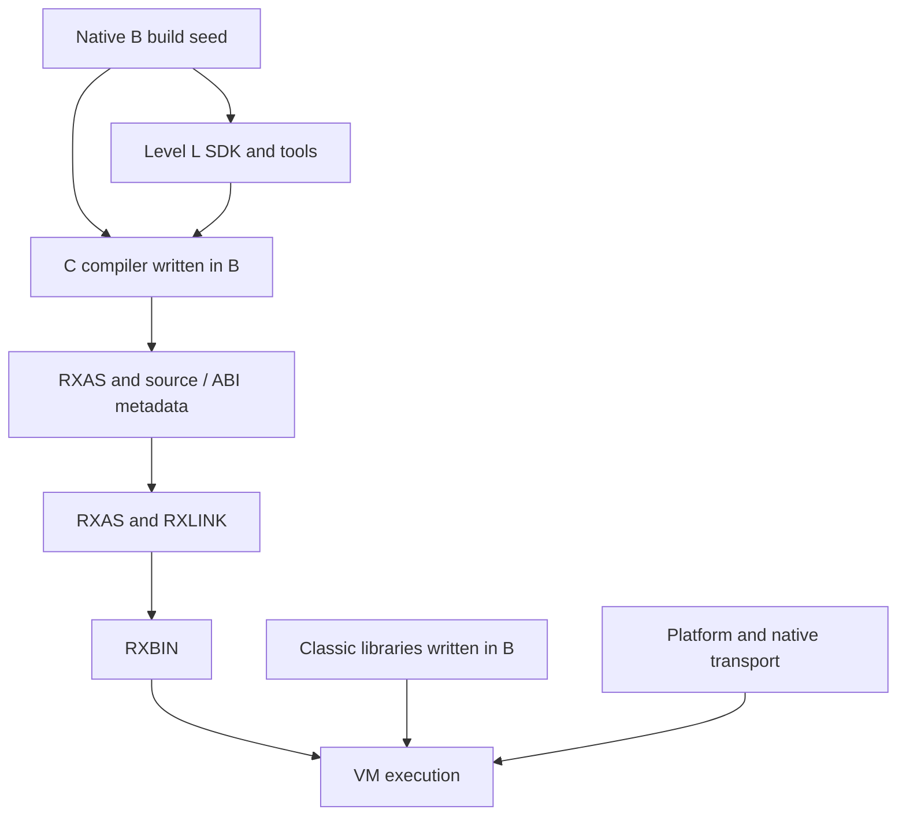

# Level C compiler architecture

**Target architecture approved by Adrian, 19 October 2026.** The original
native/reference audit used `016e6a65466c65a5c722b96452d95025acb463b2`;
the context ABI records completed STEP03d and the current approved C v4/SELECT
implementation. Qualification remains in the plan.
The [plan](../PLAN.md#c-first-delivery-milestone) owns qualification and sequence;
[requirements](levelc-requirements.md) map coverage and
[agent work packages](agent-work-packages.md) define implementation assignments.
“Current” below means inspected source, not fresh execution qualification.
Approval establishes the ownership and delivery direction, not implemented
capability. Exact new public API/schema/ISA contracts retain their step gates.

## Outcome

Deliver one complete, explicitly selected Classic Level C compiler implemented
in Level B with Level L grammars/services; independently useful Level L analysis
and optimisation; shared Classic runtime libraries written in B; and justified
RXAS/VM improvements for Classic workloads. INTERPRET completes the sequence.
New B/G coverage and self-hosting are outside this delivery. Existing consumers
and signed B/G interoperability remain regression obligations. Default compiler
replacement is a separate decision after qualification.

Native B remains the build seed. New source requests cannot invoke native source
compilers/backends. RXAS, RXLINK, VM, platform services and native transport
providers remain legitimate dependencies. A native primitive executes a defined
operation; it must not hide a second Classic parser, lowerer or BIF implementation.

Native compiler source changes in this delivery are limited to evidenced defects
in the Level B build seed, with focused regressions preserving the existing
language contract. New Classic compiler features remain in this B/L implementation;
shared runtime behavior remains in `lib/rxfnsc/`. Native Classic parsing, lowering
and feature work are outside this delivery.

## Current implementation review

| Inspected surface | Current facts | Target consequence |
|---|---|---|
| Native `compiler/rxcpcscn.re`, `rxcpcpar.c`, `rxcpcgmr.y`, `rxcpcval.c`, `rxcp_levelc_lower.c`, `rxcc.[ch]` | Separate Classic parsing/lowering feeds the common native backend. `rxcc_parse` owns an exact-length parsed/mapped unit, not a complete compile service. | Reuse requirements/fixtures, not the native implementation as a dependency. Parse success proves neither execution nor INTERPRET. |
| Native architecture/worklist | 24 admitted instruction reviews closed with exceptions; INTERPRET rejected; host/source/configuration/lifecycle obligations open. | Native closure never automatically closes the new compiler. |
| Native direct-BIF table | 70 catalogue names, LOWER/UPPER and 23 Unicode extension names have entries. | Integrate and test every name; entry presence is not conformance. |
| `levelc/levelc.rxl`, `llcparse`, `llcfrontend` | Generated Unicode-variable lexer/LR grammar and C token policy; ordered DROP and SELECT projection/lowering, limited operators, ASCII private PROCEDURE labels/calls, simple ARG and LENGTH/ARG/DIGITS only. Shared-pool labels/fall-through refused. | Qualify each instruction increment; wider source/instruction coverage remains substantially smaller than native C. |
| `llcir`, `llcrxas`, `llccompiler`, `llrxc-c` | Independent C family/selector/service/CLI; neutral ABI attributes still use `crexx.g` type names. Owned RXAS output and explicit limits. | Preserve separation; neutral ABI types belong in compiler-common contracts, not typed semantics. |
| `lib/rxfnsl/rexx/llflow.crexx` | Checked AST-role graphs, structured loops/branches, condition facts and finite definite assignment already exist. | Reuse this foundation; distinguish source-AST analysis from executable IR analysis. Its short-circuit roles cannot model eager Classic AND/OR. |
| `lib/rxfnsl/rexx/llir*` | Frozen modules/schemas, block-local values, cross-block slots, revision-bound facts, checked rewrites and bounded local optimisation. | Add exceptional/resumable edges, generic analyses and liveness before relying on them. No immediate SSA rewrite. |
| `levelc/runtime/llctarget.crexx` | One current B target: ten borrowed-context adapters and one no-match bridge reuse shared B bodies; no per-operation default config/pool or copied activation. Fourteen literal/pool/packet/result helpers remain. | Preserve live owners and shared algorithms; complete later operations/BIF bindings and prove any specialization's state/failure/observation equivalence. |
| `lib/rxfnsc` | B implementations own values, pools, activation, DO state, BIFs and streams; package imports include classlib, B Unicode core, cstream/fs. | Extend existing owners; retain independent Unicode/provider delivery and Classic policy. |
| Maintained `examples/step06/walk-c.after.rxas` | Borrowed root owners and result packets remain; exact literal branches prune dead arms while retaining runtime truth. Current wrapper/body frames are 16/27; clause IDs remain zero (full TRACE is open). | Named conservative costs remain C-OPT-01–03/05/06; walkthrough counts include wrappers/cold handlers and exclude helper bodies/metadata. No minimal-frame or speed claim. |
| RXAS sources, `binutils/include/rxops.h`, VM guide, `interpreter/rxvml.h` | Existing peephole/procedure analysis and decimal/context/call/PARSE primitives. Public load-file/load-buffer/context-destroy, no individual-module unload. | Prefer existing operations. Dynamic code needs continuation and reclamation, not merely a bounded lookup cache. |

Some old BIF/reference paragraphs still describe DATE/TIME refresh and streams
as missing despite later code/worklist corrections. Resolve using current code
and the owning contract; reconcile stale prose in the corresponding increment.
Do not import historical statuses into the new requirements ledger.

## Ownership and permitted dependencies

| Owner | Responsibility | Excluded responsibility |
|---|---|---|
| `research/level-l/compilers/levelc/` | C tokens/grammar/AST, binding, clause/control rules, C IR semantics, specialisation legality, selector, service/CLI | Generic graph algorithms, duplicate BIFs, VM loader internals, typed frontend |
| `lib/rxfnsl/rexx/` | Generic source/tree/CFG records, facts/effect interfaces, worklists, checked rewrites, liveness/interference, bounded output | C keywords/numeric defaults/pool rules/BIF names or target opcodes |
| `langtools/` | Level L specification compiler/generation, rxlang, generic tool services, guides/examples and independent SDK tests | C application main or another Level L subtree |
| `compilers/common/` | Shared cREXX ABI/metadata interpretation and target utilities with real common users | Language-dispatch main, hidden C/G policy, speculative universal frontend |
| `lib/rxfnsb/unicode/` (shared B component) | Unicode algorithms, pinned data and B procedural API used by G/C; optional runtime image | G collection facade, C BIF/error policy, compiler bootstrap dependency |
| `lib/rxfnsc/` | Classic values, pools, activation, conditions/state, BIFs and parse/stream adapters | Source parsing, IR or dependency on research compiler modules |
| `assembler/`, `binutils/`, `disassembler/`, `linker/`, `interpreter/` | ISA/encoding, machine optimisation, execution, generic owned code images | Classic grammar/AST, BIF-name dispatch or source-level EXPOSE rules |
| `platform/`, RXPA providers, `ports/single-threaded/` | OS transport, codecs, clocks, maintained CMS/TSO profiles | Compiler language decisions or duplicate runtime algorithms |



Arrows describe build/use flow, not reverse import permission. Generated C
programs depend on Classic libraries; the compiler host reads their ABI metadata
as data. SDK/tool libraries cannot import research/compiler modules. C-only
configuration cannot generate/link a typed/G frontend. Shared changes retain G
regressions without requiring new G features.

`llctarget` may temporarily remain an ABI shim, but lasting runtime semantics
belong in rxfnsc. Remove obsolete adapters after consumers migrate. Unicode
packaging follows the shared B foundation below. Preserve public G namespaces
and existing consumers; directory movement alone does not prove independence.

### First foundation increment

The active slice preserves existing public APIs. C-only dependency controls
stage separate compiler-host and static-target roots; static C links the
existing `library`, `rxfnsc`, `llctarget`, `classlib` and B Unicode core images explicitly.
The collection library supplies variable-pool storage. Generic IR definite
assignment indexes predecessor edges once and schedules changed exits through
a bounded worklist; it does not introduce a C analysis engine or liveness API.
Unicode ownership below preserves private ABI, public procedure bodies and G classes.
Exact qualification and remaining criteria belong to the active plan.

## Shared Unicode foundation in Level B

The shared component packages the existing algorithms and 23 public
`rxunicode` procedures in `rxunicode-core.rxbin`. C adapters compile against
that exact B metadata. G includes the same B members in its aggregate and
retains its collection/iterator classes. No duplicate procedure body, extra
forwarding layer or second Unicode algorithm is introduced.

CLC-STEP03b preserves namespace, signatures, argument presence, bodies and
documentation. Adrian approved the
[exact public contract](../../../../lib/rxfnsb/unicode/README.md#public-b-interface)
after independent verification that minimal B and L bootstrap remain upstream
of this optional component. Property/simple-mapping and other new interfaces
remain later exact-contract gates. The plan records qualification separately.

| Owner | Content and contract |
|---|---|
| `lib/rxfnsb/unicode/` | Shared B runtime source/templates and canonical pinned Unicode/legacy-codec data; separately selectable `rxunicode-core.rxbin` (selectable component image). No dependency on the G facade or C libraries. |
| `tools/unicode/` | Component-specific table compilers/generators, their Level L grammar and build adapters; use `rxlang` as a tool. Generated code/tables remain build outputs. No source compiler algorithm is moved here. |
| Shared B procedural facade | STEP03b preserves the existing 23 `rxunicode` version, normalization/full mapping/folding, direct grapheme and codec procedures. Property/simple mapping remains a separate STEP03 contract. Private numeric selectors stay private. |
| `lib/rxfnsg/rexx/unicode.crexx` | Preserve G collection/iterator classes and their private helper calls; the aggregate explicitly includes the B-owned procedures to preserve its old public surface without duplicate bodies. Source compatibility and doc tags remain required. |
| `lib/rxfnsc/` | Preserve Classic BIF names, argument presence/checking, text/ordinal conversion and Classic error translation. Call the B facade directly. No second normalization, segmentation or codec implementation. |
| `lib/rxfnsl/` | Consume pinned property data or a minimal independent property table for recognition; no import of G/C and no requirement to load the full Unicode runtime. |

Do not merge all large tables into the seed `library.rxbin`. Bootstrap order is
minimal B library → L bootstrap/tool → optional Unicode generation → B Unicode
runtime → G facade/C runtime. L's own property generation must use minimal B
and pinned source data without depending on this optional runtime image. One
canonical source-data owner can feed different generated indexes needed by L
and runtime algorithms; do not create a graph cycle or conflate those indexes.

The current B interface uses `.string`, `.binary` and ordinary scalar results;
its grapheme positions count extended graphemes. It preserves existing value
ownership and family-specific errors. It adds no public traversal, simple-map
or budget API. Those possible shared scanner/pool services remain later
STEP03 contract work; G-only iterator objects stay in G and locale/configuration
overlays remain C-owned. Existing
ordinary text remains exact codepoints, without implicit normalization, folding
or grapheme indexing. Explicit full casing may expand; ordinary Classic symbol
casing must use its simple-mapping contract. Stream codec choice never changes
the fixed Classic ordinal bridge.

Validate the extraction with direct B consumers, unchanged G facade fixtures,
all C Unicode BIFs/streams, UCD conformance inputs, embedded NUL/high scalars,
malformed bytes, replacement controls and both engines. Compare linked constant
ownership and RXAS so the split does not duplicate tables or introduce wrapper
copying. Test C-only and G-only clean/incremental/installed builds, missing and
changed generated inputs and no-op freshness. Preserve data provenance/licenses,
API doc tags and code-shape assertions. These tests close ownership; no new
Unicode version or semantic expansion is implied.

Select one provider aggregate per linked image: standalone B core for C-only
applications or the existing G aggregate containing those B members for
combined products. The linker rejects overlapping providers; no deduplication
change is proposed. Exact import roots and autoload-origin checks must prove
the C path's independence, rather than relying on broad installed-directory
search order. Existing embedded/G consumers retain a focused compatibility
check with the standalone core physically absent.

## Compilation pipeline

1. **Owned request.** Exact UTF-8 bytes, logical source ID and physical mapping,
   mode, explicit imports, options and work/storage limits. File I/O and atomic
   destination replacement belong to the command adapter; the service cannot
   exit, spawn a source compiler or use ambient import fallback.
2. **Recognition.** Level L engines plus C contextual token policy handle words,
   labels, continuation, comments, radix suffixes and blank/abutment. Preserve
   byte spans separately from Unicode positions; do not translate C into B.
3. **Named C AST.** Source constructs, explicit fields/lists/optionality,
   spelling and clause identity. Bind entry identities and validate static
   errors throughout unreachable source before optimisation.
4. **C semantic IR.** Explicit blocks, ordered effects, values/slots, context
   use, control/completion edges and source observations. Keep pool operations
   until C legality analysis proves a narrower representation.
5. **Generic analysis.** Level L computes def/use, reachability, liveness and
   finite-domain facts from registered C summaries. C supplies numeric, pool,
   alias, call and TRACE semantics. Rewrites invalidate revision-bound facts.
6. **Target lowering.** Choose existing VM instructions or checked runtime calls;
   every operation has a conservative executable route. Typed target records
   precede physical register assignment and retain source origins.
7. **Registers/emission.** Generic liveness/interference consumes use/def/edge
   records. The target owns aliases, call windows, clobbers, reserved registers,
   cleanup and legality. Render through Level L's writer. RXAS independently
   owns machine optimisation, separately switchable from compiler optimisation.
8. **Assemble/link/run.** Existing tools validate RXBIN and explicit imports.
   Keep separate file stages. Later in-memory assembly must use the same
   assembler contract and prove diagnostics/output equivalence.

### Representation contracts

Names describe proposed records, not committed public identifiers.

| Record | Required content/ownership | Validation |
|---|---|---|
| CompileRequest | Owned bytes, logical identity/map, module/routine/interpreted-group mode, imports/profile, limits, optimisation policy | Exact length including NUL, valid options/encoding, no ambient mutable compiler state |
| CompileResult | Status, owned diagnostics, optional frozen AST/IR, RXAS chunks/source map, runtime ABI requirements | No executable after recovery/error/limit; earlier results survive later failure |
| C AST | Kind, named fields/lists, source span, clause, spelling, generated origins | Grammar/schema plus C static checks; no overloaded anonymous fields |
| IR operation | Typed inputs/results, attributes, ordered effects, normal/exceptional/resumable edges and origin | Generic structure plus C meaning; unknown effects prohibit speculation |
| Analysis result | Owner/revision, domain/version, explicit absent versus false, budgets | No stale/foreign facts; transformation declares invalidation |
| Target record | Opcode ID, typed operands, use/def/clobber, failure/normal edges and observations | Validate before/after allocation and rewriting; strings are output, not optimisation IR |
| Runtime ABI | Namespace/signature, presence, ownership/borrowing, context, effects/errors | Separate producer/consumer, metadata and malformed-import tests |
| Completion/continuation | Kind, result presence/value, destination, condition, owned code handle/PC and live spills | Generation/lifetime/cleanup checks; no raw expired caller pointers |

Retain current block-local values and cross-block slots. SSA is not a prerequisite.
Reuse existing `llflow` AST analysis and `llirservices` IR passes rather than
introducing competing generic engines. Their graphs answer different questions:
source structure before lowering versus explicit executable edges after it.
Only proved mapping adapters may transfer facts; Classic eager logical evaluation
must not inherit `llflow` short-circuit AND/OR behavior.
Make exceptional/resumable edges and clause observations explicit before global
passes cross them. Version changed serialized schemas; reject incompatible data
rather than silently assigning new semantics. Algorithm records must state
invariants, convergence/work bounds, allocation accounting and atomic failure.

## Classic activation and runtime

Start with RexxValue, RexxStem, RexxVariablePool, RexxActivationArguments,
RexxClassicConfig/State, RexxDoState and existing BIF modules. Keep their public
consumers compatible while introducing a coherent reference-based compiled-C
activation facade. A copied argument/result packet is not the live activation.

An activation owns or explicitly borrows arguments/presence and invocation kind;
result presence; the replaceable visible-pool binding and caller/exposure links;
PROCEDURE eligibility; NUMERIC/ADDRESS/TRACE/clause-clock/condition state;
source/clause and label/routine identities; active loop state; program-root
completion; and execution-owned queue, stream and host services.

Internal CALL creates an activation with defined inheritance/restoration. A
label alone creates no private pool. PROCEDURE replaces the visible-pool binding
and resolves EXPOSE in source order. Interpreted code sees that replacement
through the same binding. Create configuration at program/host entry, not per
operator. Calls, callbacks and context mutation invalidate affected facts;
process-global defaults cannot silently replace active Classic state.

Compile a source unit's label/control space into one owned code body with checked
entry identities. An internal call can recursively enter that body with a new
activation and entry ID; SIGNAL changes position within the current invocation.
Do not clone the source tail for every label or require PROCEDURE after labels.
Preserve first-label precedence, fall-through and control-stack clearing.

Existing BIF bodies and valid library qualification are reused; extending the
new compiler's current three-name subset is binding/context work, not a second
BIF implementation. Reuse expected-result fixtures through the new compiler;
change library algorithms only for a demonstrated defect or named missing
contract. BIF calls share one runtime context/presence contract. Pure text entries need
not copy the entire activation; stateful entries borrow their declared context
from its authoritative owner. Numeric specialisation preserves decimal DIGITS,
FUZZ/FORM, literal spelling, exact logical tests, errors and LOSTDIGITS. Machine
integers/floats are implementation choices, not changed Classic semantics.
Ordinary text is exact Unicode codepoints with the fixed Latin-1 ordinal bridge;
external stream encodings do not change source or ordinal semantics.

### Borrowed Classic context contract

**Shared B surface and nine borrowed target adapters approved by Adrian on
19 October 2026; implemented and locally qualified.** Adrian subsequently
approved the clean selector/schema migration below and removed compatibility
requirements for earlier research C output: use one current `llctarget`
namespace/product and remove obsolete copied-context adapter bodies. The plan
owns implementation and qualification; shared B/L consumer contracts remain.
The intended outcome is one execution-owned configuration and one authoritative
activation/pool binding for the C subset already admitted at `975afbc15`.
Remove per-operator configuration construction and copies of live activation
state while retaining existing expression/BIF bodies and observable results.
This does not admit more source forms or close an instruction review.

The following selector migration will cover the existing scalar expressions, assignments, structured
control, NUMERIC forms, private PROCEDURE routines, argument/result presence
and LENGTH/ARG/DIGITS forms. It does not add shared-label/fall-through calling,
EXPOSE syntax, condition handlers, new BIF names, signed external calls, host
invocation APIs or dynamic compilation. Those remain with their owning steps.
The completed runtime baseline supplies the five-callable B bundle and nine
direct-host adapters below; generated C still needs the approved migration.
The existing Unicode procedures and algorithms are unchanged.

#### Approved shared B surface

`RexxClassicContext` lives in namespace `rexxclassiccontext`, owned by
`lib/rxfnsc/RexxClassicContext.crexx` and delivered in the existing
`rxfnsc.rxbin`. It is a reference bundle, not a second implementation of an
activation. Its only fields are references to existing caller-owned objects.
It allocates no activation, pool or configuration and stores no reference to
itself or one of its own members. Existing `rexxactivation`, `rexxpool`,
configuration and BIF exports retain their signatures and behavior.

Passing the three existing references separately would add no B class, but
would spread pool-binding replacement across every helper ABI. A copied pool
reference does not observe replacement of the caller's binding, and nested
reference containers are outside the current B surface. The bundle
provides one explicit mutable binding using existing class/reference rules.

These are the complete five approved callables. All arguments are required;
there are no defaults, optional-presence bits or exposed by-value arguments.
Types below use the existing fully qualified source identities.

| Callable | Exact parameters | Result |
|---|---|---|
| `.rexxclassiccontext..RexxClassicContext(...)` (default factory) | `activation = reference .rexxactivation..RexxActivationArguments, pool = reference .rexxpool..RexxVariablePool, config = reference .rexxclassicconfig..RexxClassicConfig` | `.rexxclassiccontext..RexxClassicContext` |
| `activation()` | none | `reference .rexxactivation..RexxActivationArguments` |
| `pool()` | none | `reference .rexxpool..RexxVariablePool` |
| `config()` | none | `reference .rexxclassicconfig..RexxClassicConfig` |
| `bindPool(pool)` | `pool = reference .rexxpool..RexxVariablePool` | `.void` |

The factory checks all three references with the existing `<refvalid>` facility
before publishing a bundle. Each getter checks its selected reference before
returning it. `bindPool` checks the replacement before changing the binding;
failure leaves the previous binding intact. Invalid or expired targets raise
the existing `REFERENCE_INVALID` condition. There is no new handle, error
category, lifetime extension, global registry or VM/object ABI.
If an existing B procedure signal handler resumes with `.signalaction.skip()`,
the rejected operation returns immediately: a failed factory returns a bundle
with empty references, a failed getter returns an empty reference, and a failed
`bindPool` preserves its old binding. This is failure recovery, not a successful
borrow; no rejected reference is installed after the signal handler returns.
Callers supply initialized instances; a live reference cell does not by itself
prove object initialization. Existing `OBJECT_NOT_INITIALIZED` behavior remains
when an uninitialized object is used. The bundle adds no profile/state inference
or eager copy of the referenced objects.

`bindPool` changes only this bundle's pool reference. It does not create or copy
a pool, apply EXPOSE, change Unicode-name policy, alter activation state or
modify configuration. Those operations retain their existing owners. C selects
UTF8 configuration and Unicode pool names at entry; the shared bundle itself
does not introduce a new character-profile policy.

#### Stable owners and copying

The C entry wrapper owns the existing root `RexxActivationArguments`, UTF8
`RexxClassicConfig`, root `RexxVariablePool` and the bundle in stable local
storage. Capture arguments and complete any by-value construction before
binding references. Helpers receive a reference to that authoritative bundle;
they do not receive copies of live activation/configuration objects.

The factory's value result can safely move into its final local because its
three references point to external caller-owned storage. Ordinary B copying
of a bundle copies these references: the referents are shared, but a later
`bindPool` changes only the copied bundle receiving that call. Generated C
therefore passes the authoritative bundle by reference and never substitutes
a value copy when a live binding is required. It must not overwrite, move,
resize away or recycle any referenced owner while a borrow is live.

For the admitted private-PROCEDURE call profile, each caller call window owns
the child's argument/activation object, private pool and bundle until the child
returns. Populate arguments in source order, inherit state with the existing
`inheritSignalPolicy`, and mark the invocation using `beginInternalCall` or
`beginInternalFunction`. Use existing `enterProcedure` validation and pool
initialisation/status inheritance; no new inheritance algorithm is added.
Construct the bundle only after those owners occupy stable storage. Nested
calls borrow the same root configuration and create fresh child activation
state; a child NUMERIC change cannot modify the parent's activation.

The callee uses the supplied binding rather than constructing another pool.
Rebinding in direct runtime tests can use another caller-owned pool, proving
that subsequent reads and BIF contexts observe the same authoritative bundle.
This is not permission to implement the later shared-label/PROCEDURE protocol
inside this slice. Any later callee-local replacement must restore or end every
borrow before that local dies; it cannot leave a caller-owned bundle referring
to returned-frame storage.

Keep existing fresh return-presence packets for now. They contain returned
value/presence, not a copied live child activation or references to child local
storage. Their current representation cost remains explicit. Reference targets
cannot escape into program results, cross a VM-context boundary or outlive
their invocation. Stale-reference controls must fail through checked references,
not extend owner lifetimes. Repeated executions own separate roots/configs.

#### Numeric frame and error contract

`RexxActivationArguments` remains the authoritative stored DIGITS/FUZZ/FORM
state. The executing C frame must also carry those settings: existing numeric
BIFs read the immediate caller's VM frame through inherited numeric clauses,
not `RexxBifCallContext.setCallerActivation`.

At root entry install the root defaults, and at child entry install the inherited
child settings in the C frame. After a successful NUMERIC statement, install
the new settings in that same frame. An existing-instruction sequence can set
FUZZ to zero, set DIGITS, set the validated FUZZ and set FORM, avoiding an invalid
intermediate DIGITS/FUZZ pair. This sequence is emitted in the C frame; calling
a B setter that changes only its own VM frame would lose the setting on return.

Validation reuses `setNumericDigits`, `setNumericFuzz` and `setNumericForm`.
They commit only after successful validation and return their existing error
text. On validation failure, raise the existing authored `CLASSIC_SYNTAX`
diagnostic and execute no VM setting instructions: activation fields and the
owning C frame retain their prior settings. Validated installs must use admitted
integer values and existing instructions, with no fallible conversion between
field commit and frame synchronisation. This is the ordinary validation-failure
atomicity contract. Resumable asynchronous conditions and observer boundaries
remain STEP02/07 obligations; this slice does not claim their closure.

When a direct numeric BIF is emitted from the C frame, its inherited clauses
read that frame. If a temporary B shim is the immediate BIF caller, the shim
must declare DIGITS, FUZZ and FORM inherited so that it receives the C frame's
settings; relying on the shim's default settings is incorrect. Returning from
the shim or child restores its caller's VM frame using existing VM behavior.
Do not change process-global RexxValue defaults or add a native numeric service.

#### Checked BIF reuse and current target

Call sites retain source-ordered values/presence and existing direct BIF entry
selection. Build a call-local `RexxBifCallContext.expression(name)`, bind the
bundle's config/pool/activation through existing setters, set arguments and call
the selected existing B entry followed by `rexxclassicbif_checked`. The name is
diagnostic context, not selection through the legacy name dispatcher. No BIF
body or error policy is copied into the compiler. Existing config getters and
argument arrays can still copy values internally; those are retained costs,
not a claim that the complete BIF path performs no copies.

**Approved clean target:** one namespace `llctarget` in the existing installed
`llctarget.rxbin`. Consolidate the completed borrowed adapters into that owner
and delete `llctarget2` and the replaced copied-context implementations. Earlier
research C images/IR are not a compatibility contract. New C output uses the
following exact borrowed-context entries. Here `V` is
`.rexxvalue..RexxValue` and `C` is
`reference .rexxclassiccontext..RexxClassicContext`; these are table abbreviations,
not additional public type names.
All parameters are required and have no defaults/expose flags.

| New entry | Parameters | Result |
|---|---|---|
| `llctarget..binaryop` | `operation = .string, left = V, right = V, context = C` | `V` |
| `llctarget..unaryop` | `operation = .string, value = V, context = C` | `V` |
| `llctarget..truth` | `value = V, context = C` | `.int` |
| `llctarget..setting` | `operation = .string, context = C, value = V` | `.void` |
| `llctarget..digits` | `context = C` | `V` |
| `llctarget..readarg` | `context = C, ordinal = .int` | `V` |
| `llctarget..countargs` | `context = C` | `V` |
| `llctarget..existsarg` | `context = C, ordinal = V, option = V` | `V` |
| `llctarget..lengthvalue` | `value = V, context = C` | `V` |

Keep the currently admitted operation names and argument forms. `readarg`
retains ARG-instruction uppercase behavior; it is not the raw ARG BIF accessor.
`setting` mutates the borrowed activation only after existing validation; the
selector then performs the C-frame install above. `digits`, ARG and LENGTH
select their existing checked BIF entries. Existing argument construction,
literal/pool helpers and fresh result packets retain their current ABI;
argument construction finishes before the new bundle borrows the activation.
Keep only the helpers used by the clean selector: `literal`, `poolnew`,
`poolread`, `poolwrite`, `sayvalue`, `arguments`, `mainargs`, `append`, `present`,
`absent`, `requirevalue`, `setresult`, `status` and `failuremessage`. Together
with the nine entries above these form the 23-export foundation. SELECT adds
two entries under its [approved contract](#approved-select-contract), giving
the current 25 exports. Remove
`contextnew`, the old nine bodies, compatibility bridge/build entries and
old-image/legacy-signature tests. Preserve applicable RexxDoc tags when moving
the current implementations. The private `bifcontext` remains internal.
The existing operator-name branch and conservative root setup remain named
C-OPT-01/03 work; this contract does not add direct-operation B exports or claim
that literal-only programs have no unused setup.

New generated C source-unit procedures receive one `C` reference; invocation
kind and argument presence reside in its existing activation. Their existing
fresh result-packet result type remains. This internal ABI is distinct from
the unchanged VM main entry and from later signed external-call contracts.
Changed C semantic type/effect/call records use the approved C family revision
below; do not reinterpret old frozen records or change generic L record
semantics. Installed target metadata missing current `llctarget` signatures or
the bundle must cause a precise import diagnostic before publishing RXAS, preserving
the previous output. Incompatible packages must not accidentally select
an old same-name signature. No new runtime product or compiler dependency is
introduced into static applications.

#### Approved C-family revision and generated procedure ABI

**CLC-STEP03d is locally complete; DROP introduced C family version 3 and
SELECT advances it to version 4 without changing the context ABI.** Use the following semantic contract and generated procedure
ABI, with one clean current C target and no compatibility bridge for earlier
research C programs. The five shared B callables and nine borrowed signatures
above are retained. DROP adds its approved source form and C-owned IR operation
below; no extra B callable, generic L API/transport format, RXBIN metadata
record or RXAS/VM operation is introduced. Complete labels, conditions and
INTERPRET retain their later gates.

The C selector accepts `core` version 1, neutral `crexx.g` version 1 scalar
types and `crexx.c` version 4. The neutral scalar names do not load the G
frontend. The generic LLIR text/binary format remains version 2. `crexx.c`
versions 1/2/3 are never reinterpreted as version 4. Within version 4, the complete C
type/operation declarations, including unused declarations and all ordered
fields and effect summaries, must match the canonical C registration before
emission. Foreign operations remain outside the C profile.

The C types are `value`, `arguments`, `result` and `context`. The first
three retain their current runtime representations: `RexxValue`, a not-yet-
borrowed argument/activation packet and a fresh return-presence packet. They
retain the existing byte codec in the semantic registry. `context` uses that
same nominal codec registration but denotes only a live reference to an
authoritative `RexxClassicContext`; its runtime payload is never serialized in
IR. It may originate only at the one required function parameter and flow
through reference-value copies and local slots. A context slot is bound once
in its function's entry block, from parameter 1 or an earlier proven entry
alias, before entry reads; every later/dead-block read requires that binding.
Reject nonentry/repeated stores and unproved producers. This is the narrow
C opaque-context invariant, not a general definite-assignment service; the
generic structural verifier alone does not prove slot initialization.
Reject `core.constant` and
optional/default parameters of this type, references in results, and any
unsupported producer/use. The former `numeric` and `pool` types and `pool.new`
operation remain absent. Resolve the current pool from the bundle
at each pool operation, so an observed `bindPool` replacement remains live.

The following table preserves the 40 context-foundation operations; approved
DROP adds the 41st operation [below](#proposed-next-instruction-drop), and
[SELECT](#approved-select-contract) adds operations 42/43. Names have
the `crexx.c.` prefix; field order is significant. `V`, `C`, `A`, `R`, `B`,
`I` and `T` mean `value`, `context`, `arguments`, `result`, `core.boolean`,
`crexx.g.int64` and `crexx.g.text`. An output, when present, is named `value`.
`context` is a conservative state footprint covering reads or writes through
the bundle, including existing BIF pool-policy setters; it does not assert
read-only access. `condition` includes the existing reference, initialization,
conversion, numeric, argument and resource conditions without changing their
names or diagnostic policy. All rows terminate as `returns` except `exit`.
No evaluator is registered for context-dependent operations, including truth.
For exact literal bytes `0`/`1`, C construction may supply a separate derived
core Boolean to the branch while retaining the effectful runtime truth call.
Dead-arm pruning therefore preserves owner checks, pool-policy effects and
condition timing. Removing that context work remains C-OPT-03, subject to its
state/failure/observation proof.

| Operation(s) | Ordered inputs | Ordered attributes | Output | State | Failure |
|---|---|---|---|---|---|
| `add sub mul div eq ne lt le gt ge strict concat blank abut and or xor` | `left:V right:V context:C` | — | V | `context` | `condition` |
| `positive negative not` | `value:V context:C` | — | V | `context` | `condition` |
| `say` | `value:V` | — | — | `output` | `conversion.io` |
| `load` | `context:C` | `name:T` | V | `context` | `condition` |
| `store` | `context:C value:V` | `name:T` | — | `context` | `condition` |
| `truth` | `value:V context:C` | — | B | `context` | `condition` |
| `numeric.digits numeric.fuzz` | `value:V context:C` | — | — | `context` | `condition` |
| `numeric.form` | `context:C` | `form:T` | — | `context` | `condition` |
| `digits` | `context:C` | — | V | `context` | `condition` |
| `arguments.empty` | — | — | A | `none` | `resource` |
| `arguments.append` | `arguments:A value:V present:B` | — | A | `none` | `resource` |
| `arguments.read` | `context:C` | `ordinal:I` | V | `context` | `condition` |
| `arguments.count` | `context:C` | — | V | `context` | `condition` |
| `arguments.exists` | `context:C ordinal:V option:V` | — | V | `context` | `condition` |
| `return.present` | `value:V` | — | R | `none` | `resource` |
| `return.absent` | — | — | R | `none` | `resource` |
| `requirevalue` | `result:R` | — | V | `none` | `missing.result` |
| `setresult` | `context:C result:R` | — | — | `context` | `condition` |
| `call` | `arguments:A context:C` | `target:T function:B` | R | `context.output` | `condition` |
| `length` | `value:V context:C` | — | V | `context` | `condition` |
| `exit` | `value:V` | — | — | `process` | `exit` |

`exit` has termination `diverges`. `form` admits only the current
`scientific`/`engineering` spellings; `ordinal` must be positive; `target`
must identify an existing private routine. `function` is a required canonical
Boolean attribute: true selects `beginInternalFunction`, false selects
`beginInternalCall`. It is static invocation metadata, not another argument
or source-language feature. Ordered actual evaluation and explicit omitted
positions remain in the existing argument packet. Context-free constants are
limited to the currently selected literal/scalar types, never argument,
result or context packets manufactured from bytes.

Every generated source-unit procedure, including `$MAIN`, has precisely:

```text
(context = reference .rexxclassiccontext..RexxClassicContext)
    -> .rexxactivation..RexxActivationArguments
```

The sole argument is required, with no default or expose modifier. The result
is the existing fresh presence packet; it cannot contain references to child
owners. Expression calls still use `requirevalue`; statement calls still
apply/drop `RESULT` in the caller's current pool using existing behavior.
The VM `main(argv)` entry and integer completion status are unchanged.

Root entry finishes `mainargs(argv)`, constructs one UTF8 configuration and one
Unicode-name pool in dedicated stable locals, then constructs one bundle using
their references. It passes `reference bundle` to `$MAIN`. A private call first
finishes all argument-packet construction, puts that activation in its final
caller-owned local, calls existing `inheritSignalPolicy(parent.activation())`,
the selected `beginInternal*` and `enterProcedure`, and initializes a fresh
private pool with existing command-status inheritance from `parent.pool()`.
Only then does it construct the child bundle with the parent's configuration
reference and call the callee with `reference childBundle`. The caller owns
these locals until return/unwind; callees construct no replacement pool.
Nested calls have distinct owner windows. Normal return clears borrowed call
arguments and temporary aliases before releasing bundle/activation/pool owners;
abrupt paths use existing VM unwind cleanup. This introduces no shared-label
entry or later PROCEDURE/EXPOSE protocol.

Select the existing exported class factories/methods through the independent
metadata reader. In particular, use the existing
`rexxclassiccontext.rexxclassiccontext.§factory` and getter symbols, activation
numeric/inheritance/procedure methods and pool `inheritCommandStatus` method;
do not read private attribute layouts. Validate the selected class owner,
callable identity, B flags, exact result, declared arguments and optional flags.
The selected configuration factory's `?requested_profile=.string` stays
optional in metadata and is supplied explicitly. Existing `poolnew()` owns
the explicit `.RexxVariablePool(1)` construction; no duplicate pool-factory
selection is added to the C emitter.
The nine foundational adapters and the two SELECT entries remain required-only. Legacy short type spellings may
match only their explicit known owner-qualified identities, never arbitrary
basenames or class/interface assignability. Preserve the existing hidden
receiver ABI: pass a live receiver alias with its established call-window
swap/restoration protocol, rather than a by-value receiver snapshot. Copy an
already-reference operand's payload; use `mkref` only on an actual stable owner,
never a reference-valued slot. End every temporary `linkref` alias before its
window is cleared. Existing general calls suffice; no new ISA is needed.

Each executing C frame selects Classic numeric standard with existing
`numsci 18,1,2`, then reads validated integer `numericDigits/Fuzz/Form` through
the borrowed activation and installs `FUZZ=0`, DIGITS, FUZZ, FORM in that frame.
After a successful void `llctarget.setting` call it performs the same integer
getter/install sequence, with no text conversion between commit and install.
Install the existing four fatal `sigbrv` handlers before entry setup/body.
A failed setting diverts to that C frame's fatal branch and cannot reach any
numeric install or ordinary next statement. The existing relay installs
`sighalt` before `signalorigin`: this profile is nonresumable even with an
outer B skip handler. Do not claim outer-handler recovery or alter that policy
in this migration. The unchanged direct B adapter tests prove stored-state
atomicity; generated error executions and branch-shape checks prove diversion.
Child return restores the caller VM frame; its stored activation was never
changed by the child. Same-frame FUZZ/FORM proof must use observations whose
results actually differ, including a non-multiple-of-three exponent.

| Compiler/input/target combination | Disposition |
|---|---|
| Current compiler + canonical C v4 IR + current bundle/adapters | Supported through the one-context ABI. |
| Current selector + C v1/v2/v3/unknown IR | Refuse unsupported C-family version; no old schema/emission path or implicit upgrade. |
| Earlier emitted C programs + changed target | No compatibility guarantee or bridge; rebuild through the current compiler. |
| Current compiler + incompatible target or `rxfnsc` missing bundle | Precise import refusal identifying the missing/incompatible selected callable before publishing output. |
| Current compiler + mixed, forged, private, ambiguous, optionality/type/effect-incompatible records | Refuse before publication; never fall back to old adapters or native compilation. |

Use existing generic manifest save/load checks and reader bounds; add C-owned
whole-family/type/use and signature checks in `llcrxas`, not C policy in the
generic reader. Recheck every constant/attribute byte record with the canonical
selected codec, including unused/dead records, before any raw interpretation:
host codecs are not identified by the serialized manifest. All required entry
metadata and every selected runtime contract
must be admitted before publishing RXAS. Any refusal returns empty output and
leaves the graph and prior CLI output file byte-identical.

Implementation covers `levelc/llcir.crexx`, `llcfrontend.crexx` and
`llcrxas.crexx`, consolidation into `levelc/runtime/llctarget.crexx`, deletion
of `llctarget2.crexx`, their existing service/IR and STEP07/backend/direct-target
fixtures/checkers, and necessary build/test registration cleanup. Reuse `backend-step07.crexx`,
`check-step07.py`, `backend/{numeric,arguments,argv,calls}-c.crexx` and
`cases.json`; extend existing numeric observations for FUZZ/FORM inheritance,
restoration and failures instead of adding another scenario aggregate. Add
canonical current-C save/load and adversarial old/forged schema, constant-context,
wrong-width attributes, entry/unbound context-slot provenance, function-ABI
and selected runtime metadata refusals. Remove the old-image and
legacy-signature compatibility controls; retain independent B runtime/Classic
expectations and shared B/L consumer regressions.

Structural checks must show one root configuration per execution, one required
reference formal, no live owner snapshots/per-operation configuration, no
callee pool construction, stable child owners before borrowing, current-pool
lookup, correct call-kind/presence/result handling, safe receiver restoration
and reference-window cleanup, Classic same-frame numeric installs only on
success, existing fatal diversion, and unchanged source/error origins. Inspect
both caller and helper work; retained packet/config-getter copies stay named
costs. Qualify focused CLI/service/generated execution in compiler/IR modes and
both VMs, with separate assembler-mode controls and existing C-only restricted
roots. Reuse native controls by expected behavior, not faulty/excess native
output. Materially expanded nested tests need isolated normal Debug scheduling
measurement before registration, with generous serial timeouts. Reuse valid
sanitizer evidence for unchanged native inputs; any warranted new sanitizer
work is consolidated at final delivery under AGENTS.md. No build/test result is claimed
before implementation/qualification.

#### Review, migration and verification gates

The first public-surface approval is complete; implementation/qualification
status is recorded under CTX in the plan. These gates serve
CFC-AC02/03/06/07/09/11/12 and describe
this contract slice, not complete activation, BIF, host or C acceptance.

1. The five-callable B surface, borrowing/error contract, clean single-target
   C family revision and internal procedure ABI above are approved. Preserve all existing
   rxfnsc public class/BIF signatures and native/typed/RexxScript consumers.
2. Prove the bundle independently with existing B reference operations: external
   stable owners, safe factory-result copying, live pool rebinding, independent
   copy binding, failed replacement atomicity and `REFERENCE_INVALID` after
   owner death. Use direct B runtime tests in both modes and both VMs.
3. Reuse `testRexxActivationArguments`, `testRexxRuntimePools`,
   `testRexxClassicBifArg`, `testRexxClassicBifLength` and
   `testRexxClassicBifNumeric`. Add only missing checks for the new borrow path,
   invalid NUMERIC preserving both stored and VM state, independent roots and
   nested caller restoration. Reuse existing body expectations unchanged.
4. Migrate the admitted C selector/IR atomically. Reuse
   `tests/backend/{numeric,arguments,argv,calls}-c.crexx` and their `cases.json`
   expectations, selected independent `classic_expression_contract.py`
   expectations and `levelc_bif_numeric_context` fixtures. Extend STEP07's
   malformed-import/previous-output controls to the current surfaces. Refuse
   incompatible metadata without retaining an old-program compatibility path.
5. Inspect caller and helper RXAS: one UTF8 configuration per execution, stable
   borrowed owners, no live activation/configuration copy per operator, no unused
   callee pool reconstruction, correct inherited numeric shim frame and no new
   BIF dispatch/body. Classify retained result/argument/config-getter copies.
   Reuse the C-only exact-root/static/installed controls and existing consumer
   regressions. Measure any materially expanded nested aggregate before CTest
   registration, and qualify centrally under the repository's normal Debug
   rules. Source-only slices reuse valid unchanged-native sanitizer evidence;
   consolidate any warranted new proof at final delivery, preserving actual SAN
   obligations.

These gates do not design or implement INTERPRET, continuation ownership or
ephemeral code loading. The later mechanism must use the same live pool binding;
its exact runtime/VM contracts remain at the final STEP11 decision gate.

<a id="proposed-next-instruction-drop"></a>

### Implemented instruction: DROP

**Approved by Adrian, 19 October 2026; C v3 source/AST/admission/lowering is
locally qualified in normal Debug with independent caller/helper review.**
The [plan](../PLAN.md#current-drop-proof) records its exact bounded proof;
source EXPOSE, conditions/full diagnostics and TRACE retain later owners.
Reuse the existing [Unicode symbol contract](../../../../compiler/docs/levelc_unicode_and_streams.md#ordinary-values-and-byte-compatibility)
and [pool methods](../../../../lib/rxfnsc/RexxVariablePool.crexx), including
`dropSymbol(name=.string)->.void` and
`dropIndirectList(list=.string,config_ref=reference .rexxclassicconfig..RexxClassicConfig)->.void`.
No new B/L/VM API, target export, runtime algorithm or legacy compatibility path
is needed. One current `crexx.c` family advances to version 3, retaining its
four types and one-context procedure ABI, with this 41st operation:

| Operation | Ordered inputs | Ordered attributes | Output | State / failure / termination |
|---|---|---|---|---|
| `crexx.c.drop` | `context:crexx.c.context` | `name:crexx.g.text indirect:core.boolean` | none | `context` / `condition` / `returns` |

The projected AST adds `CDrop(items:(DropDirect|DropIndirect)+)`, whose items each
carry a raw `name` text field and their original authored span. The grammar is
a nonempty, ordered list of direct variable symbols or parenthesized single
variable references; `(expression)` is not an indirect target. Emit one drop
operation per item in source order. Direct items call the current pool's
`dropSymbol` once. An indirect item reads that variable at its position,
captures `symbolValue(name).asString(0)` once, then calls the current pool's
`dropIndirectList` with that captured text and the borrowed configuration.
Never pre-evaluate all parenthesized references or substitute all tails before
earlier drops. The shared pool owns tail case, arbitrary component counts,
stem defaults/tombstones, recursive aliases, word splitting and the already
approved skip-invalid-word policy.

Shared C variable-symbol recognition for DROP and ordinary variable
read/assignment uses existing L `input utf8` and `unicode.gc.L`.
The existing authority admits
letters and `! ? _ @ # $` initially; bodies/tails also admit ASCII digits and
dots. Leading-digit and ordinary leading-dot constant symbols are not DROP
targets. Only the existing `.MN`, `.RESULT`, `.RC`, `.RS` and `.SIGL` exception
remains variable. Preserve number/string/other expression token meanings and
keyword variables such as `drop=1`; suppress inserted expression-concatenation
tokens only in DROP item lists. No XID/combining-mark/emoji expansion or NFC is
introduced. Pass raw variable spellings to pool operations: its existing simple
casing retains micro-sign U+00B5 identity. The scanner L set equals pinned
Unicode 17 `gc.L`; [the shared generator](../../../../cmake/CrexxClassicUnicode.cmake)
owns that letter authority and micro-sign case exception.
The C lexer retains `typename` only as a whole-token rejection sink, with no
C parser production consuming it. In particular, `.RCx`/`.RESULTx` must not
split into a reserved-dot variable plus another target or concatenated value;
reducing the sink must preserve that refusal and the original error position.
Preserve raw ARG destination names too, while its existing `readarg` helper
keeps uppercase argument-content behavior. The wider variable lexer does not
expand the current ASCII-undotted routine/call-name profile: validate those
names separately and refuse unsupported shapes rather than collapsing Unicode
identities. Full routine-name integration remains open in STEP04/06; include
this boundary in the shared-symbol regressions.
[L token/tree byte offsets](../../../../langtools/doc/user-guide.md#input-profiles)
and original source bytes remain unchanged. Switching to scalar `utf8` also
expands the quoted-body sets beyond U+00FF, preserving existing Greek/CJK/emoji
literals and comment contents, delimiter/newline rules and byte spans. Retain
the existing `LENGTH('α漢🙂')` regression alongside Unicode variable names.

The C grammar's generation allowance is `dfa.states=16384`, passed through the
existing `rxlang --limit` option and atomic generation wrapper; global L defaults
are unchanged. Its two full name uses and scalar quote bodies expand through
disjoint UTF-8 boxes and fresh Thompson fragments into the existing unminimized
subset DFA. The locally qualified Unicode 17 artifact has 5,609 DFA states,
exceeding the default 4,096. The plan records full counts and normal Debug
cold-construction observations, separately from target execution and without
a formal performance claim.
`L-CONSTRUCT-01` in the plan assigns later subset-key indexing/equivalent-state
reduction to generic L, with independent match/priority/Unicode/span proof.

In v3, each `load`, `store` and `drop` name attribute must be exactly one valid
C variable symbol. `dropSymbol` assumes this precondition; it is not a runtime
source-name validator. One private C-owned admission check uses the
same generated C symbol lexer rule and requires one variable token spanning
all input bytes: reuse `llcgrammar.language()` and existing
`lllanguage.request(...).lex(0)`, then check token kind/count and original
start/end offsets. Each selector retains one generated definition and budget
policy; it lexes each name without rebuilding tables or adding a growing linear
name memo. The same generated definition serves source lexing and
name admission; no source parsing or new public service is needed. This adds
no compiler-host `rxfnsc` dependency or duplicate Unicode classifier.
Indirect subsidiary words retain their separate existing
runtime/configuration validation. Canonical codecs, entry-bound context and
unsupported-version/previous-output protections remain unchanged.

The plan's DROP-AC01–04 cover source/AST/name/schema admission; independent
ordered scalar/stem/compound/indirect observations; Unicode/configuration/
alias/private-pool behavior and errors; and caller/helper RXAS plus focused
qualification. Use the existing direct/indirect/whole-DROP native fixtures as
read-only comparison inputs, with new-C independent expectations and pool
tests. Include `drop names (names)`, subsidiary `key items.key`, invalid words
followed by valid names, arbitrary tails, dropped-versus-empty/default state,
Unicode letters/blanks/micro sign and malformed unreachable source. Prebound
context/IR tests can prove alias integration while source EXPOSE and resumable
conditions keep their later owners. Distinguish `µ` from Greek `μ`/`Μ` across
assignment/read/drop; `names='names victim'; drop(names)` must retain its captured
list after dropping its carrier. A prebound lowercase compound-tail alias must
survive whole-stem DROP without affecting an unrelated parent tail. Bound DROP
list mode at inline THEN/ELSE and separators so following concatenation resumes.
RXAS must show one library drop path per
item, one capture per indirect reference, live pool/config bindings, truthful
source/clause origins and no compiler word/tail algorithm or extra configuration.

### Assignment: existing one-write contract

The [assignment review](LEVELC-INSTRUCTION-REVIEW.md#assignment-one-write-after-rhs-evaluation)
qualifies the existing C v3 operation without a new schema or API. The frontend
evaluates `Assignment(value?)` once, using empty text only when the RHS is
absent, then emits `crexx.c.store(context,value)[name]` with the raw target.
The selector borrows the current pool at that operation; `llctarget.poolwrite`
passes the exact `RexxValue` to `RexxVariablePool.setSymbolValue` once. The pool
owns post-RHS tail substitution, final classification, stem reset and alias
propagation. Compiler-side tail capture or text conversion is not required.

Source call/read-before-store inspection and a test-only exported C IR body
that mutates the supplied context before storing provide complementary proof.
Ordinary private calls create fresh pools, so that composition does not prove a
source RHS call can mutate its caller through EXPOSE. Source EXPOSE/shared
labels, exact Classic diagnostics, resumable conditions and full TRACE remain
the existing STEP04/06/07 dependencies; ASSIGN-AC01–04 track the bounded review.

<a id="proposed-next-instruction-options"></a>

### Approved OPTIONS contract

**Adrian approved the COptions AST and no-op specialization, introduced in C v3.**
Reuse the [approved source/runtime policy](../../../../docs/planning/release-1/levelc-compatibility-worklist.md#acceptance-criteria)
under LC-AC-66/LC-STEP-67B. The current shared
[`RexxClassicConfig.applyOptions(words=.RexxValue)->.void`](../../../../lib/rxfnsc/RexxClassicConfig.crexx)
recognizes zero runtime words and returns without scanning, conversion or state
change. C specializes that present contract without emitting a call whose body
has no work.

1. **Source AST and ownership.** Replace the bounded `Options(level:text)`
   node with `COptions(value:expression?)` for every OPTIONS clause, including
   the leading header. Its original expression tree, raw Name spellings and
   authored byte spans retain all bare header words; no new public header
   record is needed. A private C prepass selects source policy before full
   lexing, bounded by the existing `source.bytes` and `scan.work` policy. It
   uses default block-comment preparation and generated lexing of a first-clause
   candidate framed by masked CR/LF/semicolon bytes. Failed candidate lexing,
   quoted values, operators or call punctuation make it runtime-only; only a
   successfully lexed complete OPTIONS/bare-word clause selects settings.
   Header-own-line hash/dash markers are not stripped during discovery and
   cannot turn a punctuation expression into a static header. Never apply
   settings from a prefix
   such as `options levelc()` or from a later/nested clause. The leading clause
   still evaluates its expression once at its source position.
   UTF-8, resource and contract failures propagate; only an unclosed default
   comment strictly after a proven complete clause may defer discovery's error.
   The selected-policy full parse owns all source validity, including dead
   source; partial/recovered preparation is never publishable output.
2. **Existing file settings.** This C-only compiler accepts `LEVELC` and
   `NUMERIC_CLASSIC`; other level selectors and `NUMERIC_COMMON` refuse with
   located profile diagnostics. Nested block comments remain the default.
   `COMMENTS_HASH`/`COMMENTS_NOHASH` and `COMMENTS_DASH`/`COMMENTS_NODASH`
   explicitly enable/disable their line forms; `COMMENTS_NOSLASH` is accepted,
   `COMMENTS_SLASH` refused, and opposite switches for one form conflict.
   Repeated identical switches are harmless. Generated `language()` constructs
   fresh definition/comment-rule owners per call with no globals. Replace only
   that request's rules through existing `llcomments.rules` and
   `lllanguage.definition.usecomments`, preserving quote
   shielding, original bytes/spans and request isolation. No native pre-scan,
   second comment algorithm, Unicode-profile switch or B/G dispatch is added.
   Unknown bare words do not change file settings; their ordinary expression
   evaluation remains. Full header controls remain open under LC-I-05 /
   LC-REF-064, STRICTC under LC-I-09 / LC-REF-041, and source-map integration
   under C-SRC / LC-REF-002; these are later obligations, not exclusions.
   Known but unsupported static controls such as STRICTC/srcmap receive a
   located PROFILE refusal; quoted or later values do not select static settings.
3. **Runtime expression.** Evaluate an operand exactly once using
   existing expression operations, including Name reads, calls, function-result
   requirements, context/failure effects and source origins; only its unused
   final value is discarded. Unknown words, embedded NUL and DBCS-specific
   values have no processor effect. Bare OPTIONS emits no empty default.
   Exactly one String or Number leaf through Group/zero-operator single-operand
   Chain wrappers is fully validated without constructing an unused IR constant
   or RexxValue helper. Unary/binary operations, Name reads, calls and required
   result checks retain their effects/errors even when the result is unused.
   Preserve normal node visits/budgets and validation of malformed unreachable
   literals/expressions. Bare/literal dead OPTIONS must not reopen a terminated
   block merely to construct an unused result. No new operation, target export,
   B/L API or family-version change was required for OPTIONS; its C v3 baseline
   had 41 operations. SELECT separately advances the current family to v4/43.
4. **Checkable closure and future gate.** Independent AST/header positives and
   located refusals cover complete-clause classification, raw words/spans,
   comment switches/conflicts, quoted markers and independent requests. Source
   cases prove once-only effects/errors in supported main/IF/group/while/private
   contexts, first dynamic OPTIONS, bare/unknown/NUL values and malformed dead
   source; prior output survives rejection. IR-off/on RXAS must retain operand
   work/errors while showing no OPTIONS processor call or unused bare/literal
   helper/default/frame growth. Focused normal Debug reuses existing tools and
   comment/runtime proofs; SELECT/shared labels, exact Classic diagnostics and
   full conditions/TRACE retain their later owners. Adding any recognized word
   or other effect to `applyOptions` invalidates this specialization and requires
   C contract review, consumer regressions and recompilation before integration.

<a id="proposed-select-contract"></a>
<a id="approved-select-contract"></a>

## Approved SELECT contract

**Approved by Adrian; implemented and locally qualified within the
[recorded SELECT proof](../PLAN.md#current-select-proof).** [LC-AC-68](../../../../docs/planning/release-1/levelc-compatibility-worklist.md#acceptance-criteria)
is the reference contract. The approved C-owned change keeps the current four
types and required-context procedure ABI, advances `crexx.c` to **version 4 /
43 operations**, and extends `llctarget` from 23 to **25 exports**. Its existing
41 operations stay unchanged; version 3 is rejected rather than reinterpreted.
Generic LLIR format/core/scalar families and B/L/VM APIs stay unchanged.

| Contract | Exact approved shape |
|---|---|
| Source AST | `CSelect(clauses:(CWhen\|COtherwise\|CLabel)+)`; `CWhen(condition:expression, body:statement)`; `COtherwise(body:Sequence)`. At least one WHEN, at most one final OTHERWISE; its Sequence may be empty. Preserve ordered clauses and authored byte spans. |
| `crexx.c.when.truth` | Inputs `value:V context:C`; output `value:core.boolean`; no attributes. State `context`, failure `condition`, termination `returns`. |
| `crexx.c.select.missing` | No inputs/results/attributes. State `none`, failure `condition`, termination `diverges` under the current nonresumable C profile. |
| `llctarget..whentruth` | `(value=.rexxvalue..RexxValue, context=reference .rexxclassiccontext..RexxClassicContext) -> .int` |
| `llctarget..selectmissing` | `(line=.string) -> .void` |

SELECT has a plain header followed by a clause delimiter, ordered
`WHEN expression THEN instruction` clauses, optional OTHERWISE instruction
list and plain END. OTHERWISE may start its first instruction on the same
clause, including nested SELECT. Preserve null clauses, nearest ELSE, keyword
variables and ordinary statement dispatch for every admitted arm. Missing,
stray, duplicate or out-of-order clauses, missing operands/arms/END and named
END receive located refusal, including dead source. Retained CLabel nodes at
legal clause boundaries remain a shared-label profile refusal until STEP06;
they must not be silently discarded.

Lower to ordered test edges: evaluate each WHEN once until the first exact
logical 1, execute only its body, then skip remaining tests and arms. Last false
selects the complete OTHERWISE list or `select.missing`. SELECT adds no loop
frame; LEAVE/ITERATE retain their enclosing repetitive-DO targets. Visit and
validate all authored expressions/arms at compilation. Join only structurally
open endpoints, preserving dead-block closure; exact 0/1 branch facts retain
effectful WHEN truth. Reuse `rexxclassic_expression_unary` with
`LOGICALWHENVALUE` and `rexxclassicbif_checked` for **34.2**, without copying
logical validation or changing the existing IF truth entry.

For **7.3**, `selectmissing` calls existing `rexxvalue_select_missing(line)` in a
simple B group with `on signal error as problem`. Re-raise its unchanged message
through `signalorigin "CLASSIC_SYNTAX",message,problem`. This preserves the
shared helper's raw bound module/address; it does not create a SELECT VM fault
address. The frontend supplies an exact SELECT-keyword origin; it drives the
indexed line and visible C source/diagnostic context. The selector admits only
an owned exact, source-backed, nonempty valid indexed span/location for
`select.missing`, on fresh and loaded graphs alike, before output publication.
Absent/synthetic/recovered/derived/composite or invalid origins refuse. There
is no freely serialized line attribute or extra lexical authentication pass.

The existing generated-C fatal handlers make this path nonresumable; no such
claim is made for a direct B caller that skips a signal. A divergent extension
still needs a core terminator: retain the existing EXIT convention of cold
`return.absent` plus `core.return` closure and mark the path terminated. This
structural fallback is separate from an unused join; no generic terminator or
condition-dispatch API is added.

Qualification must cover lazy marker/error order, empty/list/inline OTHERWISE,
34.2 at WHEN and visible 7.3 at SELECT, nested/private/loop-transfer placements,
all admitted arms, source refusals and keyword variables. Exact schema/import/
version and fresh/loaded origin refusals preserve prior output. Direct shims
and IR-off/on caller/helper RXAS must prove retained checks, dormant later arms
and no unused join/default construction. Reuse existing focused Debug
selectors and runtime proofs; no new aggregate or per-slice ASan campaign.
Whole SELECT retains shared labels/fall-through/EXPOSE, complete expressions/
DO/named transfers, exact diagnostic/recovery and condition/SIGL/clause/TRACE
dependencies. Approval covers only these AST records, C v4 operation contracts
and two target exports/signal bridge. Focused source/IR/runtime/admission and
actual caller/helper RXAS qualification passes the linked plan; whole SELECT
and complete C remain open.

## Optimisation ownership

| Candidate | Owner/mechanism | Required negatives and shape proof |
|---|---|---|
| C-OPT-01: unnecessary setup | C requirement analysis | Constant SAY versus VALUE/host pool/TRACE/dynamic execution; safe constant-only case has no unused pool construction |
| C-OPT-02: registers and temporaries | Generic L liveness, target allocation | Loops, handlers, calls, aliases and cleanup; frame demand follows simultaneously live values, not all source temporaries |
| C-OPT-03: arithmetic/context | C facts, direct runtime entries, existing primitives first | Mutation, recursion, conversions, overflow, LOSTDIGITS and spelling; no avoidable config construction/name dispatch per known operation |
| C-OPT-04: pool/name access | C binding/alias proof, runtime lookup | EXPOSE, DROP, compound-tail mutation, VALUE and callbacks invalidate cached binding/value facts |
| C-OPT-05: calls/BIFs | C ABI selector and existing short-call forms | Omitted/empty/RESULT, failure cleanup and hidden helper work; stateful helpers are not assumed pure |
| C-OPT-06: machine operations | RXAS peephole/procedure proof | Signal/TRACE/reference/cleanup equivalence independent of compiler-only annotations |

L supplies algorithms; C supplies premises; RXAS proves machine rewrites; VM
executes documented operations. Never teach L Classic rules or RXAS BIF names.
Keep bounded peephole before procedure analysis. Fix direct construction/emitter
defects at their owner even with optimisation off.

Before selecting a native primitive, compare the best existing opcode sequence,
a library/selector repair and a native operation where viable. Context-aware
scalar operations and owned code regions are candidates, not approved opcodes.
Exact names/operands require a contract review, alias/lifetime/error/source and
numeric proof, both VM engines, disassembly/load and constrained-platform tests.
A public ABI/RXBIN change needs explicit version/migration approval. Pool/EXPOSE
algorithms and instruction parsing stay above the VM.

Ordinary L research uses structural and focused functional quality checks; no
formal benchmark gate is added. Production RXAS/VM performance edits retain the
first Release verdict/approval in `performance/AGENTS.md`. Static counts alone
make no speed claim. The performance roadmap records these candidates without
creating a competing delivery plan.

## INTERPRET — final implementation stage

Use the same C service in interpreted-group mode, with no native compiler or
RexxScript fallback. Evaluate the source once; validate exact text with implied
final delimiter, complete groups and no label clauses. The LC-87 obligations,
[IBM INTERPRET reference](https://www.ibm.com/docs/en/cics-ts/6.x?topic=instructions-interpret)
and [condition rules](https://www.ibm.com/docs/en/cics-ts/6.x?topic=reference-conditions-condition-traps)
require caller context and CALL-handler resumption versus SIGNAL termination.
Repository Unicode extensions and existing exceptions remain explicit.

### Proposed control protocol

1. Compile/assemble into a private image, verify imports/runtime ABI and publish
   a generation-checked code handle.
2. Enter with the **live** borrowed activation and an owned continuation, not a
   fresh ordinary private Classic invocation.
3. Run local operations as compiled code. At transfers crossing code owners,
   return a checked outcome: normal, call request, RETURN, EXIT, SIGNAL or
   condition. Spill only values live across a resumable boundary and record a
   verified continuation entry.
4. The C runtime dispatcher resolves outer routine/label identities. CALL creates
   a child activation; CALL ON runs its handler and resumes the saved fragment;
   SIGNAL discards crossed loops/continuations; RETURN/EXIT propagate to their
   defined owner. A completion tag without actual dispatch/resumption is not
   an implementation. Outer loops are inactive for interpreted LEAVE/ITERATE.
5. Unwind pins, values and resources on every path. Nested INTERPRET uses a
   bounded continuation stack and the replaceable live pool binding. Independent
   host contexts share no mutable activation state.

This is compiled control flow, not AST interpretation. Compiler owns entry/spill
layout, runtime owns Classic dispatch, VM owns code storage/safe entry. Ordinary
static bodies retain direct branches/calls where no cross-owner continuation is
needed. Final mechanism proof must demonstrate semantic equivalence of these
routes before full integration. No INTERPRET implementation precedes that stage.

### Proposed code ownership

Prefer restricted **ephemeral image groups** over arbitrary existing-module
unload. Lifecycle: private → verified → published → pinned/running → retired →
reclaimed. Handles carry owner/generation. Frames, suspended continuations,
bound entries and diagnostic/source readers pin their group. Retirement prevents
new entries; reclamation waits for zero pins. Resolver indexes, shared constant
pools, dispatch tables and source metadata must be reclaimed together. Ephemeral
pointers cannot escape into permanent imports/caches; stable dependencies can be
borrowed with explicit lifetimes.

Bound resident generated bytes as well as lookup-cache size. Cache identity
includes source, compiler/runtime/IR ABI versions, imports, options and relevant
lexical/source environment. Borrow mutable activation state at execution; never
capture an expired caller in cached code. Cache-free operation is acceptable;
loading every image forever is not. All capacity pinned means a defined resource
failure, not eviction of running code. Test nested/concurrent misses, failed
publication, stale handles, source readers and context teardown.

The current public loader has no image-group API. Compare this design with
context-lifetime retention (insufficient for bounded long-lived use) and child
contexts (do not inherently share pools/handlers). Exact assembler/VM APIs and
continuation ABI need approval before coding. Their absence remains an open
criterion, not a reason to silently weaken INTERPRET.

## Product and platform delivery

Retain the existing directories. C stays opt-in until promotion is approved.
Build native tools/B seed → B runtime and L → C compiler → C artifacts. Separate
compiler-host, target-runtime and optional runtime-compilation manifests; static
C programs must not load compiler/L services. Keep standalone file stages for
constrained hosts and one independently selectable Unicode/provider closure.

Cover macOS ARM64/Intel, Linux, Windows MSVC/MinGW and applicable concrete VMs;
record maintained CMS/TSO profiles individually. Guest/SDK, local, hosted,
sanitizer, signing and release proof are distinct. Missing facilities are open
cells, not an implicit desktop-only definition of completion. Retain native-C,
B/G and RexxScript shared-library consumers and library doc tags.

Every increment checks independent values/state/errors, source/TRACE, compiler
and RXAS opt/no-opt separately, direct/linked and affected installed/host paths.
Inspect complete representative RXAS and helpers. Keep structural regressions
and purposeful worked examples; delete diagnostics after recording conclusions
in the plan. There is no evidence/archive subtree in this architecture.
