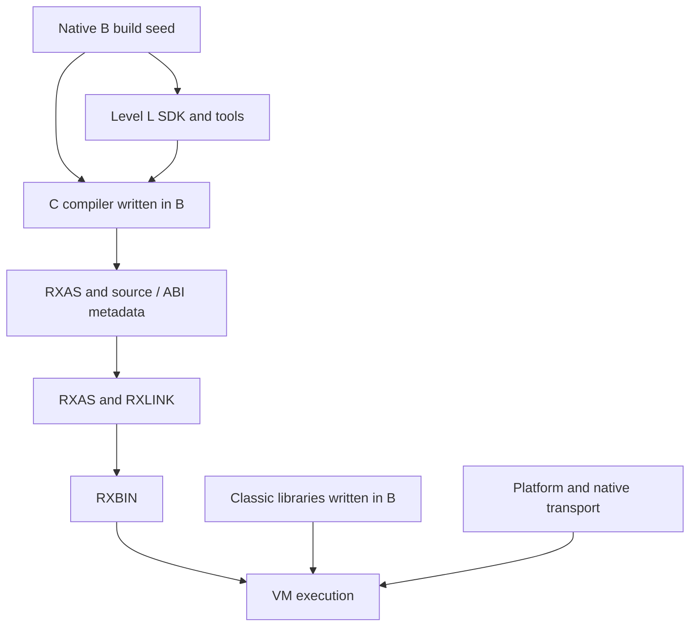

# Level C compiler architecture

**Target architecture approved by Adrian, 19 October 2026.** The original
native/reference audit used `016e6a65466c65a5c722b96452d95025acb463b2`;
the context ABI records completed STEP03d and the current approved C v6
implementation. Static named LEAVE and ITERATE are locally qualified.
The plan records bounded local qualification.
The [plan](../PLAN.md#c-first-delivery-milestone) owns qualification and sequence;
[requirements](levelc-requirements.md) map coverage and
[agent work packages](agent-work-packages.md) define implementation assignments.
“Current” below means inspected source, not fresh execution qualification.
Approval establishes the ownership and delivery direction, not implemented
capability. Exact new public API/schema/ISA contracts retain their step gates.

## Outcome

Deliver one complete, explicitly selected Classic Level C compiler implemented
in Level B with Level L grammars/services; independently useful Level L analysis
and optimisation; shared Classic runtime libraries written in B; and justified
RXAS/VM improvements for Classic workloads. INTERPRET completes the sequence.
New B/G coverage and self-hosting are outside this delivery. Existing consumers
and signed B/G interoperability remain regression obligations. Default compiler
replacement is a separate decision after qualification.

Native B remains the build seed. New source requests cannot invoke native source
compilers/backends. RXAS, RXLINK, VM, platform services and native transport
providers remain legitimate dependencies. A native primitive executes a defined
operation; it must not hide a second Classic parser, lowerer or BIF implementation.

Native compiler source changes in this delivery are limited to evidenced defects
in the Level B build seed, with focused regressions preserving the existing
language contract. New Classic compiler features remain in this B/L implementation;
shared runtime behavior remains in `lib/rxfnsc/`. Native Classic parsing, lowering
and feature work are outside this delivery.

## Current implementation review

| Inspected surface | Current facts | Target consequence |
|---|---|---|
| Native `compiler/rxcpcscn.re`, `rxcpcpar.c`, `rxcpcgmr.y`, `rxcpcval.c`, `rxcp_levelc_lower.c`, `rxcc.[ch]` | Separate Classic parsing/lowering feeds the common native backend. `rxcc_parse` owns an exact-length parsed/mapped unit, not a complete compile service. | Reuse requirements/fixtures, not the native implementation as a dependency. Parse success proves neither execution nor INTERPRET. |
| Native architecture/worklist | 24 admitted instruction reviews closed with exceptions; INTERPRET rejected; host/source/configuration/lifecycle obligations open. | Native closure never automatically closes the new compiler. |
| Native direct-BIF table | 70 catalogue names, LOWER/UPPER and 23 Unicode extension names have entries. | Integrate and test every name; entry presence is not conformance. |
| `levelc/levelc.rxl`, `llcparse`, `llcfrontend` | Generated Unicode-variable lexer/LR grammar and C token policy; locally qualified bounded DROP/SELECT/static DO/named LEAVE/ITERATE projection/lowering, limited operators, ASCII private PROCEDURE labels/calls, simple ARG and LENGTH/ARG/DIGITS only. Shared-pool labels/fall-through refused. | Qualify each instruction increment; wider source/instruction coverage remains substantially smaller than native C. |
| `llcir`, `llcrxas`, `llccompiler`, `llrxc-c` | Independent C family/selector/service/CLI; neutral ABI attributes still use `crexx.g` type names. Owned RXAS output and explicit limits. | Preserve separation; neutral ABI types belong in compiler-common contracts, not typed semantics. |
| `lib/rxfnsl/rexx/llflow.crexx` | Checked AST-role graphs, structured loops/branches, condition facts and finite definite assignment already exist. | Reuse this foundation; distinguish source-AST analysis from executable IR analysis. Its short-circuit roles cannot model eager Classic AND/OR. |
| `lib/rxfnsl/rexx/llir*` | Frozen modules/schemas, block-local values, cross-block slots, revision-bound facts, checked rewrites and bounded local optimisation. | Add exceptional/resumable edges, generic analyses and liveness before relying on them. No immediate SSA rewrite. |
| `levelc/runtime/llctarget.crexx` | One 33-export B target delegates contextual expressions/BIFs, DO state and error bridges to shared B bodies, alongside literal/pool/packet/result helpers; no per-operation default config/pool or copied activation. | Preserve live owners and shared algorithms; complete later operations/BIF bindings and prove any specialization's state/failure/observation equivalence. |
| `lib/rxfnsc` | B implementations own values, pools, activation, DO state, BIFs and streams; package imports include classlib, B Unicode core, cstream/fs. | Extend existing owners; retain independent Unicode/provider delivery and Classic policy. |
| Maintained `examples/step06/walk-c.after.rxas` | Borrowed root owners and result packets remain; exact literal branches prune dead arms while retaining runtime truth. Current wrapper/body frames are 16/27; clause IDs remain zero (full TRACE is open). | Named conservative costs remain C-OPT-01–03/05/06; walkthrough counts include wrappers/cold handlers and exclude helper bodies/metadata. No minimal-frame or speed claim. |
| RXAS sources, `binutils/include/rxops.h`, VM guide, `interpreter/rxvml.h` | Existing peephole/procedure analysis and decimal/context/call/PARSE primitives. Public load-file/load-buffer/context-destroy, no individual-module unload. | Prefer existing operations. Dynamic code needs continuation and reclamation, not merely a bounded lookup cache. |

Some old BIF/reference paragraphs still describe DATE/TIME refresh and streams
as missing despite later code/worklist corrections. Resolve using current code
and the owning contract; reconcile stale prose in the corresponding increment.
Do not import historical statuses into the new requirements ledger.

## Ownership and permitted dependencies

| Owner | Responsibility | Excluded responsibility |
|---|---|---|
| `research/level-l/compilers/levelc/` | C tokens/grammar/AST, binding, clause/control rules, C IR semantics, specialisation legality, selector, service/CLI | Generic graph algorithms, duplicate BIFs, VM loader internals, typed frontend |
| `lib/rxfnsl/rexx/` | Generic source/tree/CFG records, facts/effect interfaces, worklists, checked rewrites, liveness/interference, bounded output | C keywords/numeric defaults/pool rules/BIF names or target opcodes |
| `langtools/` | Level L specification compiler/generation, rxlang, generic tool services, guides/examples and independent SDK tests | C application main or another Level L subtree |
| `compilers/common/` | Shared cREXX ABI/metadata interpretation and target utilities with real common users | Language-dispatch main, hidden C/G policy, speculative universal frontend |
| `lib/rxfnsb/unicode/` (shared B component) | Unicode algorithms, pinned data and B procedural API used by G/C; optional runtime image | G collection facade, C BIF/error policy, compiler bootstrap dependency |
| `lib/rxfnsc/` | Classic values, pools, activation, conditions/state, BIFs and parse/stream adapters | Source parsing, IR or dependency on research compiler modules |
| `assembler/`, `binutils/`, `disassembler/`, `linker/`, `interpreter/` | ISA/encoding, machine optimisation, execution, generic owned code images | Classic grammar/AST, BIF-name dispatch or source-level EXPOSE rules |
| `platform/`, RXPA providers, `ports/single-threaded/` | OS transport, codecs, clocks, maintained CMS/TSO profiles | Compiler language decisions or duplicate runtime algorithms |

Foundational execution capabilities follow the
[built-in VM service principle](../../../../docs/ai-context/RXVM_INTERPRETER.md#built-in-vm-services):
mandatory core availability, existing native bindings/lifetime and one semantic
owner. An ISA extension requires justified instruction-level support and its
own exact-contract approval; this does not move compiler or Classic policy
into the VM.



Arrows describe build/use flow, not reverse import permission. Generated C
programs depend on Classic libraries; the compiler host reads their ABI metadata
as data. SDK/tool libraries cannot import research/compiler modules. C-only
configuration cannot generate/link a typed/G frontend. Shared changes retain G
regressions without requiring new G features.

`llctarget` may temporarily remain an ABI shim, but lasting runtime semantics
belong in rxfnsc. Remove obsolete adapters after consumers migrate. Unicode
packaging follows the shared B foundation below. Preserve public G namespaces
and existing consumers; directory movement alone does not prove independence.

### First foundation increment

The active slice preserves existing public APIs. C-only dependency controls
stage separate compiler-host and static-target roots; static C links the
existing `library`, `rxfnsc`, `llctarget`, `classlib` and B Unicode core images explicitly.
The collection library supplies variable-pool storage. Generic IR definite
assignment indexes predecessor edges once and schedules changed exits through
a bounded worklist; it does not introduce a C analysis engine or liveness API.
Unicode ownership below preserves private ABI, public procedure bodies and G classes.
Exact qualification and remaining criteria belong to the active plan.

## Shared Unicode foundation in Level B

The shared component packages the existing algorithms and 23 public
`rxunicode` procedures in `rxunicode-core.rxbin`. C adapters compile against
that exact B metadata. G includes the same B members in its aggregate and
retains its collection/iterator classes. No duplicate procedure body, extra
forwarding layer or second Unicode algorithm is introduced.

CLC-STEP03b preserves namespace, signatures, argument presence, bodies and
documentation. Adrian approved the
[exact public contract](../../../../lib/rxfnsb/unicode/README.md#public-b-interface)
after independent verification that minimal B and L bootstrap remain upstream
of this optional component. Property/simple-mapping and other new interfaces
remain later exact-contract gates. The plan records qualification separately.

| Owner | Content and contract |
|---|---|
| `lib/rxfnsb/unicode/` | Shared B runtime source/templates and canonical pinned Unicode/legacy-codec data; separately selectable `rxunicode-core.rxbin` (selectable component image). No dependency on the G facade or C libraries. |
| `tools/unicode/` | Component-specific table compilers/generators, their Level L grammar and build adapters; use `rxlang` as a tool. Generated code/tables remain build outputs. No source compiler algorithm is moved here. |
| Shared B procedural facade | STEP03b preserves the existing 23 `rxunicode` version, normalization/full mapping/folding, direct grapheme and codec procedures. Property/simple mapping remains a separate STEP03 contract. Private numeric selectors stay private. |
| `lib/rxfnsg/rexx/unicode.crexx` | Preserve G collection/iterator classes and their private helper calls; the aggregate explicitly includes the B-owned procedures to preserve its old public surface without duplicate bodies. Source compatibility and doc tags remain required. |
| `lib/rxfnsc/` | Preserve Classic BIF names, argument presence/checking, text/ordinal conversion and Classic error translation. Call the B facade directly. No second normalization, segmentation or codec implementation. |
| `lib/rxfnsl/` | Consume pinned property data or a minimal independent property table for recognition; no import of G/C and no requirement to load the full Unicode runtime. |

Do not merge all large tables into the seed `library.rxbin`. Bootstrap order is
minimal B library → L bootstrap/tool → optional Unicode generation → B Unicode
runtime → G facade/C runtime. L's own property generation must use minimal B
and pinned source data without depending on this optional runtime image. One
canonical source-data owner can feed different generated indexes needed by L
and runtime algorithms; do not create a graph cycle or conflate those indexes.

The current B interface uses `.string`, `.binary` and ordinary scalar results;
its grapheme positions count extended graphemes. It preserves existing value
ownership and family-specific errors. It adds no public traversal, simple-map
or budget API. Those possible shared scanner/pool services remain later
STEP03 contract work; G-only iterator objects stay in G and locale/configuration
overlays remain C-owned. Existing
ordinary text remains exact codepoints, without implicit normalization, folding
or grapheme indexing. Explicit full casing may expand; ordinary Classic symbol
casing must use its simple-mapping contract. Stream codec choice never changes
the fixed Classic ordinal bridge.

Validate the extraction with direct B consumers, unchanged G facade fixtures,
all C Unicode BIFs/streams, UCD conformance inputs, embedded NUL/high scalars,
malformed bytes, replacement controls and both engines. Compare linked constant
ownership and RXAS so the split does not duplicate tables or introduce wrapper
copying. Test C-only and G-only clean/incremental/installed builds, missing and
changed generated inputs and no-op freshness. Preserve data provenance/licenses,
API doc tags and code-shape assertions. These tests close ownership; no new
Unicode version or semantic expansion is implied.

Select one provider aggregate per linked image: standalone B core for C-only
applications or the existing G aggregate containing those B members for
combined products. The linker rejects overlapping providers; no deduplication
change is proposed. Exact import roots and autoload-origin checks must prove
the C path's independence, rather than relying on broad installed-directory
search order. Existing embedded/G consumers retain a focused compatibility
check with the standalone core physically absent.

## Compilation pipeline

1. **Owned request.** Exact UTF-8 bytes, logical source ID and physical mapping,
   mode, explicit imports, options and work/storage limits. File I/O and atomic
   destination replacement belong to the command adapter; the service cannot
   exit, spawn a source compiler or use ambient import fallback.
2. **Recognition.** Level L engines plus C contextual token policy handle words,
   labels, continuation, comments, radix suffixes and blank/abutment. Preserve
   byte spans separately from Unicode positions; do not translate C into B.
3. **Named C AST.** Source constructs, explicit fields/lists/optionality,
   spelling and clause identity. Bind entry identities and validate static
   errors throughout unreachable source before optimisation.
4. **C semantic IR.** Explicit blocks, ordered effects, values/slots, context
   use, control/completion edges and source observations. Keep pool operations
   until C legality analysis proves a narrower representation.
5. **Generic analysis.** Level L computes def/use, reachability, liveness and
   finite-domain facts from registered C summaries. C supplies numeric, pool,
   alias, call and TRACE semantics. Rewrites invalidate revision-bound facts.
6. **Target lowering.** Choose existing VM instructions or checked runtime calls;
   every operation has a conservative executable route. Typed target records
   precede physical register assignment and retain source origins.
7. **Registers/emission.** Generic liveness/interference consumes use/def/edge
   records. The target owns aliases, call windows, clobbers, reserved registers,
   cleanup and legality. Render through Level L's writer. RXAS independently
   owns machine optimisation, separately switchable from compiler optimisation.
8. **Assemble/link/run.** Existing tools validate RXBIN and explicit imports.
   Keep separate file stages. Later in-memory assembly must use the same
   assembler contract and prove diagnostics/output equivalence.

### Representation contracts

Names describe proposed records, not committed public identifiers.

| Record | Required content/ownership | Validation |
|---|---|---|
| CompileRequest | Owned bytes, logical identity/map, module/routine/interpreted-group mode, imports/profile, limits, optimisation policy | Exact length including NUL, valid options/encoding, no ambient mutable compiler state |
| CompileResult | Status, owned diagnostics, optional frozen AST/IR, RXAS chunks/source map, runtime ABI requirements | No executable after recovery/error/limit; earlier results survive later failure |
| C AST | Kind, named fields/lists, source span, clause, spelling, generated origins | Grammar/schema plus C static checks; no overloaded anonymous fields |
| IR operation | Typed inputs/results, attributes, ordered effects, normal/exceptional/resumable edges and origin | Generic structure plus C meaning; unknown effects prohibit speculation |
| Analysis result | Owner/revision, domain/version, explicit absent versus false, budgets | No stale/foreign facts; transformation declares invalidation |
| Target record | Opcode ID, typed operands, use/def/clobber, failure/normal edges and observations | Validate before/after allocation and rewriting; strings are output, not optimisation IR |
| Runtime ABI | Namespace/signature, presence, ownership/borrowing, context, effects/errors | Separate producer/consumer, metadata and malformed-import tests |
| Completion/continuation | Kind, result presence/value, destination, condition, owned code handle/PC and live spills | Generation/lifetime/cleanup checks; no raw expired caller pointers |

Retain current block-local values and cross-block slots. SSA is not a prerequisite.
Reuse existing `llflow` AST analysis and `llirservices` IR passes rather than
introducing competing generic engines. Their graphs answer different questions:
source structure before lowering versus explicit executable edges after it.
Only proved mapping adapters may transfer facts; Classic eager logical evaluation
must not inherit `llflow` short-circuit AND/OR behavior.
Make exceptional/resumable edges and clause observations explicit before global
passes cross them. Version changed serialized schemas; reject incompatible data
rather than silently assigning new semantics. Algorithm records must state
invariants, convergence/work bounds, allocation accounting and atomic failure.

## Classic activation and runtime

Start with RexxValue, RexxStem, RexxVariablePool, RexxActivationArguments,
RexxClassicConfig/State, RexxDoState and existing BIF modules. Keep their public
consumers compatible while introducing a coherent reference-based compiled-C
activation facade. A copied argument/result packet is not the live activation.

An activation owns or explicitly borrows arguments/presence and invocation kind;
result presence; the replaceable visible-pool binding and caller/exposure links;
PROCEDURE eligibility; NUMERIC/ADDRESS/TRACE/clause-clock/condition state;
source/clause and label/routine identities; active loop state; program-root
completion; and execution-owned queue, stream and host services.

Internal CALL creates an activation with defined inheritance/restoration. A
label alone creates no private pool. PROCEDURE replaces the visible-pool binding
and resolves EXPOSE in source order. Interpreted code sees that replacement
through the same binding. Create configuration at program/host entry, not per
operator. Calls, callbacks and context mutation invalidate affected facts;
process-global defaults cannot silently replace active Classic state.

Compile a source unit's label/control space into one owned code body with checked
entry identities. An internal call can recursively enter that body with a new
activation and entry ID; SIGNAL changes position within the current invocation.
Do not clone the source tail for every label or require PROCEDURE after labels.
Preserve first-label precedence, fall-through and control-stack clearing.

Existing BIF bodies and valid library qualification are reused; extending the
new compiler's current three-name subset is binding/context work, not a second
BIF implementation. Reuse expected-result fixtures through the new compiler;
change library algorithms only for a demonstrated defect or named missing
contract. BIF calls share one runtime context/presence contract. Pure text entries need
not copy the entire activation; stateful entries borrow their declared context
from its authoritative owner. Numeric specialisation preserves decimal DIGITS,
FUZZ/FORM, literal spelling, exact logical tests, errors and LOSTDIGITS. Machine
integers/floats are implementation choices, not changed Classic semantics.
Ordinary text is exact Unicode codepoints with the fixed Latin-1 ordinal bridge;
external stream encodings do not change source or ordinal semantics.

### Borrowed Classic context contract

**Shared B surface and nine borrowed target adapters approved by Adrian on
19 October 2026; implemented and locally qualified.** Adrian subsequently
approved the clean selector/schema migration below and removed compatibility
requirements for earlier research C output: use one current `llctarget`
namespace/product and remove obsolete copied-context adapter bodies. The plan
owns implementation and qualification; shared B/L consumer contracts remain.
The intended outcome is one execution-owned configuration and one authoritative
activation/pool binding for the C subset already admitted at `975afbc15`.
Remove per-operator configuration construction and copies of live activation
state while retaining existing expression/BIF bodies and observable results.
This does not admit more source forms or close an instruction review.

The following selector migration will cover the existing scalar expressions, assignments, structured
control, NUMERIC forms, private PROCEDURE routines, argument/result presence
and LENGTH/ARG/DIGITS forms. It does not add shared-label/fall-through calling,
EXPOSE syntax, condition handlers, new BIF names, signed external calls, host
invocation APIs or dynamic compilation. Those remain with their owning steps.
The completed runtime baseline supplies the five-callable B bundle and nine
direct-host adapters below; generated C still needs the approved migration.
The existing Unicode procedures and algorithms are unchanged.

#### Approved shared B surface

`RexxClassicContext` lives in namespace `rexxclassiccontext`, owned by
`lib/rxfnsc/RexxClassicContext.crexx` and delivered in the existing
`rxfnsc.rxbin`. It is a reference bundle, not a second implementation of an
activation. Its only fields are references to existing caller-owned objects.
It allocates no activation, pool or configuration and stores no reference to
itself or one of its own members. Existing `rexxactivation`, `rexxpool`,
configuration and BIF exports retain their signatures and behavior.

Passing the three existing references separately would add no B class, but
would spread pool-binding replacement across every helper ABI. A copied pool
reference does not observe replacement of the caller's binding, and nested
reference containers are outside the current B surface. The bundle
provides one explicit mutable binding using existing class/reference rules.

These are the complete five approved callables. All arguments are required;
there are no defaults, optional-presence bits or exposed by-value arguments.
Types below use the existing fully qualified source identities.

| Callable | Exact parameters | Result |
|---|---|---|
| `.rexxclassiccontext..RexxClassicContext(...)` (default factory) | `activation = reference .rexxactivation..RexxActivationArguments, pool = reference .rexxpool..RexxVariablePool, config = reference .rexxclassicconfig..RexxClassicConfig` | `.rexxclassiccontext..RexxClassicContext` |
| `activation()` | none | `reference .rexxactivation..RexxActivationArguments` |
| `pool()` | none | `reference .rexxpool..RexxVariablePool` |
| `config()` | none | `reference .rexxclassicconfig..RexxClassicConfig` |
| `bindPool(pool)` | `pool = reference .rexxpool..RexxVariablePool` | `.void` |

The factory checks all three references with the existing `<refvalid>` facility
before publishing a bundle. Each getter checks its selected reference before
returning it. `bindPool` checks the replacement before changing the binding;
failure leaves the previous binding intact. Invalid or expired targets raise
the existing `REFERENCE_INVALID` condition. There is no new handle, error
category, lifetime extension, global registry or VM/object ABI.
If an existing B procedure signal handler resumes with `.signalaction.skip()`,
the rejected operation returns immediately: a failed factory returns a bundle
with empty references, a failed getter returns an empty reference, and a failed
`bindPool` preserves its old binding. This is failure recovery, not a successful
borrow; no rejected reference is installed after the signal handler returns.
Callers supply initialized instances; a live reference cell does not by itself
prove object initialization. Existing `OBJECT_NOT_INITIALIZED` behavior remains
when an uninitialized object is used. The bundle adds no profile/state inference
or eager copy of the referenced objects.

`bindPool` changes only this bundle's pool reference. It does not create or copy
a pool, apply EXPOSE, change Unicode-name policy, alter activation state or
modify configuration. Those operations retain their existing owners. C selects
UTF8 configuration and Unicode pool names at entry; the shared bundle itself
does not introduce a new character-profile policy.

#### Stable owners and copying

The C entry wrapper owns the existing root `RexxActivationArguments`, UTF8
`RexxClassicConfig`, root `RexxVariablePool` and the bundle in stable local
storage. Capture arguments and complete any by-value construction before
binding references. Helpers receive a reference to that authoritative bundle;
they do not receive copies of live activation/configuration objects.

The factory's value result can safely move into its final local because its
three references point to external caller-owned storage. Ordinary B copying
of a bundle copies these references: the referents are shared, but a later
`bindPool` changes only the copied bundle receiving that call. Generated C
therefore passes the authoritative bundle by reference and never substitutes
a value copy when a live binding is required. It must not overwrite, move,
resize away or recycle any referenced owner while a borrow is live.

For the admitted private-PROCEDURE call profile, each caller call window owns
the child's argument/activation object, private pool and bundle until the child
returns. Populate arguments in source order, inherit state with the existing
`inheritSignalPolicy`, and mark the invocation using `beginInternalCall` or
`beginInternalFunction`. Use existing `enterProcedure` validation and pool
initialisation/status inheritance; no new inheritance algorithm is added.
Construct the bundle only after those owners occupy stable storage. Nested
calls borrow the same root configuration and create fresh child activation
state; a child NUMERIC change cannot modify the parent's activation.

The callee uses the supplied binding rather than constructing another pool.
Rebinding in direct runtime tests can use another caller-owned pool, proving
that subsequent reads and BIF contexts observe the same authoritative bundle.
This is not permission to implement the later shared-label/PROCEDURE protocol
inside this slice. Any later callee-local replacement must restore or end every
borrow before that local dies; it cannot leave a caller-owned bundle referring
to returned-frame storage.

Keep existing fresh return-presence packets for now. They contain returned
value/presence, not a copied live child activation or references to child local
storage. Their current representation cost remains explicit. Reference targets
cannot escape into program results, cross a VM-context boundary or outlive
their invocation. Stale-reference controls must fail through checked references,
not extend owner lifetimes. Repeated executions own separate roots/configs.

#### Numeric frame and error contract

`RexxActivationArguments` remains the authoritative stored DIGITS/FUZZ/FORM
state. The executing C frame must also carry those settings: existing numeric
BIFs read the immediate caller's VM frame through inherited numeric clauses,
not `RexxBifCallContext.setCallerActivation`.

At root entry install the root defaults, and at child entry install the inherited
child settings in the C frame. After a successful NUMERIC statement, install
the new settings in that same frame. An existing-instruction sequence can set
FUZZ to zero, set DIGITS, set the validated FUZZ and set FORM, avoiding an invalid
intermediate DIGITS/FUZZ pair. This sequence is emitted in the C frame; calling
a B setter that changes only its own VM frame would lose the setting on return.

Validation reuses `setNumericDigits`, `setNumericFuzz` and `setNumericForm`.
They commit only after successful validation and return their existing error
text. On validation failure, raise the existing authored `CLASSIC_SYNTAX`
diagnostic and execute no VM setting instructions: activation fields and the
owning C frame retain their prior settings. Validated installs must use admitted
integer values and existing instructions, with no fallible conversion between
field commit and frame synchronisation. This is the ordinary validation-failure
atomicity contract. Resumable asynchronous conditions and observer boundaries
remain STEP02/07 obligations; this slice does not claim their closure.

When a direct numeric BIF is emitted from the C frame, its inherited clauses
read that frame. If a temporary B shim is the immediate BIF caller, the shim
must declare DIGITS, FUZZ and FORM inherited so that it receives the C frame's
settings; relying on the shim's default settings is incorrect. Returning from
the shim or child restores its caller's VM frame using existing VM behavior.
Do not change process-global RexxValue defaults or add a native numeric service.

#### Checked BIF reuse and current target

Call sites retain source-ordered values/presence and existing direct BIF entry
selection. Build a call-local `RexxBifCallContext.expression(name)`, bind the
bundle's config/pool/activation through existing setters, set arguments and call
the selected existing B entry followed by `rexxclassicbif_checked`. The name is
diagnostic context, not selection through the legacy name dispatcher. No BIF
body or error policy is copied into the compiler. Existing config getters and
argument arrays can still copy values internally; those are retained costs,
not a claim that the complete BIF path performs no copies.

**Approved clean target:** one namespace `llctarget` in the existing installed
`llctarget.rxbin`. Consolidate the completed borrowed adapters into that owner
and delete `llctarget2` and the replaced copied-context implementations. Earlier
research C images/IR are not a compatibility contract. New C output uses the
following exact borrowed-context entries. Here `V` is
`.rexxvalue..RexxValue` and `C` is
`reference .rexxclassiccontext..RexxClassicContext`; these are table abbreviations,
not additional public type names.
All parameters are required and have no defaults/expose flags.

| New entry | Parameters | Result |
|---|---|---|
| `llctarget..binaryop` | `operation = .string, left = V, right = V, context = C` | `V` |
| `llctarget..unaryop` | `operation = .string, value = V, context = C` | `V` |
| `llctarget..truth` | `value = V, context = C` | `.int` |
| `llctarget..setting` | `operation = .string, context = C, value = V` | `.void` |
| `llctarget..digits` | `context = C` | `V` |
| `llctarget..readarg` | `context = C, ordinal = .int` | `V` |
| `llctarget..countargs` | `context = C` | `V` |
| `llctarget..existsarg` | `context = C, ordinal = V, option = V` | `V` |
| `llctarget..lengthvalue` | `value = V, context = C` | `V` |

Keep the currently admitted operation names and argument forms. `readarg`
retains ARG-instruction uppercase behavior; it is not the raw ARG BIF accessor.
`setting` mutates the borrowed activation only after existing validation; the
selector then performs the C-frame install above. `digits`, ARG and LENGTH
select their existing checked BIF entries. Existing argument construction,
literal/pool helpers and fresh result packets retain their current ABI;
argument construction finishes before the new bundle borrows the activation.
Keep only the helpers used by the clean selector: `literal`, `poolnew`,
`poolread`, `poolwrite`, `sayvalue`, `arguments`, `mainargs`, `append`, `present`,
`absent`, `requirevalue`, `setresult`, `status` and `failuremessage`. Together
with the nine entries above these form the 23-export foundation. SELECT adds
two entries under its [approved contract](#approved-select-contract), giving
25 exports. The [approved DO contract](#approved-do-contract) adds seven;
the [transfer contract](#approved-leave-iterate-contract) adds `invalidtransfer`,
giving the current 33 exports. Remove
`contextnew`, the old nine bodies, compatibility bridge/build entries and
old-image/legacy-signature tests. Preserve applicable RexxDoc tags when moving
the current implementations. The private `bifcontext` remains internal.
The existing operator-name branch and conservative root setup remain named
C-OPT-01/03 work; this contract does not add direct-operation B exports or claim
that literal-only programs have no unused setup.

New generated C source-unit procedures receive one `C` reference; invocation
kind and argument presence reside in its existing activation. Their existing
fresh result-packet result type remains. This internal ABI is distinct from
the unchanged VM main entry and from later signed external-call contracts.
Changed C semantic type/effect/call records use the approved C family revision
below; do not reinterpret old frozen records or change generic L record
semantics. Installed target metadata missing current `llctarget` signatures or
the bundle must cause a precise import diagnostic before publishing RXAS, preserving
the previous output. Incompatible packages must not accidentally select
an old same-name signature. No new runtime product or compiler dependency is
introduced into static applications.

<a id="current-c-family-contract"></a>

#### Approved C-family revision and generated procedure ABI

**CLC-STEP03d is locally complete; current C uses family version 6 without
changing the context ABI.** Use the following semantic contract and generated procedure
ABI, with one clean current C target and no compatibility bridge for earlier
research C programs. The five shared B callables and nine borrowed signatures
above are retained. DROP adds its approved source form and C-owned IR operation
below; no extra B callable, generic L API/transport format, RXBIN metadata
record or RXAS/VM operation is introduced. Complete labels, conditions and
INTERPRET retain their later gates.

The C selector accepts `core` version 1, neutral `crexx.g` version 1 scalar
types and `crexx.c` version 6. The neutral scalar names do not load the G
frontend. The generic LLIR text/binary format remains version 2. `crexx.c`
versions 1/2/3/4/5 are never reinterpreted as version 6. Within version 6, the complete C
type/operation declarations, including unused declarations and all ordered
fields and effect summaries, must match the canonical C registration before
emission. Foreign operations remain outside the C profile.

The C types are `value`, `arguments`, `result` and `context`. The first
three retain their current runtime representations: `RexxValue`, a not-yet-
borrowed argument/activation packet and a fresh return-presence packet. They
retain the existing byte codec in the semantic registry. `context` uses that
same nominal codec registration but denotes only a live reference to an
authoritative `RexxClassicContext`; its runtime payload is never serialized in
IR. It may originate only at the one required function parameter and flow
through reference-value copies and local slots. A context slot is bound once
in its function's entry block, from parameter 1 or an earlier proven entry
alias, before entry reads; every later/dead-block read requires that binding.
Reject nonentry/repeated stores and unproved producers. This is the narrow
C opaque-context invariant, not a general definite-assignment service; the
generic structural verifier alone does not prove slot initialization.
Reject `core.constant` and
optional/default parameters of this type, references in results, and any
unsupported producer/use. The former `numeric` and `pool` types and `pool.new`
operation remain absent. Resolve the current pool from the bundle
at each pool operation, so an observed `bindPool` replacement remains live.

The following table owns all 52 current descriptors: 40 context-foundation
operations, [DROP](#proposed-next-instruction-drop) at 41,
[SELECT](#approved-select-contract) at 42/43,
[DO](#approved-do-contract) at 44–51 and
[transfer.invalid](#approved-leave-iterate-contract) at 52. Names have
the `crexx.c.` prefix; field order is significant. `V`, `C`, `A`, `R`, `B`,
`I` and `T` mean `value`, `context`, `arguments`, `result`, `core.boolean`,
`crexx.g.int64` and `crexx.g.text`. An output, when present, is named `value`.
`context` is a conservative state footprint covering reads or writes through
the bundle, including existing BIF pool-policy setters; it does not assert
read-only access. `condition` includes the existing reference, initialization,
conversion, numeric, argument and resource conditions without changing their
names or diagnostic policy. All rows terminate as `returns` except `exit`,
`select.missing` and `transfer.invalid`, which terminate as `diverges` under
the current nonresumable C profile.
No evaluator is registered for context-dependent operations, including truth.
For exact literal bytes `0`/`1`, C construction may supply a separate derived
core Boolean to the branch while retaining the effectful runtime truth call.
Dead-arm pruning therefore preserves owner checks, pool-policy effects and
condition timing. Removing that context work remains C-OPT-03, subject to its
state/failure/observation proof.

| Operation(s) | Ordered inputs | Ordered attributes | Output | State | Failure |
|---|---|---|---|---|---|
| `add sub mul div eq ne lt le gt ge strict concat blank abut and or xor` | `left:V right:V context:C` | — | V | `context` | `condition` |
| `positive negative not` | `value:V context:C` | — | V | `context` | `condition` |
| `say` | `value:V` | — | — | `output` | `conversion.io` |
| `load` | `context:C` | `name:T` | V | `context` | `condition` |
| `store` | `context:C value:V` | `name:T` | — | `context` | `condition` |
| `truth` | `value:V context:C` | — | B | `context` | `condition` |
| `numeric.digits numeric.fuzz` | `value:V context:C` | — | — | `context` | `condition` |
| `numeric.form` | `context:C` | `form:T` | — | `context` | `condition` |
| `digits` | `context:C` | — | V | `context` | `condition` |
| `arguments.empty` | — | — | A | `none` | `resource` |
| `arguments.append` | `arguments:A value:V present:B` | — | A | `none` | `resource` |
| `arguments.read` | `context:C` | `ordinal:I` | V | `context` | `condition` |
| `arguments.count` | `context:C` | — | V | `context` | `condition` |
| `arguments.exists` | `context:C ordinal:V option:V` | — | V | `context` | `condition` |
| `return.present` | `value:V` | — | R | `none` | `resource` |
| `return.absent` | — | — | R | `none` | `resource` |
| `requirevalue` | `result:R` | — | V | `none` | `missing.result` |
| `setresult` | `context:C result:R` | — | — | `context` | `condition` |
| `call` | `arguments:A context:C` | `target:T function:B` | R | `context.output` | `condition` |
| `length` | `value:V context:C` | — | V | `context` | `condition` |
| `exit` | `value:V` | — | — | `process` | `exit` |
| `drop` | `context:C` | `name:T indirect:B` | — | `context` | `condition` |
| `when.truth` | `value:V context:C` | — | B | `context` | `condition` |
| `select.missing` | — | — | — | `none` | `condition` |
| `do.new` | `context:C` | `key:T name:T` | — | `loop.context` | `condition.resource` |
| `do.capture` | `value:V` | `key:T part:T` | — | `loop.context` | `condition` |
| `do.start do.advance` | — | `key:T` | — | `loop.context` | `condition` |
| `do.entry` | — | `key:T` | B | `loop.context` | `condition` |
| `do.close` | — | `key:T` | — | `loop` | `none` |
| `while.truth until.truth` | `value:V context:C` | — | B | `context` | `condition` |
| `transfer.invalid` | — | `code:T name:T` | — | `none` | `condition` |

`form` admits only the current
`scientific`/`engineering` spellings; `ordinal` must be positive; `target`
must identify an existing private routine. `function` is a required canonical
Boolean attribute: true selects `beginInternalFunction`, false selects
`beginInternalCall`. It is static invocation metadata, not another argument
or source-language feature. Ordered actual evaluation and explicit omitted
positions remain in the existing argument packet. Context-free constants are
limited to the currently selected literal/scalar types, never argument,
result or context packets manufactured from bytes.

Every generated source-unit procedure, including `$MAIN`, has precisely:

```text
(context = reference .rexxclassiccontext..RexxClassicContext)
    -> .rexxactivation..RexxActivationArguments
```

The sole argument is required, with no default or expose modifier. The result
is the existing fresh presence packet; it cannot contain references to child
owners. Expression calls still use `requirevalue`; statement calls still
apply/drop `RESULT` in the caller's current pool using existing behavior.
The VM `main(argv)` entry and integer completion status are unchanged.

Root entry finishes `mainargs(argv)`, constructs one UTF8 configuration and one
Unicode-name pool in dedicated stable locals, then constructs one bundle using
their references. It passes `reference bundle` to `$MAIN`. A private call first
finishes all argument-packet construction, puts that activation in its final
caller-owned local, calls existing `inheritSignalPolicy(parent.activation())`,
the selected `beginInternal*` and `enterProcedure`, and initializes a fresh
private pool with existing command-status inheritance from `parent.pool()`.
Only then does it construct the child bundle with the parent's configuration
reference and call the callee with `reference childBundle`. The caller owns
these locals until return/unwind; callees construct no replacement pool.
Nested calls have distinct owner windows. Normal return clears borrowed call
arguments and temporary aliases before releasing bundle/activation/pool owners;
abrupt paths use existing VM unwind cleanup. This introduces no shared-label
entry or later PROCEDURE/EXPOSE protocol.

Select the existing exported class factories/methods through the independent
metadata reader. In particular, use the existing
`rexxclassiccontext.rexxclassiccontext.§factory` and getter symbols, activation
numeric/inheritance/procedure methods and pool `inheritCommandStatus` method;
do not read private attribute layouts. Validate the selected class owner,
callable identity, B flags, exact result, declared arguments and optional flags.
The selected configuration factory's `?requested_profile=.string` stays
optional in metadata and is supplied explicitly. Existing `poolnew()` owns
the explicit `.RexxVariablePool(1)` construction; no duplicate pool-factory
selection is added to the C emitter.
All current target exports retain required-only signatures. Legacy short type spellings may
match only their explicit known owner-qualified identities, never arbitrary
basenames or class/interface assignability. Preserve the existing hidden
receiver ABI: pass a live receiver alias with its established call-window
swap/restoration protocol, rather than a by-value receiver snapshot. Copy an
already-reference operand's payload; use `mkref` only on an actual stable owner,
never a reference-valued slot. End every temporary `linkref` alias before its
window is cleared. Existing general calls suffice; no new ISA is needed.

Each executing C frame selects Classic numeric standard with existing
`numsci 18,1,2`, then reads validated integer `numericDigits/Fuzz/Form` through
the borrowed activation and installs `FUZZ=0`, DIGITS, FUZZ, FORM in that frame.
After a successful void `llctarget.setting` call it performs the same integer
getter/install sequence, with no text conversion between commit and install.
Install the existing four fatal `sigbrv` handlers before entry setup/body.
A failed setting diverts to that C frame's fatal branch and cannot reach any
numeric install or ordinary next statement. The existing relay installs
`sighalt` before `signalorigin`: this profile is nonresumable even with an
outer B skip handler. Do not claim outer-handler recovery or alter that policy
in this migration. The unchanged direct B adapter tests prove stored-state
atomicity; generated error executions and branch-shape checks prove diversion.
Child return restores the caller VM frame; its stored activation was never
changed by the child. Same-frame FUZZ/FORM proof must use observations whose
results actually differ, including a non-multiple-of-three exponent.

| Compiler/input/target combination | Disposition |
|---|---|
| Current compiler + canonical C v6 IR + current bundle/adapters | Supported through the one-context ABI. |
| Current selector + C v1/v2/v3/v4/v5/unknown IR | Refuse unsupported C-family version; no old schema/emission path or implicit upgrade. |
| Earlier emitted C programs + changed target | No compatibility guarantee or bridge; rebuild through the current compiler. |
| Current compiler + incompatible target or `rxfnsc` missing bundle | Precise import refusal identifying the missing/incompatible selected callable before publishing output. |
| Current compiler + mixed, forged, private, ambiguous, optionality/type/effect-incompatible records | Refuse before publication; never fall back to old adapters or native compilation. |

Use existing generic manifest save/load checks and reader bounds; add C-owned
whole-family/type/use and signature checks in `llcrxas`, not C policy in the
generic reader. Recheck every constant/attribute byte record with the canonical
selected codec, including unused/dead records, before any raw interpretation:
host codecs are not identified by the serialized manifest. All required entry
metadata and every selected runtime contract
must be admitted before publishing RXAS. Any refusal returns empty output and
leaves the graph and prior CLI output file byte-identical.

Implementation covers `levelc/llcir.crexx`, `llcfrontend.crexx` and
`llcrxas.crexx`, consolidation into `levelc/runtime/llctarget.crexx`, deletion
of `llctarget2.crexx`, their existing service/IR and STEP07/backend/direct-target
fixtures/checkers, and necessary build/test registration cleanup. Reuse `backend-step07.crexx`,
`check-step07.py`, `backend/{numeric,arguments,argv,calls}-c.crexx` and
`cases.json`; extend existing numeric observations for FUZZ/FORM inheritance,
restoration and failures instead of adding another scenario aggregate. Add
canonical current-C save/load and adversarial old/forged schema, constant-context,
wrong-width attributes, entry/unbound context-slot provenance, function-ABI
and selected runtime metadata refusals. Remove the old-image and
legacy-signature compatibility controls; retain independent B runtime/Classic
expectations and shared B/L consumer regressions.

Structural checks must show one root configuration per execution, one required
reference formal, no live owner snapshots/per-operation configuration, no
callee pool construction, stable child owners before borrowing, current-pool
lookup, correct call-kind/presence/result handling, safe receiver restoration
and reference-window cleanup, Classic same-frame numeric installs only on
success, existing fatal diversion, and unchanged source/error origins. Inspect
both caller and helper work; retained packet/config-getter copies stay named
costs. Qualify focused CLI/service/generated execution in compiler/IR modes and
both VMs, with separate assembler-mode controls and existing C-only restricted
roots. Reuse native controls by expected behavior, not faulty/excess native
output. Materially expanded nested tests need isolated normal Debug scheduling
measurement before registration, with generous serial timeouts. Reuse valid
sanitizer evidence for unchanged native inputs; any warranted new sanitizer
work is consolidated at final delivery under AGENTS.md. No build/test result is claimed
before implementation/qualification.

#### Review, migration and verification gates

The first public-surface approval is complete; implementation/qualification
status is recorded under CTX in the plan. These gates serve
CFC-AC02/03/06/07/09/11/12 and describe
this contract slice, not complete activation, BIF, host or C acceptance.

1. The five-callable B surface, borrowing/error contract, clean single-target
   C family revision and internal procedure ABI above are approved. Preserve all existing
   rxfnsc public class/BIF signatures and native/typed/RexxScript consumers.
2. Prove the bundle independently with existing B reference operations: external
   stable owners, safe factory-result copying, live pool rebinding, independent
   copy binding, failed replacement atomicity and `REFERENCE_INVALID` after
   owner death. Use direct B runtime tests in both modes and both VMs.
3. Reuse `testRexxActivationArguments`, `testRexxRuntimePools`,
   `testRexxClassicBifArg`, `testRexxClassicBifLength` and
   `testRexxClassicBifNumeric`. Add only missing checks for the new borrow path,
   invalid NUMERIC preserving both stored and VM state, independent roots and
   nested caller restoration. Reuse existing body expectations unchanged.
4. Migrate the admitted C selector/IR atomically. Reuse
   `tests/backend/{numeric,arguments,argv,calls}-c.crexx` and their `cases.json`
   expectations, selected independent `classic_expression_contract.py`
   expectations and `levelc_bif_numeric_context` fixtures. Extend STEP07's
   malformed-import/previous-output controls to the current surfaces. Refuse
   incompatible metadata without retaining an old-program compatibility path.
5. Inspect caller and helper RXAS: one UTF8 configuration per execution, stable
   borrowed owners, no live activation/configuration copy per operator, no unused
   callee pool reconstruction, correct inherited numeric shim frame and no new
   BIF dispatch/body. Classify retained result/argument/config-getter copies.
   Reuse the C-only exact-root/static/installed controls and existing consumer
   regressions. Measure any materially expanded nested aggregate before CTest
   registration, and qualify centrally under the repository's normal Debug
   rules. Source-only slices reuse valid unchanged-native sanitizer evidence;
   consolidate any warranted new proof at final delivery, preserving actual SAN
   obligations.

These gates do not design or implement INTERPRET, continuation ownership or
ephemeral code loading. The later mechanism must use the same live pool binding;
its exact runtime/VM contracts remain at the final STEP11 decision gate.

<a id="proposed-next-instruction-drop"></a>

### Implemented instruction: DROP

**Approved by Adrian, 19 October 2026; C v3 source/AST/admission/lowering is
locally qualified in normal Debug with independent caller/helper review.**
The [plan](../PLAN.md#current-drop-proof) records its exact bounded proof;
source EXPOSE, conditions/full diagnostics and TRACE retain later owners.
Reuse the existing [Unicode symbol contract](../../../../compiler/docs/levelc_unicode_and_streams.md#ordinary-values-and-byte-compatibility)
and [pool methods](../../../../lib/rxfnsc/RexxVariablePool.crexx), including
`dropSymbol(name=.string)->.void` and
`dropIndirectList(list=.string,config_ref=reference .rexxclassicconfig..RexxClassicConfig)->.void`.
No new B/L/VM API, target export, runtime algorithm or legacy compatibility path
is needed. One current `crexx.c` family advances to version 3, retaining its
four types and one-context procedure ABI, with this 41st operation:

| Operation | Ordered inputs | Ordered attributes | Output | State / failure / termination |
|---|---|---|---|---|
| `crexx.c.drop` | `context:crexx.c.context` | `name:crexx.g.text indirect:core.boolean` | none | `context` / `condition` / `returns` |

The projected AST adds `CDrop(items:(DropDirect|DropIndirect)+)`, whose items each
carry a raw `name` text field and their original authored span. The grammar is
a nonempty, ordered list of direct variable symbols or parenthesized single
variable references; `(expression)` is not an indirect target. Emit one drop
operation per item in source order. Direct items call the current pool's
`dropSymbol` once. An indirect item reads that variable at its position,
captures `symbolValue(name).asString(0)` once, then calls the current pool's
`dropIndirectList` with that captured text and the borrowed configuration.
Never pre-evaluate all parenthesized references or substitute all tails before
earlier drops. The shared pool owns tail case, arbitrary component counts,
stem defaults/tombstones, recursive aliases, word splitting and the already
approved skip-invalid-word policy.

Shared C variable-symbol recognition for DROP and ordinary variable
read/assignment uses existing L `input utf8` and `unicode.gc.L`.
The existing authority admits
letters and `! ? _ @ # $` initially; bodies/tails also admit ASCII digits and
dots. Leading-digit and ordinary leading-dot constant symbols are not DROP
targets. Only the existing `.MN`, `.RESULT`, `.RC`, `.RS` and `.SIGL` exception
remains variable. Preserve number/string/other expression token meanings and
keyword variables such as `drop=1`; suppress inserted expression-concatenation
tokens only in DROP item lists. No XID/combining-mark/emoji expansion or NFC is
introduced. Pass raw variable spellings to pool operations: its existing simple
casing retains micro-sign U+00B5 identity. The scanner L set equals pinned
Unicode 17 `gc.L`; [the shared generator](../../../../cmake/CrexxClassicUnicode.cmake)
owns that letter authority and micro-sign case exception.
The C lexer retains `typename` only as a whole-token rejection sink, with no
C parser production consuming it. In particular, `.RCx`/`.RESULTx` must not
split into a reserved-dot variable plus another target or concatenated value;
reducing the sink must preserve that refusal and the original error position.
Preserve raw ARG destination names too, while its existing `readarg` helper
keeps uppercase argument-content behavior. The wider variable lexer does not
expand the current ASCII-undotted routine/call-name profile: validate those
names separately and refuse unsupported shapes rather than collapsing Unicode
identities. Full routine-name integration remains open in STEP04/06; include
this boundary in the shared-symbol regressions.
[L token/tree byte offsets](../../../../langtools/doc/user-guide.md#input-profiles)
and original source bytes remain unchanged. Switching to scalar `utf8` also
expands the quoted-body sets beyond U+00FF, preserving existing Greek/CJK/emoji
literals and comment contents, delimiter/newline rules and byte spans. Retain
the existing `LENGTH('α漢🙂')` regression alongside Unicode variable names.

The C grammar's generation allowance is `dfa.states=16384`, passed through the
existing `rxlang --limit` option and atomic generation wrapper; global L defaults
are unchanged. Its two full name uses and scalar quote bodies expand through
disjoint UTF-8 boxes and fresh Thompson fragments into the existing unminimized
subset DFA. The locally qualified Unicode 17 artifact has 5,609 DFA states,
exceeding the default 4,096. The plan records full counts and normal Debug
cold-construction observations, separately from target execution and without
a formal performance claim.
`L-CONSTRUCT-01` in the plan assigns later subset-key indexing/equivalent-state
reduction to generic L, with independent match/priority/Unicode/span proof.

In v3, each `load`, `store` and `drop` name attribute must be exactly one valid
C variable symbol. `dropSymbol` assumes this precondition; it is not a runtime
source-name validator. One private C-owned admission check uses the
same generated C symbol lexer rule and requires one variable token spanning
all input bytes: reuse `llcgrammar.language()` and existing
`lllanguage.request(...).lex(0)`, then check token kind/count and original
start/end offsets. Each selector retains one generated definition and budget
policy; it lexes each name without rebuilding tables or adding a growing linear
name memo. The same generated definition serves source lexing and
name admission; no source parsing or new public service is needed. This adds
no compiler-host `rxfnsc` dependency or duplicate Unicode classifier.
Indirect subsidiary words retain their separate existing
runtime/configuration validation. Canonical codecs, entry-bound context and
unsupported-version/previous-output protections remain unchanged.

The plan's DROP-AC01–04 cover source/AST/name/schema admission; independent
ordered scalar/stem/compound/indirect observations; Unicode/configuration/
alias/private-pool behavior and errors; and caller/helper RXAS plus focused
qualification. Use the existing direct/indirect/whole-DROP native fixtures as
read-only comparison inputs, with new-C independent expectations and pool
tests. Include `drop names (names)`, subsidiary `key items.key`, invalid words
followed by valid names, arbitrary tails, dropped-versus-empty/default state,
Unicode letters/blanks/micro sign and malformed unreachable source. Prebound
context/IR tests can prove alias integration while source EXPOSE and resumable
conditions keep their later owners. Distinguish `µ` from Greek `μ`/`Μ` across
assignment/read/drop; `names='names victim'; drop(names)` must retain its captured
list after dropping its carrier. A prebound lowercase compound-tail alias must
survive whole-stem DROP without affecting an unrelated parent tail. Bound DROP
list mode at inline THEN/ELSE and separators so following concatenation resumes.
RXAS must show one library drop path per
item, one capture per indirect reference, live pool/config bindings, truthful
source/clause origins and no compiler word/tail algorithm or extra configuration.

### Assignment: existing one-write contract

The [assignment review](LEVELC-INSTRUCTION-REVIEW.md#assignment-one-write-after-rhs-evaluation)
qualifies the existing C v3 operation without a new schema or API. The frontend
evaluates `Assignment(value?)` once, using empty text only when the RHS is
absent, then emits `crexx.c.store(context,value)[name]` with the raw target.
The selector borrows the current pool at that operation; `llctarget.poolwrite`
passes the exact `RexxValue` to `RexxVariablePool.setSymbolValue` once. The pool
owns post-RHS tail substitution, final classification, stem reset and alias
propagation. Compiler-side tail capture or text conversion is not required.

Source call/read-before-store inspection and a test-only exported C IR body
that mutates the supplied context before storing provide complementary proof.
Ordinary private calls create fresh pools, so that composition does not prove a
source RHS call can mutate its caller through EXPOSE. Source EXPOSE/shared
labels, exact Classic diagnostics, resumable conditions and full TRACE remain
the existing STEP04/06/07 dependencies; ASSIGN-AC01–04 track the bounded review.

<a id="proposed-next-instruction-options"></a>

### Approved OPTIONS contract

**Adrian approved the COptions AST and no-op specialization, introduced in C v3.**
Reuse the [approved source/runtime policy](../../../../docs/planning/release-1/levelc-compatibility-worklist.md#acceptance-criteria)
under LC-AC-66/LC-STEP-67B. The current shared
[`RexxClassicConfig.applyOptions(words=.RexxValue)->.void`](../../../../lib/rxfnsc/RexxClassicConfig.crexx)
recognizes zero runtime words and returns without scanning, conversion or state
change. C specializes that present contract without emitting a call whose body
has no work.

1. **Source AST and ownership.** Replace the bounded `Options(level:text)`
   node with `COptions(value:expression?)` for every OPTIONS clause, including
   the leading header. Its original expression tree, raw Name spellings and
   authored byte spans retain all bare header words; no new public header
   record is needed. A private C prepass selects source policy before full
   lexing, bounded by the existing `source.bytes` and `scan.work` policy. It
   uses default block-comment preparation and generated lexing of a first-clause
   candidate framed by masked CR/LF/semicolon bytes. Failed candidate lexing,
   quoted values, operators or call punctuation make it runtime-only; only a
   successfully lexed complete OPTIONS/bare-word clause selects settings.
   Header-own-line hash/dash markers are not stripped during discovery and
   cannot turn a punctuation expression into a static header. Never apply
   settings from a prefix
   such as `options levelc()` or from a later/nested clause. The leading clause
   still evaluates its expression once at its source position.
   UTF-8, resource and contract failures propagate; only an unclosed default
   comment strictly after a proven complete clause may defer discovery's error.
   The selected-policy full parse owns all source validity, including dead
   source; partial/recovered preparation is never publishable output.
2. **Existing file settings.** This C-only compiler accepts `LEVELC` and
   `NUMERIC_CLASSIC`; other level selectors and `NUMERIC_COMMON` refuse with
   located profile diagnostics. Nested block comments remain the default.
   `COMMENTS_HASH`/`COMMENTS_NOHASH` and `COMMENTS_DASH`/`COMMENTS_NODASH`
   explicitly enable/disable their line forms; `COMMENTS_NOSLASH` is accepted,
   `COMMENTS_SLASH` refused, and opposite switches for one form conflict.
   Repeated identical switches are harmless. Generated `language()` constructs
   fresh definition/comment-rule owners per call with no globals. Replace only
   that request's rules through existing `llcomments.rules` and
   `lllanguage.definition.usecomments`, preserving quote
   shielding, original bytes/spans and request isolation. No native pre-scan,
   second comment algorithm, Unicode-profile switch or B/G dispatch is added.
   Unknown bare words do not change file settings; their ordinary expression
   evaluation remains. The [transfer contract](#approved-leave-iterate-contract)
   adds request-local STRICTC for invalid-transfer policy; it does not add a
   runtime OPTIONS processor word. Wider header controls remain open under
   LC-I-05 / LC-REF-064 and source-map integration under C-SRC / LC-REF-002.
   Unsupported static SRCMAP receives a located PROFILE refusal; quoted or
   later values do not select static settings.
3. **Runtime expression.** Evaluate an operand exactly once using
   existing expression operations, including Name reads, calls, function-result
   requirements, context/failure effects and source origins; only its unused
   final value is discarded. Unknown words, embedded NUL and DBCS-specific
   values have no processor effect. Bare OPTIONS emits no empty default.
   Exactly one String or Number leaf through Group/zero-operator single-operand
   Chain wrappers is fully validated without constructing an unused IR constant
   or RexxValue helper. Unary/binary operations, Name reads, calls and required
   result checks retain their effects/errors even when the result is unused.
   Preserve normal node visits/budgets and validation of malformed unreachable
   literals/expressions. Bare/literal dead OPTIONS must not reopen a terminated
   block merely to construct an unused result. No new operation, target export,
   B/L API or family-version change was required for OPTIONS; its C v3 baseline
   had 41 operations. The current C v6/52 descriptors are owned by the
   [C-family table](#current-c-family-contract).
4. **Checkable closure and future gate.** Independent AST/header positives and
   located refusals cover complete-clause classification, raw words/spans,
   comment switches/conflicts, quoted markers and independent requests. Source
   cases prove once-only effects/errors in supported main/IF/group/while/private
   contexts, first dynamic OPTIONS, bare/unknown/NUL values and malformed dead
   source; prior output survives rejection. IR-off/on RXAS must retain operand
   work/errors while showing no OPTIONS processor call or unused bare/literal
   helper/default/frame growth. Focused normal Debug reuses existing tools and
   comment/runtime proofs; SELECT/shared labels, exact Classic diagnostics and
   full conditions/TRACE retain their later owners. Adding any recognized word
   or other effect to `applyOptions` invalidates this specialization and requires
   C contract review, consumer regressions and recompilation before integration.

<a id="proposed-select-contract"></a>
<a id="approved-select-contract"></a>

## Approved SELECT contract

**Approved by Adrian; implemented and locally qualified within the
[recorded SELECT proof](../PLAN.md#current-select-proof).** [LC-AC-68](../../../../docs/planning/release-1/levelc-compatibility-worklist.md#acceptance-criteria)
is the reference contract. The SELECT increment retained four types and the
required-context procedure ABI, introduced `crexx.c` **version 4 / 43 operations**,
and extended `llctarget` from 23 to **25 exports** without changing its earlier
41 operations. Current [C v6/52/33](#current-c-family-contract) supersedes that
version boundary; earlier versions are rejected rather than reinterpreted.
Generic LLIR format/core/scalar families and B/L/VM APIs stay unchanged.

| Contract | Exact approved shape |
|---|---|
| Source AST | `CSelect(clauses:(CWhen\|COtherwise\|CLabel)+)`; `CWhen(condition:expression, body:statement)`; `COtherwise(body:Sequence)`. At least one WHEN, at most one final OTHERWISE; its Sequence may be empty. Preserve ordered clauses and authored byte spans. |
| C descriptors | `when.truth` and `select.missing` retain their exact fields/effects in the [current C-family table](#current-c-family-contract). |
| `llctarget..whentruth` | `(value=.rexxvalue..RexxValue, context=reference .rexxclassiccontext..RexxClassicContext) -> .int` |
| `llctarget..selectmissing` | `(line=.string) -> .void` |

SELECT has a plain header followed by a clause delimiter, ordered
`WHEN expression THEN instruction` clauses, optional OTHERWISE instruction
list and plain END. OTHERWISE may start its first instruction on the same
clause, including nested SELECT. Preserve null clauses, nearest ELSE, keyword
variables and ordinary statement dispatch for every admitted arm. Missing,
stray, duplicate or out-of-order clauses, missing operands/arms/END and named
END receive located refusal, including dead source. Retained CLabel nodes at
legal clause boundaries remain a shared-label profile refusal until STEP06;
they must not be silently discarded.

Lower to ordered test edges: evaluate each WHEN once until the first exact
logical 1, execute only its body, then skip remaining tests and arms. Last false
selects the complete OTHERWISE list or `select.missing`. SELECT adds no loop
frame; LEAVE/ITERATE retain their enclosing repetitive-DO targets. Visit and
validate all authored expressions/arms at compilation. Join only structurally
open endpoints, preserving dead-block closure; exact 0/1 branch facts retain
effectful WHEN truth. Reuse `rexxclassic_expression_unary` with
`LOGICALWHENVALUE` and `rexxclassicbif_checked` for **34.2**, without copying
logical validation or changing the existing IF truth entry.

For **7.3**, `selectmissing` calls existing `rexxvalue_select_missing(line)` in a
simple B group with `on signal error as problem`. Re-raise its unchanged message
through `signalorigin "CLASSIC_SYNTAX",message,problem`. This preserves the
shared helper's raw bound module/address; it does not create a SELECT VM fault
address. The frontend supplies an exact SELECT-keyword origin; it drives the
indexed line and visible C source/diagnostic context. The selector admits only
an owned exact, source-backed, nonempty valid indexed span/location for
`select.missing`, on fresh and loaded graphs alike, before output publication.
Absent/synthetic/recovered/derived/composite or invalid origins refuse. There
is no freely serialized line attribute or extra lexical authentication pass.

The existing generated-C fatal handlers make this path nonresumable; no such
claim is made for a direct B caller that skips a signal. A divergent extension
still needs a core terminator: retain the existing EXIT convention of cold
`return.absent` plus `core.return` closure and mark the path terminated. This
structural fallback is separate from an unused join; no generic terminator or
condition-dispatch API is added.

Qualification must cover lazy marker/error order, empty/list/inline OTHERWISE,
34.2 at WHEN and visible 7.3 at SELECT, nested/private/loop-transfer placements,
all admitted arms, source refusals and keyword variables. Exact schema/import/
version and fresh/loaded origin refusals preserve prior output. Direct shims
and IR-off/on caller/helper RXAS must prove retained checks, dormant later arms
and no unused join/default construction. Reuse existing focused Debug
selectors and runtime proofs; no new aggregate or per-slice ASan campaign.
Whole SELECT retains shared labels/fall-through/EXPOSE, complete expressions/
DO, dynamic transfer invalidation, exact diagnostic/recovery and condition/SIGL/clause/TRACE
dependencies. Approval covers only these AST records, C v4 operation contracts
and two target exports/signal bridge. Focused source/IR/runtime/admission and
actual caller/helper RXAS qualification passes the linked plan; whole SELECT
and complete C remain open.

<a id="proposed-do-contract"></a>
<a id="approved-do-contract"></a>

## Approved DO contract

**APPROVED by Adrian on 20 October 2026; implemented and locally qualified
within the bounded static profile.** [DO-AC01–04 and CLC-STEP05.DO1–3](../PLAN.md#current-action-do)
record the bounded LC-I-08 qualification against
[LC-AC-65](../../../../docs/planning/release-1/levelc-compatibility-worklist.md#acceptance-criteria).
The qualified DO increment introduced **version 5 / 51 operations** and
**32 exports**, retaining the four existing C types and context procedure ABI.
The [current v6/52/33 contract](#current-c-family-contract) supersedes that
version boundary without changing the DO descriptors. No generic L, B runtime,
native compiler or VM API/algorithm changes are commissioned.

| Normalized source AST | Fields |
|---|---|
| `CDo` | `header:DoHeader, body:Sequence, ending:DoEnd` |
| `DoHeader` | `repetition?:(DoCount\|DoForever\|DoControl), condition?:(DoWhile\|DoUntil)` |
| `DoCount`; `DoForever` | `value:expression`; no fields |
| `DoControl` | `name:Name, initial:expression, modifiers:DoModifier*` |
| `DoModifier` | `keyword:text, value:expression`; authored TO/BY/FOR spelling and order |
| `DoWhile`; `DoUntil` | `value:expression` |
| `DoEnd` | `name?:Name`; existing `Name(spelling:text)` preserves raw spelling |

An empty header is grouping. Repetition is counted, controlled or FOREVER,
optionally followed by WHILE/UNTIL; either condition may also stand alone.
Preserve full node/operand/keyword byte spans, null clauses, contextual keyword
variables and IF/SELECT/group ownership. A named END is permitted only for a
controlled DO and must match its authored control symbol, without compound-tail
substitution, using the existing shared Classic Unicode casing (including the
micro-sign exception). A matching `ELSE` END name is retained at a following
delimiter/EOF or before a second `ELSE`; `ELSE` followed by an ordinary arm
belongs to the enclosing IF. Missing END, wrong/end-on-noncontrol names, duplicate
TO/BY/FOR and missing/invalid header operands receive located refusals, even in
dead source. END validation adds no named LEAVE/ITERATE support.

Here `C`, `V`, `T` and `B` mean the existing context, value, text and
`core.boolean` types. Every state key is nonempty valid UTF-8 text, without normalization, compared
by exact bytes within its function; the frontend supplies stable local names
such as `do.1`. Keys are attributes, never raw arena/operation IDs or runtime
values. All eight operations terminate `returns`.

The eight exact operation descriptors are owned by the
[current C-family table](#current-c-family-contract), at IDs 44–51.

`do.new.name` is empty for counted repetition or an admitted raw variable
symbol for controlled repetition. `part` is exactly `start`, `to`, `by`,
`repeat` or `for`. Grouping, FOREVER and condition-only loops construct no
`RexxDoState`. No state type, constant, argument, result, slot or escaping
reference is added to C IR.

| New `llctarget` export | Exact signature |
|---|---|
| `donew` | `(context=reference .rexxclassiccontext..RexxClassicContext, name=.string) -> .rexxdostate..RexxDoState` |
| `docapture` | `(state=reference .rexxdostate..RexxDoState, part=.string, value=.rexxvalue..RexxValue) -> .void` |
| `dostart`; `doadvance` | `(state=reference .rexxdostate..RexxDoState) -> .void` |
| `doentry` | `(state=reference .rexxdostate..RexxDoState) -> .int` |
| `whiletruth`; `untiltruth` | `(value=.rexxvalue..RexxValue, context=reference .rexxclassiccontext..RexxClassicContext) -> .int` |

The five state shims delegate to the existing
[`RexxDoState`](../../../../lib/rxfnsc/RexxDoState.crexx) factory and
`setStart/setTo/setBy/setRepeatCount/setForCount/startControl/entryAllowed/advance`
methods. Count-mode `do.start` is a protocol marker with no helper call; only
controlled state needs `startControl`. All shims inherit caller DIGITS/FUZZ/FORM. Shared ERROR signals are
relayed with unchanged message and bound event through the existing SELECT-style
`signalorigin CLASSIC_SYNTAX` bridge. WHILE/UNTIL use the existing checked
`LOGICALWHILEVALUE`/`LOGICALUNTILVALUE` entries, giving **34.3/34.4**; IF/WHEN
truth stays unchanged. Captures/counts/control checks retain **26.2/26.3** and
**41.4/41.5/41.6**. Authored origins drive visible C locations; raw shared-helper
origin remains bound. Only the generated C fatal profile claims nonresumption.

### Header order, control edges and ownership

Capture the start before evaluating modifiers. Evaluate and immediately validate
each TO/BY/FOR operand once in written order, accepting all six permutations.
Call `do.start` only after all captures: initial-control validation/assignment
therefore occurs after modifier checks, including FOR 0. Count/TO entry checks
precede WHILE, suppressing its expression and the body when entry is disallowed.
UNTIL runs after the body or a valid ITERATE, before advance; true skips the
step. LEAVE skips both UNTIL and advance. A final count-limited iteration still
advances before the next entry fails. Shared pool methods re-resolve compound
control names and read body-mutated control values at each entry/step; no cached
binding or duplicated decimal-count algorithm is introduced.

Each static `do.new` owns one hidden strong `RexxDoState` register in its C
frame, outside IR values and the disjoint call window. Initialize hidden owners
to null before installing fatal handlers or executing fallible numeric/context
entry setup. The factory returns the owning value into that register;
only a synchronous helper call borrows it with `mkref`. Never return a reference
to helper-local storage or copy mutable state. The pool owner outlives this
frame's loop state. `do.close` releases transient call references, then nulls
the hidden owner; it needs no runtime export. Re-entry reconstructs the same
inactive key. ITERATE retains its state and targets UNTIL/advance, not the body.
Normal exits/LEAVE close the selected loop's state on incoming edges, retaining
outer states; a state-free inner loop does not close its enclosing state.
RETURN first forms its owned
result packet, then closes active states inner-to-outer. EXIT closes this frame's
states before process termination; VM teardown owns other terminating frames.
Fatal diversion releases call-window aliases and all hidden owners, deepest
first, while preserving bound signal `r0` and diagnostic state. Explicit cleanup
is required because frame recycling alone does not immediately tear down values.

### C-owned protocol admission

Run this read-only check before writer publication on fresh, loaded and final
post-transform graphs. Generic LLIR verification remains the owner of record,
type, block-local-value and terminator integrity; it supplies no DO lifetime
proof. Bound private tables and work before allocation using existing request
limits; exhaustion refuses atomically rather than disabling admission. Fresh
frontend validation uses its existing source-work budget, with workspace bounded
by `budget * 64`. Selector validation uses existing `output.bytes` for both
workspace and work; it adds no public limit parameter or fixed hidden work cap.

1. **All records:** check current canonical descriptors/codecs/imports, nonempty keys,
   valid names/parts and one `do.new` per key per function. Every keyed operation,
   including dead records, must resolve that constructor in its own function.
   Constructor mode fixes permitted capture parts: count permits `repeat`;
   control permits `start/to/by/for`. Source validation also
   checks all dead header forms, associations, names and expressions.
2. **Executable paths:** start each function entry with an empty owner stack,
   following both branch successors. Stack frames hold key, phase and capture
   mask. `do.new` pushes an inactive key in `Collect`; capture requires that
   top key/phase and a legal new part. Count captures exactly one `repeat`;
   control captures `start` first, then at most one each of `to/by/for`.
   `do.start` requires the complete mask and
   changes it to `Ready`. Nested construction is allowed in a parent's `Body`.
3. **Entry/iteration:** `do.entry` requires top `Ready`. Its sole Boolean use is
   the same block's terminating branch: true changes the top to `Body`, false
   to `FalseExit`. `do.advance` requires top `Body` and changes it to `Ready`.
   `Ready` admits only structural jumps to entry; `FalseExit` only jumps to
   close. `do.close` pops top `Body` or `FalseExit`. Edge-local closes make all
   ordinary loop exits converge with the same outer stack.
4. **Merges/backedges:** a block receives one exact stack/phase/mask; every
   later incoming edge must agree, including backedges. Reject disagreements,
   non-top uses, repeated start/capture, use before construction/after close
   and re-entry while active. Core return and executing EXIT require empty
   stacks. The exact known divergent `select.missing` has no normal successor;
   its fatal path clears owners. Structural cold suffixes remain verified.
5. **Finite checking/cleanup:** intern immutable stack nodes with indexed
   predecessor links; a block is transferred once and subsequent edges compare
   state identities. Derive each executable constructor's fixed parent/depth
   from its entry fact. Enumerate hidden owner registers by key, transient
   borrow slots by the existing call window, and fatal cleanup in reverse depth;
   unreachable owners remain null. There is no value/slot alias search.

Phase/LIFO proof applies only to instruction paths reachable from function
entry, stopping at the exact admitted divergent operations. Checked dead source
can have predecessorless components and edges into live headers: do not invent
active entry facts for it or claim dead phase-execution proof. Every such record
still receives the declaration/static checks above. Revalidation prevents a
rewrite from making an unchecked phase path executable. Keys survive existing
serialization/rebuild/pruning as text attributes; whole-function clones have
their own key scope. Duplicating a constructor within one function requires a
fresh key throughout its cloned region. Arbitrary owner/phase merges or general
loop rotations are not accepted merely because they might be equivalent; this
profile adds no path-sensitive lifetime optimizer.

Qualification must cover AST/order/spans and header refusals, zero/large/exponent
counts, signed/zero BY, numeric spelling/scale, source-order failures, compound
tail/body mutation, nested/main/private placements, WHILE/UNTIL/transfer timing,
normal/RETURN/EXIT/fatal cleanup, and the shared error identities. Fresh/loaded/
dead key declarations, reachable bad merges/backedges/order/close/re-entry,
post-transform admission and exact target metadata refuse without publication.
IR-off/on caller/helper RXAS must show no state allocation for state-free forms,
no repeated capture/config construction, stable owners and only required joins,
checks and cleanup. Reuse focused Debug/reference fixtures and unchanged shared
B/L proof; native EXPOSE fixtures require adapted independent expectations, not
unsupported source copying. No new aggregate or per-slice ASan is commissioned.
Unnamed transfers cover every admitted repetitive form and skip groups/SELECT;
named LEAVE/ITERATE and invalid-target delivery are separately qualified under
the [transfer contract](#approved-leave-iterate-contract). Shared
labels/EXPOSE, full expressions/exact recovery, resumable conditions/SIGL and
clause/TRACE remain open; approval of this bounded increment closes no CFC criterion.

<a id="proposed-leave-iterate-contract"></a>
<a id="approved-leave-iterate-contract"></a>

## Approved LEAVE and ITERATE contract

**APPROVED by Adrian on 20 October 2026. Named LEAVE, named ITERATE and the
shared v6 foundation are locally qualified in the
[current plan](../PLAN.md#current-action-iterate).** Complete the bounded static-transfer behavior of LC-I-09, then
LC-I-10, using the qualified DO ownership protocol. The shared decision is
**C v6 / 52 operations, four unchanged types and 33 target exports**, refusing
v5 without a compatibility path. No generic L, shared B runtime, native compiler
or VM API/algorithm change is commissioned.

Extend existing `Leave` and `Iterate` with `name?:Name`; retain every raw symbol
and instruction/name byte span. A name is one variable symbol, never an
expression or pool lookup. Resolve within the current source routine only:
unnamed transfers select the innermost repetitive DO; named transfers select
the innermost controlled DO matching the authored symbol under shared Classic
Unicode casing, including the micro-sign exception. Never substitute compound
tails or normalize the stored spelling. Groups, IF and SELECT are not targets;
an inactive caller loop is unavailable. Malformed names and surplus same-clause
operands receive located compile-time refusals under both policies; wider exact
diagnostic/recovery obligations remain with C-SRC.

Keep existing actual-owner nearest-ELSE disambiguation: eligible inline
`if f then leave else; say x` is bare LEAVE followed by an ELSE arm. A raw ELSE
target remains valid outside that ambiguity or inside an explicit group; optional
transfer names do not gain the matching-END lookahead exception.

### Static policy and the error operation

The existing complete-first-bare-OPTIONS-clause classifier recognizes ASCII
`STRICTC` for this C request, for example `OPTIONS LEVELC STRICTC`. Each parse
starts with strict policy off. A private linked output carries the fully
validated header choice; read-only `parsed.strictc() -> .int` publishes 0/1 only
with successful parsing (0 on failure). The frontend reads it after parse
success. Duplicate STRICTC is idempotent; quoted, later, call-shaped or otherwise
non-static expressions do not enable it. Existing comment/numeric compatibility
checks remain transactional, and the leading COptions expression still executes
once. SRCMAP and the rest of the open header contract are unchanged.

Ordinary C refuses every source-provable invalid target, including dead source.
STRICTC validates syntax everywhere but raises an invalid-target error only if
the instruction executes. No repetitive loop gives LEAVE **28.1** / ITERATE
**28.2**, even with an authored name. A name that misses the available controlled
loops gives **28.3 / 28.4**. Retain the authored name unchanged for diagnostics.

The [current C-family table](#current-c-family-contract) owns descriptor 52,
`crexx.c.transfer.invalid`. Its target export is
`llctarget.invalidtransfer(code=.string, name=.string) -> .void`, with both
arguments required.

All records, including dead/loaded records, require one of the four exact codes.
A nonempty name must be one admitted raw symbol; 28.3/28.4 require a nonempty
name, while 28.1/28.2 also permit a valid authored name. The shim calls existing
`rexxdostate_invalid_transfer(code,name)` and relays its unchanged message and
bound ERROR event with `signalorigin CLASSIC_SYNTAX`. It adds no error-message
algorithm, context argument, target search or serialized line. Authored transfer
origin drives the visible C location; raw shared-helper origin remains bound.

### Transfer edges, cleanup and acceptance

Valid targets use existing core jumps and edge-local `do.close`, with no new
runtime transfer operation. LEAVE closes crossed states inner-to-outer including
the selected loop, then jumps to its continuation. ITERATE closes only crossed
inner states, retains the selected state in Body, and jumps to its normal
UNTIL/advance point. Thus LEAVE skips checks/steps; ITERATE preserves their DO
order. State-free crossed loops contribute no owner. Keep all source visits and
structural terminators. The invalid operation stops protocol transfer like
`select.missing`, with the existing cold absent/core.return closure; common fatal
diversion releases borrows and all owners. It creates no normal cleanup edge or
resumable transfer claim. Recheck fresh and post-transform graphs before output.

| Separate acceptance IDs | Checkable closure |
|---|---|
| `LEAVE-AC01`; `ITERATE-AC01` | Raw optional-name AST/spans and independent nearest/named/shadowed/compound/Unicode targets, group/IF/SELECT wrappers and private-call isolation; malformed and dead syntax refuses. |
| `LEAVE-AC02`; `ITERATE-AC02` | Default invalid targets refuse even dead; STRICTC signals the instruction's two exact identities only when reached, preserving prior output. Same-process default/strict and quoted/later header controls prove request isolation. |
| `LEAVE-AC03`; `ITERATE-AC03` | LEAVE preserves control values and skips all crossed end work; ITERATE closes inner owners and preserves selected UNTIL/step/count/entry timing. Nested stateful/state-free and repeated private-call cases prove lifetime boundaries. |
| `LEAVE-AC04`; `ITERATE-AC04` | Exact v6/52-op/33-export and code/name admission, atomic fresh/loaded/post-transform refusal, ERROR-origin bridge, and IR-off/on caller/helper RXAS. Valid transfers add only required closes/jumps; focused existing Debug fixtures, docs and cleanup qualify each instruction separately. |

`CLC-STEP05.LEAVE1–3` delivered the shared AST/header/schema/bridge and qualified
LEAVE with independent fixtures. `CLC-STEP05.ITERATE1–3` separately qualified
ITERATE using the same approved ABI and existing DO end path. Reuse unchanged
DO/B/L proof; no new aggregate or per-slice
sanitizer campaign is commissioned. Shared labels/EXPOSE, SIGNAL/INTERPRET loop
invalidation, resumable conditions, exact recovery and clause/TRACE retain their
owners. All complete-C criteria remain open and INTERPRET remains last.

<a id="parse-machinery-review"></a>

## PARSE machinery review — shared cursor approved

**Adrian approved the shared cursor API on 20 October 2026; its implementation
is locally qualified and committed at `e0b11db9e7293bc1f45e86574cb1f857edb1c038`.
Real platform proof and C PARSE integration remain open.** ARG must
subsequently use the same machinery. LC-I-19 / LC-81-01–07 retain the seven
agreed sources (ARG, PULL, SOURCE, LINEIN, VERSION, VALUE and VAR), optional UPPER,
arbitrary comma/empty templates, targets/dots, literal and variable patterns,
and absolute/relative positions. The accepted initial EXTERNAL/NUMERIC exclusions
remain; the existing [LC-GAP-05 ledger row](levelc-requirements.md), rather than
this review, owns their final Release 1 disposition.

| Existing investment | Reuse and ownership boundary |
|---|---|
| Native [PARSE design](../../../../compiler/docs/levelc_working_architecture.md#610-parse-and-templates), LC-81 criteria and maintained fixtures | Carry source, template, order, error and Unicode expectations into independent B/L tests. Native closed rows are controls, not new-C passes or a compiler dependency. |
| [Frozen PARSE kernel/instructions](../../../../docs/ai-context/RXVM_INTERPRETER.md#frozen-parse-execution) | Retain codepoint positions, literal/relative anchors, pending fields, validation and existing exact/whole-plan consumers. One engine must own cursor semantics. |
| [B PARSE exit](../../../../compiler/exits/parse/Parse.crexx) | Existing exact paths include ordered assignment/operand evaluation for supported shapes; the general v2 path preloads external operands and writes targets after the whole plan. Neither is an unqualified complete live-pool route. |
| Shared B values, pools, activation and configuration | C/B owns source acquisition, once-only text capture/UPPER, argument presence/comma selection, live operand reads and ordered raw-name pool writes. Preserve aliases, compound tails, conditions and source; do not put Classic pool policy in the generic kernel. |

### Confirmed live-pool ordering gap

This minimal proposed regression has independent expected output
`N|left|right`: absolute position 2 completes KEY before the later delimiter
lookup, so `patterns.key` must then resolve through the newly assigned `N`.
[IBM's variable-pattern rules](https://www.ibm.com/docs/en/zos/2.5.0?topic=parsing-variable-patterns)
allow a variable assigned by an earlier completed template section to supply a
later pattern.

```rexx
options levelc
key='OLD'
patterns.OLD='!'
patterns.N=':'
parse value 'Nleft:right' with key 2 piece (patterns.key) rest
say key || '|' || piece || '|' || rest
```

The read-only native control on the ITERATE-qualified inputs instead prints
`N|left:right|`. `rxc-c -n -i <bin>`, `rxas -n`, unstripped `rxlink` and
`rxbvm --no-autoload` all succeeded
(four commands, 1.248s). Actual RXAS reads `PATTERNS.KEY` before `parseplan`,
then writes KEY afterward. The v2 completed-capture shortcut matches an earlier
target name; it cannot represent this indirect dependency through the live pool.
This is a native lowering limitation, not an oracle to copy or a request to
change native C. The snippet and expected result own the future regression;
the diagnostic files are disposable.

A distinct section boundary is apparent from source inspection: for source
`x:y z`, authored template `a b ':' rest` requires `a='x'`, `b=''`,
`rest='y z'`. Native normalization emits `ABS(1), TARGET(a), WORD(6), TARGET(b),
LITERAL(':'), TARGET(rest)`. Packed kind 6 closes a word against the current
source before the later literal search, producing `x:y`, `z`, empty. Merely
delaying the pool writes cannot repair those already captured fields. Preserve
that existing packed-opcode behavior independently of Classic normalization.

### Approved engine direction

The approved prerequisite exposes a minimal resumable/checkpoint surface over the **existing** generic
kernel, with completed-field events and live external-operand requests. It must
expose earlier completed writes before later reads, yet request a dynamic
delimiter against the old pool when that delimiter is needed to finish the
current field. Static lookahead must not read future operands early. Source,
cursor, capture/relative/literal anchors, pending sections and drops remain
engine-owned; C must not replay prefixes or implement a second cursor machine.

**Field completion means packed-plan completion, not automatic completion of an
authored Classic section.** A concrete C composition captures each maximal
target run as one outer packed target, keeping explicit patterns/positions in
order and omitting kind 6 within that run. On its section Field, apply a constant
word-only plan through the same kernel/existing word primitives, then perform
authored raw-name writes before advancing the outer cursor. For `x:y z`, the
outer plan captures `x` and `y z`; a word-only plan on `x` yields `a='x', b=''`.
The earlier absolute-2 example's first section writes `N` before the later Input; an Input
closing an unfinished section still reads the old pool first. This requires no
C cursor arithmetic, second algorithm or prefix/suffix replay. Cost is outer
capture plus bounded section copying and one word pass per section; authored
backward ranges may revisit text, without repeatedly copying an unconsumed
tail. The independent B composition consumer qualifies this prerequisite's
forward section/word route; full backward/anchor equivalence belongs to the
later C normalization gate.

Existing exact instructions remain useful. Compiled segments are an alternative
only if their full state/order equivalence can be demonstrated without replay
or duplicated algorithms; no such general route is presently established.
[PERF-DEC-06](../../../../performance/DECISIONS.md) retains the existing compiled
route; the reproduced semantic gap justifies this review, not automatic opcode
or runtime-API approval.

The concrete [cursor contract](#proposed-parse-cursor-contract) below records
the exact prerequisite approved on 20 October 2026. C AST/IR/target integration has a later
contract gate; ARG shares the eventual executor. Wider host/condition/TRACE and
all CFC criteria remain open.

<a id="proposed-parse-cursor-contract"></a>

## Approved generic PARSE cursor contract

**APPROVED by Adrian on 20 October 2026; locally qualified in normal Debug and
focused Apple ASan. Real platform proof remains open.** Expose the existing PARSE kernel through one shared cursor
primitive, allowing a consumer to apply completed fields before resolving later
live operands. This is a built-in VM service using native RXPA bindings:
`rxparse.cursor`, source type `.rxparse..cursor`. Existing bindings supply
factory/method dispatch, metadata and resource lifetime; the shared VM kernel
owns parsing. RXPA is the binding interface, not optional/dynamic packaging or
the source of parsing semantics. Field/Input checkpoints serve observable
write/read ordering, without a speed claim. The service parses no template
source and knows no Classic pool, target name, C source span or TRACE formatting
policy. Its inputs are text and an existing packed v1/v2 descriptor; no new
descriptor version, ISA/RXBIN feature, RXPA host service, callback or generic L
API is proposed.

### Exact public surface and events

Both factory operands and the supply operand are required. The default factory
has no receiver; methods use the existing hidden receiver ABI.

| Callable | Result | Contract |
|---|---|---|
| `*(source=.string, plan=.binary)` | `.rxparse..cursor` | Own snapshots, validate the whole descriptor/source and publish a Ready cursor only on success. |
| `next()` | `.int` | Advance from Ready; acknowledge the current Field then advance; return `0` Done, `1` Field or `2` Input. Input without supply is an error. Done returns `0` repeatedly. |
| `item()` | `.int` | Nonadvancing, 1-based packed item ordinal for the current event. |
| `slot()` | `.int` | Field: 1-based stored-result index, or `0` for a drop target. Input: 1-based external-operand index. |
| `text()` | `.string` | Field only; lazily return a fresh owned copy of its completed text. Repeated reads do not acknowledge the event. |
| `supply(text=.string)` | `.void` | Input only, exactly once: snapshot/convert this occurrence's operand, clear the event and return Ready. |
| `close()` | `.void` | Nonraising and idempotent for a successfully constructed current-VM cursor; close its shared resource and every alias. |

Phases are Ready, Field, Input, Done, Failed and Closed. `item`/`slot` return
zero in Ready/Done/Closed; Failed retains the failing item/slot for diagnosis.
Wrong-phase `next`, `text` or `supply` signals `INVALID_ARGUMENTS`: a live
Ready/Field/Input cursor becomes Failed, while Done/Failed/Closed stay terminal.
Only Done's repeated `next` is valid. `close` clears event IDs/text from every
phase; ordinary uninitialized/foreign/forged receiver guards still apply.

Every completed packed target, including a drop, yields Field in descriptor
order. Drop uses slot zero: a consumer that ignores it allocates no result
string and performs no target write. Lazy `text` leaves future
[placeholder observations](https://www.ibm.com/docs/en/zos/3.1.0?topic=trace-format-output)
possible without replay; their formatting remains with the C
TRACE owner. A Field is acknowledged only by the next `next` call, after the
consumer's visible write/observation, rather than at an arbitrary internal store.

An Input identifies one physical external-reference occurrence. Internal
lookahead may reuse that occurrence's supplied snapshot, but each distinct
occurrence requests anew even when its slot repeats. Static kind lookahead
must not request future live values. Fields completed by earlier controls are
yielded/acknowledged before a later Input; an Input needed to finish the current
section occurs before that section's Fields. Cursor, pending word/section,
capture start, literal/relative anchors, shared-item reuse, backward movement,
drops and lookahead remain in the one kernel. Valid completed-capture references
resolve internally. A later C consumer must use live external requests unless
the full pool/alias equivalence of a capture shortcut is proved.

### Validation, failures and ownership

Construction checks the entire descriptor before publication or any event:
version/header/flags, nonzero item count, all boundaries and declared counts,
exact trailing length, literal byte/character counts and text, numeric encodings,
external indexes and references to already completed captures. Source and
literals retain the current build's `.string`/`parseplan` units: strict UTF8 and
codepoints in Unicode builds, existing byte units under NUTF8. This adds no
profile switch or Unicode table; C's Unicode platform capability remains a
separate delivery obligation. Each supplied operand receives the corresponding
text/conversion checks before use.

Malformed plans, protocol misuse and forged/foreign receivers signal
`INVALID_ARGUMENTS`; the ordinary uninitialized receiver guard signals
`OBJECT_NOT_INITIALIZED`. Invalid Unicode text signals `UNICODE_ERROR`,
unrepresentable storage extents/products `OUT_OF_RANGE`, and allocation or
publication failure `FAILURE`. Dynamic numeric conversion retains the existing
shared v2 policy/message owner: flagged plans signal `CLASSIC_SYNTAX` /
`RXC-LC-26.4`, otherwise `CONVERSION_ERROR`. Preserve the bound native event.
The first failure is terminal; later fields do not execute, and already
acknowledged visible writes are not rolled back. A consumer's pool failure is
outside the engine: close the successfully constructed cursor, then preserve
and propagate that original failure. Item IDs support later authored attribution
without placing source/Classic error policy in the generic object.

Native storage owns source/plan bytes, capture spans/indexes and only still-needed
operand/anchor snapshots. Retain no RXPA register/value/string-view handles
across calls. Returned text copies survive source/plan mutation, supply, next
and close. Copies of the cursor share one session-affine, refcounted resource;
there is no fork or worker transfer. Independent cursors interleave without
shared progress. Explicit close covers normal/abrupt/fatal cleanup; last-owner
finalization releases leftovers without promising prompt lexical cleanup.
A failed factory releases partial storage and publishes no initialized cursor;
cleanup must not close an unconstructed result and mask its original failure.

Check subtraction/division and representation before allocation/products,
including source offset plus one. Existing descriptor item/result/dynamic counts
remain 16-bit and literal byte/character counts 32-bit. Work follows finite
byte/item/event progress, with no prefix replay or repeated copying of the
unconsumed tail. Cursor memory consists of one source/plan snapshot, an
O(codepoints) offset index for non-ASCII Unicode source, bounded item/capture
state and active operand bytes; caller-owned text copies have
ordinary VM lifetimes. Existing allocation/OOM and dispatch HALT behavior apply.
There is no new configurable work/space quota or promise of prompt interruption
inside one native call. Finite bounds are not a formal speed claim.

### One engine and mandatory delivery

Factor existing PARSE helpers/state from `rxvmintp.c` into one private
interpreter C kernel/header. The existing `parseplan` opcode driver and cursor
driver use that kernel; `parsewords3`, `parsepos2` and `parsewords3d` remain.
Preserve existing whole-plan/direct contracts and their regressions. Do not
duplicate a cursor in compiler-generated code, replay plan prefixes, call back
to B from native execution or add a runtime textual template parser.

Use the documented [native RXPA object bindings](../../../../docs/ai-context/CREXX_LIBS.md#constructing-and-binding-objects-entirely-in-c)
and session/refcounted payload pattern in
[`rxpa_objects.c`](../../../../tests/rxpa/rxpa_objects.c). Kernel/binding are
mandatory core sources in `RXVM_CORE_OBJECT_SOURCES` and the single-threaded
`vm_sources` manifest, with explicit idempotent catalogue initialization through
`rxinimod_common` for CLI/embedding and constructorless CMS/TSO. Native compiler
declarations use `DECL_ONLY` and existing metadata retention/freshness; avoid
duplicate full/declaration initializers. Preserve 31-bit size checks, text/binary
ownership and constructorless/no-TLS registration. This is not an optional
desktop plugin or a B forwarding class and creates no B/L dependency cycle.

Later C integration owns source acquisition/UPPER, normalized template records,
compile-time constant binary descriptors, raw-name live pool reads/writes,
authored diagnostics and all-path cursor cleanup. Its AST/IR/target contract
must be reviewed and approved separately; no C-family revision or target export
is invented in this prerequisite. Empty/omitted templates create no cursor,
while required source acquisition/consumption and comma-position effects still
occur. ARG then uses that same executor.

### Acceptance and implementation steps

AC01–04 have passed local proof; AC05's local core/static boundary is qualified
while real platform proof remains **open**. AC06 has passed consumer/RXAS proof,
documentation and cleanup; local delivery is committed at
`e0b11db9e7293bc1f45e86574cb1f857edb1c038`. The
[PLAN qualification](../PLAN.md#parse-cursor-local-qualification) records the
sole command/result summary and its limits; the criteria below remain the
authoritative contract.

| ID | Checkable closure |
|---|---|
| **PARSE-ENGINE-AC01** | Exact seven-callable metadata and event/phase tests prove packed Field/drop order, one Input per external occurrence, same-slot rereads, old-value triggering versus earlier completed writes and terminal behavior. An independent live-pool consumer produces `N\|left\|right` for the confirmed counterexample; no early lookahead read or prefix replay. |
| **PARSE-ENGINE-AC02** | Complete malformed/truncated/trailing/count/flag/index/capture/Unicode/overflow and protocol controls refuse before publication as specified. Dynamic conversion checks both existing policies, preserves earlier acknowledged writes and prevents later events; consumer failures preserve their original bound event after close. |
| **PARSE-ENGINE-AC03** | Source/plan/supply/text snapshot controls, copy/alias close, two interleaved cursors, repeated use and normal/abrupt/fatal/teardown paths prove current-VM ownership. Failed construction publishes no cursor or leaked storage; uninitialized/foreign/forged receivers refuse. |
| **PARSE-ENGINE-AC04** | Checked representation/allocation products and finite item/event progress cover large/edge inputs without wrap, replay or growing tail copies. Retained state and lazy drop text have checkable bounds; document ordinary OOM/HALT and platform limits without quota or prompt-native-interruption claims. |
| **PARSE-ENGINE-AC05** | Source/build review proves one kernel and mandatory normal/static/embedded/single-threaded delivery, exact `DECL_ONLY` metadata, retention/freshness and idempotent initialization. Source/manifests and local constructorless/NUTF8 simulations establish their local boundaries; real CMS/TSO/Windows guest proof remains open until separately observed. Preserve 31-bit/text ownership checks, with no optional-provider or native frontend fallback. |
| **PARSE-ENGINE-AC06** | Independent B consumers outside the C compiler include the section/word composition above; unchanged frozen/direct PARSE regressions and focused toolchain/both-engine tests qualify the implementation. Readable caller/helper RXAS checks required protocol/ownership work and simple static baselines without a broad benchmark. Current docs/scheduling and scoped cleanup/local delivery state exact inputs, results and limits; this does not close C PARSE/ARG or CFC. |

1. **PARSE-ENGINE-STEP01 — Approved/complete (AC01–06):** exact API,
   independent order/error expectations and platform boundary were reviewed;
   Adrian approved the shared cursor prerequisite on 20 October 2026.
2. **PARSE-ENGINE-STEP02 — Locally complete (AC01–05):** one private kernel
   serves the opcode and built-in cursor; owned state, checked failures and
   mandatory bindings/declarations passed independent review and local tests.
3. **PARSE-ENGINE-STEP03 — Locally qualified (AC01–06):** independent consumers,
   existing opcode/direct regressions, both VM engines, maintained Apple ASan,
   kernel-only NUTF8 and actual constructorless static smoke passed. Real
   31-bit/CMS/TSO/Windows and Linux LeakSanitizer proof remain open.
4. **PARSE-ENGINE-STEP04 — Locally committed (AC01–06):**
   independent/root source and RXAS review, local qualification, documentation
   and task-only cleanup are complete at `e0b11db9e7293bc1f45e86574cb1f857edb1c038`.
   C PARSE integration retains its
   normalization proof and separate exact-contract gate.

<a id="proposed-c-parse-integration"></a>

## Approved complete C PARSE integration

**APPROVED by Adrian on 20 October 2026. CPARSE-STEP01 is complete;
CPARSE-STEP02 is current. Product implementation and qualification remain open.**
Approval covers the exact contracts below, shared cursor/B-library reuse,
focused tests, actual RXAS review and scoped local commits, using the agreed
Sol 6.1 Extra High workers. Baseline is `e0b11db9e7293bc1f45e86574cb1f857edb1c038`:
C v6/52 operations, 33 `llctarget` exports and the committed seven-callable
cursor. The outcome is all seven agreed PARSE sources and complete templates,
including live dependencies, backward/equal/zero movement, empty patterns,
Unicode/configured blanks and arbitrary representable comma positions. ARG
subsequently uses this executor; its instruction acceptance is separate. PULL
also has its own instruction review. EXTERNAL/NUMERIC retain the current
exclusion and final Release 1 decision; INTERPRET remains last.

### Why a versioned section mode is needed

The committed cursor fixes event ordering, not Classic section normalization.
The forward outer-section/inner-word proof above is valid within its tested
scope. Read-only probes with the existing cursor, and independent authored
expectations checked with Regina where its dialect agrees, expose additional
gaps. For source `one two three`, `1 a 1 b` must yield the whole source twice;
`a b +0 rest` must yield `one|two three|one two three`; and `a b '' rest` must
yield `one|two three|`. The existing packed route instead captures only a word
at a backward/equal numeric boundary and reverses the empty-pattern sections.
For source `aa:bb cc`, `a ':' +1 b` must yield `aa|bb cc`; the current outer
composition yields `aa|b cc`. A raw-target flag alone cannot correct the
control-only anchor transition. These are retained future regression inputs,
not authority to repair native C or change v1/v2 behavior.

**Approved minimal generic addition: packed descriptor version 3, section
mode, through the existing cursor API and one shared kernel.** Its 12-byte
header is `0x50,0x03`, LE16 header length 12, LE16 item count, LE16 stored
section count, LE16 external count, policy byte, zero byte. Policy bit 0 retains
the Classic numeric-error policy; every other bit is zero. Each item begins
with u8 kind/u8 flags. Kind 1 denotes a raw section target, with only flag bit
0 store and no payload. Kind 2 has flags zero, LE32 literal byte count,
LE32 codepoint count, then literal bytes. Kinds 3/4/5 are ABS/PLUS/MINUS,
flags zero plus LE64 nonnegative movement no larger than RXINTEGER_MAX.
Kinds 7/8/9/10 are dynamic LITERAL/ABS/PLUS/MINUS, flags zero plus LE16
zero-based external index. Kind 6 and numeric overlay flags are invalid in v3.
Dynamic flags must be zero: v3 admits external operands only, not completed
capture shortcuts. Targets permit only the existing store bit; result indexes
are assigned in stored-target order, drops use zero. Nonzero item counts,
16-bit item/result/external counts, 32-bit literal byte/scalar counts, exact
length and full text/reference validation remain mandatory. Adjacent section
targets without a separating control are invalid; arbitrary consecutive or
targetless controls are valid. Empty templates are represented outside the
kernel, which still rejects a zero-item descriptor.

The exact v3 state is source length `n`, prior match start `m` and end-exclusive
`e`, initially `m=e=1`, with positions clamped to `[1,n+1]`. A target's closing
control determines its capture start `s`: relative plus/minus uses `m`; every
other closing control uses `e`. This is a kind test, never early evaluation of
a later operand. A nonempty string control searches from `e`; a match at `p`
of length `l` captures `[s,p)` and sets `m=p,e=p+l`. No match, or an empty
literal/dynamic pattern, captures `[s,n+1)` and sets `m=e=n+1`. Absolute numeric
control computes `p=clamp(max(1,value))`; relative plus/minus computes
`p=clamp(m +/- value)` using checked/saturating arithmetic before narrowing.
Movement values retain the existing nonnegative whole-string conversion and
Classic `26.4` policy. Numeric control captures `[s,p)` when `p>s`, otherwise
`[s,n+1)`, then sets `m=e=p`. At template end a pending target captures
`[e,n+1)`. Every control updates state even without a pending target; a pending
target yields exactly one Field before a later control's Input. A control
needed to close that target requests its Input before that Field.

The equations are the approved interpretation of the
[IBM positional-pattern rules](https://www.ibm.com/docs/en/cics-ts/6.x?topic=parsing-templates-that-contain-positional-numeric-patterns)
and [string/relative special case](https://www.ibm.com/docs/en/zvm/7.2?topic=parsing-combining-string-positional-patterns-special-case),
supported by 22 existing-cursor probes and 31 bounded Regina controls. The
cursor probes used `rxc -n`, `rxas -n`, explicit `rxlink` and `rxbvm
--no-autoload`; these are feasibility observations, not v3 implementation or
new-C qualification. Temporary probe files were deleted.

All matching, codepoint indexing, movement, anchors and section spans remain
in `interpreter/rxvmparse.c`, reusing its storage/search/conversion helpers.
V1/v2 and existing direct instructions preserve their exact transitions and
regressions. V3 is admitted only by the cursor factory; the existing `parseplan`
opcode driver explicitly rejects v3 before publishing results. Both drivers
retain one private kernel, without an additional opcode contract. No opcode,
RXBIN feature, RXPA host service, callable, callback or generic L API is added.
This descriptor contract received separate approval on 20 October 2026;
it was not part of the earlier cursor approval. Native product qualification applies to its
eventual implementation; local design review is no runtime/platform proof.

### Source AST, acquisition and comma normalization

Use named C AST nodes, not a runtime template parser. `Parse` has required
`source`, `templates`, and Boolean `upper`; `ParseSource` has canonical `kind`
ARG/PULL/SOURCE/LINEIN/VERSION/VALUE/VAR, zero or one expression `value` only
for VALUE, exactly one raw `Name` for VAR, and neither for the others.
An omitted VALUE expression lowers to an empty value with a truthful zero-width
origin at the VALUE/WITH boundary, so `PARSE VALUE WITH target` is admitted.
`ParseTemplates.items` contains at least one `ParseTemplate`, including empty
ones. Each template has ordered `items`: `ParseTarget(name)`, `ParseDrop()`,
`ParseLiteral(value,spelling)`, `ParseVariablePattern(name)`, or
`ParsePosition(mode,operand)` with mode ABS/PLUS/MINUS and exactly one authored
numeric literal or raw variable name. These nodes retain original half-open
byte spans, scalar columns, clause IDs and decoded/spelled literal distinctions.
The C source policy recognizes PARSE/source/UPPER/WITH only in their grammar
positions; WITH is required only for VALUE. Validate the complete tree,
including unreachable text, malformed tails, unsupported sources and invalid
radix/position/name forms, before publishing IR/output. Do not generalize a
parenthesized variable operand into an arbitrary expression.
Retain contextual source/missing VAR/missing WITH/malformed-template diagnostics;
EXTERNAL/NUMERIC and unagreed LOWER/CASELESS spellings receive invalid-PARSE-type
diagnostics rather than aliases. Static and dynamic position conversion errors
retain their distinct authored tokens and the agreed runtime `26.4` identity.

| Source | Once-only producer, before any target write |
|---|---|
| ARG | New `parse.source(context; kind=ARG, ordinal)` calls the current activation's raw `argument(ordinal)` for each selected comma position; omissions/missing positions parse as empty while presence bits and originals remain unchanged. Empty templates advance ordinal without a read or cursor. Existing `arguments.read` remains unchanged because its existing ARG-instruction adapter uppercases and cannot implement plain PARSE ARG. |
| VALUE | Ordinary C expression lowering, exactly once even with an empty template; an omitted expression supplies an empty value. Retain effects and resulting value before parsing. |
| VAR | Existing C `load(context; name)` once, preserving raw-name/tail lookup and source aliasing before any write, even with an empty template. |
| PULL | Existing configuration `pullText()` once, selected queue first then its default-input route, including an empty first template. No duplicate queue/input implementation. |
| LINEIN | Existing `rexxclassicbifstream.rexxclassicbif_linein` with zero actual arguments and caller-owned `RexxBifCallContext` bound to current config/pool/activation. The C caller immediately checks its error and NOTREADY fields as specified below; do not lose them in an adapter-local context, substitute `lineinText()` or consume a queued entry. |
| SOURCE | Emit SOURCEINFO in the generated C procedure, then `config.sourceText(info,activation.programSourceMode())`. Calling SOURCEINFO inside the adapter would describe the adapter. Preserve root COMMAND/FUNCTION/SUBROUTINE, logical source identity and spaces. |
| VERSION | Existing configuration `versionText()` once; no compiler-host version constant. |

For non-ARG sources the first comma template receives that acquired value;
every subsequent position receives empty text, without reacquisition or replay.
An empty first template still consumes/evaluates the source. Each invoked
template executor snapshots `source.asString(1)` once in the inherited numeric
frame and, when UPPER is set,
uses the checked existing Classic `rexxclassicbif_upper` with the borrowed
configuration. This uses shared simple casing, never expanding full casing or
normalization. UPPER changes only the captured source, never literal/dynamic
patterns, the original variable or the activation's original arguments.
An empty program performs required source conversion/UPPER then
returns without a cursor. Omitted empty ARG positions need no executor.

### Exact approved C IR and B target surface

The approved integration advances only `crexx.c` to **version 7, 54 operations**; the
existing 52 declarations and their effects remain byte-identical. Add one
C-owned type `parseprogram`, registered with the existing `.llir..bytescodec`.
It may occur only as the `program` attribute below, never as a value,
parameter, result, constant operation or slot. The generic LLIR format stays
v2; neutral scalars stay `crexx.g` v1. V6 is rejected rather than reinterpreted.

| Operation | Exact ordered inputs | Exact ordered attributes | Result / effects |
|---|---|---|---|
| `crexx.c.parse.source` | `context:C` | `kind:T ordinal:I` | `value:V`; state `context.input`, failure `condition.resource`, termination `returns` |
| `crexx.c.parse.execute` | `context:C source:V` | `program:crexx.c.parseprogram` | none; state `context.input.output.observation`, failure `condition.resource`, termination `returns` |

Each listed field occurs exactly once, in that order, with no extra attribute
or input. `kind` is exactly uppercase ARG/PULL/LINEIN/SOURCE/VERSION;
`ordinal` is positive for ARG and exactly zero otherwise. No generic
string dispatch or source-kind value is accepted. Both operations are
effectful and have no evaluator: no folding, deletion, duplication or motion
across pool, I/O, condition or observation effects. Admission verifies the
entire canonical family, opaque-context provenance, enum, program and every
dead operation before allocation/emission. Malformed input preserves the
graph and previous output and produces no partial RXAS.

These are the complete new required B signatures; no defaults or optional
arguments are permitted. Both declare inherited DIGITS/FUZZ/FORM when calling
existing checked BIF bodies. The producer metadata and C selector's independent
expected signatures must agree exactly. Construct each `RexxBifCallContext`
using its current configuration **before** binding caller pool and activation,
so the pool's Unicode-name policy is never reset by a BYTE-default context:

```text
llctarget.parsesource(
  context = reference .rexxclassiccontext..RexxClassicContext,
  kind = .string, ordinal = .int, caller_source = .string,
  source_state = reference .rexxclassicbifs..RexxBifCallContext)
    -> .rexxvalue..RexxValue

rexxclassicparse.execute(
  context = reference .rexxclassiccontext..RexxClassicContext,
  source = .rexxvalue..RexxValue, program = .binary) -> .void
```

`parsesource` is the one justified acquisition adapter, increasing `llctarget`
to **34 exports**; its SOURCE case receives the C caller's SOURCEINFO result,
the other cases require an empty `caller_source`. Its located failure belongs
to the source AST. `execute` is a direct shared `rxfnsc` export, with no second
`llctarget.execute` forwarding body. The selector loads `program` as an RXAS
binary constant (`load rN,0x<hex bytes>`) and makes one counted call with the
three required arguments. Both exports are ordinary procedures (no receiver),
with metadata language flag `b`, exact result, ordered type/arity and all
optional flags false. Independent metadata refusal controls include missing,
wrong-arity/type/result/language/optional declarations. `execute` returns void;
`parsesource` returns a detached value, never a cursor/context/BIF reference.
Their metadata is checked through explicit runtime artifacts; neither adapter
nor target bytecode is linked into the compiler host. No native C parser/backend
service is a dependency.

The selector reserves/clears stable typed `source_state` storage for each live
source-operation window and passes its reference as argument 5; that value may
be uninitialized on first use. The adapter first checks `<refvalid>` and, before
any method/attribute access or binding, replaces that caller-owned value through
its reference with the existing
`.rexxclassicbifs..RexxBifCallContext.expression(kind)` factory result, never the
default factory that allocates unused owned pool/config objects. This is
exactly one lean factory/reset per source call,
with no redundant caller-side factory. The reset is necessary even on reuse:
`setConfig` on a previously bound
context may dereference its old, now-stale pool after `bindPool` replacement.
The exact existing factory metadata identity is
`rexxclassicbifs.rexxbifcallcontext.§factory.expression`, language `b`, result
`.rexxclassicbifs..rexxbifcallcontext`, one required `.string`, no receiver.
The acquisition adapter's producer build explicitly imports that factory;
the C selector imports the existing context class/checkpoint methods, without
emitting or binding an unused factory call in the C caller. On every
call the adapter then uses `clearError()` (which clears condition fields),
`setArguments(empty_values,empty_presence)` (both arrays have count zero),
`setConfig(bundle.config())`, `setCallerPool(bundle.pool())`, then
`setCallerActivation(bundle.activation())`; LINEIN uses this same object and
other kinds return it cleared. It retains only references to stable bundle
owners, never adapter-local objects. After return, before conversion or template work,
the C caller inspects `hasError()/errorDetail()` and raises the existing
authored CLASSIC_SYNTAX if needed. Then it reads `conditionId()` and
`conditionDescription()`: nonzero conditions use existing
`activation.queueCallCondition(id,description,authored_line)` and enabled
`signalPolicy(id)>0` emits the existing typed
`.rexxclassicconditionevent..RexxClassicConditionEvent(id,description)` through
`signal CLASSIC_CONDITION,event` **in the C caller**, at the source operation's
origin. This preserves NOTREADY data and source before the context is reused;
no new class, result packet or signal ABI is required. CALL delivery remains
at its authored clause checkpoint; handler transfer/resumption CFG and actual
TRACE behavior retain CPARSE-AC07. Clear call-window references after return and
null `source_state` after its checkpoint or on fatal/unwind before its borrowed
owners expire. Before release, snapshot error detail/condition fields into
ordinary value/string locals so queue/raise never dereferences a cleared state.
Required imported members are `hasError()->.boolean`, `errorDetail()->.string`,
`conditionId()->.int`, `conditionDescription()->.string`,
`queueCallCondition(.int,.string,.int)->.boolean` and
`signalPolicy(.int)->.int`, with their existing receiver metadata. The existing
event factory is `rexxclassicconditionevent.rexxclassicconditionevent.§factory`,
language `b`, result `.rexxclassicconditionevent..rexxclassicconditionevent`,
two required arguments `.int .string`, no receiver. Test this transport now with a prebound activation/pool and
injected EOF/NOTREADY/error producer: verify OFF, CALL and SIGNAL policies,
first-use uninitialized storage, cleared reused/rebound state, pending CALL
fields/causing line, typed SIGNAL payload and original
caller source before any template execution. Source SIGNAL/CALL syntax is not
needed to exercise the producer contract through a direct harness. A finite
string relay never substitutes for this object-payload path.

### Immutable template-program byte format

The shared B `rexxclassicparse` executor owns the **LCP1 version 1** runtime
envelope below; the C compiler is its producer and independently validates
that contract. This is one packet per comma template, not a new generic L
serialization or mutable runtime object. All integers below are
unsigned little-endian, with no padding. Every length is a byte count unless
named otherwise. Header offsets and widths are fixed:

| Offset | Width | Value |
|---|---|---|
| 0 | 4 | ASCII `LCP1` |
| 4 | 2 | packet version `1` |
| 6 | 2 | flags: bit 0 UPPER, all others zero |
| 8 | 4 | exact total packet length |
| 12 | 4 | 1-based comma-template ordinal |
| 16 | 4 | origin count, at least one |
| 20 | 4 | section count |
| 24 | 4 | dynamic input occurrence count |
| 28 | 4 | outer v3 descriptor byte length |
| 32 | 4 | original compilation-unit source byte length |
| 36 | 4 | logical-source-ID byte length |

After the 40-byte header come, in order: the nonempty strict-UTF8 logical ID;
`origin_count` fixed 20-byte origin records; the outer descriptor; section
records; and input records, ending exactly at total length. An origin is five
u32s: zero-based byte start/end-exclusive, 1-based scalar line/column, and
1-based clause ID. Origin 1 is the complete template, including a truthful
zero-width empty-template boundary. IDs refer to this table, never addresses
or host paths.
Origins 2 through `outer_item_count+1` map every outer item in descriptor order,
including static/targetless controls. Additional origins belong to input names
or individual authored targets and must be referenced; section origins equal
their outer item's origin. Empty programs have only origin 1. Source compilation
checks truthful byte/scalar mapping against its owned source bytes. Loaded IR
checks structural spans and retained provenance against available source
records; if original bytes are absent it cannot certify source authenticity
and must not reopen host paths or invent missing source text.

A section record is `(u32 outer_item, u32 origin_id, u32 target_count)` followed
by that many targets. A target is `(u8 kind, u8 zero, u16 zero, u32 origin_id,
u32 name_bytes, name_bytes of raw UTF8 name)`, with kind 0 drop/1 store.
Drops have zero name bytes; stores require a valid nonempty raw C variable
symbol. Sections occur in outer-target order and cover every outer target
exactly once; `target_count` is positive and includes drops. The outer target
store bit is set iff the section has a store target; all-drop sections remain
lazy Fields. This ordered target list is the word-distribution program; no
ASCII inner-cursor descriptor is stored or executed.

An input record is `(u32 outer_item, u32 origin_id, u32 name_bytes, raw UTF8
name)`. It covers one dynamic operand occurrence, in outer-item order; each
receives a distinct 1-based external slot even when names repeat. The descriptor
stores that record's ordinal minus one as its LE16 external index and must
refer to exactly these occurrence slots in order, with no capture flags
or unmatched/unused references. Input kind is determined by its descriptor
item, not duplicated in the packet. Control-only/targetless templates still
carry their controls and input maps. Empty templates alone have zero outer
bytes/sections/inputs. Static-only patterns/positions and all-dot runs are
valid without dynamic records.

Packet size/source offsets fit u32 and the current checked VM/host extent;
descriptor items/sections/inputs retain the 65,535 bound; authored-target and
origin totals are u32 and additionally bounded by packet length, host extent
and existing request work/storage limits. Check subtraction/products before reads or
allocation, reject trailing bytes, unknown flags/versions/kinds, invalid names,
Unicode/literal counts, missing/duplicate maps, unsorted or out-of-range IDs
and mismatched descriptor counts. No truncation, quota default or new platform
exclusion is inferred. Compiler admission and the shared executor independently
validate packets before a cursor or pool effect. The direct executor requires
the current configuration's UTF8 profile; BYTE is refused rather than silently
reinterpreted. Runtime names use existing
`rexxclassicdatatype.rexxclassic_datatype_symbol_kind(value,config)` with that
configuration and the exact source target/operand restrictions; the BYTE-default
`rexxclassic_symbol_kind` shortcut is unsuitable. Compiler names use the
generated-language symbol authority already used by `llcdoprotocol`.
The compiler's packet builder/admission share one C-only codec. The B executor
has its own trust-boundary envelope/map decoder and depends on no compiler/L
module. This duplicated boundary validation is not a second parsing algorithm;
generic descriptor validity/execution remains the kernel's authority. The
executor owns its packet snapshot during execution and borrows bundle roots;
cursor construction separately validates/snapshots
the outer descriptor/source. Earlier user output remains intact on refusal.

### Shared executor ordering, word policy and observations

The compiler groups each maximal authored target/dot run into one outer v3
section target; authored controls remain ordered and are never pre-evaluated.
`rxparse.cursor` owns the complete outer state. On Input, resolve that physical
occurrence's raw name through the **current** `context.pool().symbolValue`,
convert once with `.asString(1)` in the inherited numeric frame and supply;
do not cache names, tail resolutions or values across occurrences. On Field,
retain one owned section text snapshot and distribute its ordered targets
before calling the next outer `next()`. If the entire section consists of
drops and no observer requests text, acknowledge without `text()`, a section
copy, a word scan, `RexxValue` allocation or pool write. If a drop observer
needs individual fields, materialize the section once and use the same scan.

Word distribution belongs privately to shared `rexxclassicparse`, reusing
`rexxclassic_find_text_nonblank(text,start,other_blanks)` and
`rexxclassic_find_text_blank(text,start,other_blanks)` from
`RexxClassicCharacterScan`. That existing owner supplies Unicode White_Space
plus `config.textOtherBlanks()`; no Unicode table or scan loop is copied into
the compiler/VM. C retains its UTF8/codepoint profile. The legacy kernel's
ASCII-only word operations, `RexxValue.parseWordTemplate` and repeated
WORD/SUBWORD calls cannot establish this contract.

For one target, use the whole raw section. For `k>1`, each of the first `k-1`
targets skips all leading configured blanks, captures the maximal nonblank
word, then advances past **exactly one** following separator; exhaustion yields
empty. The final target receives the untouched suffix, including remaining
leading/trailing blanks. Use monotonic zero-based scalar offsets into the
single snapshot, not repeatedly copied shrinking tails. Dots consume identical
fields; an unobserved drop needs no `RexxValue` or pool write. Each store wraps
its field and calls current `pool.setSymbolValue(raw_name,value)` immediately,
resolving compound tails at that moment. Thus repeated targets, stem aliases
and earlier writes affect later names and dynamic reads. The current B pool
owner supplies tail rules; the executor adds no private variable cache.

Private authored checkpoints are: source acquisition; conversion/UPPER;
before each Input read/supply; before each target write; and after each
store/drop observation before acknowledgement. Packet origin/ordinal is the
lookup key. The existing C source/clause owner emits one statement anchor;
these checkpoints must survive optimization. TRACE's owner later consumes
field text and raw target/drop identity at these points, using lazy drop text
only when requested. No observer callback, trace formatter or generic signal
ABI is introduced here. Pool `resolveSymbolName` suppresses tail NOVALUE and
`symbolValue` currently does not produce final-read NOVALUE; retaining raw names
alone cannot prove that condition. Its actual producer/handler integration is
a C-POOL/C-OBS dependency, not permission to implement a second pool. Actual
configured TRACE output, NOVALUE production,
typed conditions and resumed handlers remain explicit STEP03/07 dependencies;
retaining hooks is not a passing TRACE/condition test or whole-PARSE closure.

### Failure, cleanup and code-shape contract

For the current nonresumable text-error profile, the exact named relay set is
CLASSIC_SYNTAX, DIVISION_BY_ZERO, CONVERSION_ERROR, INVALID_ARGUMENTS,
OBJECT_NOT_INITIALIZED, REFERENCE_INVALID, UNICODE_ERROR, OUT_OF_RANGE and
FAILURE. Extend generated C's current four-name fatal bridge to this set and
test every added name; CLASSIC_SYNTAX needs an explicit handler rather than
relying on a catch-all. Retain the original bound signal and original message
bytes and the active origin/physical-item/action IDs, then close the constructed
cursor before any diagnostic formatting. On failure only, format the suffix
` [PARSE logical-id:line:column template=N item=M action=A]`, where `A` is
`input#J`, `target#J`, `control` or `source`; N/J are 1-based template/occurrence
or authored-target ordinals, M is the 1-based physical item, and M=0 is reserved
for validated-program conversion/construction before an event exists.
Pre-event failures use template origin 1, never a fabricated item span.
The suffix is bounded by logical-ID bytes plus 128, with
checked size arithmetic. Relay with static
`signalorigin "NAME",original_message || suffix,problem`.
The original message is a byte-identical prefix; the full relayed message is
intentionally annotated. Name and raw module/address remain those of the
bound event; authored context does not replace raw helper fault provenance.
Invalid packets without a validated item map retain the caller clause/default
context. On invalid numeric supply retain `CLASSIC_SYNTAX`/`RXC-LC-26.4` and the
operand origin. Earlier acknowledged writes survive; no later read/write runs.

Track a cursor as live only after successful construction. Close it on Done,
every admitted caught failure, and every explicit abort before relaying the
original event; failed construction must not trigger a close on an uninitialized
result. Release section/reference temporaries after the last use. A relay
followed by a direct B caller's skip returns immediately, never re-enters the
loop or writes later targets. This finite text relay is implementable with
existing instructions; there is no catch-all dynamic-name/payload-preserving
`signalorigin`. Do not flatten CLASSIC_CONDITION object payloads, pretend to
resume NOVALUE or promise generic resumable cleanup. Those wider protocols
retain their exact gate and full PARSE acceptance remains open until integrated.
Existing `rexxclassic_signal_record` recognizes a Classic error code only when
the message starts with `RXC-LC-`; the suffix preserves that identity. A direct
B harness must pass the relayed event through the existing recorder and verify
RC/.MN, in addition to raw origin and exact original-message prefix. The C
fatal profile may add its existing clause context after this shared relay;
the later full condition owner intercepts before fatal decoration. This proof
does not close complete handler/resumption behavior or add a signal ABI.
VM last-owner/session teardown remains fallback for uncaught HALT/fatal paths,
with no prompt native-interruption or lexical-finalization claim.

Readable RXAS must show one source acquisition, no C-host absolute path,
compile-time binary packet loads, one shared executor call per invoked comma
template, no cursor machinery in generated C and no eager dynamic-operand
vector. Inspect helper work too: one outer cursor, at most one live section
snapshot, monotonic existing scans, ordered raw-name writes and all named
cleanup/relay paths. Simple whole-source, one word run, static position,
all-dot, live-pattern and backward cases have structural checks in both
compiler modes with RXAS optimization separately on/off and both concrete VMs.
No target-count acceptance switch, prefix replay, growing-tail copies or
unconditional per-field source/clock update is permitted. Necessary snapshot,
validation/call/scan costs are stated; static counts are not speed claims.

### Integration acceptance and implementation steps

The acceptance contract below is **approved; all implementation criteria remain
open**. They refine CLC-STEP06.PARSE3 and
serve CFC-AC01–04/06–12 without closing those complete-C criteria.

| ID | Checkable pass condition |
|---|---|
| **CPARSE-AC01** | Independent AST/admission fixtures cover seven sources, UPPER, empty/leading/trailing/repeated comma positions, arbitrary target/dot/control runs, literal/radix/dynamic operands and located malformed/dead source; previous output survives refusal. Exact v7 declarations/metadata/packet malformed controls refuse atomically. |
| **CPARSE-AC02** | Direct generic B consumers prove cursor v3 transitions, control-only anchors, backward/equal/zero/oversize positions, empty/missing/repeated patterns, Unicode/NUL and Input/Field order. Direct assembly proves `parseplan` rejects v3 atomically and unchanged v1/v2/direct consumers pass. No duplicated matcher, callable or opcode is introduced. |
| **CPARSE-AC03** | Direct shared-B and independent new-C tests prove earlier writes/later live reads, old-value operands that close pending sections, repeated/compound/stem/drop/alias targets and exact final remainders with Unicode White_Space/configured blanks. No eager lookahead, shrinking tails or prefix replay. |
| **CPARSE-AC04** | Seven-source state/effect tests prove once-only acquisition/conversion/UPPER, queue versus LINEIN distinction, exact raw ARG values/presence, non-ARG extra commas receiving empty, SOURCE root mode/logical path/spaces and VERSION runtime identity. Empty templates still consume required sources without a cursor. Direct prebound source-state tests prove LINEIN error/NOTREADY under OFF/CALL/SIGNAL, first-use uninitialized storage and exactly one reset, clean reuse/rebinding, pending CALL line and typed SIGNAL transport before template execution without a new condition ABI. |
| **CPARSE-AC05** | Every named text failure retains identity/raw provenance, the byte-identical original-message prefix and exact bounded authored suffix, earlier writes and no later effects. Direct B recorder checks prove Classic RC/.MN survives this shared relay. Failed factory, drop-only, normal/error/skip/teardown and repeated/interleaved executions prove close-before-format, ownership/cleanup and unchanged packet/source snapshots, checked size/work limits and recovery. |
| **CPARSE-AC06** | Complete caller/helper RXAS structural checks cover simple/static/dynamic/backward/drop cases, separate compiler/assembler modes and both VMs. Measured focused Debug aggregates are serialized with evidence-based generous timeouts; tests use independent expectations, classifying native disagreements rather than copying them. |
| **CPARSE-AC07** | Source/clause/field/drop observations and required configured errors, NOVALUE, typed conditions and resumed handlers are integrated with their STEP03/07 owners. Positive/failure/resumption TRACE checks establish the agreed practical contract. A current fatal-profile slice or checkpoint inventory alone leaves this criterion and whole PARSE open. |
| **CPARSE-AC08** | Explicit C host/runtime manifests, required metadata/freshness, direct/linked/service/install routes and declared platforms prove no native source-compiler or target-runtime host dependency. Native v3 changes receive applicable normal/sanitizer/platform proof; existing engine platform and CFC gates remain open until observed. ARG/PULL gain separate instruction acceptance using the same executor. |

1. **CPARSE-STEP01 — Approved/complete (AC01–08):** Adrian approved exact v3,
   v7, packet, two B signatures, ownership, qualification and stage boundaries
   on 20 October 2026 before product edits.
2. **CPARSE-STEP02 — Current; implementation open (AC02/05/08):** implement v3 in the
   single kernel with independent non-C consumers, legacy compatibility,
   mandatory delivery and applicable native qualification; no C source logic.
3. **CPARSE-STEP03 — Shared B executor (AC03–05/07):** implement packet
   validation, existing-scan word distribution, live writes/reads and finite
   relays, with direct B tests. Keep typed-condition/TRACE integration visibly
   open until its owner supplies qualified contracts; no replacement ABI.
4. **CPARSE-STEP04 — C integration (AC01/03–06/08):** implement named AST,
   source acquisition adapter, v7 registration/admission, constant packet
   construction and direct calls; independently verify seven-source behavior,
   malformed imports, emitted shape and focused toolchain routes.
5. **CPARSE-STEP05 — Complete instruction review (AC01–08):** separately
   integrate/verify remaining conditions/TRACE and declared platform/delivery
   obligations, then review LC-I-19. Schedule ARG and PULL as individual
   instruction assignments reusing the executor; retain all twelve CFC criteria
   and last-stage INTERPRET until their own complete proof.

## Optimisation ownership

| Candidate | Owner/mechanism | Required negatives and shape proof |
|---|---|---|
| C-OPT-01: unnecessary setup | C requirement analysis | Constant SAY versus VALUE/host pool/TRACE/dynamic execution; safe constant-only case has no unused pool construction |
| C-OPT-02: registers and temporaries | Generic L liveness; C target allocation | Loops, handlers, calls, aliases and cleanup; frame demand follows simultaneously live values, not all source temporaries. Per-function global owner/slot/block filtering remains conservative compile-time allocation work; later per-function indices must preserve identical RXAS, frames and cleanup for functions with sparse loop owners. No whole-selector linearity or runtime-copying claim follows. |
| C-OPT-03: arithmetic/context | C facts, direct runtime entries, existing primitives first | Mutation, recursion, conversions, overflow, LOSTDIGITS and spelling; no avoidable config construction/name dispatch per known operation |
| C-OPT-04: pool/name access | C binding/alias proof, runtime lookup | EXPOSE, DROP, compound-tail mutation, VALUE and callbacks invalidate cached binding/value facts |
| C-OPT-05: calls/BIFs | C ABI selector and existing short-call forms | Omitted/empty/RESULT, failure cleanup and hidden helper work; stateful helpers are not assumed pure |
| C-OPT-06: machine operations | RXAS peephole/procedure proof | Signal/TRACE/reference/cleanup equivalence independent of compiler-only annotations |

L supplies algorithms; C supplies premises; RXAS proves machine rewrites; VM
executes documented operations. Never teach L Classic rules or RXAS BIF names.
Keep bounded peephole before procedure analysis. Fix direct construction/emitter
defects at their owner even with optimisation off.

Before selecting a native primitive, compare the best existing opcode sequence,
a library/selector repair and a native operation where viable. Context-aware
scalar operations and owned code regions are candidates, not approved opcodes.
Exact names/operands require a contract review, alias/lifetime/error/source and
numeric proof, both VM engines, disassembly/load and constrained-platform tests.
A public ABI/RXBIN change needs explicit version/migration approval. Pool/EXPOSE
algorithms and instruction parsing stay above the VM.

Ordinary L research uses structural and focused functional quality checks; no
formal benchmark gate is added. Production RXAS/VM performance edits retain the
first Release verdict/approval in `performance/AGENTS.md`. Static counts alone
make no speed claim. The performance roadmap records these candidates without
creating a competing delivery plan.

## INTERPRET — final implementation stage

Use the same C service in interpreted-group mode, with no native compiler or
RexxScript fallback. Evaluate the source once; validate exact text with implied
final delimiter, complete groups and no label clauses. The LC-87 obligations,
[IBM INTERPRET reference](https://www.ibm.com/docs/en/cics-ts/6.x?topic=instructions-interpret)
and [condition rules](https://www.ibm.com/docs/en/cics-ts/6.x?topic=reference-conditions-condition-traps)
require caller context and CALL-handler resumption versus SIGNAL termination.
Repository Unicode extensions and existing exceptions remain explicit.

### Proposed control protocol

1. Compile/assemble into a private image, verify imports/runtime ABI and publish
   a generation-checked code handle.
2. Enter with the **live** borrowed activation and an owned continuation, not a
   fresh ordinary private Classic invocation.
3. Run local operations as compiled code. At transfers crossing code owners,
   return a checked outcome: normal, call request, RETURN, EXIT, SIGNAL or
   condition. Spill only values live across a resumable boundary and record a
   verified continuation entry.
4. The C runtime dispatcher resolves outer routine/label identities. CALL creates
   a child activation; CALL ON runs its handler and resumes the saved fragment;
   SIGNAL discards crossed loops/continuations; RETURN/EXIT propagate to their
   defined owner. A completion tag without actual dispatch/resumption is not
   an implementation. Outer loops are inactive for interpreted LEAVE/ITERATE.
5. Unwind pins, values and resources on every path. Nested INTERPRET uses a
   bounded continuation stack and the replaceable live pool binding. Independent
   host contexts share no mutable activation state.

This is compiled control flow, not AST interpretation. Compiler owns entry/spill
layout, runtime owns Classic dispatch, VM owns code storage/safe entry. Ordinary
static bodies retain direct branches/calls where no cross-owner continuation is
needed. Final mechanism proof must demonstrate semantic equivalence of these
routes before full integration. No INTERPRET implementation precedes that stage.

### Proposed code ownership

Prefer restricted **ephemeral image groups** over arbitrary existing-module
unload. Lifecycle: private → verified → published → pinned/running → retired →
reclaimed. Handles carry owner/generation. Frames, suspended continuations,
bound entries and diagnostic/source readers pin their group. Retirement prevents
new entries; reclamation waits for zero pins. Resolver indexes, shared constant
pools, dispatch tables and source metadata must be reclaimed together. Ephemeral
pointers cannot escape into permanent imports/caches; stable dependencies can be
borrowed with explicit lifetimes.

Bound resident generated bytes as well as lookup-cache size. Cache identity
includes source, compiler/runtime/IR ABI versions, imports, options and relevant
lexical/source environment. Borrow mutable activation state at execution; never
capture an expired caller in cached code. Cache-free operation is acceptable;
loading every image forever is not. All capacity pinned means a defined resource
failure, not eviction of running code. Test nested/concurrent misses, failed
publication, stale handles, source readers and context teardown.

The current public loader has no image-group API. Compare this design with
context-lifetime retention (insufficient for bounded long-lived use) and child
contexts (do not inherently share pools/handlers). Exact assembler/VM APIs and
continuation ABI need approval before coding. Their absence remains an open
criterion, not a reason to silently weaken INTERPRET.

## Product and platform delivery

Retain the existing directories. C stays opt-in until promotion is approved.
Build native tools/B seed → B runtime and L → C compiler → C artifacts. Separate
compiler-host, target-runtime and optional runtime-compilation manifests; static
C programs must not load compiler/L services. Keep standalone file stages for
constrained hosts and one independently selectable Unicode/provider closure.

Cover macOS ARM64/Intel, Linux, Windows MSVC/MinGW and applicable concrete VMs;
record maintained CMS/TSO profiles individually. Guest/SDK, local, hosted,
sanitizer, signing and release proof are distinct. Missing facilities are open
cells, not an implicit desktop-only definition of completion. Retain native-C,
B/G and RexxScript shared-library consumers and library doc tags.

Every increment checks independent values/state/errors, source/TRACE, compiler
and RXAS opt/no-opt separately, direct/linked and affected installed/host paths.
Inspect complete representative RXAS and helpers. Keep structural regressions
and purposeful worked examples; delete diagnostics after recording conclusions
in the plan. There is no evidence/archive subtree in this architecture.
