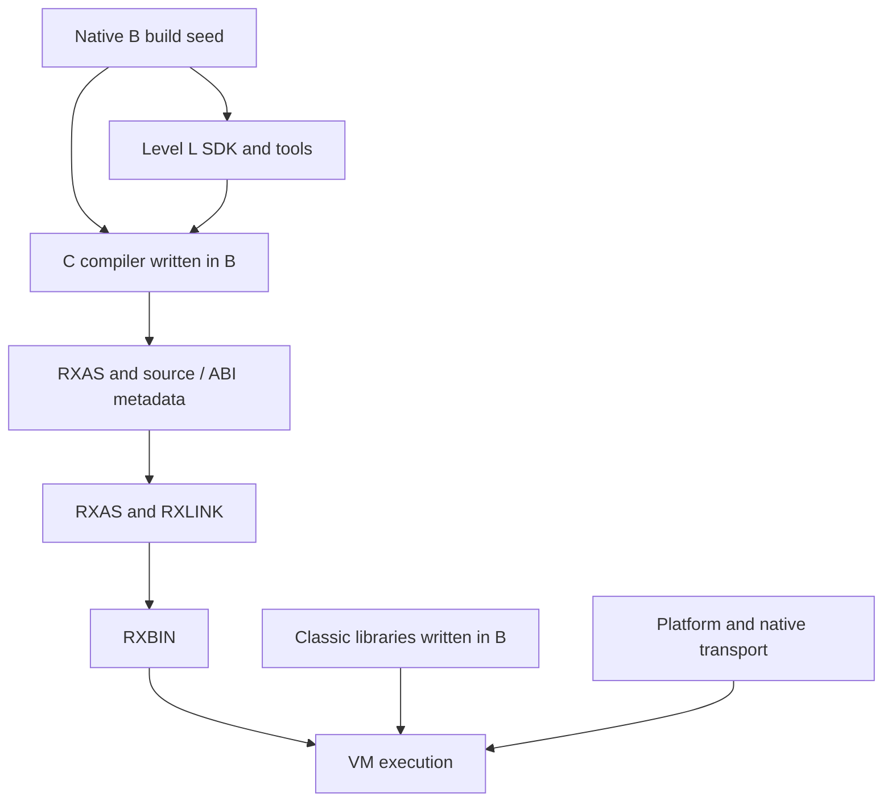

# Level C compiler architecture

**Target architecture approved by Adrian, 19 October 2026.** Source review:
`develop` `016e6a65466c65a5c722b96452d95025acb463b2`, 19 October 2026.
Reconciled with `e5c066b87945dc697df6c771fc5a56a20962c772` (sanitizer scheduling/docs;
reviewed compiler/runtime source unchanged). The [plan](../PLAN.md#c-first-delivery-milestone) owns acceptance and sequence;
[requirements](levelc-requirements.md) map coverage and
[agent work packages](agent-work-packages.md) define implementation assignments.
“Current” below means inspected source, not fresh execution qualification.
Approval establishes the ownership and delivery direction, not implemented
capability. Exact new public API/schema/ISA contracts retain their step gates.

## Outcome

Deliver one complete, explicitly selected Classic Level C compiler implemented
in Level B with Level L grammars/services; independently useful Level L analysis
and optimisation; shared Classic runtime libraries written in B; and justified
RXAS/VM improvements for Classic workloads. INTERPRET completes the sequence.
New B/G coverage and self-hosting are outside this delivery. Existing consumers
and signed B/G interoperability remain regression obligations. Default compiler
replacement is a separate decision after qualification.

Native B remains the build seed. New source requests cannot invoke native source
compilers/backends. RXAS, RXLINK, VM, platform services and native transport
providers remain legitimate dependencies. A native primitive executes a defined
operation; it must not hide a second Classic parser, lowerer or BIF implementation.

## Current implementation review

| Inspected surface | Current facts | Target consequence |
|---|---|---|
| Native `compiler/rxcpcscn.re`, `rxcpcpar.c`, `rxcpcgmr.y`, `rxcpcval.c`, `rxcp_levelc_lower.c`, `rxcc.[ch]` | Separate Classic parsing/lowering feeds the common native backend. `rxcc_parse` owns an exact-length parsed/mapped unit, not a complete compile service. | Reuse requirements/fixtures, not the native implementation as a dependency. Parse success proves neither execution nor INTERPRET. |
| Native architecture/worklist | 24 admitted instruction reviews closed with exceptions; INTERPRET rejected; host/source/configuration/lifecycle obligations open. | Native closure never automatically closes the new compiler. |
| Native direct-BIF table | 70 catalogue names, LOWER/UPPER and 23 Unicode extension names have entries. | Integrate and test every name; entry presence is not conformance. |
| `levelc/levelc.rxl`, `llcparse`, `llcfrontend` | Generated lexer/LR grammar and C token policy; limited operators, ASCII name pattern, private PROCEDURE labels, simple ARG, LENGTH/ARG/DIGITS only. Shared-pool labels/fall-through refused. | Extend the actual pipeline; coverage is substantially smaller than native C. |
| `llcir`, `llcrxas`, `llccompiler`, `llrxc-c` | Independent C family/selector/service/CLI; neutral ABI attributes still use `crexx.g` type names. Owned RXAS output and explicit limits. | Preserve separation; neutral ABI types belong in compiler-common contracts, not typed semantics. |
| `lib/rxfnsl/rexx/llflow.crexx` | Checked AST-role graphs, structured loops/branches, condition facts and finite definite assignment already exist. | Reuse this foundation; distinguish source-AST analysis from executable IR analysis. Its short-circuit roles cannot model eager Classic AND/OR. |
| `lib/rxfnsl/rexx/llir*` | Frozen modules/schemas, block-local values, cross-block slots, revision-bound facts, checked rewrites and bounded local optimisation. | Add exceptional/resumable edges, generic analyses and liveness before relying on them. No immediate SSA rewrite. |
| `levelc/runtime/llctarget.crexx` | B adapter, name-dispatched operators, per-arithmetic-call UTF8 configuration, copied numeric snapshots and private pools. | Use one activation-owned context, direct checked entrypoints and a thin adapter. |
| `lib/rxfnsc` | B implementations own values, pools, activation, DO state, BIFs and streams; package imports include classlib, rxfnsg, cstream/fs. | Extend existing owners; separate required Unicode/provider delivery from G aggregation after closure audit. |
| Maintained `examples/step06/walk-c.after.rxas` | Literal/constant-IF example still creates a pool and carries arguments/context/result; main/body frames have 6/16 registers; clause IDs zero. | Historical readable cost example, not optimal or newly measured. Specialise only after observation/lifetime proof. |
| RXAS sources, `binutils/include/rxops.h`, VM guide, `interpreter/rxvml.h` | Existing peephole/procedure analysis and decimal/context/call/PARSE primitives. Public load-file/load-buffer/context-destroy, no individual-module unload. | Prefer existing operations. Dynamic code needs continuation and reclamation, not merely a bounded lookup cache. |

Some old BIF/reference paragraphs still describe DATE/TIME refresh and streams
as missing despite later code/worklist corrections. Resolve using current code
and the owning contract; reconcile stale prose in the corresponding increment.
Do not import historical statuses into the new requirements ledger.

## Ownership and permitted dependencies

| Owner | Responsibility | Excluded responsibility |
|---|---|---|
| `research/level-l/compilers/levelc/` | C tokens/grammar/AST, binding, clause/control rules, C IR semantics, specialisation legality, selector, service/CLI | Generic graph algorithms, duplicate BIFs, VM loader internals, typed frontend |
| `lib/rxfnsl/rexx/` | Generic source/tree/CFG records, facts/effect interfaces, worklists, checked rewrites, liveness/interference, bounded output | C keywords/numeric defaults/pool rules/BIF names or target opcodes |
| `langtools/` | Level L specification compiler/generation, rxlang, generic tool services, guides/examples and independent SDK tests | C application main or another Level L subtree |
| `compilers/common/` | Shared cREXX ABI/metadata interpretation and target utilities with real common users | Language-dispatch main, hidden C/G policy, speculative universal frontend |
| `lib/rxfnsb/unicode/` (shared B component) | Unicode algorithms, pinned data and B procedural API used by G/C; optional runtime image | G collection facade, C BIF/error policy, compiler bootstrap dependency |
| `lib/rxfnsc/` | Classic values, pools, activation, conditions/state, BIFs and parse/stream adapters | Source parsing, IR or dependency on research compiler modules |
| `assembler/`, `binutils/`, `disassembler/`, `linker/`, `interpreter/` | ISA/encoding, machine optimisation, execution, generic owned code images | Classic grammar/AST, BIF-name dispatch or source-level EXPOSE rules |
| `platform/`, RXPA providers, `ports/single-threaded/` | OS transport, codecs, clocks, maintained CMS/TSO profiles | Compiler language decisions or duplicate runtime algorithms |

Arrows describe build/use flow, not reverse import permission. Generated C
programs depend on Classic libraries; the compiler host reads their ABI metadata
as data. SDK/tool libraries cannot import research/compiler modules. C-only
configuration cannot generate/link a typed/G frontend. Shared changes retain G
regressions without requiring new G features.

`llctarget` may temporarily remain an ABI shim, but lasting runtime semantics
belong in rxfnsc. Remove obsolete adapters after consumers migrate. Unicode
packaging follows the shared B foundation below. Preserve public G namespaces
and existing consumers; directory movement alone does not prove independence.

### First foundation increment

The active slice preserves existing public APIs. C-only dependency controls
stage separate compiler-host and static-target roots; static C links the
existing `library`, `rxfnsc`, `llctarget` and `classlib` images explicitly.
The collection library supplies variable-pool storage. Generic IR definite
assignment indexes predecessor edges once and schedules changed exits through
a bounded worklist; it does not introduce a C analysis engine or liveness API.
Unicode runtime extraction below preserves private ABI and G facade source.
Exact qualification and remaining criteria belong to the active plan.

## Shared Unicode foundation in Level B

Adrian suggested a common B Unicode foundation for both G and C during this
review. Source inspection confirms that the case/codec/grapheme templates and
normalization executor are already B; the public `rxunicode` facade is G, and
all are bundled in `rxfnsg`. C adapters import that facade. Extract and expose
existing capability rather than rewrite the algorithms or make C depend on G.
The ownership extraction is approved. The initial implementation preserves the
private `_rxunicode` ABI; the new public B facade remains an exact-contract gate.

| Proposed owner | Content and contract |
|---|---|
| `lib/rxfnsb/unicode/` | Shared B runtime source/templates and canonical pinned Unicode/legacy-codec data; separately selectable `rxunicode-core.rxbin` (internal component image). No dependency on the G facade or C libraries. |
| `tools/unicode/` | Move component-specific table compilers/generators, their Level L grammar and build adapters here; use `rxlang` as a tool. Generated code/tables remain build outputs. No source compiler algorithm is moved here. |
| Shared B procedural facade | Version, property/simple mapping, explicit normalization/full mapping/folding, direct grapheme operations and byte/text codecs. Exact public namespace/signatures are a CLC-STEP03 contract gate; private numeric selectors stay private. |
| `lib/rxfnsg/rexx/unicode.crexx` | Preserve public `rxunicode` functions and G collection/iterator API, delegating to the B foundation. Source compatibility and doc tags remain required. |
| `lib/rxfnsc/` | Preserve Classic BIF names, argument presence/checking, text/ordinal conversion and Classic error translation. Call the B facade directly. No second normalization, segmentation or codec implementation. |
| `lib/rxfnsl/` | Consume pinned property data or a minimal independent property table for recognition; no import of G/C and no requirement to load the full Unicode runtime. |

Do not merge all large tables into the seed `library.rxbin`. Bootstrap order is
minimal B library → L bootstrap/tool → optional Unicode generation → B Unicode
runtime → G facade/C runtime. L's own property generation must use minimal B
and pinned source data without depending on this optional runtime image. One
canonical source-data owner can feed different generated indexes needed by L
and runtime algorithms; do not create a graph cycle or conflate those indexes.

The B interface uses `.string`, `.binary`, scalar positions/results and explicit
owned values, with documented errors and work limits. G-only iterator objects
stay in G. Shared byte/codepoint iteration and simple mappings may be consumed
by the C scanner/pool; locale/configuration overlays remain C-owned. Existing
ordinary text remains exact codepoints, without implicit normalization, folding
or grapheme indexing. Explicit full casing may expand; ordinary Classic symbol
casing must use its simple-mapping contract. Stream codec choice never changes
the fixed Classic ordinal bridge.

Validate the extraction with direct B consumers, unchanged G facade fixtures,
all C Unicode BIFs/streams, UCD conformance inputs, embedded NUL/high scalars,
malformed bytes, replacement controls and both engines. Compare linked constant
ownership and RXAS so the split does not duplicate tables or introduce wrapper
copying. Test C-only and G-only clean/incremental/installed builds, missing and
changed generated inputs and no-op freshness. Preserve data provenance/licenses,
API doc tags and code-shape assertions. These tests close ownership; no new
Unicode version or semantic expansion is implied.

## Compilation pipeline

1. **Owned request.** Exact UTF-8 bytes, logical source ID and physical mapping,
   mode, explicit imports, options and work/storage limits. File I/O and atomic
   destination replacement belong to the command adapter; the service cannot
   exit, spawn a source compiler or use ambient import fallback.
2. **Recognition.** Level L engines plus C contextual token policy handle words,
   labels, continuation, comments, radix suffixes and blank/abutment. Preserve
   byte spans separately from Unicode positions; do not translate C into B.
3. **Named C AST.** Source constructs, explicit fields/lists/optionality,
   spelling and clause identity. Bind entry identities and validate static
   errors throughout unreachable source before optimisation.
4. **C semantic IR.** Explicit blocks, ordered effects, values/slots, context
   use, control/completion edges and source observations. Keep pool operations
   until C legality analysis proves a narrower representation.
5. **Generic analysis.** Level L computes def/use, reachability, liveness and
   finite-domain facts from registered C summaries. C supplies numeric, pool,
   alias, call and TRACE semantics. Rewrites invalidate revision-bound facts.
6. **Target lowering.** Choose existing VM instructions or checked runtime calls;
   every operation has a conservative executable route. Typed target records
   precede physical register assignment and retain source origins.
7. **Registers/emission.** Generic liveness/interference consumes use/def/edge
   records. The target owns aliases, call windows, clobbers, reserved registers,
   cleanup and legality. Render through Level L's writer. RXAS independently
   owns machine optimisation, separately switchable from compiler optimisation.
8. **Assemble/link/run.** Existing tools validate RXBIN and explicit imports.
   Keep separate file stages. Later in-memory assembly must use the same
   assembler contract and prove diagnostics/output equivalence.

### Representation contracts

Names describe proposed records, not committed public identifiers.

| Record | Required content/ownership | Validation |
|---|---|---|
| CompileRequest | Owned bytes, logical identity/map, module/routine/interpreted-group mode, imports/profile, limits, optimisation policy | Exact length including NUL, valid options/encoding, no ambient mutable compiler state |
| CompileResult | Status, owned diagnostics, optional frozen AST/IR, RXAS chunks/source map, runtime ABI requirements | No executable after recovery/error/limit; earlier results survive later failure |
| C AST | Kind, named fields/lists, source span, clause, spelling, generated origins | Grammar/schema plus C static checks; no overloaded anonymous fields |
| IR operation | Typed inputs/results, attributes, ordered effects, normal/exceptional/resumable edges and origin | Generic structure plus C meaning; unknown effects prohibit speculation |
| Analysis result | Owner/revision, domain/version, explicit absent versus false, budgets | No stale/foreign facts; transformation declares invalidation |
| Target record | Opcode ID, typed operands, use/def/clobber, failure/normal edges and observations | Validate before/after allocation and rewriting; strings are output, not optimisation IR |
| Runtime ABI | Namespace/signature, presence, ownership/borrowing, context, effects/errors | Separate producer/consumer, metadata and malformed-import tests |
| Completion/continuation | Kind, result presence/value, destination, condition, owned code handle/PC and live spills | Generation/lifetime/cleanup checks; no raw expired caller pointers |

Retain current block-local values and cross-block slots. SSA is not a prerequisite.
Reuse existing `llflow` AST analysis and `llirservices` IR passes rather than
introducing competing generic engines. Their graphs answer different questions:
source structure before lowering versus explicit executable edges after it.
Only proved mapping adapters may transfer facts; Classic eager logical evaluation
must not inherit `llflow` short-circuit AND/OR behavior.
Make exceptional/resumable edges and clause observations explicit before global
passes cross them. Version changed serialized schemas; reject incompatible data
rather than silently assigning new semantics. Algorithm records must state
invariants, convergence/work bounds, allocation accounting and atomic failure.

## Classic activation and runtime

Start with RexxValue, RexxStem, RexxVariablePool, RexxActivationArguments,
RexxClassicConfig/State, RexxDoState and existing BIF modules. Keep their public
consumers compatible while introducing a coherent reference-based compiled-C
activation facade. A copied argument/result packet is not the live activation.

An activation owns or explicitly borrows arguments/presence and invocation kind;
result presence; the replaceable visible-pool binding and caller/exposure links;
PROCEDURE eligibility; NUMERIC/ADDRESS/TRACE/clause-clock/condition state;
source/clause and label/routine identities; active loop state; program-root
completion; and execution-owned queue, stream and host services.

Internal CALL creates an activation with defined inheritance/restoration. A
label alone creates no private pool. PROCEDURE replaces the visible-pool binding
and resolves EXPOSE in source order. Interpreted code sees that replacement
through the same binding. Create configuration at program/host entry, not per
operator. Calls, callbacks and context mutation invalidate affected facts;
process-global defaults cannot silently replace active Classic state.

Compile a source unit's label/control space into one owned code body with checked
entry identities. An internal call can recursively enter that body with a new
activation and entry ID; SIGNAL changes position within the current invocation.
Do not clone the source tail for every label or require PROCEDURE after labels.
Preserve first-label precedence, fall-through and control-stack clearing.

Existing BIF bodies and valid library qualification are reused; extending the
new compiler's current three-name subset is binding/context work, not a second
BIF implementation. Reuse expected-result fixtures through the new compiler;
change library algorithms only for a demonstrated defect or named missing
contract. BIF calls share one runtime context/presence contract. Pure text entries need
not copy the entire activation; stateful entries borrow their declared context
from its authoritative owner. Numeric specialisation preserves decimal DIGITS,
FUZZ/FORM, literal spelling, exact logical tests, errors and LOSTDIGITS. Machine
integers/floats are implementation choices, not changed Classic semantics.
Ordinary text is exact Unicode codepoints with the fixed Latin-1 ordinal bridge;
external stream encodings do not change source or ordinal semantics.

## Optimisation ownership

| Candidate | Owner/mechanism | Required negatives and shape proof |
|---|---|---|
| C-OPT-01: unnecessary setup | C requirement analysis | Constant SAY versus VALUE/host pool/TRACE/dynamic execution; safe constant-only case has no unused pool construction |
| C-OPT-02: registers and temporaries | Generic L liveness, target allocation | Loops, handlers, calls, aliases and cleanup; frame demand follows simultaneously live values, not all source temporaries |
| C-OPT-03: arithmetic/context | C facts, direct runtime entries, existing primitives first | Mutation, recursion, conversions, overflow, LOSTDIGITS and spelling; no avoidable config construction/name dispatch per known operation |
| C-OPT-04: pool/name access | C binding/alias proof, runtime lookup | EXPOSE, DROP, compound-tail mutation, VALUE and callbacks invalidate cached binding/value facts |
| C-OPT-05: calls/BIFs | C ABI selector and existing short-call forms | Omitted/empty/RESULT, failure cleanup and hidden helper work; stateful helpers are not assumed pure |
| C-OPT-06: machine operations | RXAS peephole/procedure proof | Signal/TRACE/reference/cleanup equivalence independent of compiler-only annotations |

L supplies algorithms; C supplies premises; RXAS proves machine rewrites; VM
executes documented operations. Never teach L Classic rules or RXAS BIF names.
Keep bounded peephole before procedure analysis. Fix direct construction/emitter
defects at their owner even with optimisation off.

Before selecting a native primitive, compare the best existing opcode sequence,
a library/selector repair and a native operation where viable. Context-aware
scalar operations and owned code regions are candidates, not approved opcodes.
Exact names/operands require a contract review, alias/lifetime/error/source and
numeric proof, both VM engines, disassembly/load and constrained-platform tests.
A public ABI/RXBIN change needs explicit version/migration approval. Pool/EXPOSE
algorithms and instruction parsing stay above the VM.

Ordinary L research uses structural and focused functional quality checks; no
formal benchmark gate is added. Production RXAS/VM performance edits retain the
first Release verdict/approval in `performance/AGENTS.md`. Static counts alone
make no speed claim. The performance roadmap records these candidates without
creating a competing delivery plan.

## INTERPRET — final implementation stage

Use the same C service in interpreted-group mode, with no native compiler or
RexxScript fallback. Evaluate the source once; validate exact text with implied
final delimiter, complete groups and no label clauses. The LC-87 obligations,
[IBM INTERPRET reference](https://www.ibm.com/docs/en/cics-ts/6.x?topic=instructions-interpret)
and [condition rules](https://www.ibm.com/docs/en/cics-ts/6.x?topic=reference-conditions-condition-traps)
require caller context and CALL-handler resumption versus SIGNAL termination.
Repository Unicode extensions and existing exceptions remain explicit.

### Proposed control protocol

1. Compile/assemble into a private image, verify imports/runtime ABI and publish
   a generation-checked code handle.
2. Enter with the **live** borrowed activation and an owned continuation, not a
   fresh ordinary private Classic invocation.
3. Run local operations as compiled code. At transfers crossing code owners,
   return a checked outcome: normal, call request, RETURN, EXIT, SIGNAL or
   condition. Spill only values live across a resumable boundary and record a
   verified continuation entry.
4. The C runtime dispatcher resolves outer routine/label identities. CALL creates
   a child activation; CALL ON runs its handler and resumes the saved fragment;
   SIGNAL discards crossed loops/continuations; RETURN/EXIT propagate to their
   defined owner. A completion tag without actual dispatch/resumption is not
   an implementation. Outer loops are inactive for interpreted LEAVE/ITERATE.
5. Unwind pins, values and resources on every path. Nested INTERPRET uses a
   bounded continuation stack and the replaceable live pool binding. Independent
   host contexts share no mutable activation state.

This is compiled control flow, not AST interpretation. Compiler owns entry/spill
layout, runtime owns Classic dispatch, VM owns code storage/safe entry. Ordinary
static bodies retain direct branches/calls where no cross-owner continuation is
needed. Final mechanism proof must demonstrate semantic equivalence of these
routes before full integration. No INTERPRET implementation precedes that stage.

### Proposed code ownership

Prefer restricted **ephemeral image groups** over arbitrary existing-module
unload. Lifecycle: private → verified → published → pinned/running → retired →
reclaimed. Handles carry owner/generation. Frames, suspended continuations,
bound entries and diagnostic/source readers pin their group. Retirement prevents
new entries; reclamation waits for zero pins. Resolver indexes, shared constant
pools, dispatch tables and source metadata must be reclaimed together. Ephemeral
pointers cannot escape into permanent imports/caches; stable dependencies can be
borrowed with explicit lifetimes.

Bound resident generated bytes as well as lookup-cache size. Cache identity
includes source, compiler/runtime/IR ABI versions, imports, options and relevant
lexical/source environment. Borrow mutable activation state at execution; never
capture an expired caller in cached code. Cache-free operation is acceptable;
loading every image forever is not. All capacity pinned means a defined resource
failure, not eviction of running code. Test nested/concurrent misses, failed
publication, stale handles, source readers and context teardown.

The current public loader has no image-group API. Compare this design with
context-lifetime retention (insufficient for bounded long-lived use) and child
contexts (do not inherently share pools/handlers). Exact assembler/VM APIs and
continuation ABI need approval before coding. Their absence remains an open
criterion, not a reason to silently weaken INTERPRET.

## Product and platform delivery

Retain the existing directories. C stays opt-in until promotion is approved.
Build native tools/B seed → B runtime and L → C compiler → C artifacts. Separate
compiler-host, target-runtime and optional runtime-compilation manifests; static
C programs must not load compiler/L services. Keep standalone file stages for
constrained hosts and one independently selectable Unicode/provider closure.

Cover macOS ARM64/Intel, Linux, Windows MSVC/MinGW and applicable concrete VMs;
record maintained CMS/TSO profiles individually. Guest/SDK, local, hosted,
sanitizer, signing and release proof are distinct. Missing facilities are open
cells, not an implicit desktop-only definition of completion. Retain native-C,
B/G and RexxScript shared-library consumers and library doc tags.

Every increment checks independent values/state/errors, source/TRACE, compiler
and RXAS opt/no-opt separately, direct/linked and affected installed/host paths.
Inspect complete representative RXAS and helpers. Keep structural regressions
and purposeful worked examples; delete diagnostics after recording conclusions
in the plan. There is no evidence/archive subtree in this architecture.
