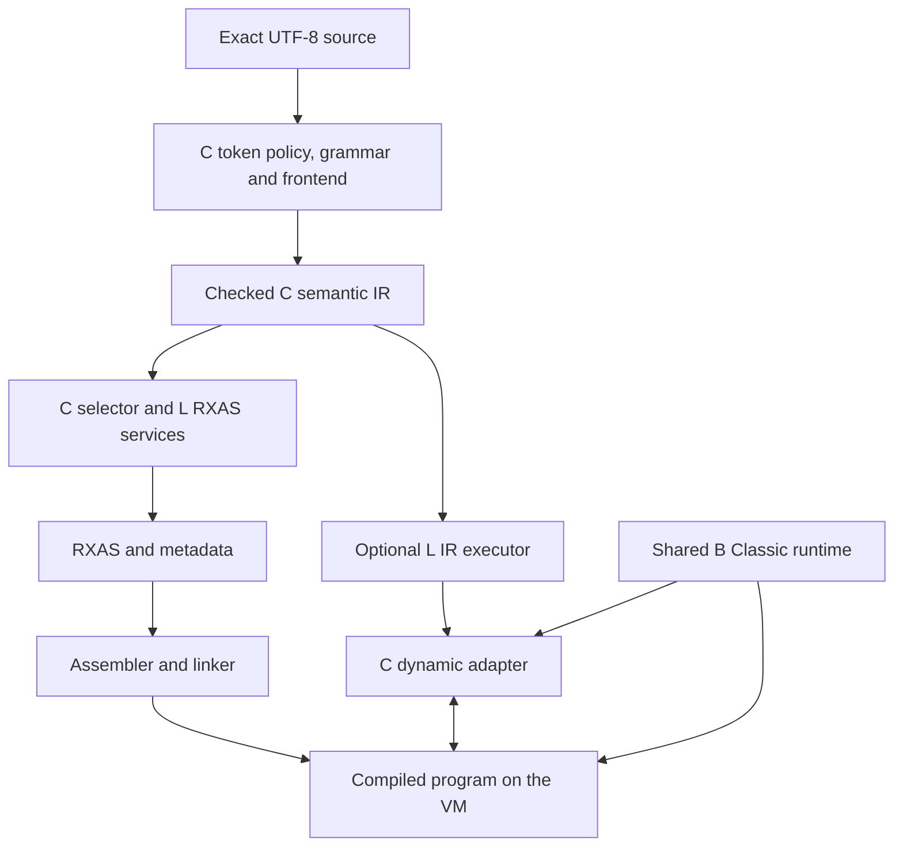

# Level C compiler architecture: Classic Rexx

<a id="level-c-compiler-architecture"></a>

The research Classic Rexx compiler is a Level B program built on the reusable
Level L language tools. Its command, `llrxc-c`, compiles source to RXAS; its
`llccompiler` service offers the same compilation without command-line I/O.
The ordinary assembler, linker and VM turn that output into a running program.
`llrexx` / `llrexx.rxbin` and `llrxc-c --run` instead use the same full-program
frontend/IR runtime directly through a true COMMAND host root.
When the program executes INTERPRET or calls a Rexx source file, the same C
frontend prepares semantic IR for the optional Level L executor instead.
Both execution paths use the shared Classic runtime for values, variables,
numeric operations, built-in functions and host services.

This document describes the compiler's components, execution paths and contracts. The
[user guide](levelc-user-guide.md) explains programming and command-line use;
the [conformance profile](levelc-conformance.md) records accepted differences.
[PLAN.md](../PLAN.md) owns acceptance and remaining work, and the
[conformance profile](levelc-conformance.md#instruction-profile) retains the instruction/BIF crosswalk.
The separate [Level L architecture](../../../../langtools/doc/architecture.md)
describes the reusable SDK, which has consumers other than Classic Rexx.

The static and dynamic language profiles described here are implemented. The
conformance profile separates current behavior and known limits from unqualified
delivery/platform capabilities; PLAN selects the bounded local research closure. Native `rxc-c` is a separate compiler: its fixtures are useful
comparison inputs, but its results are not automatically correctness oracles.
Native B builds this implementation; a C source request never delegates parsing,
lowering or selection to a native source compiler. Default compiler replacement,
native-C retirement, new B/G features and RexxScript migration are separate work.

## Reading the design

The central distinction is between a program's meaning and its execution
mechanism. The C frontend describes Classic semantics in IR. The static backend
turns those semantics into VM instructions and runtime calls. The dynamic
adapter executes them through the neutral IR engine, suspending when it needs a
compiled routine or a transfer in the containing program. Language state remains
with the same Classic owners throughout.

- [Components and dependencies](#components-and-dependencies) identifies those owners.
- [Source to checked IR](#source-to-checked-ir) explains parsing, representations and admission.
- [Runtime state and calls](#runtime-state-and-calls) follows activations, pools and completion.
- [Instruction execution](#instruction-execution) explains ordering and cleanup.
- [Conditions and observations](#conditions-and-observations) covers SIGNAL, delayed CALL, clocks and TRACE.
- [Analysis and RXAS selection](#analysis-and-rxas-selection) separates semantic and machine optimization.
- [Runtime source execution](#runtime-source-execution) covers INTERPRET, source search and ownership.
- [Contract reference](#contract-reference) retains the exact wire layouts and narrow interfaces needed at implementation boundaries.

## Components and dependencies



| Component | Responsibility |
|---|---|
| [C frontend](../levelc/) | C token policy, grammar, AST, labels and call binding, static diagnostics, semantic operations and instruction protocols. |
| [C selector and services](../levelc/llcrxas.crexx) | Runtime ABI selection, VM instruction construction, source observations, CLI and reusable compile request. |
| [Compiler common](../common/) | Scalar codecs and cREXX ABI/metadata interpretation shared by actual compiler consumers. |
| [Level L core](../../../../lib/rxfnsl/rexx/) | Source positions, recognition engines, trees, frozen IR, structural verification and checked transformations. |
| Optional L analysis, RXAS and execution packages | Graphs/effects/proofs; typed target records and checked register assignment; executable plans, frames, ports and suspension. |
| [Classic runtime](../../../../lib/rxfnsc/) | RexxValue, variable pools and aliases, activations, conditions, numeric settings, BIF algorithms, PARSE adaptation, queues, streams and host policy. |
| [B Unicode core](../../../../lib/rxfnsb/unicode/README.md) | Pinned Unicode data and shared normalization, mapping, folding, grapheme and codec algorithms. |
| Assembler, binutils, linker and VM | ISA, encoding, machine optimization, metadata, linking, values/references, checked calls, native event transport and execution. |
| Filesystem/process providers | Execution-context resources, exact bounded reads, child processes, byte channels, clocks and interrupts. |

Dependencies point from language adapters toward reusable services. Level L does
not know C keywords, BIF names or EXPOSE rules. The Classic runtime does not
import a compiler or Level L. Native transport services perform their defined
operations without hiding another Classic parser or runtime algorithm.

The static compiler reads selected runtime metadata as data; it does not link
the target runtime into its own host merely to discover signatures. C-only
configuration excludes the typed/G frontend. Existing G and shared-runtime
consumers keep their own interfaces and regressions.

### Products and build order

Build order is native tools/B seed, then B runtime and L tools/libraries, then
the C compiler, then C applications. The independently selected products are:

| Product | Role and runtime dependencies |
|---|---|
| `llrxc-c` | Packaged command adapter and compiler; publishes RXAS or delegates first-switch `--run` to the shared source-run CLI. |
| `llrexx`, `llrexx.rxbin` | Shared source-run CLI and full-program COMMAND bootstrap with frontend/IR/ordinary runtime only; no selector, assembler, linker or native source compiler. |
| `llccompiler.rxbin` | Reusable compile service with compiler-side dependencies. |
| `llctarget.rxbin` | Thin runtime adaptation for generated C, alongside `library`, `rxfnsc`, `classlib` and `rxunicode-core`. |
| `llcdynamic.rxbin` | Optional C frontend, semantic IR preparation/execution and dynamic adaptation. Excludes the RXAS selector, assembler, linker and native source frontends. |

A static application without dynamic capability needs neither the compiler nor
Level L at runtime. INTERPRET and enabled automatic source calls select the
dynamic profile and its additional runtime image. An image name in a string is
not a linker root: explicit manifests retain required bodies, metadata and
actual native provider identities.

<a id="shared-unicode-foundation-in-level-b"></a>

### Unicode ownership and Classic policy

Ordinary C values are exact Unicode text, with codepoint lengths and positions.
They are not implicitly normalized, folded or segmented into graphemes. The
fixed ordinal bridge maps every value 0–255 to U+0000–U+00FF; a byte-valued BIF
uses those ordinals, not arbitrary text's UTF-8 encoding. Stream codecs do not
change source decoding or this bridge.

Classic casing has a compatibility rule. An input in U+0000–U+00FF uses its
simple upper/lower mapping only if the result also lies in that range;
otherwise it remains unchanged. Above U+00FF, simple Unicode mappings apply.
Thus ordinary UPPER preserves `µ`, `ÿ` and `ß`, while LOWER can map `Ÿ` to `ÿ`.
This policy governs ordinary C character and name casing. It does not change
B/G casing or explicit Unicode BIFs: TOUPPERCASE can expand `ß` to `SS`.

`CrexxClassicUnicode.cmake` owns the shared Classic table generation and range
rule. The B Unicode component owns the algorithms, pinned data and 23 public
`rxunicode` procedures. Its standalone `rxunicode-core.rxbin` can serve C without
the G collection facade; the G aggregate includes those same B members. Select
one aggregate per linked image to avoid duplicate procedure/table ownership.
Minimal B and L bootstrap remain upstream of optional Unicode generation; the
large runtime tables do not become mandatory seed-library contents.
The [Unicode/streams contract](../../../../compiler/docs/levelc_unicode_and_streams.md)
and [B interface](../../../../lib/rxfnsb/unicode/README.md#public-b-interface)
own the external APIs and error details.

## Source to checked IR

A compilation begins with owned, exact UTF-8 bytes, a logical source identity,
explicit metadata roots/bindings and resource limits. Physical byte offsets and
Unicode scalar columns are distinct throughout. Canonical names are separate
values: a case mapping may change UTF-8 width without rewriting source bytes or
moving a diagnostic span.

[llcparse](../levelc/llcparse.crexx) supplies C policy around the generated
[grammar](../levelc/levelc.rxl). It recognizes contextual keywords, comments,
physical continuations, literal suffixes and the difference between blank and
abuttal concatenation. Keyword recognition uses ASCII spellings. Variable
recognition uses the pinned Unicode letter category plus Classic punctuation;
combining marks and emoji do not become identifier letters. Raw pool names are
kept until the shared runtime resolves compound tails.

Only a complete first nonempty OPTIONS clause made of bare words selects file
policy. Quoted, call-shaped and later operands remain runtime expressions.
Comment overrides and STRICTC are request-local. Runtime OPTIONS currently
recognizes no words, but its operand's reads, calls and failures still execute
once; only a proved unused literal/no-operand result is omitted. Adding a runtime
option effect would invalidate that specialization.

The main layout pass removes a continuation comma only when a physical
LF/CR/CRLF and a following significant token permit continuation. A trailing
comma at EOF remains authored syntax; a semicolon is not continuation. Original
gaps remain available, so a spaced or continued function-like form cannot
accidentally become an adjacent call.

<a id="proposed-prepared-language-reuse"></a>

### Prepared language and request isolation

A private [llclanguage](../levelc/llclanguage.crexx) module owns one immutable,
validated generated definition per VM overlay/worker. Its initializer creates
only lifecycle state. First use prepares a local definition and publishes it
once after the existing scanner/parser checks; ready, failed and reentry states
prevent partial publication or silent retries. A typed failure retains its
original event. Parser requests and symbol checks borrow its DFA/LR tables and
production metadata while retaining their own bytes, comments, limits, tokens,
trees and diagnostics. Packed-table loading retains full identity, record and
index validation. CFG layout uses the shared structural grammar validator;
nullable/FIRST queries demand complete analysis once, while `llcheck.run()`
retains all existing facts. A changed grammar requires a new prepared owner;
a failed source request does not poison
an existing one. No cross-worker mutable cache or public mutable grammar handle
is exposed. C's `dfa.states=16384` generation allowance does not alter L defaults.

Failure controls inspect the generic signal payload's physical binary component,
exact bytes and original event identity. Primitive scalar views do not acquire
class RTTI through `.object` transport; these checks use binary component access
without text conversion and validate both lengths before indexed reads.

<a id="group3-static-language-contract"></a>
<a id="representation-contracts"></a>

### Source tree and semantic graph

[llcfrontend](../levelc/llcfrontend.crexx) constructs named AST fields for source
constructs, preserving optional operands, raw spellings, clause identity and
origins. It validates static errors throughout the source, including dead arms,
before optimization. Runtime errors stay runtime errors: an untaken division
must not execute, whereas malformed unreachable source still prevents output.

Lowering produces explicit blocks, ordered effects, block-local values and typed
cross-block slots. C does not need an SSA conversion to use L. Pool operations
remain explicit until a language proof permits something narrower. Ordinary
logical AND/OR/XOR evaluate both operands; a typed short-circuit transformation
cannot be applied to them.

<a id="current-c-family-contract"></a>
<a id="approved-c-family-revision-and-generated-procedure-abi"></a>

The current static family is `crexx.c` version 24: 97 operations and five C
types, `value`, `arguments`, `result`, `context` and `parseprogram`.
`core` version 1 and neutral `crexx.g` version 1 scalar identities accompany it;
the latter names do not import G semantics. LLIR serialization remains version
2. Optional `crexx.c.dynamic` version 1 adds seven operations without changing
C24 identities. Earlier C families are refused, not silently upgraded.
[llcir](../levelc/llcir.crexx) is the exact ordered registration owner.

`value` uses the existing RexxValue representation. `arguments` is a packet
being built before borrowing; `result` is an opaque completion whose consumers
read presence and value. `context` denotes a live authoritative reference, never
serializable runtime state. It originates only at required parameter 1 and
flows through proved reference copies or an entry-bound, once-written slot.
No context constant, default argument or escaping result is admitted.
`parseprogram` is allowed only as the immutable `parse.execute` program
attribute, not as a general value, slot, argument or result.

### Admission before effects or output

Generic L verification establishes structure, types, codecs, block ownership and
terminators. C protocol checks establish language and lifetime meaning. Both are
necessary for fresh, loaded and transformed graphs, including unused/dead
records. The selector compares the complete registered family, ordered fields
and effects, rechecks byte attributes through their canonical codecs and admits
every selected runtime signature before publishing output.

The protocol dependency runs from procedure/context proof to SIGNAL proof, then
to DO/command and clause proofs. It has no reverse dependency cycle. These
checks establish entry eligibility, context identity, argument construction,
result availability, actual control edges, loop/command lifetimes and authored
observations. A same-typed value is not automatically the correct context or
completion carrier.

Proofs belong to an exact frozen graph identity and live retained owners. A
selector may borrow successful same-identity facts after checking their actual
charges against its own limits. Narrow-limit refusal is local and does not
poison a successful proof. Loaded or rewritten graphs rebuild facts; matching
bytes alone do not authorize reuse. Indices and scoped operation views avoid
repeated whole-graph scans or aggregate copies. Unknown effects and exhausted
budgets fail closed without partial usable output.

### Source identity, inventory and diagnostics

Logical source identity is distinct from a physical resource locator. The CLI
uses the opened source basename; services can supply deliberate relative names.
Diagnostics retain category, logical filename, byte span, scalar line/column
and escaped context. Original Unicode and NUL survive; CR/LF/CRLF splitting
excludes terminators and introduces no phantom trailing line.

A root installs source inventory from compile-owned physical lines when
SOURCELINE or an exported host boundary makes it observable. Internal labels
share it. Programs with no observer omit unnecessary inventory setup. Runtime
SOURCELINE never rereads source from disk.

[llcsrcmap](../levelc/llcsrcmap.crexx) decodes RXPP's existing bounded provenance
wire above L's physical origins. It owns cleaned bytes, nested map records and
optional original text; diagnostics and RXAS use the same narrowest-span lookup.
C24's first-entry `source.map{original,filename}` declaration carries this
compile-time relation and emits no runtime decoder. The selector independently
checks that its cleaned bytes equal the function source. Target coordinates
must fit RXAS's 32-bit metadata; truncation is not permitted. A mapped generated
buffer is not an original line inventory: SOURCELINE reports unavailable data,
and missing original text stays missing.

The service owns detached output chunks and warning records. Full request
accessors execute lazily at most once; `graph()` and `warnings()` can prepare
the frontend without selecting RXAS. A completed warning list survives later
lowering failure. The CLI publishes only after a complete write/close through
its sibling staging claim, preserving an existing destination on failure.

## Runtime state and calls

A running Classic invocation has an activation, a current variable-pool binding
and a configuration. [RexxClassicContext](../../../../lib/rxfnsc/RexxClassicContext.crexx)
connects them through checked references. It is not a copied activation or an
independent runtime. Root wrappers construct stable owners before borrowing;
helpers receive the authoritative context by reference and resolve its current
pool when they act.

`bindPool` changes only that context's binding. It validates the replacement
before publishing it and preserves the previous binding on failure. A copied
context shares referents but has its own replaceable binding; it cannot stand
in for the authoritative context. Referenced owners may not move, expire or be
recycled while borrowed. Invalid/expired references retain `REFERENCE_INVALID`;
ordinary uninitialized objects retain their own guard.

<a id="proposed-procedure-contract"></a>
<a id="label-arm-prerequisite"></a>

### One source body, several entries

A source unit has one generated body with the ABI:

```text
(context = reference RexxClassicContext, entry = .int)
    -> RexxActivationArguments
```

Both parameters are required. Entry 0 starts the main position; positive dense
IDs identify eligible first occurrences of canonical labels in source order.
Labels inside DO/SELECT are observation-only. IF nesting alone does not prevent
an entry: calling an eligible label in an IF arm bypasses that IF condition and
follows the arm's normal continuation. First-name selection precedes eligibility,
so an earlier ineligible label cannot be bypassed by a later duplicate or BIF.
There are no cloned source tails or per-label callable wrappers.

Each internal call constructs a fresh child activation and context, initially
sharing the caller pool/configuration. The first executed ordinary instruction
consumes PROCEDURE eligibility; labels, comments and null clauses do not.
PROCEDURE must also occupy a legal source position immediately after a label.
Only its successful execution creates a private pool. EXPOSE runs left to right
against the saved immediate-caller pool, using existing direct/indirect alias
services. The first binding must succeed before any exposure, and a second
reached PROCEDURE raises 17.1 before another allocation.

The entry dispatcher and its `entry.test` operations expose all destinations in
the ordinary CFG. Positive entry requires an eligible activation; entry 0
requires an ineligible one. Wrong activation kind and invalid IDs are ABI
errors, distinct from authored PROCEDURE or missing-routine errors. Admission
tracks FreshShared, ConsumedShared and Private possibilities; ordinary operand
work cannot sneak ahead of eligibility consumption.

INTERPRET expands an incoming FreshShared possibility to all three outcomes,
but retains an incoming ConsumedShared/Private union without recreating Fresh.
Only its proved adjacent same-clause prefix, source-expression region and
paired completion/EXIT transport may run while Fresh.

On actual invocation exit, end temporary borrows and DO/PARSE/command owners,
restore a committed pool binding, then release its private owner. Construct an
owned return value before cleanup. Failed construction leaves the old binding
intact; a failure after publication restores it before owner expiry. Dynamic
PROCEDURE uses invocation-owned storage so its pool survives group completion.

<a id="numeric-form-diagnostic-prerequisite"></a>
<a id="numeric-c-contract"></a>

### Numeric state must reach the executing frame

The activation stores DIGITS/FUZZ/FORM, but ordinary numeric BIFs also inherit
them from the immediate VM caller frame. Entry and successful NUMERIC therefore
install settings in the actual C frame: FUZZ 0, DIGITS, validated FUZZ, FORM.
A B shim calling those BIFs declares inherited numeric settings. Changing only
the activation or a helper frame would be insufficient.

Shared setters validate before committing. Failure preserves both stored and
frame state and cannot continue into installation. DIGITS is positive, greater
than FUZZ and at most 999; FUZZ is nonnegative and below DIGITS. FORM uses the
shared first translated E/S character rule, with invalid FORM reported as 33.3.
No C-specific decimal parser, rounding implementation or global default mutation
is introduced. Internal child changes do not alter the parent's activation;
return restores the caller's VM frame.

<a id="call-contract"></a>
<a id="call3-static-provider-contract"></a>
<a id="group2-calls-host-proposal"></a>

### Resolution, arguments and results

Unquoted calls resolve the first local name, then a BIF, then the external
phase. Quoted calls skip locals but can still match an exact uppercase BIF name.
Arguments evaluate once left to right before dispatch. Raw positional extent,
omissions and present empty/NUL values remain distinct. CALL VALUE is not a
dynamic-name form.

Statement CALL applies or drops RESULT/.RESULT without assigning RC. A function
requires a present value: bare RETURN raises 45.1 in a function, and absent EOF
or other completion raises 44.1 at the call. Missing ordinary routines raise
43.1 only when reached, after actual effects. Internal calls update ordinary
SIGL to the call line; direct BIF/missing calls do not.

The external phase can use an explicit Classic packet provider, ordinary scalar
bytecode/RXPA export or process binding. Prepared selections own checked metadata
and aliases under explicit roots. Duplicate/ambiguous selections fail even in
dead source; no filename-derived callable identity or ambient import fallback
is allowed. Acquisition and projection have aggregate byte/work limits.
Binutils `rxcontract` owns signature grammar; its bounded projection preserves
formal order, expose/optional/vararg/default and complete type identities.

| Callee | Caller adaptation |
|---|---|
| Classic packet provider | One required by-value activation packet and void transport. Recover owned Classic result presence/value from that packet after the call. The provider owns a fresh external root, pool and config. |
| Ordinary scalar B/G/RXPA procedure | Convert present RexxValues to declared string/binary/int/float/decimal/boolean or admitted RexxValue types. Preserve omissions; callee evaluates defaults. |
| Exposed scalar formal | Use a private temporary cell through the ordinary exposed ABI; discard writes afterward. It never aliases a Classic variable. |
| Scalar varargs | Use normal count/cell conventions; authored holes are refused. |
| Void result | Absent completion: CALL drops RESULT; a function reports 44.1 after execution. |
| Reference, object, array, method/factory or task interface | Requires an explicit adapter; no receiver, global access or arbitrary object conversion is inferred. |

All actual evaluation precedes conversion, and all conversion precedes target
entry. Static arity/presence/type-shape errors refuse compilation; value-dependent
conversion failures stay runtime events. B/G exposed globals remain invisible
to C. Native provider identity and normal VM lifecycle rules remain intact.

Classic packet transport uses the existing disposable counted-call swap/recovery
protocol: recover the invocation before clearing the call window, and never
inverse-swap twice during unwind. Consumers see only completion, not a provider's
local references. Routine wrappers have one public packet export and distinct
private body identities, avoiding collisions when independent units link.

<a id="return-contract"></a>
<a id="exit-contract"></a>

### RETURN, EXIT and host completion

RETURN completes the current invocation with an owned presence packet. EXIT
records completion on the applicable program root and unwinds toward it; source
bodies do not emit VM EXIT or narrow results to command status. An external
Classic program has a fresh root, so its ordinary EXIT does not terminate its
caller. Only the root command adapter converts completion to integer status.

After a call that may request program exit, the IR preserves its result and
queries `program.exiting` before RESULT, required-result checks or later operand
work. Its true edge returns the same owned carrier through a private cleanup
path; the false edge continues. Admission checks carrier identity, single
writer, private predecessors and derived call provenance. Only a proved unwind
may discard a partially captured DO or pending command. `clause.complete` has a
stricter conditional carrier: it contains R only on the EXIT edge and is never
read on normal continuation.

The RXAS selector presents a proved `program.exiting` query's retained invoking
range as generated, inherited source metadata, so a failed root query reports
the invoking call's logical source location. This private presentation override
preserves the query's frozen IR origin and uses the existing source index and
source-map lookup. Its presentation step ID is the origin count plus its unique
query operation ID, checked against RXAS's 32-bit metadata range before addition.
This gives each query a distinct ID beyond all IR origins, including when
queries share an origin. Only the query source record uses this private ID;
instruction provenance and clause identity retain their existing owners. Other
synthetic guard transport retains no source coordinates under its original ID.

An explicit host completion boundary can own the first escaping event after
Classic cleanup. Inherited references carry generation identity; ending and
reopening a root cannot revive stale children. `requestProgramFailure` clears
result presence and captures the exact event only for a live owner. Without
that boundary, unhandled C events retain terminal HALT relay with their tag,
payload and origin. This is not general permission for an arbitrary outer host
handler to skip and resume failed Classic execution.

The cold fatal-payload carrier is first defined from the original event after
cleanup. Source spans, clause/query identities and TRACE/error mapping remain in
metadata and their existing scalar state; no eager diagnostic-location string or
saved-location cell is maintained. Outward relay preserves the event's original
tag, payload and origin without formatting a replacement message.

## Instruction execution

The compiler describes evaluation and control; shared runtime owners perform
Classic algorithms. An instruction's result includes its observable ordering,
writes, omitted values, traps and cleanup as well as its final output value.

<a id="proposed-next-instruction-drop"></a>
<a id="proposed-next-instruction-options"></a>
<a id="approved-options-contract"></a>

### Variables and simple statements

Assignment evaluates its right side once, then performs one raw-name pool write.
Compound-tail resolution happens after right-side effects. DROP processes direct
and indirect items in order; each indirect list is captured once at its position,
so dropping its carrier does not erase the rest of that captured list. The pool
owns stem defaults/tombstones, aliases, name casing and invalid subsidiary-word
policy. The compiler does not pre-resolve every tail or invent a variable cache.

SAY uses configured output. NOP has no language effect beyond its executed
instruction/clause obligations. OPTIONS preserves expression effects even when
its current runtime processor has no work. These small cases are useful code
quality controls: necessary entry/context work must be distinguishable from
accidental per-instruction configuration or helper construction.

<a id="proposed-select-contract"></a>
<a id="approved-select-contract"></a>
<a id="proposed-do-contract"></a>
<a id="approved-do-contract"></a>
<a id="proposed-leave-iterate-contract"></a>
<a id="approved-leave-iterate-contract"></a>

### Branches, loops and transfer cleanup

IF and ordered WHEN tests use shared exact-logical validation. SELECT evaluates
only through its first true WHEN, then skips remaining tests; otherwise it runs
OTHERWISE or raises 7.3. IF/WHEN/WHILE/UNTIL retain their distinct logical error
identities. All authored arms are still statically validated.

A controlled DO captures its start, then validates TO/BY/FOR operands once in
written order, then installs the initial control value. Entry/count checks
precede WHILE. UNTIL follows the body or ITERATE and precedes advance; LEAVE
skips both. A final FOR-limited iteration still advances before the next failed
entry. Shared RexxDoState rereads body-mutated control values and resolves
compound names at the required points.

Each stateful DO key has one frame-local strong owner. The C proof tracks a
LIFO stack through Collect, Ready, Body and FalseExit phases. Captures are legal
only at the top Collect owner; start completes its mask, entry branches change
phase, advance returns to Ready and close pops the owner. Incoming states must
agree at merges/backedges. Grouping, FOREVER and condition-only loops allocate
no RexxDoState. Dead declarations are checked without pretending dead paths have
an executable stack; transformations must revalidate any newly live path.

LEAVE closes crossed owners including the selected loop. ITERATE closes only
inner owners and resumes the selected UNTIL/advance path. Named targets compare
authored controlled symbols without tail substitution. Default C rejects
source-provable invalid targets, including dead ones; STRICTC delays those
errors until reached. Neither policy admits malformed syntax or caller loops.
SIGNAL and program unwind have their own checked cleanup edges, not arbitrary
permission to reset a loop stack.

<a id="parse-machinery-review"></a>
<a id="proposed-c-parse-integration"></a>
<a id="proposed-arg-contract"></a>
<a id="pull-contract"></a>

### PARSE, ARG and PULL

PARSE accepts ARG, PULL, SOURCE, LINEIN, VERSION, VALUE and VAR, optional UPPER,
and ordered templates with targets, dots, literal/variable patterns and
absolute/relative positions. EXTERNAL and NUMERIC remain excluded. ARG is the
same executor with source ARG and UPPER; PULL is source PULL and UPPER.

C produces an immutable LCP1 packet per comma template. The shared B executor
acquires/captures text, applies optional Classic UPPER and uses the generic
PARSE cursor for matching and positions. It applies fields to the live pool
before requesting later operands. A delimiter needed to finish a pending
section is read before that section's writes; a later delimiter sees already
completed writes. This ordering matters for compound names as well as direct
variables and cannot be replaced by an eager operand vector.

For example, `parse value 'Nleft:right' with key 2 piece (patterns.key) rest`
writes `key='N'` before reading `patterns.key`. A target run before a pattern
is one outer section, then shared Classic word scanning distributes that
section. With several targets, early fields are words and the final field is
the untouched remainder. One target receives the whole raw section. Dots consume
the same fields; unobserved all-dot sections avoid text/value construction.

Source acquisition is once-only. ARG selects each nonempty comma position from
the original activation, preserving its presence bits. Non-ARG sources supply
the first template, then empty text to later templates. Empty first templates
still evaluate/consume VALUE, VAR, PULL or LINEIN; bare ARG requires no read,
but bare PULL still consumes input. SOURCE obtains metadata in the C caller,
not in an adapter; VERSION comes from runtime configuration. LINEIN carries
its BIF error/NOTREADY state back to the caller before template execution.

The executor owns one packet/source snapshot and at most one section snapshot.
Dynamic operands are read through the current context for each occurrence;
ordered raw-name writes happen immediately. On failure it closes a successfully
constructed cursor before formatting/relaying the original event. Earlier writes
survive and later fields do not execute. Authored template/item/action suffixes
preserve the original Classic message prefix and raw event origin. Typed
condition payloads remain typed. [The wire reference](#parse-wire-contracts)
below gives exact bounds and framing.

<a id="push-contract"></a>
<a id="queue-contract"></a>

### Selected queues

PUSH and QUEUE evaluate/convert one optional operand, using empty text when bare,
and call the current configuration's existing queue service. PUSH inserts at the
front; QUEUE at the tail. They neither consume queue values nor create an
activation-local queue. PULL uses that selected queue before its configured
fallback input; LINEIN has its separate stream route. An operand EXIT prevents
insertion. Queue ordering, consumed-slot reuse and host selection remain shared
runtime responsibilities.

<a id="address-b-binding-bridge"></a>
<a id="address-c-command-contract"></a>

### ADDRESS, commands and lexical bindings

ADDRESS can select an environment, compute one with VALUE, swap current/alternate
settings, or execute a transient command. WITH resources are ordered and use
existing NORMAL/STREAM/STEM and REPLACE/APPEND rules. An implicit expression
command captures the active environment after evaluating its expression.
Each command evaluates once; an operand transfer prevents construction/dispatch.

C represents a command by one function-local key: construct, configure
connections, attach binding descriptors, then consume with run. Ordinary
branches/joins cannot split that segment. Only proved call continuations may
cross it; unwind releases the pending strong owner. Command-free code gets no
command setup. Shared B owns environment dispatch, redirects, status, conditions,
request/response matching and writeback.

Lexical `:name` and `${name}` anchors are collected from admitted original
tokens, not a scan of runtime command text. The compiler supplies ordered
VAR/STEM descriptors; the environment owns their meaning. Before dispatch the
adapter snapshots each binding once. VAR writes back only when a response
matches, including explicit empty values. STEM merges updates and copies final
literal 0..count even for direct request-stem mutation, preserving unrelated
tails/defaults and aliases. TRACE inhibition precedes binding reads and dispatch.

Non-string-headed implicit commands produce owned
`RXC-LC-IMPLICIT_ADDRESS` warnings. Collection visits source once, retains exact
head spans, and publishes a complete list or a bounded failure. These warnings
explain likely accidental commands without changing successful execution.

### Host services and processes

The shared [host facade](../../../../lib/rxfnsc/RexxClassicHost.md) owns
COMMAND/FUNCTION/SUBROUTINE requests, argument presence, configuration, streams,
queues, clocks, callback windows and detached completion. A generated `--host`
export takes RexxClassicHostRequest and returns RexxClassicHostResult. Its
wrapper anchors activation/pool/config before lending references. Callback pool
windows are synchronous, explicitly enabled and revoked on exit; nested windows
restore their outer owner. Ordinary typed calls acquire no implicit pool access.

Executable CALL and ADDRESS share the existing process/byte-channel owner.
An explicit process binding passes direct argv, preserving spaces/empty elements;
authored holes are refused and OS NUL restrictions are checked before launch.
Its result is present decimal exit-status text. Stdout/stderr inherit host
streams, and CALL adds no shell parsing or redirection syntax. Nonzero status
is ordinary data; launch/cancel/resource failures remain distinct events.

Real HALT uses the execution-local pending interrupt and shared condition owner.
`rxvml_request_interrupt` requires the active execution's owner thread and
rejects foreign/inactive requests. Clocks retain existing producers and UTC-based
TIME(E/R) behavior. A missing host facility is an explicit outcome, not permission
to substitute an unrelated operation.

## Conditions and observations

<a id="external-condition-b-prerequisite"></a>
<a id="signal-static-contract"></a>
<a id="signal-complete-contract"></a>

### SIGNAL and event ownership

SIGNAL transfers within the current invocation. Direct/quoted targets use
canonical Classic name comparison; VALUE evaluates, converts and folds once.
Strict length-aware text equality keeps `1.20` distinct from `1.2`. The first
label match controls eligibility. Successful transfer updates SIGL/.SIGL,
cleans crossed transient/loop owners and jumps to the natural label, retaining
arguments, private/shared pool and numeric state. It does not rearm PROCEDURE.

SIGNAL ON/OFF supports SYNTAX, ERROR, FAILURE, HALT, NOTREADY, NOVALUE and
LOSTDIGITS. The shared activation owns policy replacement and condition data;
a delivered SIGNAL disables only its own policy before the handler. Missing
or trace-only handlers fail when delivered, at the causing event. Ordinary
external entry clears foreign handler ordinals; an explicitly delivered CALL
handler retains only its validated event and DELAY suppression.

C contributes source destinations, cleanup and real CFG edges. `core.protect`
marks invocation protection with normal/exceptional successors; exceptional
entry can read only admitted setup storage. One immutable source-order
label/handler inventory supports calls and transfers. The selector erases its
proved compile-time transport and emits literal comparisons/finite branches,
not a runtime table decoder. Handler destinations and cleanup suffixes cannot
have ordinary incoming edges.

Shared producers supply NOVALUE on final resolved reads, LOSTDIGITS on captured
numeric operands and configured ADDRESS/stream events. Compound-tail substitution
itself does not become a NOVALUE read. Strict text comparison has no numeric
loss check. Signal recording owns CONDITION, SIGL and Classic error state.
C tracks the authored site where needed while preserving the event's raw origin.
VM SIGNALORIGIN retains typed, length-bearing payloads and permits payload/origin
aliasing; it does not flatten objects or NUL text into messages.

<a id="conditions-observations-complete-contract"></a>

### Delayed CALL and clause completion

CALL ON/OFF supports ERROR, FAILURE, HALT and NOTREADY. A handler receives a
fresh zero-argument child activation and normal call-state inheritance. Internal
handlers share the interrupted pool until PROCEDURE; external handlers own
their external root. Returned values are discarded. Ordinary SIGL receives the
causing line while reserved .SIGL is preserved. Cleanup finishes before the
interrupted program resumes.

Shared activation policy owns pending events, same-event suppression and the
one-extra-HALT buffer. A false queue result can mean suppression or an occupied
slot; it cannot alone identify an unhandled event. After a handler returns, the
same checkpoint drains pending events before the next authored clause.

Clause completion captures decisions and values before dispatch. IF/WHEN truth,
DO headers, RETURN/EXIT packets and transfer targets cannot be changed retroactively
by a handler. PROCEDURE completes after ordered EXPOSE. Loop predicate and empty
iteration checkpoints remain explicit; labels/END bookkeeping do not invent
new clauses. A source-less BIF handler uses child DELAY state but leaves event
completion with the interrupted source dispatcher.

<a id="clause-clock-contract"></a>

### Clocks and source observations

DATE/TIME in one activation's authored clause share a lazy sample. Later evaluated
clauses refresh it; called activations sample independently. The interrupted
sample survives a delayed handler. Program-root elapsed/reset state is separate.
C clause markers identify authored ranges and actual repeated loop tests; they
do not sample the clock themselves. A clock-free owner emits no clock setup.

Source records retain logical identities and truthful control-entry mappings.
Generated guard/cleanup work shares its owning authored context without
pretending to be another source clause. TRACE does not turn on DATE/TIME clocks.

<a id="trace-complete-contract"></a>

### Practical TRACE

TRACE and TRACE() share activation settings and the existing B controller.
The generated private observer reads the interrupted VM frame directly through
`metalinkpreg`; adding a wrapper at that read would inspect the wrong frame.
It delegates formatting, escaping, output and mode state to shared services and
restores the enclosing observer/controller on normal and abrupt exit.
Mode, breakpoint and module gates run before context work. The existing
case-sensitive `llctarget.` exclusion reads only lazy procedure metadata before
the full controller source/content filter; other procedures retain that filter.

Scalar metadata names actual live values after their producers: assignment/read
records in R/I, literal/operator/prefix/function records in I. Shared PARSE
observations occur after each completed store or consumed dot and before the next
operand; earlier records survive later failures. Disabled/unobserved drops avoid
unnecessary text construction. Dynamic IR uses authored operation origins and
actual values, suspending the implementation observer during IR execution.

The accepted ceiling is practical TRACE, not an interactive debugger. `?` reports
state without prompting; nonzero signed counts are validated but not enacted;
SCAN is unsupported; Labels mode is quiet; expression/source coverage is partial.
Command N/E/F classification is coarse. The compiled observer omits the native
file-transition marker and may show extra truthful multiline/BIF records.
Dynamic literal-only IR constants emit no intermediate event. These accepted
presentation limits do not excuse incorrect values, control, state or ownership.
The [conformance profile](levelc-conformance.md#practical-trace-target) owns the
complete list.

<a id="group4-infrastructure-proposal"></a>
<a id="group4-package-closure-contract"></a>
<a id="retained-c-operation-views"></a>

## Analysis and RXAS selection

The optional L analysis package indexes entities, predecessors, uses and slots
once per frozen graph, then computes requested reachability, dominance,
loops/liveness and sealed effect proofs. C supplies premises for pools, aliases,
settings, handlers, callbacks and observations. A source variable's default or
NOVALUE behavior is not the same as an unassigned IR slot; value liveness is not
permission to release borrowed storage. Unknown, conditional or escaping effects
conservatively prevent an affected rewrite.

Current preserved-state proofs are bounded and narrow. Invocation protection,
unknown continuations or incomplete lifetime information pin relevant storage.
Two explicit protect edges alone do not make reuse across every potential fault
safe. Facts bind to graph/schema/effect-model identities; rewriting declares
invalidation and re-verifies reconstructed output.

The C selector chooses checked runtime calls and VM instructions, then sends
all expanded work through typed L RXAS records: helper bodies, call windows,
receiver swaps/restoration, TRACE uses and cleanup count as target work too.
A generated view of canonical native opcode/effect/signal metadata supplies
legality and freshness; C does not maintain another opcode table. Metadata and
final text still use their owning writer/quoting services.

Whole-cell allocation starts from distinct identities. It reuses proved plain
scalar temporaries within a target block and coalesces proved aliases of the
immutable context binding. Addressed/reference/owned cells, unknown effects,
protected or cross-label storage keep conservative identities. Call windows
remain contiguous, fixed ABI indices remain fixed and inclusive intervals
preserve same-instruction interference. An independent constraint check runs
before rendering. There is no general spilling, component packing or speculative
cross-loop reuse.

<a id="optimisation-ownership"></a>

### Optimization boundaries and retained costs

Compiler `-n` disables optional semantic transformations, not mandatory admission
or correct construction. Assembler `-n` independently disables its machine
optimization. Native B seed optimization is a third build-time choice.

| Opportunity | Owner and obligation |
|---|---|
| Root/context setup | C requirement analysis must prove that omitted setup is unobservable through pool, host, TRACE, error and dynamic behavior. |
| Scalar registers and copies | L graph/target services plus C identity/lifetime premises; preserve reference ownership, call windows and cleanup. |
| Numeric/context specialization | C legality plus shared operations; preserve mutation, recursion, spelling, conversion and LOSTDIGITS. |
| Pool access | C alias/binding proof; EXPOSE, DROP, compound tails, VALUE and callbacks invalidate cached facts. |
| Calls/BIFs | C ABI selection; preserve omissions, required results, helper effects and failure cleanup. |
| Machine peepholes | RXAS owns instruction equivalence, independently of compiler annotations. |

Even simple SAY conservatively constructs root owners and installs numeric/error
state. Result packets, unproved/shared argument packets and some configuration
getters copy values. A C-private all-record proof coalesces fresh, unpublished
argument chains into one fixed owner and calls the existing activation append.
Exact slot versions distinguish unread transport stores from retained snapshots;
forwarded SSA and private slot transport share the same proof. Unknown reads,
forks and optional proof exhaustion keep persistent value semantics. Actuals,
presence flags and final invocation marshalling still copy as required; source
records survive omitted transport instructions and abrupt cleanup drops private
prefixes after detaching borrowers. No packet/runtime algorithm is duplicated.
Dynamic bodies share one same-frame boundary dispatcher and one equivalent
normal exit tail. Checked continuation IDs select bounded source-mapped child,
provider, link and resume windows; generated protocol transport adds no helper
frame or authored TRACE event. A private scalar target predicate reads program
EXIT/host failure and pending CALL state before suspending TRACE. An idle clause
clears the previous boundary and conditional carrier without constructing a
boundary/argument packet, changing numeric/TRACE state or searching site IDs.
Actual work retains the existing checkpoint and same-boundary HALT draining.
Cold routing splits checked integer IDs into flat leaves of at most four:
logarithmic split depth replaces a full site scan, at the cost of extra static
branches and labels. Each leaf explicitly refuses an unknown ID.
The normal result cell is outside transient
cleanup, while fatal close(event), SIGNAL transfer and each existing loop,
command and private-pool owner retain their distinct cleanup obligations.
The [plan](../PLAN.md) separates selected structural qualification from remaining
construction costs and unselected optimization opportunities.
The current implementation makes no claim of minimal frames or speed.
Research quality checks inspect structure and independent behavior; production
performance changes keep their separate governance.

<a id="prepared-immutable-catalogues-first-slice-contract"></a>

### Module-owned immutable catalogues

The compiler prepares eager, private module data using existing `.globals=N`,
`gN` operands and a same-symbol private META_FUNC/META_INITIALIZER pair with
void result, zero arguments and one local procedure identity. No VM, ISA or public image
format change is needed. The selector emits the initializer after existing
application procedures, with a private qualified name and synthetic source.
One fixed global array contains pure declaration rows; one further global per
dynamic-capable function owns its exact legacy fingerprint, label/entry vectors
and logical source identity, plus a reference to the declaration array.

| Private C-runtime interface | Contract |
|---|---|
| `declaration(callable, alias, kind, result, arguments, provider, projection)` | Prepare only immutable strings, existing checked signature projections and typed-call input vectors; an empty alias means none. No native catalogue, binding, context or callback is acquired. |
| `catalogue(fingerprint, names, entries, sourceIdentity, declarationsRef)` | Own exact legacy definition data and borrow only the completed, stable declaration array. Validate dimensions and set readiness last. |
| `declaration.ready()` / `catalogue.ready()` | Read-only readiness checks; invalid input signals rather than silently returning a usable owner. The initializer checks every published result and signals if it is unusable. |
| `scope.prepared(contextRef, catalogueRef, resourceBase)` | Construct invocation state while borrowing a ready catalogue; do not copy its fingerprint or label vectors on entry. Existing value factories remain supported. |
| `scope.bindcatalogue()` | After the scope is stored in its caller-owned cell, use the rows with the existing `findbinding`, `bind` and `route` owners. Create live native catalogues/bindings here; failure uses existing scope cleanup. |
| `scope.matchesdefinition(catalogueRef)` / `scope.matchesfingerprint(reference .string)` | Compare borrowed exact fingerprint bytes. Same validated owner may be a fast path; different owners require exact equality. No hash, pointer or generation substitutes for the legacy equality relation. |

The immutable classes expose no mutable-reference getter or update operation.
Label lookup reads their stable vectors directly. Existing fingerprint/vector
getters, cold IR snapshots and handler definitions still return owned values;
they remain valid after their originating scope closes. Cache keys retain the
full fingerprint because parent caches can span different definitions.
Native rxinvoke catalogues retain context sessions, procedure targets and
semantic generations, so they cannot be placed in the pure module data.
Invocation identity/generation, live capabilities, policy state, pool/context
references, source configuration, ledgers, cache pins and child tickets remain
with the existing scope owners. Pure projection construction is removed from
entry; required argument/native-boundary copies and cold snapshots remain costs.

Constructors publish readiness only after validation and complete construction;
references are taken only after the owning global or array is complete. They
perform no authored callbacks. Existing loader initialization prevents public
entry during construction, detects cross-module cycles, poisons failed modules
without retry and preserves an already-ready prefix after a late-load failure.
Globals are worker-local, stable across late loads and destroyed after frames;
no registry, eviction, replacement or separate shutdown protocol is introduced.
Compiler admission charges the declaration payload once and every function's
catalogue payload with checked dimensions in the existing resource envelope.
Eager preparation also allocates unused function data and retains it until
module teardown; allocation failure may therefore surface at initialization
instead of first invocation. This explicit eager-allocation tradeoff is part of the current implementation.
Graph transcoding, cache-key changes, further reachability specialization and
execution-state adoption are not implemented by this mechanism.

<a id="guarded-optimisation-and-fallback-design-limits"></a>

### Unselected optimization directions

INTERPRET invalidates affected mutable facts, not immutable definitions or every
local freshness proof. Further guarded specialization would require exact
invalidation, source/TRACE, ownership, failure and bounded-analysis proof, with
the existing general compiled path preserved. The current IR executor does not
adopt a compiled frame; no state-adoption API, JIT, mutation epoch or new VM
service is selected. Moving COPY/MKREF/NULL into shared cold windows also needs
proof of raw fault origins and finalization/borrow effects, even if CALL sites
stay separate. [PLAN](../PLAN.md#emission-simplifications-and-conformance-choices)
keeps these opportunities distinct from current implementation.

<a id="dynamic-execution-strategy"></a>
<a id="group4-execution-contract"></a>
<a id="group4-execution-assessment"></a>

## Runtime source execution

Runtime source is prepared through [llcgraph](../levelc/llcgraph.crexx), which
imports no RXAS selector. `program` mode admits a whole source unit; an
`interpret-group` is complete and label-free and borrows the containing program's
immutable lexical/binding definitions. Both use the same C grammar, source
validation and semantic operations as static compilation.

Executing semantic IR avoids temporary RXBIN generation and per-module unloading.
It does not avoid lifetime or control obligations. The neutral executor owns
checked plans, frames, protection, suspension and declared ports; the C adapter
owns Classic meaning and calls shared runtime algorithms. RexxScript's existing
tree evaluator is a separate consumer, not the engine for Classic INTERPRET.

### Preparation and execution manifest

A trusted manifest binds the exact admitted graph, schema, operation and origin
identities to permitted invocation/transfer ports, result gates, leases and
cleanup services. Preflight rejects unsupported operations or stale manifests
before effects. Saved graphs cannot install callbacks or invent a VM destination.
Recognized but unavailable host services retain their reached-error policy.

The executor distinguishes never-assigned, present and conditional-absent cells.
A store can carry conditional absence without reading a payload; a load cannot.
In particular, normal `clause.complete` does not manufacture an initialized
absent-result packet. Events carry owned original payload/origin, not merely
formatted error strings. Context leases resolve only during admitted synchronous
dispatch and cannot escape into caches, results or another execution.

The seven dynamic operations are `group.entry`, `expansion.begin`, `interpret`,
`owner.return`, `owner.signal`, `call.owner` and `call.resolve`.
They express inherited entry eligibility, INTERPRET expansion, owner transfers,
lexical local calls and external resolution explicitly. Group normal completion
is distinct from authored RETURN even where an absent packet serves as its
transport. Quotation/source spelling is retained; it cannot be guessed from case.

### Standalone COMMAND bootstrap

`llccompilecli` owns the compilation parser/body. The established internal
`llrxc-c-linked.rxbin` and `imports-llrxc-c` retain only compiler dependencies;
compile workers do not acquire the COMMAND runtime. A separate `llccommand`
main and private rich import/image root feed the public packed `llrxc-c`.
`llcruncli` owns file-only CLI parsing shared by `llrexx` and the first-switch
`llrxc-c --run` path. It uses the existing exact bounded filesystem resource
reader, anchoring a physical source base through the execution resource view
separately from the logical source identity. Each trailing OS argument is one
present public host-request position; stdin remains available to the program.

`llcdynamic.runprogram` admits an exact full-program `llcgraph` request before
entering the public `RexxClassicHostScope`. Stable locals own activation, pool,
configuration, context, HostScope and dynamic scope until teardown finishes.
It installs the source inventory, sets IR, registers existing effect/lease/port
services and uses the same execution manifest, plan, start/advance and SIGNAL
landing machinery. Local calls and handlers stay full-program IR; no INTERPRET
group or SUBROUTINE masquerades as the COMMAND root. Static/invoke boundaries
without an admitted host discharge fail explicitly.

The public result is detached after cleanup. Private `scope.closeoutcome` projects
only the first owned cleanup event, including an active child's teardown, while
existing `close` preserves its primary-aware suppression/relay behavior. The
COMMAND result keeps an original primary condition plus its first cleanup event.
No new runtime algorithm, native ownership service, wire format or VM opcode is
involved. Frontend diagnostics delegate to the original mapped frontend owner;
unhandled IR events retain their native helper-PC traceback as a documented
presentation limit rather than fabricating a Rexx PC.

### The compiled and interpreted boundary

[llcdynamic](../levelc/dynamic/llcdynamic.crexx) owns a stable invocation scope,
checked catalogue, selected capabilities and sessions. The compiled body's ABI
stays unchanged. A finite dispatcher services a boundary result: normal
completion, compiled call, owner RETURN/SIGNAL/EXIT, original-event failure or
compatible static-handler fallback. The runtime never selects a raw VM PC.

A request owns session/generation/request identity, target port, argument
values/presence, source origin and a single-use continuation when resumable.
Completion validates before consuming that token. Malformed external completion
can leave a valid suspension available for correction; a malformed trusted
handler terminalizes it. Owners move from created to bound/running/waiting,
then closing/closed; closing revokes entry rights before cleanup.

On a compiled call, IR suspends while the dispatcher uses the normal call path.
Child cleanup precedes exactly-once resume. On owner transfer, it discards only
crossed group owners and uses the existing compiled return/unwind/label path.
SIGNAL in a child is local to that child and leaves a suspended parent group
intact. EXIT ends its program root; an external child's root remains separate.
An escaping event releases affected sessions before ordinary relay, preserving
its authored origin. Terminal host failure cannot be mistaken for missing result
or permit later expression operands.

INTERPRET evaluates its expression once and validates the complete group before
group effects. Empty source succeeds; labels and incomplete DO/SELECT groups
refuse. Outer loops are not LEAVE/ITERATE targets. The group shares live ARG,
pool, numeric, ADDRESS, TRACE, condition and host state. Unquoted calls still
resolve containing-program locals before BIFs through the immutable lexical
snapshot, whose fingerprint is a preparation dependency.

INTERPRET preserves the insertion window for a first generated PROCEDURE in an
eligible called invocation. Empty/nested expansions do not consume it; an
ordinary generated instruction does. The resulting private pool belongs to the
invocation and survives normal group end, trapped group failure or same-invocation
SIGNAL. It is restored only when that invocation exits.

### Persistent handlers, numeric state and cancellation

A group can install a condition policy used later in compiled code. Shared B
retains an immutable checked handler definition/provenance beside static policy
ordinals. Internal children inherit the definition but bind it to their own
invocation; no parent executable token is inherited. OFF/replacement releases
unused definitions, and repeated ON does not append an unbounded history.
Dynamic-capable bodies therefore retain protection and clause checkpoints even
without a static ON statement.

Runtime operations install numeric settings in the VM frame that executes them;
resume reinstalls changed settings in the waiting compiled frame. IR observations
use shared source/TRACE writers and never report coordinator addresses as source.
An original event must be caught before leaving a busy executor handler: abort
revokes tokens, cleans frames/terminal services and releases reservations before
relay. Maskable CANCEL follows that path; strong KILL retains native terminal
teardown rather than a general finally guarantee.

### Calling ordinary bytecode and RXPA from IR

The generic built-in `rxinvoke` service retains a checked callable capability,
full contract/provider identity and immutable typed argument capsules. C performs
RexxValue conversion; the VM receives converted scalar values and an exact
presence vector. Native storage owns the target return cell and publishes an
owned completion, keeping void/absence separate from failure.

Logical extent is separate from physical ABI count: the window is padded to at
least the fixed-formal count, with absent cells for omissions. Present disposable
cells use flag 768; exposed private cells use 256; omitted cells use 0. Callees
own defaults. Bounds, conversions and reservations finish before sealing/entry;
true references and arbitrary objects remain outside implicit adaptation.

The designated service submits a request to its scoped native-call boundary and
returns from C. The VM epilogue enters an ordinary child frame with the live
coordinator as parent; RET resumes after the service call. There is no recursive
VM run, parentless embedding call, global queue or fabricated register base.
RET, signal unwind, failed entry and teardown complete/discard the pinned window
exactly once. Foreign/stale capabilities and replay fail before dereference.

<a id="interpret--final-implementation-stage"></a>

### Rexx source search

Resolution order is local, BIF, explicit prepared binding, configured
EXTERNALROUTINE hook, enabled source resolver, then missing-routine 43.1.
Only an unhandled hook or genuinely absent source candidate permits continuation.
Handled absence is final. Conversion/provider, unreadable-file, encoding, syntax
or execution failures do not fall through to another candidate.

The standalone source policy freezes one execution resource view after actual
evaluation and the hook:

1. Search the trusted caller resource directory, then execution-context cwd,
   then configured roots; keep the first occurrence of duplicate directories.
2. For an unqualified stem, try `.rexx` then the exact extensionless name in
   each directory. Quoted spelling stays exact; unquoted stems use Classic
   lowercase. `.crexx` is tried only when explicitly named or configured.
3. An explicit extension selects that exact name per root. A nonleading dot,
   including a trailing dot, marks an extension; `.helper` remains a stem.
4. A path bypasses roots/suffix search. Absolute paths are exact, relative paths
   use execution cwd; `./foo` does not imply `./foo.rexx`. Platform drive/UNC
   rules need their declared resource base and never consult hidden per-drive cwd.
5. Do not implicitly search OS PATH, REXXPATH or compiler import roots. No suffix,
   shebang or execute bit selects a process ABI or another source language.

Names are not trimmed; empty/NUL-containing names have no filesystem candidate.
A logical filename, PARSE SOURCE or debug record grants no trusted directory.
File-backed children establish their own resource base; INTERPRET inherits the
containing base. Initial compiled programs without a source locator omit that
root unless their host supplies an application resource base.

`llcsource.resourceview` owns this C policy. `rxfs.contextcwd` obtains the shared
execution-context resource view; immutable `rxfs.source(path,budget)` returns
found/absent/error/limit with exact bytes and native failure classification.
The reader checks regular-file policy on its opened handle, reads bounded chunks
with an exact-bound EOF probe and closes on every path. Normal configured
symlink/reparse behavior is retained. Process-global cwd/pathkind convenience
queries cannot replace these isolated outcomes.

Full source programs own a fresh external root, pool, UTF8 configuration,
source inventory and host scope. They inherit approved numeric/ADDRESS/TRACE
settings while clearing foreign handler policy. FUNCTION/SUBROUTINE presence
and completion rules remain those of ordinary external Classic programs.
`scope.configureSource(enabled, roots)` is the runtime policy boundary;
standalone dynamic scopes start enabled with no extra roots. Embeddings must
arrange explicit policy; a cwd snapshot alone is not permission configuration.

<a id="implementation-interfaces-and-limits"></a>

### Budgets, caches and lifetime

One invocation-tree ledger accounts source, preparation scratch, graphs/constants,
bindings/policies, active or suspended frames, values, pending events, cache pins
and checked VM invocation windows. Nested work does not reset it. Reserve before
publication or target entry; all-pinned exhaustion fails the new request without
damaging existing runs. Logical limits do not claim a process RSS ceiling or a
bound on uncooperative host code.

| Current default | Bound |
|---|---|
| Invocation-tree ledger | 64 MiB |
| Immutable group-plan cache | 16 MiB |
| One source acquisition | 16 MiB |
| Nested groups per invocation / IR frames per session | 64 / 64 |
| Live IR cells / session dispatches | 100,000 / 1,000,000 |
| Typed invocation allowance | 1 MiB before target entry, plus input/vector charges |
| Advertised operation output | 1 MiB |
| Source roots/candidates / configured suffixes | 1,024 / 64 |

Group cache keys include exact bytes, source mode/options, compiler/L/runtime/BIF
ABI identities, lexical/binding fingerprints, logical provenance and trusted
base/configuration generation. They never retain activations, leases, host
windows or results. Active/suspended owners stay pinned; only unpinned plans can
be evicted. Current source-program calls reread and prepare each reached
resource; path/mtime and cached misses are not authoritative. Teardown,
failure, transfer and cancellation release their pins/windows/values, while
stale generation handles cannot revive them.

## Contract reference

The following layouts are deliberately precise because they cross independently
validated boundaries. Ordinary implementation modules and subordinate
[frontend](frontends.md), [IR](trees-and-ir.md) and [backend](backend.md) specs
supply further detail. Acceptance progress and remaining work belong in
[PLAN.md](../PLAN.md); the [conformance profile](levelc-conformance.md)
retains current language/qualification boundaries.

### Context and target ABI

The required context factory takes references to activation, pool and config.
`activation()`, `pool()` and `config()` return checked references; `bindPool(pool)`
validates before replacement. Parse observation opt-in is default off through
`enableParseObservations(boolean)` / `parseObservations()`. The context borrows
owners and does not extend their lifetime.

`llctarget` currently has 39 exports. Its exact metadata is checked rather than
inferred from short names or private fields. Representative contracts are:

| Entry | Required arguments → result |
|---|---|
| `binaryop` / `unaryop` | operation, operand(s), context → RexxValue |
| `truth`, `whentruth`, `whiletruth`, `untiltruth` | value, context → int |
| `setting` | operation, context, value → void; successful caller installs numeric frame |
| `clausepending` | borrowed context → boolean; read pending CALL/program completion without consuming events |
| `donew` | context, raw control name → owned RexxDoState |
| `docapture`, `dostart`, `doentry`, `doadvance` | Borrow the stable state; shared DO owner performs its algorithm |
| `parsesource` | context, kind, ordinal, caller_source, reference BIF source_state → RexxValue |
| Shared `rexxclassicparse.execute` | context, source RexxValue, binary program → void |
| `requirevalue` | result packet, diagnostic routine name → RexxValue or 44.1 |

Factories/methods use checked metadata, including hidden receivers, expose and
optional qualifiers. `mkref` applies to actual stable storage; an already-reference
operand's payload is copied as a reference. End temporary `linkref` aliases before
clearing their windows. No private field ordinal is hardcoded. Incompatible
runtime signatures fail before any RXAS publication.

<a id="proposed-parse-cursor-contract"></a>

### PARSE cursor API

The mandatory `rxparse.cursor` built-in shares one VM kernel with existing PARSE
instructions. It owns source/descriptor snapshots and knows no C pool, template
source or TRACE policy. Copies share one session-affine resource.

| Callable | Meaning |
|---|---|
| Factory `(source:string, plan:binary)` | Validate all input and publish Ready only on success. |
| `next()->int` | From Ready advance; from Field acknowledge then advance. Return 0 Done, 1 Field, 2 Input. Done repeats 0. |
| `item()->int`, `slot()->int` | Current 1-based item and field/input slot; drop slot is 0. |
| `text()->string` | Field-only fresh owned text; repeat reads do not acknowledge it. |
| `supply(text:string)->void` | Input-only, once per physical occurrence; snapshot then return Ready. |
| `close()->void` | Idempotently close a constructed current-VM resource and every alias. |

Wrong-phase operations fail; Ready/Field/Input become Failed, while terminal
states remain terminal. Failed retains diagnostic item/slot; close clears them.
Malformed/foreign/forged use is INVALID_ARGUMENTS; uninitialized access uses its
ordinary object guard, invalid text UNICODE_ERROR, extent overflow OUT_OF_RANGE
and allocation/publication failure FAILURE. Dynamic numeric conversion preserves
Classic 26.4 when requested, otherwise CONVERSION_ERROR. First failure is terminal,
with no rollback of acknowledged consumer writes. Returned text outlives cursor
changes/close; native storage retains no RXPA register/view handles across calls.

<a id="parse-wire-contracts"></a>

### Section descriptor version 3

The cursor admits v3 section mode; the whole-plan `parseplan` opcode explicitly
rejects it. V1/v2 and existing direct instructions retain their contracts through
the same kernel.

The 12-byte header is `50 03`, LE16 header length 12, LE16 item count, LE16 stored
section count, LE16 external count, policy byte and zero byte. Only policy bit 0
(Classic numeric error) is allowed. Each item starts with u8 kind/u8 flags:

| Kind | Payload/flags |
|---|---|
| 1 raw section target | Only bit 0 store; no payload. Drops have slot 0. |
| 2 literal | Flags 0, LE32 byte count, LE32 codepoint count, literal bytes. |
| 3/4/5 absolute/plus/minus | Flags 0, LE64 nonnegative movement ≤ RXINTEGER_MAX. |
| 7/8/9/10 dynamic literal/absolute/plus/minus | Flags 0, LE16 zero-based external occurrence index. |

Kind 6, overlay flags and completed-capture shortcuts are invalid. Adjacent
targets without a control are invalid; consecutive/targetless controls are valid.
Counts and text lengths must match exactly. Empty templates live outside the
kernel rather than using a zero-item descriptor.

For source length `n`, prior match start/end `m=e=1`, all positions clamp to
`[1,n+1]`. A pending target starts at `m` for a closing relative control, otherwise
at `e`. A nonempty string match at `p` of length `l` captures `[s,p)` and sets
`m=p,e=p+l`; missing/empty patterns capture `[s,n+1)` and set both to `n+1`.
Absolute movement uses `p=clamp(max(1,value))`; relative movement uses checked
`clamp(m +/- value)`. Numeric movement captures `[s,p)` if `p>s`, otherwise
`[s,n+1)`, then sets `m=e=p`. End-of-template captures `[e,n+1)`.
Every control updates anchors even without a target. Input needed to close a
section precedes its Field; completed earlier Fields precede later Input.

### LCP1 template envelope

The shared B `rexxclassicparse` executor owns the **LCP1 version 1** runtime
envelope below; the C compiler is its producer and independently validates
that contract. This is one packet per comma template, not a new generic L
serialization or mutable runtime object. All integers below are
unsigned little-endian, with no padding. Every length is a byte count unless
named otherwise. Header offsets and widths are fixed:

| Offset | Width | Value |
|---|---|---|
| 0 | 4 | ASCII `LCP1` |
| 4 | 2 | packet version `1` |
| 6 | 2 | flags: bit 0 UPPER, all others zero |
| 8 | 4 | exact total packet length |
| 12 | 4 | 1-based comma-template ordinal |
| 16 | 4 | origin count, at least one |
| 20 | 4 | section count |
| 24 | 4 | dynamic input occurrence count |
| 28 | 4 | outer v3 descriptor byte length |
| 32 | 4 | original compilation-unit source byte length |
| 36 | 4 | logical-source-ID byte length |

After the 40-byte header come, in order: the nonempty strict-UTF8 logical ID;
`origin_count` fixed 20-byte origin records; the outer descriptor; section
records; and input records, ending exactly at total length. An origin is five
u32s: zero-based byte start/end-exclusive, 1-based scalar line/column, and
1-based clause ID. Origin 1 is the complete template, including a truthful
zero-width empty-template boundary. IDs refer to this table, never addresses
or host paths.
The clause ID is a stable source-unit grouping key: the owning PARSE
instruction's zero-based start byte plus one, shared by all its sources,
templates and items. It is not a dense clause ordinal and does not close the
wider C-OBS clause inventory.
Origins 2 through `outer_item_count+1` map every outer item in descriptor order,
including static/targetless controls. Additional origins belong to input names
or individual authored targets and must be referenced; section origins equal
their outer item's origin. Empty programs have only origin 1. Source compilation
checks truthful byte/scalar mapping against its owned source bytes. Loaded IR
checks structural spans and retained provenance against available source
records; if original bytes are absent it cannot certify source authenticity
and must not reopen host paths or invent missing source text.

A section record is `(u32 outer_item, u32 origin_id, u32 target_count)` followed
by that many targets. A target is `(u8 kind, u8 zero, u16 zero, u32 origin_id,
u32 name_bytes, name_bytes of raw UTF8 name)`, with kind 0 drop/1 store.
Drops have zero name bytes; stores require a valid nonempty raw C variable
symbol. Sections occur in outer-target order and cover every outer target
exactly once; `target_count` is positive and includes drops. The outer target
store bit is set iff the section has a store target; all-drop sections remain
lazy Fields. This ordered target list is the word-distribution program; no
ASCII inner-cursor descriptor is stored or executed.

An input record is `(u32 outer_item, u32 origin_id, u32 name_bytes, raw UTF8
name)`. It covers one dynamic operand occurrence, in outer-item order; each
receives a distinct 1-based external slot even when names repeat. The descriptor
stores that record's ordinal minus one as its LE16 external index and must
refer to exactly these occurrence slots in order, with no capture flags
or unmatched/unused references. Input kind is determined by its descriptor
item, not duplicated in the packet. Control-only/targetless templates still
carry their controls and input maps. Empty templates alone have zero outer
bytes/sections/inputs. Static-only patterns/positions and all-dot runs are
valid without dynamic records.

Packet size/source offsets fit u32 and the current checked VM/host extent;
descriptor items/sections/inputs retain the 65,535 bound; authored-target and
origin totals are u32 and additionally bounded by packet length, host extent
and existing request work/storage limits. Check subtraction/products before reads or
allocation, reject trailing bytes, unknown flags/versions/kinds, invalid names,
Unicode/literal counts, missing/duplicate maps, unsorted or out-of-range IDs
and mismatched descriptor counts. No truncation, quota default or new platform
exclusion is inferred. Compiler admission and the shared executor independently
validate packets before a cursor or pool effect. The direct executor requires
the current configuration's UTF8 profile; BYTE is refused rather than silently
reinterpreted. Runtime names use existing
`rexxclassicdatatype.rexxclassic_datatype_symbol_kind(value,config)` with that
configuration and the exact source target/operand restrictions; the BYTE-default
`rexxclassic_symbol_kind` shortcut is unsuitable. Compiler names use the
generated-language symbol authority already used by `llcdoprotocol`.
The compiler's packet builder/admission share one C-only codec. The B executor
has its own trust-boundary envelope/map decoder and depends on no compiler/L
module. This duplicated boundary validation is not a second parsing algorithm;
generic descriptor validity/execution remains the kernel's authority. The
frontend reuses one lazily created request-owned source index across all comma
packets; source-backed selector admission uses its existing per-source index.
The internal `builder.useindex` / `checked.indexed` paths require an index for
the same already strict-UTF8-validated compilation-unit bytes; they transfer
that trust, not source identity inferred from a filename. Standalone codec
routes perform strict validation using the existing text codec before building
their index. Every origin also receives a constant-time continuation-byte
boundary check: the generic diagnostic index permits arbitrary byte offsets
and alone cannot certify a scalar boundary. These internal paths
avoid rebuilding a full compilation-unit index per template or validation.
With original bytes, execute admission also binds packet clause/template spans
to its exact owning-instruction origin; missing original bytes permit structural
validation only and never cause host-path lookup. In either case, packets sharing
one positive operation-origin ID must agree on its clause key; conflicting
ownership refuses before output construction. Associated setup operations reuse
that admitted key without changing their source spans.
The executor owns its packet snapshot during execution and borrows bundle roots;
cursor construction separately validates/snapshots
the outer descriptor/source. Earlier user output remains intact on refusal.


### SIGNAL and delayed CALL inventory

Current inventory framing is `CSIG3\n`, followed by canonical unsigned decimal
counts/fields separated by `:` and length-framed exact UTF-8 strings. Label rows
contain canonical name, entry ID (0 for trace-only), logical source and first/last
byte offsets. Handler rows additionally retain SIGNAL/CALL mode, dense ordinal,
condition, target row (0 missing), canonical target name, logical source and ON
span. [llcsignalprotocol](../levelc/llcsignalprotocol.crexx) owns exact admission.

Reject signs/leading zeros/overflow, invalid UTF-8, truncated/trailing bytes,
duplicate names, foreign sources or mismatched entry identities. One constant
and once-written setup slot dominate every entry; full-use proof admits only
same-function checked transport/consumers. A validated unused inventory may be
erased; arbitrary unused metadata is not trusted. Dynamic target text uses one
owned conversion/fold and strict comparisons, not repeated copies or parsing.
Handler facts remain valid when optimization removes an ON setter because the
immutable declaration, rather than surviving syntax, owns its identity.

### Delivery and qualification boundary

Explicit manifests separate the native build seed, L SDK/tools, C compiler host,
static target and optional dynamic runtime. The general SDK remains four images:
`rxfnsl`, `rxfnsl-analysis`, `rxfnsl-rxas`, `rxfnsl-execute`; core/bootstrap need
only their own upstream closure. C runtime manifests exclude compiler/L images
unless dynamic capability is selected.

Desktop, applicable-VM and maintained CMS/TSO capability contracts retain their
separate owners. The current local C research closure does not establish
installed/relocated, hosted, sanitizer or constrained-platform proof, nor silently
exclude a platform. [Conformance](levelc-conformance.md#qualification-limits) and
[PLAN](../PLAN.md) distinguish those unqualified outcomes from implemented
behavior and known limitations. This architecture is not a record of unrun
passes or release approval.
